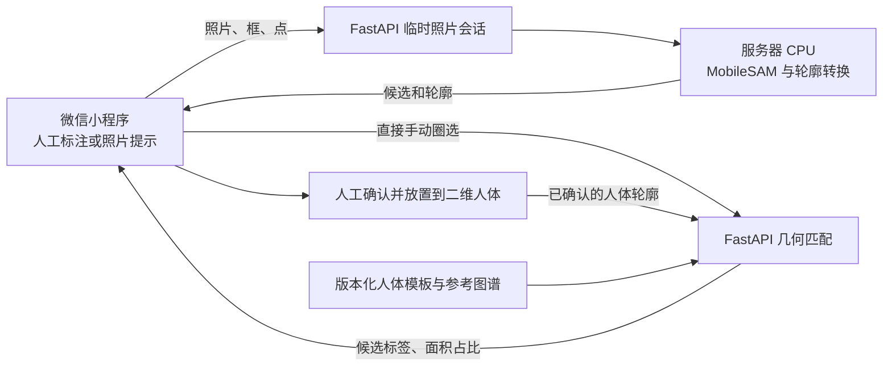
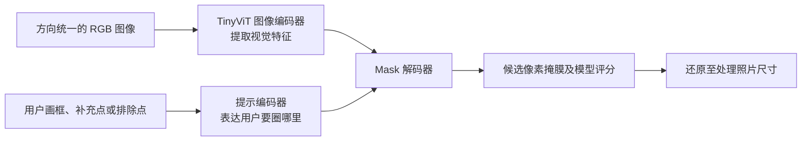
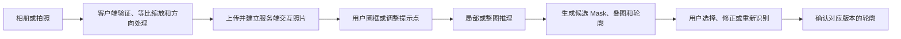
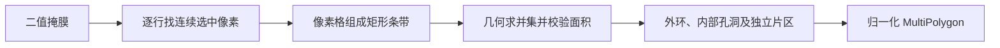
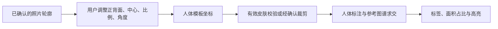
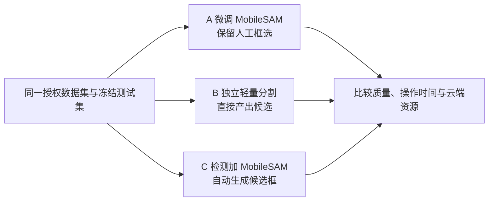

# 智络智绘 AI 技术说明与模型优化方案

2026 年 11 月 23 日 · 供医院负责人、技术人员和项目维护人员阅读

## 1. 系统能做什么

智络智绘用于在二维人体图上记录皮肤可见异常的位置，并查看标注和参考神经皮节区域的空间对应关系。用户可以直接在人形图上标注，也可以先框出照片中的目标，让 AI 提供轮廓候选。用户复核或修正轮廓后，自行选择人体正背面并确定位置、大小和方向。

**分割回答的是“照片中哪些像素属于用户指定的目标”。它不能确定这是不是带状疱疹、照片拍摄的是哪个部位，或实际受累的是哪条神经。** 参考匹配由独立的二维几何程序完成，图谱医学审核待完成。结果用于辅助观察、教学和研究，不能用于确诊、排除疾病或替代就医。

## 2. 当前模型与运行方式

| 项目 | 核对结果 |
|---|---|
| 模型 | MobileSAM `vit_t`，项目运行元数据记为 1.0，固定上游源码提交 `f706ad9c4eb7f219c00d9050e46328518ffb65d2` |
| 权重 | 上游同版本的 `weights/mobile_sam.pt`，40,728,226 字节，约 38.84 MiB。本地 SHA-256 为 `6dbb90523a35330fedd7f1d3dfc66f995213d81b29a5ca8108dbcdd4e37d6c2f` |
| 参数 | 以本地实际构建的 `vit_t` 按 PyTorch 参数张量计数约 1,013 万。图像编码器 6,065,532，提示编码器 6,220，Mask 解码器 4,058,340。上游概述的组件规模与此计数口径不同 |
| 许可与来源 | 上游仓库以 Apache-2.0 发布。权重使用上游同一提交分发的文件，部署和再分发应保留适用许可与归属 |
| 运行位置 | 微信端负责准备图像及交互，当前腾讯云由服务器 CPU 做 float32 推理。受控服务单推理槽，PyTorch 设置 1 个计算线程。代码也支持具备相应设备的 MPS/CUDA 实验 |
| 加载 | 首次分割时加载，随后在同一服务进程内复用模型。同一照片重新识别仍会重新编码，推理结束清除本次 predictor 的图像状态 |
| 训练状态 | 使用通用预训练权重，加载器核对固定文件大小及 Git blob。当前请求链没有皮损专项微调、独立检测或疾病分类模型 |

来源与实现见[官方固定源码](https://github.com/ChaoningZhang/MobileSAM/tree/f706ad9c4eb7f219c00d9050e46328518ffb65d2)、[官方权重](https://github.com/ChaoningZhang/MobileSAM/blob/f706ad9c4eb7f219c00d9050e46328518ffb65d2/weights/mobile_sam.pt)、[上游许可](https://github.com/ChaoningZhang/MobileSAM/blob/f706ad9c4eb7f219c00d9050e46328518ffb65d2/LICENSE)及[项目加载器](../../ai/inference/mobile_sam.py)。

图像进入预测器时是高 × 宽 × 3 的 RGB 数组。每次模型调用将最长边等比调整为 1024 像素，按模型配置归一化，并补齐为 1 × 3 × 1024 × 1024 的张量。框与正负点同步变换到模型空间。预测器将候选掩膜从模型空间映射回输入照片或局部裁图。每次预测请求启用多候选。模型评分用于参考当前候选，不能当作疾病概率。用户仍需画框，因为通用模型不会自行判断这一张照片中希望标注哪处皮肤表现。

## 3. 照片怎样变成人体标注

| 步骤与执行位置 | 输入、处理与输出 | 代码与影响 |
|---|---|---|
| 选图与准备，微信端 | 检查文件内容、方向及尺寸，静态 JPEG、PNG、WebP 可走对应路径。大图优先系统缩图，可在受控尺寸内重新编码。原图上限 50 MiB、5000 万像素，交互上传文件上限 8 MiB、300 万像素、最长边 1920 px | [prepare-photo.ts](../../miniprogram/packages/clinical/utils/prepare-photo.ts)。HEIC 直接输入无支持保证。设备可用内存与解码器影响成功率，缩图可能丢失细小纹理 |
| 上传与解码，FastAPI | 接收临时会话图片，验证格式与尺寸，应用 EXIF 方向，透明图合成白底，生成去除元数据的交互照片。服务端独立限制 50 MiB 文件、5000 万源像素、单边 8–10000 px。受控推理最多 300 万像素，普通开发测试配置上限为 1200 万 | [ai.py](../../backend/app/api/routes/ai.py)、[ai_image_input.py](../../backend/app/services/ai_image_input.py) 的 `prepare_upload_image`。服务端上限不等于客户端上传尺寸或真机验证结果 |
| 框和点，微信端与服务端 | 人在展示图上拖框。可补充前景点或排除背景点。微信端扣除留白并转换为方向统一的照片归一化坐标，后端映射到像素域 | [photo-canvas.ts](../../miniprogram/packages/clinical/components/photo-canvas/photo-canvas.ts)、[segmentation.py](../../ai/segmentation.py)。提示太宽可带入正常皮肤，提示太紧可遗漏边缘 |
| 推理与候选，服务器 | `MobileSAM.predict` 每轮执行编码与提示预测。支持扩大框周边后裁图分析或整图分析，裁图结果映射回同一照片坐标。多框可产生多次编码，结果按候选顺序合并 | [mobile_sam.py](../../ai/inference/mobile_sam.py)、[local_regions.py](../../ai/inference/local_regions.py)。首轮加载、重复图像编码以及多框推理增加等待 |
| 轮廓、质量与修正，服务器和微信端 | 推理即生成候选掩膜和轮廓，界面叠加预览。面积、框外占比、碎片及提示一致性用于提醒。画笔可补选或擦除，服务端按编辑版本重算 Mask 和轮廓。确认接口检查选中的候选和修订，交付已生成的轮廓 | [ai_sessions.py](../../backend/app/services/ai_sessions.py) 的 `segment`、`edit`、`confirm`，[quality.py](../../ai/postprocessing/quality.py)。复杂掩膜增加后处理成本，超过资源预算可返回明确错误 |
| 人体放置，微信端与后端 | [placement-geometry.ts](../../miniprogram/utils/placement-geometry.ts) 的 `preparePhotoGeometry` 与 `transformPhotoPolygonToBody` 保留照片宽高比例，在人体逻辑空间进行平移、等比缩放和旋转，输出人体归一化轮廓。有效边界之外可按提示调整，部分越界可经用户确认使用人体内交集 | [placement.ts](../../miniprogram/packages/clinical/pages/placement/placement.ts)、[body_intersection.py](../../backend/app/services/body_intersection.py)。缩放屏幕只改变视口，用户仍需核对方位和位置 |
| 神经皮节参考匹配，FastAPI | `POST /api/v1/evaluate` 验证模板、图谱、版本和坐标。Shapely 对人体标注和相应视图参考区求交。标签比例为交集面积除以所选标注面积，总覆盖对重叠做并集 | [evaluate.py](../../backend/app/api/routes/evaluate.py)、[dermatome_matcher.py](../../backend/app/services/dermatome_matcher.py)。可返回多个重叠标签或无匹配。比例不能用来判断受累神经的概率 |

Mask 是一张只区分“选中”和“未选中”的像素图。转换按四邻接像素格并集进行，仅角点接触的片区仍可分开。每个 Polygon 由外边界及可选内环组成，MultiPolygon 可以同时保存多片独立区域。孔洞保留片区内部未选中的皮肤。默认转换不简化，避免填平空洞或用一个大轮廓吞并正常皮肤。转换按像素条带设置预算，异常碎片不会静默丢掉。实现见[轮廓转换](../../ai/postprocessing/polygons.py)。

照片轮廓使用 `photo_oriented_normalized_v1`，人体使用 `normalized_2d_top_left`，各自左上为原点。正背面各自绑定模板数据。照片画布、显示缩放与人体放置三层坐标分离。人体放置页就绪后，前端在本地保有独立几何并请求删除后端临时照片会话。服务端默认连续闲置 120 秒后由后台扫描回收，正在推理受保护。页面停留本身没有保活心跳。2026-11-24 已同步首页与上传前提示，清楚说明空闲回收、请求删除与 HTTP 测试限制。受控公网测试仅可用公开合规或合成图。详见[会话实现](../../backend/app/services/ai_sessions.py)和[隐私记录](../privacy.md)。

## 4. 已有证据与局限

| 验证范围 | 可复核结果 |
|---|---|
| 本机性能基线 | P10 的 Apple M4 CPU、4 线程、1920×1080 公开样图共 45 次真实推理。同图同框局部分析 20 次，P50 807 ms、P95 847 ms，其中编码 P50 403 ms，轮廓后处理 P50 260 ms。模型加载约 1.73 秒，进程 RSS 约 1.05–1.09 GiB。仅代表该环境和样本 |
| 客户端工程验证 | P8/P8.1 有高清图自动准备及坐标回归。P11 有框选调度和坐标等价性测试。当前 UI 基线 `fd65d53` 有 431 项前端测试、TypeScript 和微信原生静态编译通过记录。工作区另有放置预览增量，本轮未做真机复验 |
| 腾讯云部署 | 2026-11-19 部署 `backend-current-20261119-155751`。合成接口检查 12/12，公开 700×460 样图的 AI 链路 10/10，首次分割请求约 6.1 秒，3 个候选，所选几何保留 16 个片区及 25 个孔洞。该次复核的进程峰值约 695 MiB，cgroup 上限 1.5 GiB，未见 OOM。50 MiB 上限的在线压力测试未执行 |
| 微信体验版和手机 | 当前源码配置允许开发和体验环境启用受控在线能力，正式版配置关闭相关在线功能。本轮未取得与当前源码一致的体验版发布记录，也未执行 Android/iOS 真机验证 |

证据见[P10 推理审计](../performance-audit/p10-ai-upload-segmentation/03-backend-mobilesam-profile.md)、[P8](../validation-records/p8-image-upload-limits/report.md)、[P8.1](../validation-records/p8.1-high-resolution/report.md)、[P11](../performance-audit/p11-ai-canvas-optimization/README.md)、[全身工作流](../validation-records/v7.0-full-body-workflow/report.md)、[交互精简](../validation-records/v7.1-ui-simplification/report.md)和[云端复核记录](../validation-records/backend-current-deployment-20261119/server-after-verification.json)。

模糊边界、颜色接近的红斑、小水疱和密集成簇目标会增加分割难度。毛发、阴影或反光可能被误选，也可能把一块病灶切成很多片。多处区域可能需要补框，输入缩小后更难辨认小目标。目前有工程验证及公开样图的耗时记录，缺少由专家复核的独立病例掩膜测试集，未测得皮损 Dice、IoU、Precision 或 Recall，也不能据此推断诊断效果。

可分别改善两类问题。分割质量用带专家复核的病例数据验证。等待时间优先评估同照片特征复用、局部裁图缓存、后处理复杂度及前端渲染，在测试中同时检查内存、会话隔离、删除与坐标等价性。P11.2 已有复杂轮廓的放置性能专项记录，其工程加速不构成分割准确率提升。[放置性能记录](../performance-audit/p11.2-placement-geometry/report.md)

## 5. 继续训练和替代方案

**MobileSAM 可以做针对可见皮损的微调。** 建议从当前权重初始化，先冻结 TinyViT 和提示编码器，仅训练 Mask 解码器，比较性能后再尝试适配器或解冻少数后段编码层。训练时用标注轮廓生成有松紧扰动的框、目标内正点和背景负点，模拟真实用户的纠正动作，留出框偏移、小病灶及多处病灶测试。是否有收益取决于标注和独立评估。

首个候选可沿用 PyTorch 结构，导出经审查的权重与模型标识、哈希和回滚版本。现有加载器只接受固定官方权重，替换需要新增受控加载配置并验证结构兼容。保持现有 FastAPI 的上传、框点、Mask、坐标、候选修订和确认契约，可先保留小程序原交互。仅改权重且结构不变通常无需增加推理算子，CPU 时间、后处理复杂度和峰值内存仍需实测。

| 方案 | 目标能力 | 训练数据 | 分割质量验证 | 部署成本 | 当前架构改动 | 推荐阶段 |
|---|---|---|---|---|---|---|
| A 微调 MobileSAM | 保留框、点和人工确认，提高轮廓质量 | 病例分组的掩膜，可由轮廓生成模拟提示 | 与上游权重同图同提示比较边界、小病灶和修正次数 | 解码器训练成本相对低，可先保持单模型 CPU | 增加版本化权重加载和回滚配置 | 优先，改动最小，能检验数据带来的质量收益 |
| B 独立分割 | 直接输出候选异常区域，用户复核 | 需要完整轮廓和代表性阴性照片。实例方案需区分多片 | 对无框输入测召回、误检、多片分离和边界 | 需训练并评估导出运行时，轻量结构可能更省资源，需实测 | 增加无提示推理路径。U-Net 语义输出还需定义实例拆分。YOLO 实现需先核对许可 | A 有稳定基线后，若主要瓶颈是人工画框 |
| C 轻量检测 + MobileSAM | 用检测框替代首次手动框，保留现有精细分割 | 从掩膜生成候选框，需未见病例、阴性图和混淆样本 | 同时评估漏框、误框及多框传播到最终轮廓的误差，与人工框方案比较 | 两模型及多个候选框可能增加总耗时和峰值内存 | 新增检测、候选框过滤和手动兜底，复用分割及确认接口 | 对自动候选有明确需求且云端资源测试通过后 |

U-Net 可作为全图语义分割起点，轻量 YOLO 实例分割可比较直接输出逐实例候选的效果。它们都需专项标注和按病例独立验证。组合方案应限制自动框数量，测试无框及误框时能否回到手动流程。在现有单推理槽、1.5 GiB 上限下，不能预设组合方案可直接上线。[U-Net 原论文](https://arxiv.org/abs/1505.04597) · [Ultralytics 分割说明](https://docs.ultralytics.com/tasks/segment/) · [Ultralytics 许可说明](https://www.ultralytics.com/license)

## 6. 医院提供什么，技术团队负责什么

医院按明确的训练用途授权，提供原始 JPEG/PNG 和必要的匿名病例对应信息。**医院无需制作 Mask 或 Polygon。** 单次辅助圈选的授权不应沿用于长期训练。数据交接前明确使用范围、存储地点、可访问角色、保留和删除安排，使用经批准的安全渠道。当前公网测试入口不用于传输病例照片。

技术团队检查去标识化，去除元数据和图内姓名、病历号等可识别内容，做重复及近重复检查、质量筛选与匿名分组。先以 MobileSAM 预标注，再由技术团队人工校正，对难判边界按共同定义复核并记录争议。质检后的数据包括方向统一后的原始尺寸图、同尺寸二值掩膜、可选 COCO JSON（保留孔洞时优先使用 RLE）、匿名病例编号和最小必要元数据。缺少同一患者的分组信息时，应先补齐管理流程，再做独立验证。

样本应覆盖不同身体部位、肤色、大小、形态、距离和光照，包含正常皮肤、毛发阴影反光等容易误选的图像，以及多片和边界难判样本。先统一“哪些像素应被圈入”，再扩充数量。训练、验证和测试按匿名病例拆分，同一人、连拍或派生裁图不得跨集合。增强只在训练集实施，测试集冻结后方可调参之外的最终验收。

## 7. 评价和实施顺序

保留官方 MobileSAM 作为基线。在同一病例测试集保持尺寸、方向、硬件和提示规则一致。A 与基线使用同一框点。B、C 同时评估默认无框流程和允许人工补框后的完整流程，分开报告。冻结阈值和目标匹配准则，按病例汇总并给出置信区间、小目标和不同肤色等分组，以及主要失败案例。

- **分割**。Dice 和 IoU 衡量区域重合，Boundary F1 按预定像素容差衡量边缘。分别报告病灶图和正常对照，避免用空图高分掩盖错误。
- **检出**。按事先设定的实例匹配规则计算目标召回和每图误检数，另报小病灶与成簇病例。
- **操作**。记录画框、补点、重新识别、手工修正次数，以及从选图到接受结果的总时间和退出率。
- **部署**。腾讯云同类 CPU 配置测首轮、暖轮和多框 P50/P95，同时记录分割与后处理、内存峰值、访问繁忙行为、会话清理和普通业务共存。上线前设资源余量与可回滚门槛。

| 阶段 | 工作、资源与交付 | 验收与风险 | 小程序／服务器 |
|---|---|---|---|
| 1 数据准备 | 安全存储、匿名病例表、图像筛选、预标注和复核 | 交付可追溯的数据集与冻结分组，质检孔洞、边界和负样本。防授权混用、样本泄漏 | 均无需修改 |
| 2 微调基线 | 训练资源、版本化权重、同提示对照 | 验收同集质量和分组结果，关键失败不能被平均值掩盖。小样本可能过拟合 | 训练环境独立，线上仍用原权重 |
| 3 替代路线试验 | B/C 小规模原型和同集报告 | 无框场景明确减少人工操作，同时控制漏检、误框与资源开销 | 可先离线或经隔离 API 验证，后续视功能决定 UI |
| 4 运行验证 | 受控云环境、代表性样图及操作任务 | 交付端到端耗时和资源报告，验收精度、工作量和内存预算，含旧版回归 | 验证环境接入候选，生产配置不随实验变更 |
| 5 渐进切换 | 可追溯模型版本、发布验收和回滚演练 | 候选达到事先确定的质量、操作与资源门槛后才进入受控发布。保留原模型回退 | A 优先复用交互。B/C 若改默认入口，需重新验证并发布小程序 |

推荐先建高质量病例测试集，再微调 MobileSAM 解码器。这个顺序能在保留人工复核的前提下验证模型收益。独立轻量分割与自动框选留到第二轮比较，由节省的操作时间、错误代价和 CPU 资源实测决定是否接入。
