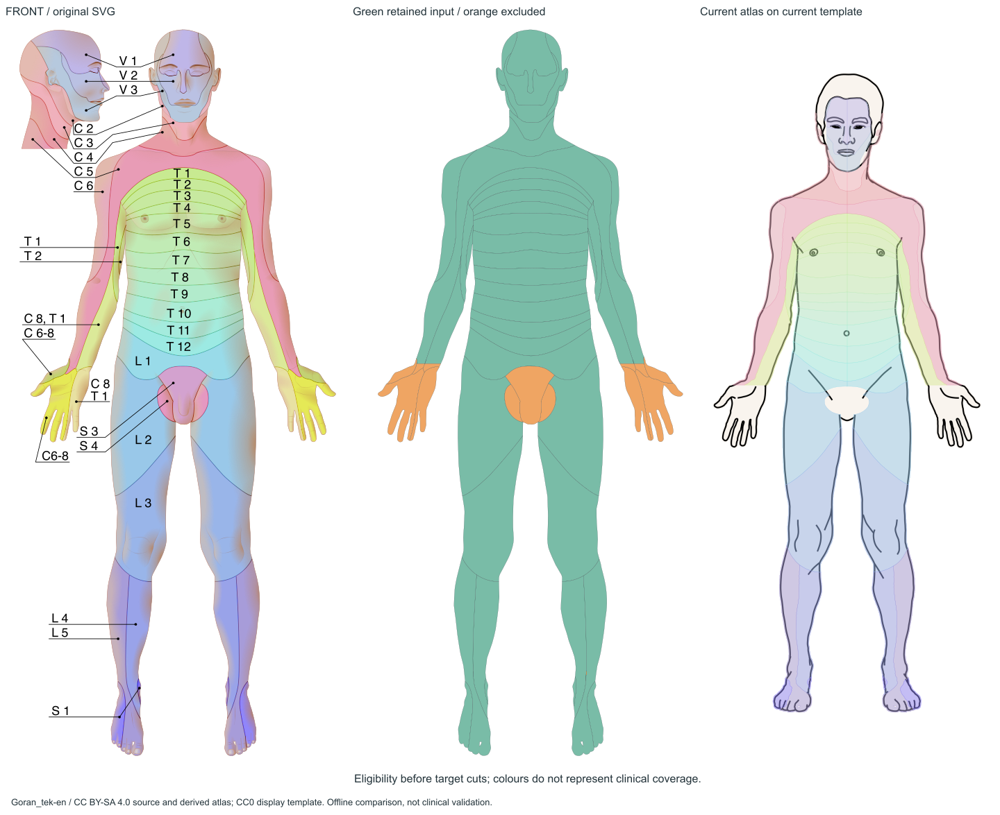
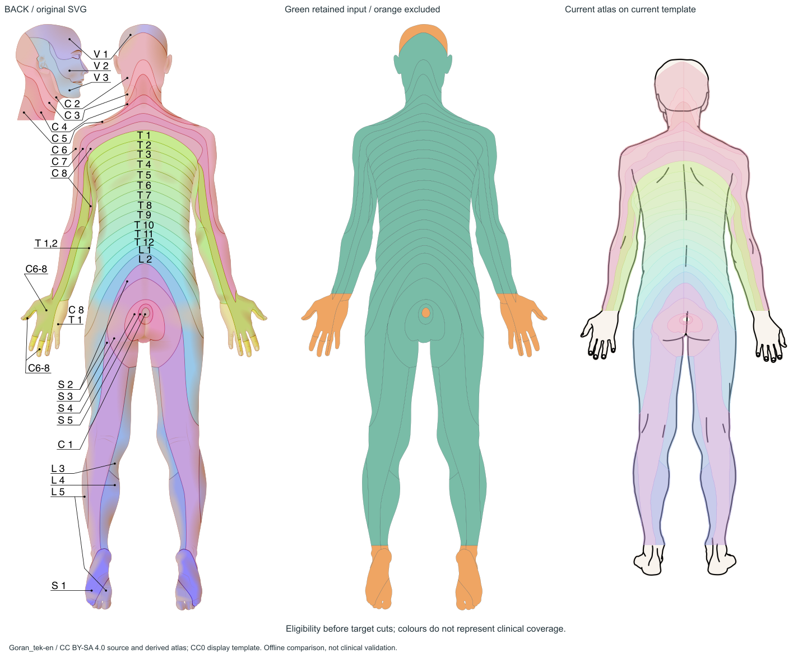

# 全身覆盖、完整标签和统计口径

A=原图真实显示且有明确分区；B=仅部分表面可见；C=有颜色/标签但不够恢复所要求的完整独立边界；D=遮挡/未展示；E=证据不足。A不是临床验证或人体全部曲面的声明，组合状态应按“已见/未见”分别理解。

| 部位 | 类别 | 实际标签/表面 | 原始路径证据 | 当前采用情况 | 限制 |
|---|---|---|---|---|---|
| 头面部 | B | 主图前V1/V2/V3、C2；后V1/C2；侧头插图V1/V2/V3、C2–C5 | 前p13/14/15/16，后p21/22；头侧插图14条 | 前面局部已用；后V1、头侧插图未用；头发/耳眼口排除 | 可见面有边界，不能声称完整头皮/口腔覆盖 |
| 颈部 | B | 前C2/C3/C4；后C2/C3/C4等可见过渡 | 前p15/17/18；后p22/23/24 | 已配准可见部分 | 侧方曲面未展开 |
| 肩部 | B | 前C4/C5/C6；后C4/C5/C6/C7/C8过渡 | 前p18/21/28；后p20/24/26/40/46 | 已配准可见部分 | 肩顶、腋侧遮挡不能补全 |
| 胸部 | A | 源前T1–T6附近实际路径，非固定高度公式 | 前p1–6 | 已用 | A仅表示图上可见投影，非医学无争议 |
| 腹部 | A | 源前T7–T12及L1过渡 | 前p7–12/33 | 已用 | 不外推侧腹隐面 |
| 背部 | A | 后T1–T12，L1/L2过渡 | 后p6–19 | 已用 | 不等于三维全背侧面 |
| 上臂 | B | 源C5/C6、后C7/C8；胸段过渡按原图 | 前p19/20/21/28；后p20/25/26/27/40/41 | 可见部分已用 | 内侧贴近躯干处遮挡 |
| 前臂 | B | 源C5、C6–8、C8/T1、T1/T2等组合 | 前p28/32；后p41/47/48 | 已用近端；远端裁除 | 不能将组合标签拆成独立节段 |
| 手背 | C | C6–8与C8/T1组合，可见指甲 | 后p28–31/39/42/47/48 | 远端未用 | 完整独立C6/C7/C8边界不足 |
| 手掌 | C | 掌心、五指掌侧真实可见；主要C6–8、C8/T1 | 前p29/30/31 | 未用；独立手掌目前另用Servier | 缺的是独立节段边界，不是完全没有掌侧图像 |
| 手指掌侧/背侧 | B/C | 掌纹、指腹与背侧指甲可辨；标签为组合 | 前p29/31；后p28–31/39/42/47/48 | 未用 | 指侧/接触面不完整；无法恢复每指独立三段边界 |
| 腰臀部 | A/B | 后L1/L2、S2/S3/S4/S5；中央C1字样含义不明 | 后p18/19/32/33/34/35/49 | 除p35外采用可见部分 | 臀沟深部非完整展开 |
| 腹股沟 | B | L1/L2及前会阴S3/S4 | 前p33/34/39/40 | L1/L2已用，S3/S4前片未用 | 邻近皮肤可提取，隐蔽皱褶不可补画 |
| 大腿前后面及内侧 | A/B | 前L2/L3；后L2/L3、S2/S3等可见片 | 前p34/35；后p19/32/37/49 | 前后可见面已用 | 内侧仅窄带，未显示的贴合面为D |
| 小腿 | A/B | L3/L4/L5及后S2等真实路径 | 前p35/36/41；后p36/37/38/49 | 踝以上已用 | 内外侧曲面不可视为完整展开 |
| 足背 | A | 前L4/L5/S1 | 前p36/37/38/41 | V3.1已补可见足背 | 不是足底 |
| 足底 | A/B | 后L5/S1明确封闭面；L4/S2仅近端踝缘 | 后p43/44；近端p36/49 | p43/44未导出，其他路径踝下也被截 | 真实足底/趾腹示意存在；需独立模板和专业核对 |
| 脚趾 | B | 前足趾背侧、后趾腹；后L5/S1 | 前p41等；后p43/44 | 前可见趾已用，后未用 | 不是每趾的完整三维表面 |
| 腋下 | B/D | 前T1/T2近腋缘有色区 | 前p19/20；后近臂躯干过渡 | 已用当前可见皮肤 | 腋窝中央/深部未充分展开，需抬臂视图 |
| 会阴 | B/D/E | 前S3/S4；后S3/S4/S5；C1字样歧义 | 前p39/40；后p32–35 | 前未用，后部分已用，C1不使用 | 完整会阴下方、深部皱褶缺观察面；C1含义E |

## 原始标签清单

已确认的35个不同标签：独立脊神经C2、C3、C4、C5、C6、C7、C8；T1–T12；L1–L5；S1–S5（29个）；组合C6–8、C8/T1、T1/T2（3个）；三叉感觉V1、V2、V3（3个）。另外原图尾骨/臀沟处写有“C1”，含义UNKNOWN，不认定为颈C1或擅改Co1。没有明确的Co/Co1字样，不能以医学编号补全。

下表统计主图填色Path，不重复计头侧插图；两个单图各有7条头侧插图Path，其中V1/V2/V3及C2–C5可识别，因此背面文件有V2/V3文字和插图，但**主后面人体没有后脸V2/V3区域**。

| 标签 | 原图主图存在 | 正面Path索引 | 背面Path索引 | 左右侧 | 主图Path数 | 当前区域实例 |
|---|---|---|---|---|---|---|
| C1 (source literal; meaning UNKNOWN) | 是 | — | 35 | 原图双侧；中线区域可跨侧 | 1 | 0 |
| C2 | 是 | 15 | 22 | 原图双侧；中线区域可跨侧 | 2 | 4 |
| C3 | 是 | 17 | 23 | 原图双侧；中线区域可跨侧 | 2 | 4 |
| C4 | 是 | 18 | 24 | 原图双侧；中线区域可跨侧 | 2 | 4 |
| C5 | 是 | 28 | 46 | 原图双侧；中线区域可跨侧 | 2 | 4 |
| C6 | 是 | 21 | 26 | 原图双侧；中线区域可跨侧 | 2 | 4 |
| C6-C8 | 是 | 29, 30 | 28, 29, 30, 31, 47, 48 | 原图双侧；中线区域可跨侧 | 8 | 2 |
| C7 | 是 | — | 20 | 原图双侧；中线区域可跨侧 | 1 | 2 |
| C8 | 是 | — | 25, 27, 40 | 原图双侧；中线区域可跨侧 | 3 | 2 |
| C8/T1 | 是 | 31, 32 | 39, 42 | 原图双侧；中线区域可跨侧 | 4 | 2 |
| T1 | 是 | 1, 19 | 6 | 原图双侧；中线区域可跨侧 | 3 | 4 |
| T1/T2 | 是 | — | 41 | 原图双侧；中线区域可跨侧 | 1 | 2 |
| T2 | 是 | 2, 20 | 7 | 原图双侧；中线区域可跨侧 | 3 | 4 |
| T3 | 是 | 3 | 8 | 原图双侧；中线区域可跨侧 | 2 | 4 |
| T4 | 是 | 4 | 9 | 原图双侧；中线区域可跨侧 | 2 | 4 |
| T5 | 是 | 5 | 10 | 原图双侧；中线区域可跨侧 | 2 | 4 |
| T6 | 是 | 6 | 11 | 原图双侧；中线区域可跨侧 | 2 | 4 |
| T7 | 是 | 7 | 12 | 原图双侧；中线区域可跨侧 | 2 | 4 |
| T8 | 是 | 8 | 14 | 原图双侧；中线区域可跨侧 | 2 | 4 |
| T9 | 是 | 9 | 15 | 原图双侧；中线区域可跨侧 | 2 | 4 |
| T10 | 是 | 10 | 16 | 原图双侧；中线区域可跨侧 | 2 | 4 |
| T11 | 是 | 11 | 17 | 原图双侧；中线区域可跨侧 | 2 | 4 |
| T12 | 是 | 12 | 13 | 原图双侧；中线区域可跨侧 | 2 | 4 |
| L1 | 是 | 33 | 18 | 原图双侧；中线区域可跨侧 | 2 | 4 |
| L2 | 是 | 34 | 19 | 原图双侧；中线区域可跨侧 | 2 | 4 |
| L3 | 是 | 35 | 37 | 原图双侧；中线区域可跨侧 | 2 | 4 |
| L4 | 是 | 36 | 36 | 原图双侧；中线区域可跨侧 | 2 | 4 |
| L5 | 是 | 41 | 38, 43 | 原图双侧；中线区域可跨侧 | 3 | 4 |
| S1 | 是 | 37, 38 | 44 | 原图双侧；中线区域可跨侧 | 3 | 2 |
| S2 | 是 | — | 49 | 原图双侧；中线区域可跨侧 | 1 | 2 |
| S3 | 是 | 40 | 32 | 原图双侧；中线区域可跨侧 | 2 | 2 |
| S4 | 是 | 39 | 33 | 原图双侧；中线区域可跨侧 | 2 | 2 |
| S5 | 是 | — | 34 | 原图双侧；中线区域可跨侧 | 1 | 2 |
| V1 | 是 | 13 | 21 | 原图双侧；中线区域可跨侧 | 2 | 2 |
| V2 | 是 | 14 | — | 原图双侧；中线区域可跨侧 | 1 | 2 |
| V3 | 是 | 16 | — | 原图双侧；中线区域可跨侧 | 1 | 2 |

每条Path实际位于哪侧、是否跨中线、多少有效片、面积、XML路由、d指纹以及当前区域ID，见[path-inventory.csv](evidence/path-inventory.csv)。单条Path可以包含左右两手/两足，不能把Path数直接当作神经数或侧别实例数。前面屏幕左=人体右，后面屏幕左=人体左；独立Gray掌侧五指向上时左掌拇指在屏幕左，不混用规则。

## 数量与面积（本次重新计算）

| 指标 | 正面 | 背面 |
|---|---:|---:|
| 选定填色Path（含头侧插图） | 42 | 50 |
| 主人体Path | 35 | 43 |
| 主图明确标签 | 30 | 33（另有歧义C1） |
| 经实际绘制顺序解析的主图片数 | 61 | 65 |
| 当前导出标签 | 27 | 30 |
| 当前左右区域实例 | 54 | 60 |
| 当前MultiPolygon片数 | 63 | 71 |
| 当前孔洞 | 15 | 2 |
| 具有任一导出引用的主图Path | 30/35 | 33/43 |
| 当前模板可见皮肤面积被图谱并集覆盖 | 88.7266% | 90.4561% |

全项目全身唯一标签仍35个，左右/视图实例114，片134，孔17。原图126个解析片包含绘制细缝与数值碎片，不代表126个医学分区。所有114个当前几何有效，来源标签与sourcePathIndices一致。

面积分母为当前400×900模板真实皮肤轮廓，分子为当前atlas并集与皮肤的交集；不是全身三维体表覆盖率，不是诊断准确率。未显示表面不能纳入分母，也不能解释为没有感觉神经。源域进入配准的面积占比约91.2721%/88.3058%，这还是目标头发/眼口/边缘适配之前的输入域，不能与上述目标比率作误差或性能对比。

证据：[summary.json](evidence/summary.json)。当前采样微重叠折算逻辑面积约前0.411678、后0.430113 px²；体外尾差约0.001345/0.000551 px²。它们在既有阈值内，但并非数学绝对无缝，也不构成医学重叠证据。

