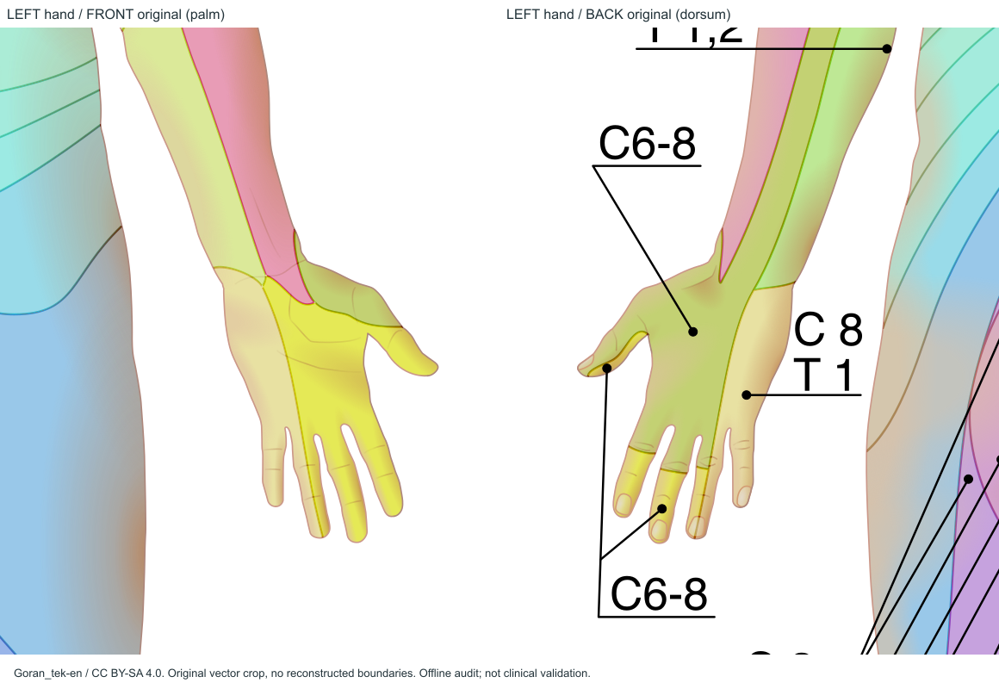
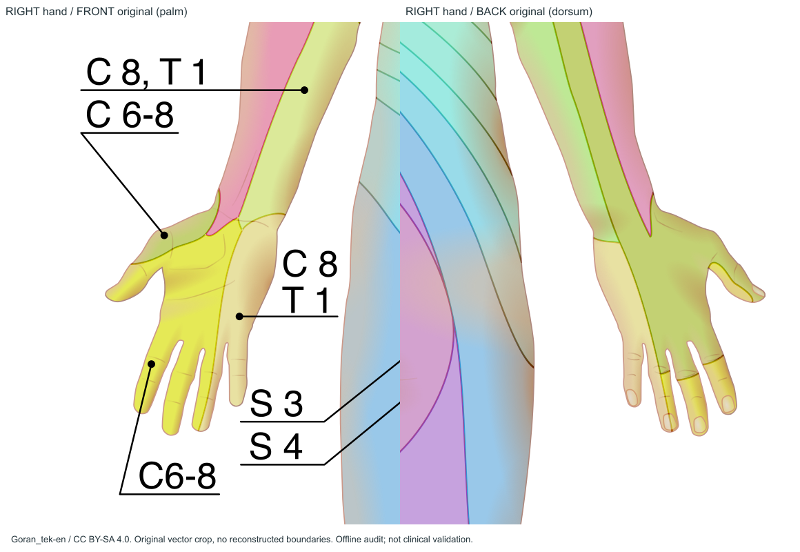
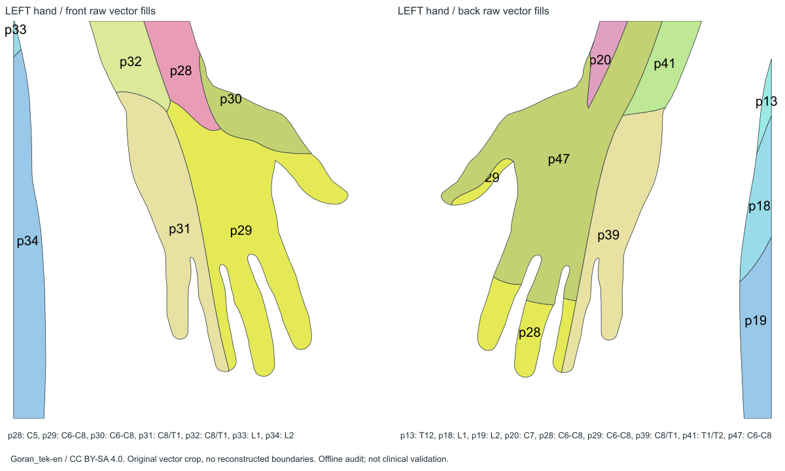
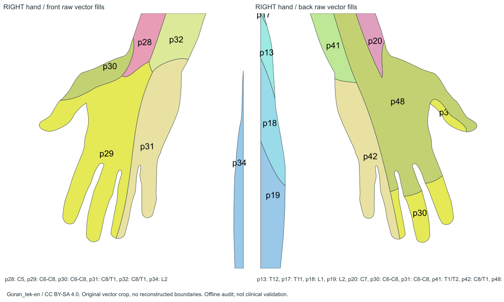

# 手掌专项调查

**结论：部分包含。原图包含掌心和五根手指掌侧的真实图像/封闭面，但不包含可分别恢复的完整C6、C7、C8掌侧边界。** 不能写成“正面手就是背面”，也不能把C6–8合并面拆成三个独立区域。

## 实际观察面与指部

正面双手可见掌纹、掌心、指腹、拇指及鱼际外形；背面可见指甲，是手背/指背。手部有倾斜和少量侧面混合，不能证明全部指侧/指间表面。两侧原图独立保留，未通过镜像生成本审计证据。

| 位置 | 源图证据 | 独立C6/C7/C8边界是否足够 |
|---|---|---|
| 拇指掌侧、食指、中指及邻近掌心 | 前p29的C6–8组合大面；源引线root/9/16指到远端 | 否，不能凭手指名称细分 |
| 大鱼际/掌根邻近 | 前p30同为C6–8，root/9/45引线 | 否；两种填色/两个Path不代表两个独立神经节段 |
| 环指/小指、尺侧掌心 | 前p31 C8/T1组合，root/9/49引线 | 否，无法将C8与T1拆开；环指有相邻组合面分界 |
| 腕口与近端前臂 | p28 C5、p32 C8/T1等依源图 | 这些近端片不能外推掌侧C6/C7边界 |
| 手背、指背 | 后p28–31 C6–8小片、p47/48组合大面，p39/42 C8/T1 | 与掌侧不同，不能翻成掌图 |

前p29=`root/6/1/24`，p30=`root/6/1/25`，p31=`root/6/1/26`。主要边界不是由渐变产生：实际平色fill路径存在；上方光影渐变和掌纹为外观。主图独立C6前p21只到近端上臂范围，不延伸为完整掌图；前面没有独立C7/C8路径。背面独立C6/C7/C8也不能提供新的掌侧观察面。

隐藏线稿、男女母版、有/无标签组合已核查。没有发现隐藏而可直接启用的完整C6/C7/C8掌侧分区。该结论来自本次22份实际取得版本及完整母版，没有把隐藏线稿当成正式新增边界。

## 与Gray模板的配准

- 整体位置/方向/尺度：可用平移、等比例缩放、旋转调整；右手源图五指向下，旋转后再与同侧Gray对齐，不能混淆侧别。
- 手指张角、长宽、拇指外展、掌宽及指蹼：需要局部非刚性配准。一个全局仿射变换不能同时贴合五指和腕口。
- 源图掌侧可见面与Gray掌侧可进行几何对应；Goran背侧的指甲/手背面不能当掌侧。
- **配准不能创造缺失的C6/C7/C8独立边界**。即使把组合面几何完整贴合Gray，输出仍只能叫C6–8、C8/T1参考区，不能满足当前3独立标签需求。

放大图均由原始SVG渲染；Path图只隐藏外观渐变并标索引，剪裁框边缘是查看窗口，不是新神经边界。对应坐标窗口和XML路由见figure-index.json与path-inventory.csv。
