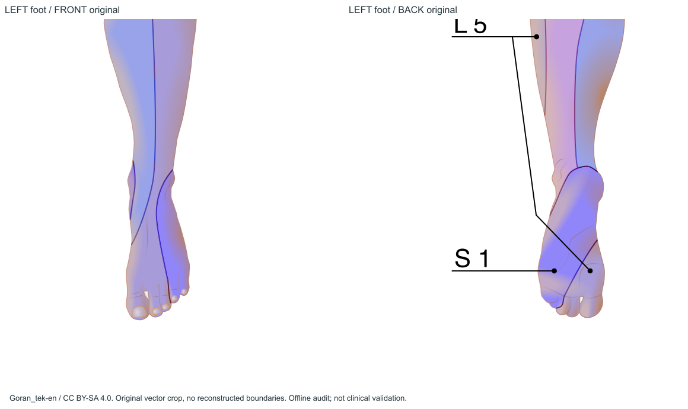
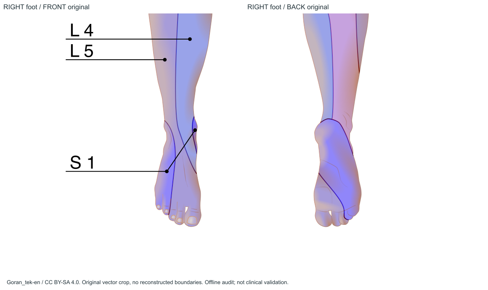
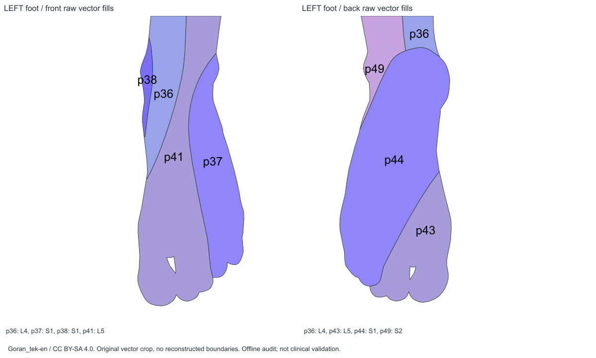
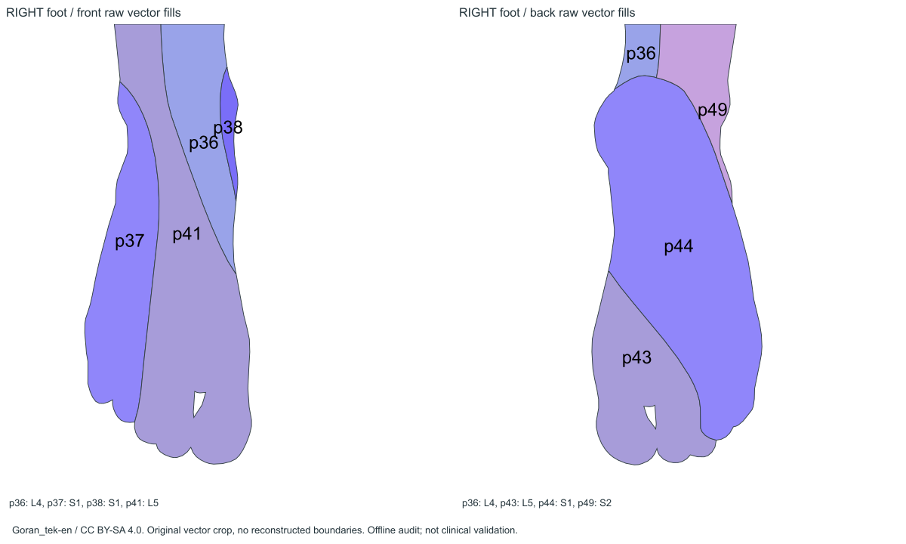

# 足底专项调查

**结论：Goran背面确实画了两足足底、前脚掌和趾腹，并有可提取的L5/S1闭合分区。并非仅画了足跟。** 它可作为独立足底参考视图的候选源；不等于足部所有曲面、每条细小解剖边界或个体皮节都完整确定。

## 观察面和标签

正面足趾有甲板，是足背/足侧及趾背；背面足趾显示趾腹，足底长面从跟部延伸至前足与趾腹，是简化的足底示意。它与中性人体背图的跟腱、足跟外后面不是同一表面。将源足底缩扁到现有足跟是错误的对应。

| 区域 | 原图实际情况 | 提取依据 | 限制 |
|---|---|---|---|
| 足背、可见内外侧 | 前L4/L5/S1真实着色面 | 前p36/37/38/41，V3.1已采用 | 不当成足底 |
| 足底中央、跟垫至大部分足弓/前足 | 后S1大面 | 后p44，`root/9/1/44`；引线root/12/47 | 图上没有单独标“足弓”或3D曲率，不能细分未画出的边界 |
| 前足内侧/部分趾腹 | 后L5面 | 后p43，`root/9/1/43`；root/12/62与L5文字关联 | 不能外推到每趾全部侧面 |
| 踝端近缘 | 后L4与S2邻接片 | 后p36、p49 | 裁剪窗口包含它们，不等于它们覆盖整个足底 |
| 趾腹/足趾分界 | L5/S1两面实际到达远端 | p43/44 | 趾间遮挡/立体侧面并未展开；不额外造五趾神经区 |
| 足跟完整周面 | 仅下方跟垫与部分边缘可见 | 后p44及外形 | 跟腱、后跟、内外侧完整周向仍需另行对应 |

原图主后图p43范围x135.58–299.22、y894.18–945.32；p44范围x124.13–310.66、y847.03–939.13（全SVG用户单位）。二者均实际含双侧几何。p49 S2到y879.89，但在足底近端旁缘，不能据此把足底任意填成S2。不存在“因为足常见L4/L5/S1/S2就补齐四区”的逻辑。

## 为什么项目没有后足底

旧生成器明确在源y842/目标y820截断，p43/44完全被排除；V3.1只新增正面足背，后足底因目标观察面不同保持未配置。这是**原图有数据、目标模板/配准未支持**，不是下载/解析器没有足底路径，也不是微小区域被简化消失。

因此，独立足底可以优先走“Goran原p43/44→左右各自提取→足底模板→局部配准→技术+医学审核”。这只是可行性结论；本轮未配准、未生成生产足底图谱。对于源图未显示的周向/趾间表面仍需补充资料，不能把有限足底示意宣传为完整足部标准。

这里是脊神经皮节标签，不是胫神经、腓神经或内/外侧足底神经区域，不能相互替代。

