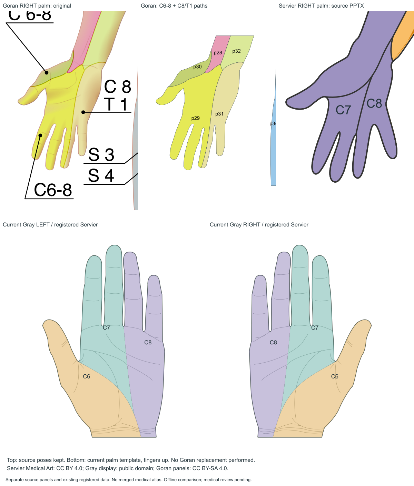

# Goran与Servier掌侧对照

上左：Goran原始右掌（原姿态）；上中：同一SVG实际着色面及Path索引；上右：Servier原PPTX曲线的源坐标截取；下方：当前Gray左右掌模板及既有Servier派生6区。它们没有做跨来源医学边界融合。颜色是各资源的显示编码，不能用相同/不同颜色判相同/不同神经。

Goran来源为2022年同套SVG，原p29/p30写C6–8，p31写C8/T1；Servier来源为官方Dermatomes，PPTX第26页group71682，外形71995，曲线72147/72148，文字72039/72041分别C7/C8，C6从标注前臂区域连续到拇指侧。

| 维度 | Goran | 当前Servier |
|---|---|---|
| 观察面 | 正面掌侧；后面手背，分别有真实原图 | 前面图掌侧 |
| 主要掌侧含义 | C6–8与C8/T1组合 | C6/C7/C8独立参考区 |
| 拇指/掌根边界 | 同一C6–8组合内存在两种色面，不能拆义 | 两条原始曲线切出三面，C6与拇指侧连续 |
| 尺侧分区 | C8/T1，不能去掉T1假装完全相同 | C8 |
| 分辨能力 | 合并参考，不足以恢复独立三段边界 | 支持独立三段参考展示，医审仍pending |
| 许可 | CC BY-SA 4.0 | CC BY 4.0，独立署名 |
| 配准 | 还未为Gray生成生产数据 | 6个掌/指蹼/腕口控制点，右侧配准后镜像左侧 |

有明显的**标签粒度与参考边界差别**；不能把它简单判为某图医学错误，也不能声称二者完全一致。Goran的C6–8大面内部缺少独立边界，无法与Servier做逐段重叠准确率；没有临床真值，不计算/虚构Dice、IoU或准确率。

原图手形姿态和Gray的指蹼、张角不同，当前Servier配准后的曲线位置也受工程变换影响；这与源图本来采用组合标签是两类差异。当前Servier右掌图经180°观察后与Gray同侧，不把来源姿态变化当成医学分布变化。

Servier官方[作品](https://smart.servier.com/smart_image/dermatomes/)、[署名许可](https://smart.servier.com/how-to-cite-servier-medical-art/)，源字节及来源曲线见data/sources/servier-palm-v1/和data/atlas/palm-v1/registration.json。本轮只读，没有替换、改名或删除这套数据。
