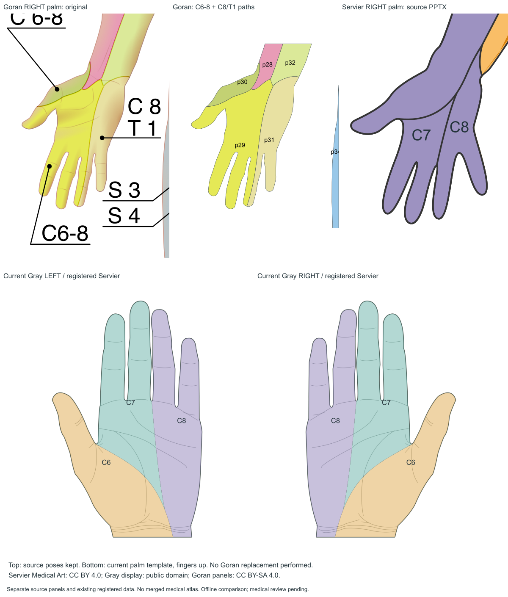
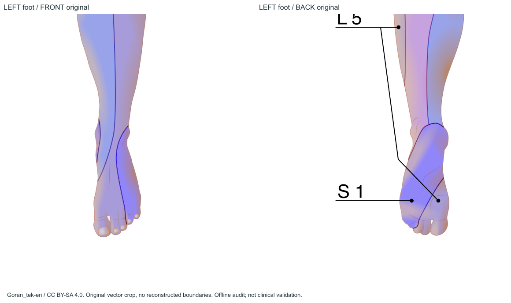

# V6.3 Goran全身图谱完整性审计

2026-11-05。**结论：不能为统一来源而全部替换。手掌有真实掌侧表面，却缺独立C6/C7/C8完整分界；足底则确实存在L5/S1源几何，值得优先复用到独立足底模板。** 推荐Goran为主、缺失部位独立补充，现有Servier掌图谱保持。

| 部位 | Goran原图覆盖情况 | 可提取皮节 | 是否可以直接使用 | 缺少的证据/工作 |
|---|---|---|---|---|
| 全身正面 | 大部分可见前面；不覆盖全部体表 | 30主图标签；当前27标签/54实例 | 已用部分，不是全部 | 掌侧、前会阴等未导出，隐面不全 |
| 全身背面 | 大部分可见后面，**包括足底示意** | 33明确主图标签+歧义C1；当前30/60 | 已用部分，不是全部 | 后头皮、手背、足底未全采用，C1待核实 |
| 左手掌 | 掌心及五指掌侧可见 | C6–8、C8/T1组合 | 不能替代独立C6/C7/C8 | 缺分开的医学边界；Gray仍需局部配准 |
| 右手掌 | 同上，有实际原侧几何 | C6–8、C8/T1组合 | 同上 | 同上 |
| 左脚底 | 真正足底、跟垫至前足/趾腹 | 后p43 L5、p44 S1 | 可提取，尚不可直接贴现人体 | 独立足底模板、局部配准、医审 |
| 右脚底 | 同上，有实际原侧几何 | L5、S1；踝邻接L4/S2 | 同上 | 不能把邻接片扩成整个足底 |
| 腋下 | 边缘部分可见，深部未展开 | 可见T1/T2等源片 | 完整腋窝不行 | 抬臂独立视图 |
| 大腿内侧 | 可见窄带，隐藏面缺失 | 可见L2/L3及后S2/S3等 | 完整内侧不行 | 真正内侧/外展观察面 |
| 会阴 | 前外生殖器/后臀沟局部 | S3/S4、后S5，歧义C1 | 完整会阴不行 | 下方观察面、C1语义及医学审核 |

本轮官方22版清单已核对；22份原件字节已取得校验。指定五份和有/无标签男女母版均已完成实查。原图、标签引线、92条填色Path（主图78、插图14）逐条有记录；现有114个区域实例未改动。

## 直接回答八个问题

1. **到底有哪些皮节？** 已确认35个不同标签：C2–C8、T1–T12、L1–L5、S1–S5；组合C6–8、C8/T1、T1/T2；三叉V1/V2/V3。另有尾骨处“C1”字样含义UNKNOWN，不能当颈C1或Co1。详见[完整标签/左右/路径表](02-full-body-coverage.md)。
2. **项目是否全部提取？** 否。当前27/30标签、54/60实例；完全未引用的主图路径前5条、后10条，还有局部裁除。没有发现包内和后端图谱不同步。[逐项遗漏](06-current-atlas-diff.md)。
3. **掌心和五指掌侧C6/C7/C8完整界线？** 部分包含：有掌侧表面与组合区，独立三段边界不足。不是缺手形、也不是可以按颜色拆三段。[掌侧证据](03-palm-investigation.md)。
4. **足底、跟垫、足弓、跖侧趾腹？** 存在可提取L5/S1二维足底示意，包含这些表面的可见部分；不是完整周向/每趾侧面标准。现项目未用源p43/44，原因是目标后跟观察面不符。[足底证据](04-sole-investigation.md)。
5. **与Servier差异？** 明显的是分区粒度/标签：Goran组合区，Servier独立三段；尺侧C8/T1与C8不同。没有真值，不能据此判谁更准确。[对照](07-goran-servier-comparison.md)。
6. **能配准到Gray？** 可尝试配准掌侧组合几何；手指/指蹼需局部非刚性处理。任何变换都不能补出缺失的独立医学边界。
7. **五类特殊部位能否纯Goran？** 足底优先可行；手掌仅组合区可行；完整腋下、内侧大腿、会阴均需补充观察面。[逐部位方案](08-unification-feasibility.md)。
8. **值得全部统一吗？** 不值得牺牲信息完整性来统一署名。推荐整体B、掌侧C、足底局部A的分来源架构，明确每区真实出处。

## 真实预览

这些是原始资源/实际路径的离线矢量渲染，不是微信运行截图。足底存在和掌侧组合标签由原SVG、文字引线、父版一致性证实；未来Gray/足底配准的工作量与可行性是工程判断，尚未实施或通过医学审核。

## 文档与证据索引

- [01 原始来源与22版清单](01-source-inventory.md)
- [02 全身覆盖矩阵、完整标签与面积](02-full-body-coverage.md)
- [03 手掌专项](03-palm-investigation.md)
- [04 足底专项](04-sole-investigation.md)
- [05 SVG与隐藏层核验](05-svg-geometry-audit.md)
- [06 当前提取差异与源码链](06-current-atlas-diff.md)
- [07 Goran/Servier比较](07-goran-servier-comparison.md)
- [08 统一来源可行性](08-unification-feasibility.md)
- [09 下一轮建议、命令与限制](09-recommended-next-step.md)
- [逐Path CSV](evidence/path-inventory.csv)、[逐Path几何正面](evidence/front-raw-source-regions.json)、[背面](evidence/back-raw-source-regions.json)、[来源结构](evidence/downloaded-svg-structures.json)、[全部引线端点](evidence/all-leader-endpoints.json)。

来源：[Goran正面](https://commons.wikimedia.org/wiki/File:Dermatomes_labeled,_male_front_3d-shaded.svg)、[Goran背面](https://commons.wikimedia.org/wiki/File:Dermatomes_labeled,_male_back_3d-shaded.svg)、[官方系列](https://commons.wikimedia.org/wiki/Dermatomes_3D_shaded_true_SVG)，Goran_tek-en / CC BY-SA 4.0；[Servier](https://smart.servier.com/smart_image/dermatomes/) / CC BY 4.0独立记录。图谱是参考插图，不能等同临床唯一标准、内部神经节病变定位或临床准确率。

**本轮只新增审计资料并追加task.md，未更换图谱、修改业务代码、访问服务器、部署或上传体验版。** 医学审核保持pending。
