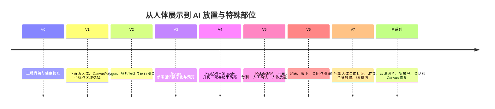
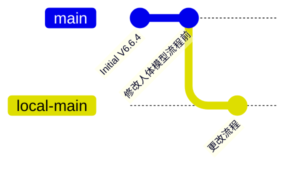

# 02 开发演进史

> 文档基线：2026-11-19；代码基线为 Git `27b41f6` 加当前未提交工作区。代码、部署和真机状态分层记录，以当前源码与实际证据为准。

## 2.1 演进主线

## 2.2 各阶段真实变化

### V0：可验证骨架

建立了原生小程序、FastAPI、Pydantic、Shapely、Pytest 和记录制度。健康接口的 `version=v0` 被保留为历史契约，即使当前功能已经远超 V0。

### V1：人体模板和区域选择

早期人体从矢量路径演进到 Commons CC0 PNG。V1.6 修复了胸部高亮覆盖到上臂的问题，并确立：

- 高亮和命中使用同一区域定义；
- 正背面各有独立坐标；
- 屏幕像素不进入持久化几何；
- 区域放大只改变显示视口。

### V2：病灶多边形

建立 `annotationSession` 作为小程序运行期唯一权威数据源。支持：

- 三点以上闭合；
- 最多 20 片/面；
- 多片和选择、删除、撤销；
- 完整人体填充区域包含检查；
- 模板和区域配置版本绑定。

### V3/V3.1：参考图谱

开始从 Goran 2022 CC BY-SA 4.0 图谱提取真实 SVG Path。V3.1 增加面部三叉神经和可见足部。医学审核状态始终独立于技术验证。

### V4：几何匹配

FastAPI 使用 Shapely 对病灶和参考区域做交集。结果包括：

- 单片结果；
- 同视图合并结果；
- 候选面积和病灶覆盖比例；
- 未覆盖比例；
- 多候选和空候选。

面积比例被明确限定为几何量，不是疾病概率。

### V5.1：独立 AI 实验

MobileSAM 在独立 `ai/` Python 环境运行。输入为照片像素或框，输出原尺寸 Mask、透明层和照片坐标 MultiPolygon。验证了：

- 点、框、多提示与背景点；
- 多个不连续病灶；
- 孔洞；
- CLI 导出；
- 真实 CPU 推理和耗时。

限制是单点提示不稳定、可能过度分割，因此后续必须人工确认。

### V5.2：小程序 AI 流程

增加照片上传、框选、候选切换、精细笔刷修正和确认。照片与人体使用不同坐标空间。AI 页面只生成 `confirmed-photo-segmentation-v1`，不会直接提交 V4 匹配。

### V5.3/V5.4：人体放置

建立 `transformPhotoPolygonToBody()` 和 `placementTransform`：

1. 将照片归一化坐标转成照片像素度量；
2. 以共同中心做等比缩放和旋转；
3. 平移到人体逻辑画布；
4. 转换成人体归一化坐标；
5. 保持所有片区和孔洞作为一个整体；
6. 最终执行完整人体边界检查；
7. 一次写入 V2 并走 V4 匹配。

### V6：特殊部位和全身手部

- V6.1 曾建立独立手掌视图；
- V6.2/6.3 审计 Goran 全身与掌/足路径；
- V6.4 新增左右脚底；
- V6.5 把真实手部路径补到主人体，并退役独立手掌；
- V6.6 新增腋下，先尝试 PROVISIONAL，后改为全覆盖 SCHEMATIC；
- V6.7 新增中性会阴和 S2–S5/UNDEFINED 模拟分区。

### V7：完整人体自由标注

V7.0 取消“必须先选择身体部位”的限制：

- 用户可跨旧粗区域边界圈选；
- AI 病灶可自由放到任意有效人体表面；
- 完全在人体内直接保存；
- 部分越界时调用一次精确人体交集；
- 用户确认后以交集作为有效几何。

V7.1 精简主界面，隐藏快捷定位、独立神经匹配入口和开发控件，并让完成标注后自动匹配。

## 2.3 P 系列工程优化

| 阶段 | 关键问题 | 结果 |
| --- | --- | --- |
| P5/P6 | 全链路性能审计 | 图谱并集和人体边界查询分桶 |
| P8/P8.1 | 手机高清照片 | 前端自动缩放压缩，后端安全解码 |
| P9 | 折叠屏 | 响应式单栏/双栏与 resize |
| P10 | AI 全链路耗时 | 拆分网络、推理、预处理和 Canvas |
| P11 | 照片框选卡顿 | 缓存尺寸、rAF 合并、去掉逐 move setData |
| P11.2 | 复杂 MultiPolygon 放置卡住 | 源几何缓存、可信快速校验、拓扑索引 |
| P12.1 | 后端上传与 TTL | 50 MiB/5000 万像素接收，闲置 120 秒 |

## 2.4 历史文档为什么会有冲突

`AGENTS.md` 仍记录“当前授权为 V4”， `ai/README.md` 部分段落仍描述早期 TTL，README 的版本表也混有旧规划。原因是系统通过多轮追加式台账演进，历史结论不能被覆盖。

处理原则：

1. 当前行为以实际代码、当前配置、测试和 `task.md` 最新覆盖记录为准；
2. 旧段落用于理解来源和约束；
3. 发现冲突时在本目录说明，不静默修改历史；
4. 任何新的覆盖都应在 `task.md` 追加日期和范围。

## 2.5 当前 Git 与演进的分叉

实际当前状态更复杂：`27b41f6` 之上仍有大量未提交改动。交接文档编写前统计为 56 项变更/未跟踪入口；它们覆盖 V7、P8、P9、P11、P11.2、P12.1 和多项 Canvas 修复。

因此：

- 不能用 `git checkout` 或 `git reset`“恢复”到某版本；
- 不能假定 GitHub 上已含当前功能；
- 不能假定 0.6.8 体验包含之后的 V7 修复。
