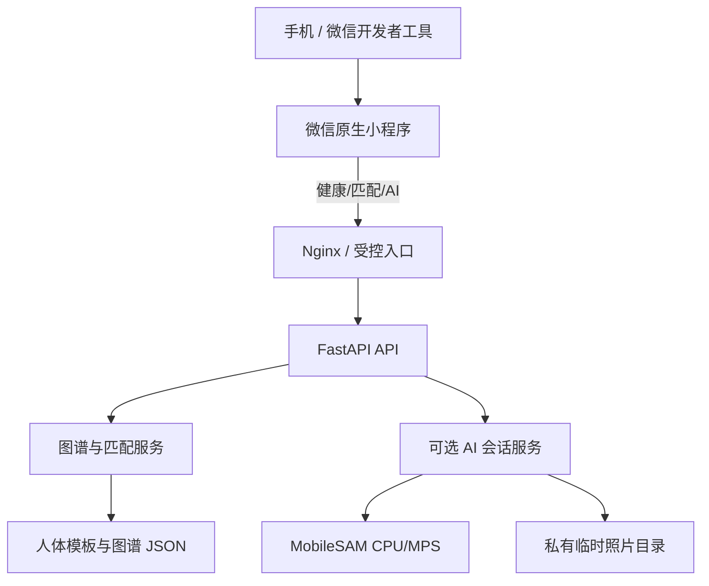
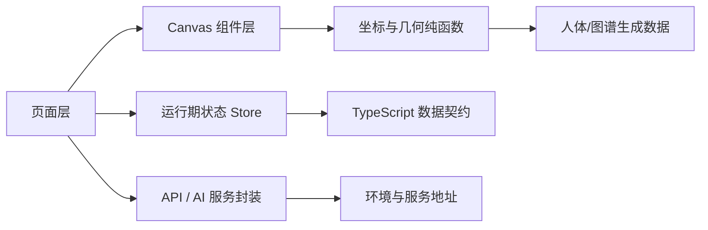
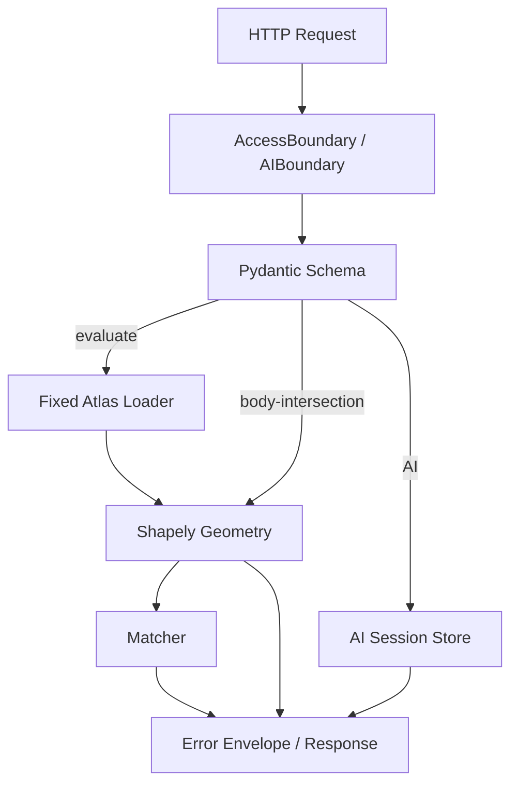
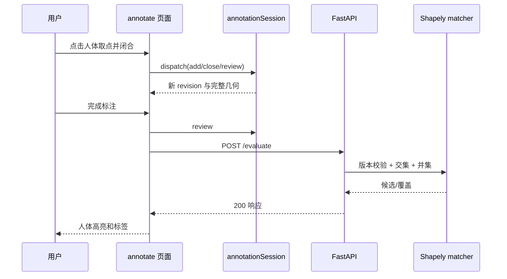
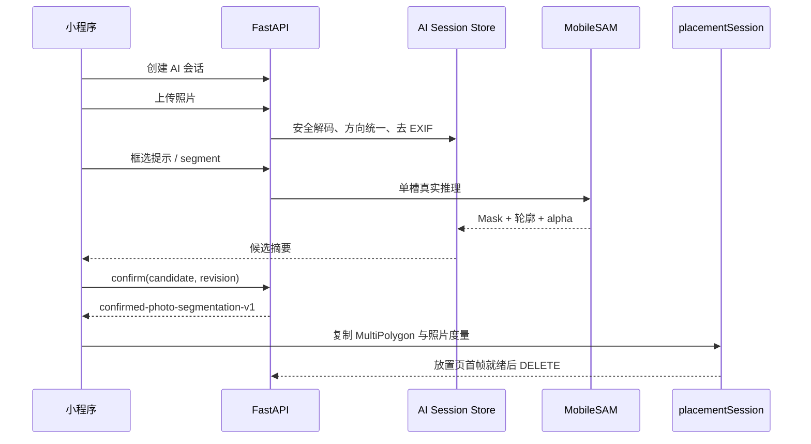
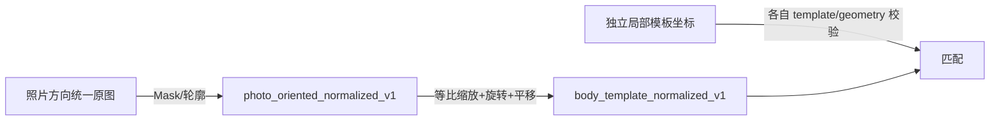
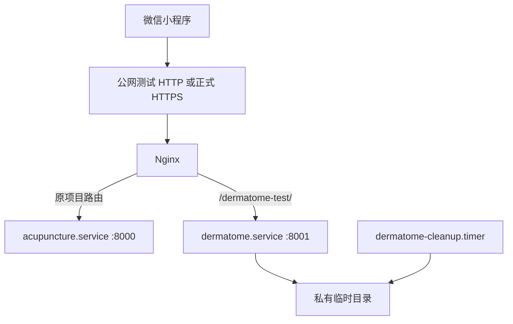

# 05 系统架构

> 文档基线：2026-11-19；代码基线为 Git `27b41f6` 加当前未提交工作区。代码、部署和真机状态分层记录，以当前源码与实际证据为准。

## 5.1 总体架构

核心原则是“人工标注和几何匹配必须能在 AI 不可用时独立运行”。

## 5.2 小程序内部分层

页面不应直接修改原始 Mask 或图谱。它们通过 store 和纯函数获取新状态。

## 5.3 后端调用链

`GET /atlas` 仍是历史 501 占位；当前没有通过该接口把完整图谱暴露给客户端。图谱主要随客户端生成包发布，后端使用固定路径和身份校验。

## 5.4 端到端人工标注流程

## 5.5 AI 端到端流程

## 5.6 坐标边界

虽然三套坐标都用 `[0,1]`，数值相同并不意味着位置相同。必须同时传递：

- `view`
- `templateId`
- `templateVersion`
- `geometryId`
- `regionSetId`
- `atlasId`
- `atlasVersion`
- 内容哈希

## 5.7 部署拓扑

当前公网测试入口使用 HTTP，只适用于公开或合成照片。正式发布需要 HTTPS、合法微信域名和受控身份体系。

## 5.8 为什么不用单一大服务

原针灸项目和新项目共享服务器，但采用以下隔离：

- 独立代码目录；
- 独立 Python venv；
- 独立 systemd service；
- 独立端口；
- 独立资源限制；
- 独立日志；
- 独立回滚；
- 原 Nginx 路径不被默认修改。

这使 AI 推理、OOM 或发布失败不会直接停掉针灸服务。
