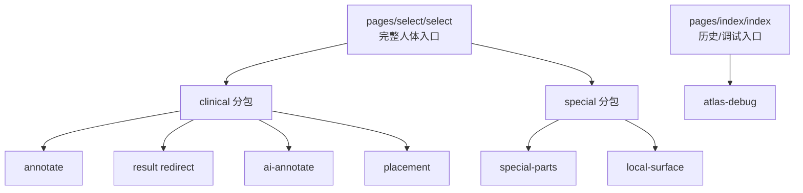
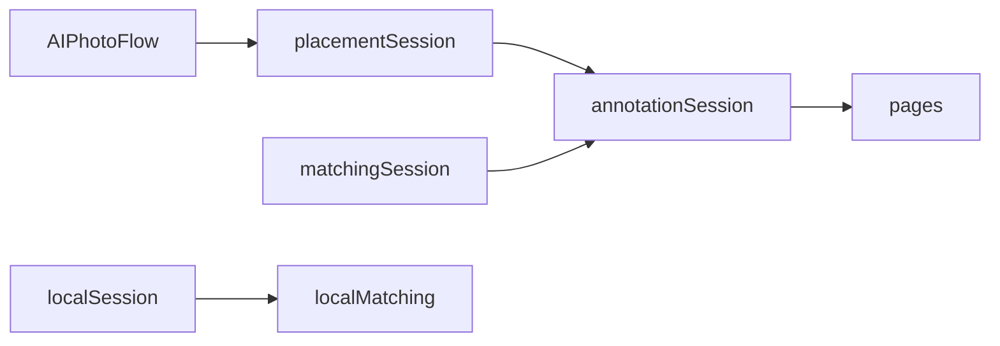

# 07 微信小程序架构

> 文档基线：2026-11-19；代码基线为 Git `27b41f6` 加当前未提交工作区。代码、部署和真机状态分层记录，以当前源码与实际证据为准。

## 7.1 页面与分包

当前 `app.json` 的起始页是完整人体入口 `pages/select/select`。`pages/index/index` 仍保留，主要用于历史入口和开发图谱调试。

## 7.2 主包与分包边界

主包包含：

- 完整人体选择页；
- 人体 Canvas 组件；
- 共享 `annotationSession`；
- 坐标/几何公共函数；
- 人体 PNG 和轮廓；
- 主人体手部几何。

clinical 分包包含：

- 人工标注和结果；
- AI 上传、分割、候选确认；
- 人体放置；
- AI 状态机；
- 大型全身图谱生成数据。

special 分包包含：

- 局部视图菜单；
- 脚底、腋下、会阴的模型和图谱；
- 局部 Canvas；
- 局部会话和匹配状态。

分包规则：

1. 分包可以引用主包公共模块；
2. 主包不能加载分包页面作为同步依赖；
3. clinical 和 special 之间没有交叉 JS/资源引用；
4. 页面跳转只传轻量 ID 或 view，不传完整几何。

检查脚本：`scripts/check_miniprogram_packages.py`。

## 7.3 页面责任

### `pages/select/select`

- 显示完整人体正/背面；
- 正背面切换；
- 人体粗区域轻触选择；
- 手动标注入口；
- AI 辅助标注入口；
- 特殊部位入口；
- 有已确认标注时恢复结果；
- 开发调试仅在受控环境显示。

### `packages/clinical/pages/annotate`

同时承担编辑、复核和匹配结果展示。它不依赖第二个人体 Canvas：

- 绘制完整人体；
- 收集手工点和闭合 Polygon；
- 对完整人体有效区域做填充包含测试；
- 完成标注后自动进入匹配；
- 展示候选、覆盖比例、单标签和全部标签；
- 支持返回修改。

### `packages/clinical/pages/ai-annotate`

- 拍照或从相册选择；
- 统一照片准备与压缩；
- `photo-canvas` 框选；
- 自动调用 MobileSAM；
- 展示候选预览；
- “换个结果”；
- 可选精细调整；
- 确认识别范围；
- 建立人体放置草稿。

### `packages/clinical/pages/placement`

- 接收自包含放置草稿；
- 完整人体初始视口；
- 正背面切换；
- 单指拖动；
- 大小和角度滑杆；
- 重置；
- 最终人体交集和确认；
- 确认后写入 V2 并触发匹配。

### `packages/special/pages/local-surface`

通用脚底/腋下/会阴页面，根据 registry 获取：

- 模板；
- 人体轮廓；
- 图谱；
- 左右方向和标题；
- 模拟/试验性状态。

它复用人工标注和匹配能力，但使用独立会话与模板。

## 7.4 组件

### `body-canvas`

负责完整人体的：

- PNG 绘制；
- 矢量兜底；
- Canvas 尺寸与 DPR；
- 正背面切换；
- 平移和双指缩放；
- 粗区域命中；
- 手工点、病灶、图谱高亮；
- Canvas ready/error 事件。

关键防线：

- 节点宽度为 0 时重测；
- PNG 失败时保留矢量人体；
- 旧回调按 scene/view/generation 丢弃；
- 高频触摸用 rAF 合并。

### `photo-canvas`

负责照片和 Mask 使用完全相同的 `contain` 显示矩形：

- 原图；
- alpha Mask；
- 框选矩形；
- 前景/背景点；
- 缓存尺寸；
- 单帧绘制调度。

### `placement-overlay`

只绘制可移动病灶贴片和选中边界，不处理人体底图。拖动期间不每帧重新变换 MultiPolygon 本体，而是绘制缓存贴片的仿射变换。

## 7.5 运行期状态

正式人体标注的唯一权威是 `annotationSession`。AI flow、placement draft 和 UI 状态都不能在未经过 commit 时直接修改正式标注。

## 7.6 环境和能力

`config/environment.ts` 按微信 `envVersion` 生成 UI 能力：

| 能力 | develop | trial | release | unknown |
| --- | --- | --- | --- | --- |
| 人体/手工标注 | 开 | 开 | 开 | 开 |
| 参考匹配 | 开 | 开 | 关 | 关 |
| AI 分割/放置 | 开 | 开 | 关 | 关 |
| 图谱调试 | 开 | 关 | 关 | 关 |
| 坐标调试 | 开 | 关 | 关 | 关 |

这只是 UI 门禁，不是服务端授权。服务端仍会拒绝未启用或未鉴权的请求。

## 7.7 API 地址

当前配置：

- develop 开发工具和 trial 可通过受控测试入口 `<PUBLIC_TEST_BASE_URL>/dermatome-test` 联调；主机与凭据从私有部署记录取得，不写入仓库；
- 如本地显式配置受控模拟器凭据，可切回本机回环；
- release 只允许配置后的 HTTPS；
- unknown 失败关闭。

`wx.request`、`wx.uploadFile`、`wx.downloadFile` 都必须基于同一 `apiBaseUrl()`。

## 7.8 大屏和折叠屏

P9 采用容器宽度而不是机型名：

- 窄屏单栏；
- 人体工作区保留较高优先级；
- 宽屏左侧人体、右侧滚动面板；
- 真实 `onResize` 才重新测量；
- 缩放只改内部 viewport，不改外层宽高。

V7.1.1 进一步固定人体工作区，避免结果内容增长带动整个人体移动。
