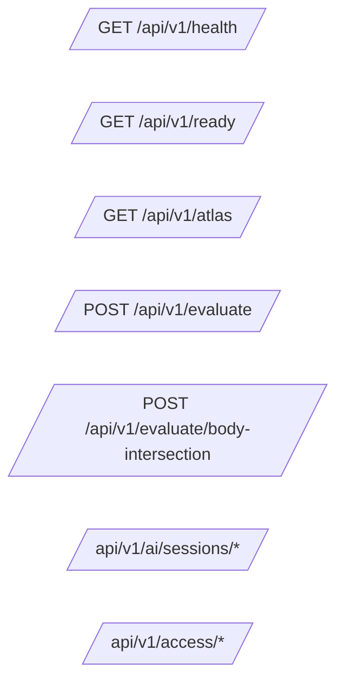

# 08 FastAPI 后端架构

> 文档基线：2026-11-19；代码基线为 Git `27b41f6` 加当前未提交工作区。代码、部署和真机状态分层记录，以当前源码与实际证据为准。

## 8.1 启动入口

入口：[backend/app/main.py](../../backend/app/main.py)

应用注册顺序：

1. `EvaluationBoundary`：在匹配请求解析前检查门禁和 2 MiB 正文；
2. `AIBoundary`：检查 AI 开关、上传预算和并发；
3. `AccessBoundary`：受控环境鉴权、Origin 和限流；
4. 路由；
5. 统一业务错误处理。

FastAPI lifespan 只在显式启用 AI 时创建 `AISessions`，不会因模型缺失阻止手工匹配。

## 8.2 路由



| 路由 | 状态 |
| --- | --- |
| `/health` | 基础可用性，固定历史 `version=v0` |
| `/ready` | 受保护技术就绪，校验图谱/模型状态 |
| `/atlas` | 501 历史占位 |
| `/evaluate` | 当前参考几何匹配 |
| `/evaluate/body-intersection` | V7 最终人体交集 |
| `/ai/sessions` | 临时照片/MobileSAM |
| `/access/session` | 公网临时测试 Bearer |

## 8.3 服务层

### 图谱加载

`atlas_service.load_dataset()` 按 `atlas_id` 固定分派：

- 全身 Goran；
- 足底；
- 腋下 provisional/schematic/未配置；
- 会阴 schematic；
- 已退役手掌明确 410。

路径不能由请求传入。所有内容哈希、模板身份、来源许可和审核门禁在请求时重新读取，避免旧缓存。

### 匹配

`dermatome_matcher.evaluate()` 是纯几何层：

1. 校验重复 lesion ID；
2. 每个 lesion 转成 Shapely 几何；
3. 每面最多 20 片；
4. 每个 view 的候选按标签/侧别合并；
5. 每请求只对候选几何做一次并集；
6. 单病灶和整视图并集共用同一候选集合；
7. 计算交集和未覆盖面积；
8. 稳定排序并返回。

候选 ID 是规范键的 SHA256，不依赖数组顺序。

### 人体交集

`body_intersection.clip_to_body()`：

- 只支持 front/back；
- 只读取当前人体导出；
- 返回 `inside / partial / outside`；
- 精确返回人体内 MultiPolygon；
- 不读取照片、AI 或图谱。

### AI 会话

`AISessions` 负责：

- 创建随机会话和照片能力令牌；
- 安全解码与缩放；
- 单槽 MobileSAM 推理；
- 候选 Mask、alpha 和几何；
- 用户笔刷修正；
- 确认快照；
- 闲置扫描和 DELETE。

## 8.4 Schema

### `schemas/evaluate.py`

关键类型：

- `Identity`
- `PolygonGeometry`
- `MultiPolygonGeometry`
- `EvaluateRequest`
- `EvaluateResponse`
- `BodyIntersectionRequest`
- `BodyIntersectionResponse`

资源预算：

- 单个 Ring 最多 20,000 点；
- MultiPolygon 最多 1,024 个 Polygon；
- 单个 lesion 最多 20,000 顶点；
- 请求总顶点最多 40,000；
- 每个视图最多 20 片。

### `schemas/ai.py`

关键类型：

- `PhotoPoint`
- `PhotoBox`
- `PhotoPrompts`
- `SegmentRequest`
- `ConfirmRequest`
- `EditRequest`
- `ConfirmedPhoto`

照片坐标类型明确限定 `photo_oriented_normalized_v1`，不能伪造为人体坐标。

## 8.5 错误格式

业务错误尽量使用：

```json
{
  "error": {
    "code": "VERSION_MISMATCH",
    "message": "人体、图谱或内容校验不一致，请同步更新后重试"
  }
}
```

不返回：

- 原始请求；
- 敏感坐标；
- 照片字节；
- 服务器文件路径；
- 堆栈。

## 8.6 访问控制

环境分为：

- `development`
- `test`
- `controlled`
- `production`
- 未知

`controlled` 需要：

- `API_ACCESS_SHA256`
- 对应功能开关
- 可选 `ENABLE_PUBLIC_TEST_ACCESS=1`

公开测试会话使用 Bearer，照片仍要求额外 `x-ai-session-key`。Bearer 只用于隔离，不证明微信身份。

## 8.7 资源保护

历史生产服务限制：

- Uvicorn 单 worker；
- dermatome service 1 CPU 配额；
- 1.5 GiB 内存；
- swap 0；
- MobileSAM 单线程；
- 模型惰性加载并缓存；
- 单推理槽；
- AI 忙碌直接 429；
- OOM policy stop。

当前本地 P12.1 把上传接收提高到 50 MiB/5000 万像素，但推理前仍缩到 3 MP 或 12 MP。不能把“允许接收 4800 万像素”理解为“MobileSAM 处理 4800 万像素原图”。
