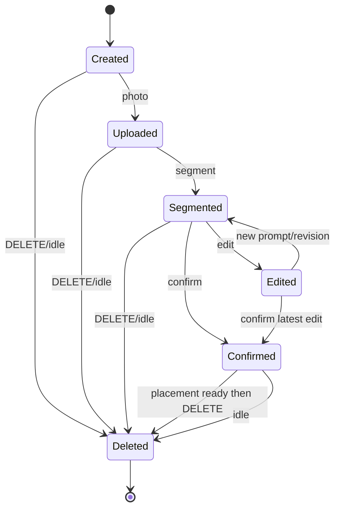
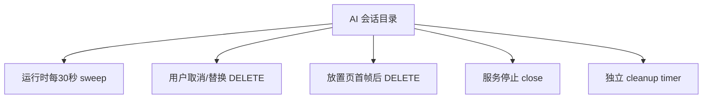

# 09 AI 辅助分割

> 文档基线：2026-11-19；代码基线为 Git `27b41f6` 加当前未提交工作区。代码、部署和真机状态分层记录，以当前源码与实际证据为准。

## 9.1 职责

AI 模块根据用户提示提取候选像素区域。它不输出：

- 带状疱疹诊断；
- 身体部位；
- 神经节段；
- 照片到人体的自动配准；
- 医学置信度。

模型最高分候选也必须经过用户选择。

## 9.2 模型与运行

主模型是 MobileSAM：

- 源码固定 commit；
- 权重约 40.7 MB；
- CPU 可运行；
- MPS/CUDA 可选；
- 加载一次后复用；
- 全局单推理槽。

不能把 40.7 MB 权重当作总内存需求。PyTorch、模型激活、图片数组和中间 Mask 会显著增加 RSS。

## 9.3 推理流程

```mermaid
flowchart LR
  A[上传照片] --> B[格式/大小/像素校验]
  B --> C[EXIF 方向统一]
  C --> D[安全缩放]
  D --> E[去除元数据并保存交互 PNG]
  E --> F[框/点提示映射到像素]
  F --> G[MobileSAM]
  G --> H[原尺寸 Mask]
  H --> I[Mask 转 MultiPolygon]
  I --> J[alpha/Mask/polygon 预览]
  J --> K[用户选择]
  K --> L[确认结果]
```



## 9.4 图像输入

支持：

- 静态 JPEG；
- 静态 PNG；
- 静态 WebP；
- 透明图在白底合成。

拒绝：

- 动画图；
- HEIC 直接上传；
- 损坏或伪装文件；
- 超大小或超像素；
- 过小图像。

P12.1 当前后端目标：

| 项 | 限制 |
| --- | --- |
| 上传文件 | 50 MiB |
| 源像素 | 50,000,000 |
| 最大单边 | 10,000 |
| 最小边 | 8 |
| controlled 推理像素 | 3,000,000 |
| development/test 推理像素 | 12,000,000 |
| 结果 JSON | 8 MiB |

小程序前端还有独立准备流程：

- 大图优先原生缩图；
- 最终上传目标通常为 ≤8 MiB、≤3 MP、最长边 ≤1920；
- Canvas 安全预算用于防止超大全分辨率 RGBA。

## 9.5 坐标

照片空间：

```text
photo_oriented_normalized_v1
```

定义：

- 原点在方向统一后的照片左上角；
- x 向右；
- y 向下；
- `[0,1]`；
- Mask 和 Polygon 均基于同一方向统一尺寸；
- 不包含人体 view/template。

前端框选必须先计算照片在组件内的 `contain` 矩形，再剔除留白。不能把屏幕像素直接发送为模型像素。

## 9.6 Mask 转多边形

实现位置：

- `ai/postprocessing/polygons.py`
- `ai/postprocessing/brush.py`
- `ai/postprocessing/quality.py`

原则：

- 每个连通片保留为独立 Polygon；
- 内部孔洞保留；
- 不用凸包合并；
- 不自动删除小片；
- 默认 `simplify=0`；
- 转换失败返回明确状态；
- 保留原始 Mask 供对照。

## 9.7 候选质量

系统计算：

- Mask 面积占原图比例；
- 框外区域比例；
- 离散片区数量；
- 孔洞数量；
- 前景点是否选中；
- 背景点是否被排除；
- 候选之间相似程度。

异常提示包括：

- 大范围 Mask；
- 大量超出框选；
- 碎片过多；
- 前景点遗漏；
- 背景点仍被选中。

这些指标只用于操作提示，不能自动删除大 Mask，也不能把高分候选自动当作病灶。

## 9.8 人工修正

用户可选择：

- 补充区域；
- 擦除误选；
- 撤销；
- 恢复原始 Mask；
- 重新识别。

修正采用原始 AI Mask 加完整笔画历史重放。每次修正写新 `edit_revision`，旧修订不能确认。真实 Mask、alpha 和 Polygon 同步更新，显示涂层本身不是最终数据。

## 9.9 会话生命周期



当前默认连续闲置 120 秒。有效请求刷新活动时间。推理中的会话被 `active_sessions` 保护。

前端没有页面可见期间的周期心跳。停留超过 120 秒且没有请求时，会话仍可能过期。

## 9.10 清理



删除范围：

- 上传临时文件；
- 方向统一照片；
- 候选 Mask；
- alpha；
- 编辑修订；
- 轮廓记录；
- 会话索引；
- 内存结果。

文件系统删除不是安全擦除；备份和平台缓存不在保证内。

## 9.11 已知限制

- CPU 首轮推理需要模型加载，明显慢于暖启动；
- 部分病例会过度分割；
- 点提示比框选不稳定；
- 无专家 Mask，不能计算临床 Dice/IoU；
- 当前没有前端长停留心跳；
- Android/iOS 原生缩图与内存仍为 `NOT_RUN`；
- 当前最新后端增量尚未全部部署。
