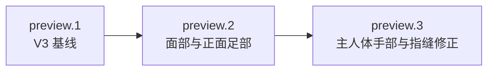
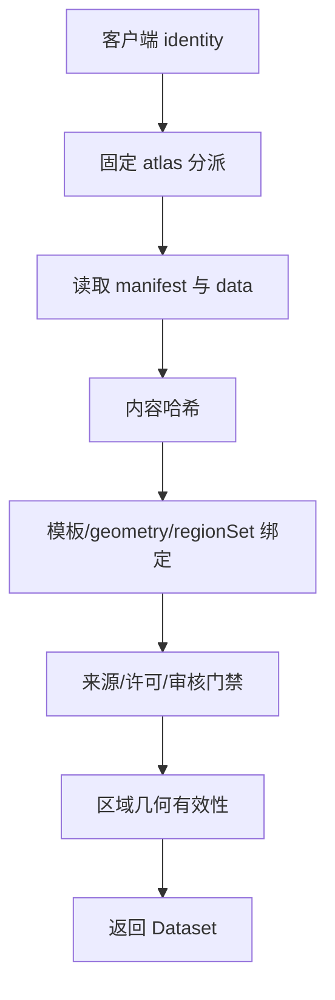

# 10 神经参考图谱

> 文档基线：2026-11-19；代码基线为 Git `27b41f6` 加当前未提交工作区。代码、部署和真机状态分层记录，以当前源码与实际证据为准。

## 10.1 数据模型

一个可计算图谱至少需要：

```text
templateId
templateVersion
geometryId
regionSetId
atlasId
atlasVersion
contentSHA256
sourceTitle
sourceUrl
attribution
license
medicalReviewStatus
technicalValidationStatus
mappingEnabled
coverageNote
```

每个区域还应绑定：

```text
regionId
view
side
labelId
sourceLabel
partitionType
geometry
sourceRefs
```

## 10.2 当前图谱清单

| atlas | 版本 | 来源/性质 | 医学状态 | 用途 |
| --- | --- | --- | --- | --- |
| `v1` | `v1` | 空结构 | `not_started` | 历史占位 |
| `goran-2022-preview-v3` | `.preview.3` | Goran CC BY-SA 4.0 | pending | 全身正背+主人体手部 |
| `axilla-reference-v1` | `unconfigured.1` | 无可计算边界 | pending | 明确 `ATLAS_NOT_READY` |
| `axilla-goran-provisional-v1` | `.provisional.1` | Goran 近似配准 | pending | 试验性 T1/T2 |
| `axilla-schematic-v1` | `.1` | 人工构建 | NOT_MEDICALLY_VALIDATED | T1/T2/T3 全覆盖模拟 |
| `goran-sole-v1` | `.preview.1` | Goran 实际足底 Path | pending | L5/S1 |
| `perineum-schematic-v1` | `.1` | 人工构建 | NOT_MEDICALLY_VALIDATED | S2/S3/S4/S5/UNDEFINED |
| `palm-dermatomes-v1` | `.preview.3` | Servier 历史参考 | pending | 独立手掌已退役 |

## 10.3 全身 Goran

当前绑定：

```text
template commons-neutral-v1 / 4.0.1
geometry commons-blank-cc0-hands-v2
region set commons-blank-cc0-v1-ui-regions-2
atlas goran-2022-commons-template4-preview.3
```

图谱包含：

- 面部三叉神经感觉分区；
- 脊神经皮节；
- 组合标签；
- 可见正面足部；
- 主人体手掌/手背；
- 额头、耳、腕部和隐面等未覆盖范围。

医学审核仍为 pending，`mappingEnabled=false`。这说明数据在运行时可用于技术预览，但不构成医学发布许可。

## 10.4 版本演进



旧版本保留用于追溯，不静默覆盖历史含义。

## 10.5 足底

来源为 Goran 背面原图可见足底 Path：

- L5：源元素 p43；
- S1：源元素 p44；
- 两侧分别提取；
- 未镜像；
- 旋转和等比放大；
- 仅覆盖原图可见投影，不补齐五趾隐面。

独立 template 为 `goran-sole-v1 / 1.0.0`。

## 10.6 腋下

有三层数据并存：

1. 未配置的 `axilla-reference-v1`：阻止计算；
2. PROVISIONAL：从 Goran 可见范围近似配准，只覆盖局部；
3. SCHEMATIC：人工设计全覆盖 T1/T2/T3。

SCHEMATIC 的 T1/T2/T3 只是交互示意。区域并集覆盖有效皮肤，重叠为 0，但不表示医学分界。

## 10.7 会阴

模板为中性、后下方示意，不显示具体男女外生殖器。有效皮肤中间有真实肛门孔洞。

区域：

- S2；
- S3；
- S4；
- S5；
- UNDEFINED（模拟未定区）。

UNDEFINED 参与几何交集但不冒充骶神经标签。

记录覆盖率曾为 100%，这仅表示当前模板上每个有效皮肤点被某个人工模拟区覆盖，不是神经识别准确率。

## 10.8 独立手掌退役

V6.1 曾提供独立手掌。V6.5 后：

- 手部真实 Path 已补入主人体 front/back；
- 独立 `palm-left/right` view 不再注册；
- 旧请求返回 `410 VIEW_RETIRED`；
- 旧坐标不迁移到 front/back；
- 历史 Servier 数据保留但不再作为运行时正常入口。

## 10.9 加载与校验



每个请求重新校验，避免服务器热更新后继续使用旧图谱。

## 10.10 覆盖比例不是医学概率

当前公式：

```text
候选比例 = area(病灶 ∩ 候选区域) / area(病灶)
总覆盖 = area(病灶 ∩ 本视图所有区域并集) / area(病灶)
未覆盖 = area(病灶 - 全部图谱区域) / area(病灶)
```

它不包含：

- 神经分布概率；
- 患者症状；
- 年龄、性别或个体差异；
- 皮肤三维曲率；
- 真实物理面积；
- 临床检查。

## 10.11 来源与许可

- Goran 来源：CC BY-SA 4.0，需要署名和相同方式共享；
- Commons 人体底图：CC0；
- Servier 历史手掌参考：CC BY 4.0；
- 腋下/会阴人工模拟：项目 CC0 声明；
- 所有预览仍必须保留来源和“非诊断”说明。

任何新图谱都不能只写“来自公开资料”。必须记录具体文件、版本、作者、许可和转换方法。
