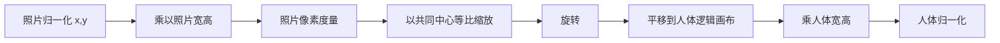
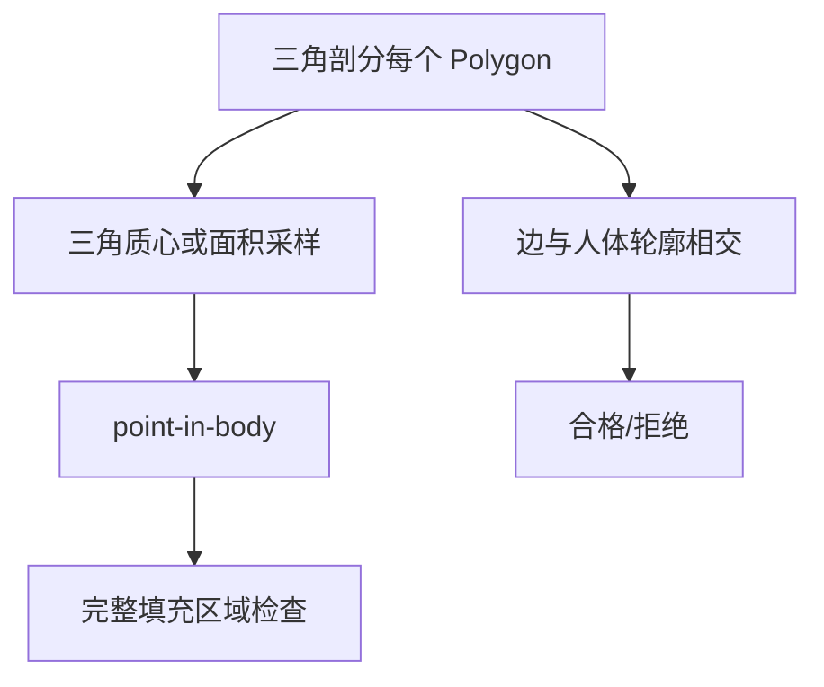
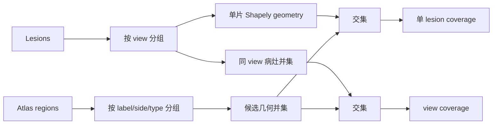
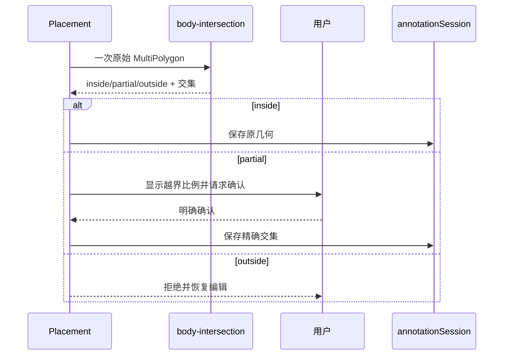

# 11 多边形、坐标与几何

> 文档基线：2026-11-19；代码基线为 Git `27b41f6` 加当前未提交工作区。代码、部署和真机状态分层记录，以当前源码与实际证据为准。

## 11.1 三种核心几何对象

### 简单标注

历史 V2 用手工顶点表达一片病灶：

```ts
{
  vertices: [{ x, y }, ...],
  view: "front"
}
```

适合没有孔洞的简单 Polygon。

### Polygon

```json
{
  "type": "Polygon",
  "coordinateSpace": "body_template_normalized_v1",
  "coordinates": [
    [{"x": 0.4, "y": 0.3}, "...外环"],
    [{"x": 0.42, "y": 0.32}, "...孔洞"]
  ]
}
```

### MultiPolygon

```json
{
  "type": "MultiPolygon",
  "coordinateSpace": "body_template_normalized_v1",
  "coordinates": [
    [["外环"], ["孔洞"]],
    [["另一个独立片区"]]
  ]
}
```

AI 放置和完整匹配优先使用 MultiPolygon。

## 11.2 坐标变换



不能对照片归一化 x 和 y 分别套人体宽高比，否则旋转时形状会被拉伸。必须先进入统一像素/度量空间。

## 11.3 坐标空间

| 名称 | 用途 |
| --- | --- |
| `photo_oriented_normalized_v1` | 方向统一后的照片 |
| `body_template_normalized_v1` | 全身或局部人体模板 |
| `normalized_2d_top_left` | API Identity 的总体声明 |
| 屏幕 CSS 坐标 | 触摸和显示，不持久化 |
| Canvas backing store 坐标 | DPR 绘制，不持久化 |
| 人体逻辑画布 | `400 × 900` 等模板内部度量 |

相同 `[0.5,0.4]` 在不同 view 中可能代表完全不同的皮肤位置。

## 11.4 合法 Polygon

要求：

- 外环闭合；
- 外环和孔洞无重复非闭合点；
- 无自交；
- 面积大于阈值；
- 孔洞位于外环内；
- 片区之间不重叠；
- 整个填充区域位于有效皮肤内。

只检查顶点在人体内是不够的。例如四点都在两侧手臂或躯干上，连线仍可能跨过人体外部空气。

## 11.5 人体边界



完整人体正背面使用同一冻结轮廓的索引版本。P11.2 只缩小候选边范围，不改变精确包含语义。

## 11.6 Shapely 匹配



候选自身可能重叠，所以候选比例之和可以超过 100%。总覆盖必须使用图谱区域并集，不能把候选比例相加。

## 11.7 面积守恒

对每个检查：

```text
病灶面积 ≈ 交集面积 + 未覆盖面积
```

如果误差超过容差，返回 `COMPUTATION_ERROR`，不能输出不一致结果。

微小正面积仍保留；接近 0 和 100% 的显示使用 `<0.01%`、`>99.99%` 等文案。

## 11.8 部分越界处理

V7 允许用户将病灶部分移到人体外。确认时：



原始变换保留在 AI source 中；V2 保存的有效几何和匹配几何是用户确认后的切片。

## 11.9 资源预算

当前 service/API 约束：

- 单 Ring 20,000 点；
- 单 MultiPolygon 1,024 片；
- 总请求 40,000 点；
- 每 view 20 个 lesion；
- 人体交集请求 20,000 点；
- 匹配正文 2 MiB。

超限必须明确失败，不能截断、抽稀或只保存首批数据。

## 11.10 性能索引

P11.2 的索引只缓存派生数据，不修改几何：

- 外环与孔洞缓存；
- 边候选 Y 轴分桶；
- 包围盒快速排除；
- 扫描线内部点判断；
- 源经非退化相似变换后的可信快速人体检查。

可靠前提是源几何已经完整验证，且变换保持拓扑。若源指纹不匹配，仍走完整校验。
