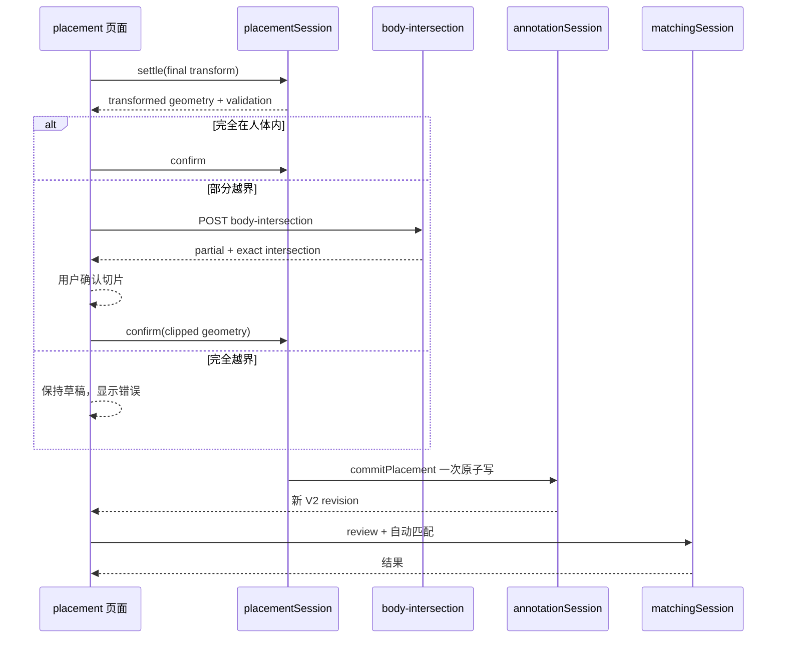

# 12 人体放置流程

> 文档基线：2026-11-19；代码基线为 Git `27b41f6` 加当前未提交工作区。代码、部署和真机状态分层记录，以当前源码与实际证据为准。

## 12.1 目标

把照片坐标的 MultiPolygon 作为一组贴片放到人体模板，不必重新识别：

- 多片一起移动；
- 所有片区保持相对位置；
- 孔洞保持孔洞；
- 等比缩放；
- 共同中心旋转；
- 不改变照片原始几何；
- 最终一次写入 V2。

## 12.2 数据来源

放置草稿来自 `ConfirmedPhoto`：

```text
schema_version
session_id
photo_id
result_id
candidate_id
prompt_revision
coordinate_space
image width/height
geometry MultiPolygon
mask asset/hash
model metadata
prompts/correction
```

放置页还会生成自包含的 `PreparedPhotoGeometry`：

- 外环和孔洞；
- 原始照片宽高；
- 面积/包围盒；
- 拓扑校验指纹；
- 快速校验缓存。

## 12.3 草稿状态

`placementSession` 独立于正式 `annotationSession`：

```ts
{
  transform: {
    translationX,
    translationY,
    scale,
    rotation
  },
  phase: "adjusting" | "confirmed",
  validation,
  revision,
  sourceDetached
}
```

运行期草稿只在内存。

## 12.4 初始位置

- 完整人体入口默认正/背面全身；
- 如用户此前有粗区域提示，只用于初始中心，不裁剪视野；
- 不能根据照片自动声称位于 T4/T5 等节段；
- 长宽比不同也不能拉伸。

## 12.5 拖动

拖动期间：

1. 组件记录起始 transform；
2. `touchmove` 只计算 translation delta；
3. 绘制缓存贴片的仿射变换；
4. 不重新遍历完整 MultiPolygon；
5. 不发送后端请求；
6. 不增加/删除顶点；
7. 不写 V2；
8. `touchend` 才结算一次。

## 12.6 缩放和旋转

- 缩放是统一标量，10%–400% 左右；
- 旋转围绕同一整体中心；
- 修改滑杆只更新草稿；
- 不修改原始 Mask/MultiPolygon；
- 不允许 0、负数、NaN 或无限值；
- 高频滑杆事件合并绘制。

## 12.7 确认链路



## 12.8 照片释放

放置页人体和病灶首帧 ready 后：

1. 本地草稿已包含全部几何和照片度量；
2. 异步 DELETE 后端照片会话；
3. DELETE 失败时有界重试；
4. 失败不影响人体放置；
5. 服务端闲置回收兜底；
6. 放置页初始化失败时不删除照片。

这保证匹配不依赖已删除的照片。

## 12.9 Canvas 就绪

`placement-overlay` 的状态：

- `waiting`
- `ready`
- `error`

页面只接受匹配的：

- interaction key；
- draft revision；
- layout revision；
- viewport。

普通拖动后不清空整个人体；只有首次初始化可显示阻塞加载。

## 12.10 性能结论

真实复杂样本：

- 389 片区；
- 690 环；
- 301 孔洞；
- 6018 顶点。

修复前 M4 Node 入口约 23.2 秒，修复后约 0.26 秒。该数字不是手机耗时。当前仍需 Android/iOS 真机确认。

## 12.11 失败状态

- 源几何非法：拒绝，不丢弃；
- 版本不一致：拒绝；
- 完全越界：保持草稿；
- overlay 超时：自动重建一次；
- 第二次仍失败：显示手动重试；
- 旧 revision 回执：丢弃；
- 放置页退出：旧 owner 不能写 V2。
