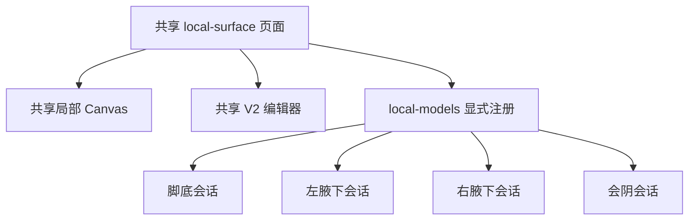

# 13 特殊部位

> 文档基线：2026-11-19；代码基线为 Git `27b41f6` 加当前未提交工作区。代码、部署和真机状态分层记录，以当前源码与实际证据为准。

## 13.1 视图注册

当前 `LocalSurfaceView`：

- `sole-left`
- `sole-right`
- `axilla-left`
- `axilla-right`
- `perineum-overview`

已退役：

- `palm-left`
- `palm-right`

每个 view 在 `local-models.ts` 中显式注册，不从字符串猜侧别。

## 13.2 脚底

```text
view: sole-left / sole-right
template: goran-sole-v1 / 1.0.0
geometry: goran-plantar-outline-v1
regionSet: goran-sole-ui-v1
atlas: goran-sole-v1 / goran-sole-preview.1
```

参考标签：

- L5；
- S1。

来源约束：

- Goran 背面实际 Path；
- p43/p44 与标签关联；
- 左右分别提取；
- 未镜像；
- 保留源缝和未覆盖区。

页面支持左右切换、多片标注、缩放复位和真实几何匹配。

## 13.3 腋下

```text
view: axilla-left / axilla-right
template: commons-axilla-v1 / 1.0.0
geometry: cc0-raised-axilla-outline-v1
regionSet: commons-axilla-ui-v1
```

三个图谱状态并存：

| atlas | 性质 | 计算 |
| --- | --- | --- |
| 未配置 | 来源不足 | `ATLAS_NOT_READY` |
| PROVISIONAL | Goran 局部近似 | 仅试验 |
| SCHEMATIC | 人工全覆盖 T1/T2/T3 | 交互模拟 |

SCHEMATIC 覆盖目标接近 100% 有效皮肤，但“100%”不是医学准确率。

## 13.4 会阴

```text
view: perineum-overview
template: neutral-perineum-overview-v1 / 1.0.0
geometry: neutral-perineum-skin-v1
regionSet: neutral-perineum-ui-v1
atlas: perineum-schematic-v1 / perineum-schematic.1
```

设计：

- 中性、无具体性别外观；
- 前侧在上；
- 后下方视角；
- 中央肛门区是有效人体孔洞；
- 左右切换隐藏；
- AI 照片放置未开放。

区域：

- S2；
- S3；
- S4；
- S5；
- UNDEFINED。

UNDEFINED 不能被界面简写为“S6”或其他神经标签。

## 13.5 独立手掌退役

V6.5 后，手部真实 Path 配准到主人体正背视图。独立手掌代码不再进入主流程。

兼容规则：

- 旧 `palm-*` 请求不能被解释成 front/back；
- 返回 `410 VIEW_RETIRED`；
- 旧坐标不自动迁移；
- 历史 Servier 文件和审计记录仍保留。

如果未来恢复独立手掌，必须重新立项并明确与主人体手部功能的取舍，不能只把入口加回来。

## 13.6 特殊视图共性

所有局部页面：

- 使用独立模板；
- 使用独立会话；
- 有自身 revision；
- 有固定图谱 identity；
- 不能把左右二维面积相加；
- 未覆盖只表示当前图谱没有边界；
- 若图谱未就绪，不返回空成功。

## 13.7 共享与隔离



共享 UI 和几何算法，不共享坐标命名空间。
