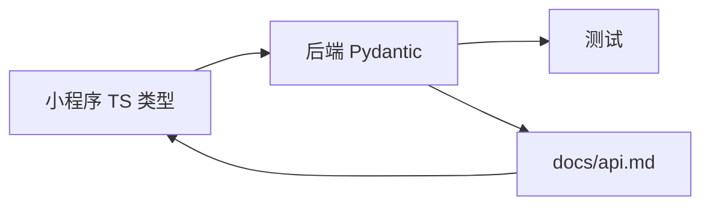

# 14 API 与数据契约

> 文档基线：2026-11-19；代码基线为 Git `27b41f6` 加当前未提交工作区。代码、部署和真机状态分层记录，以当前源码与实际证据为准。

## 14.1 基本约定

- 前缀：`/api/v1`
- JSON 字段：后端 snake_case
- 时间：Unix 秒
- 坐标：有限浮点，归一化 `[0,1]`
- 业务错误：`error.code/message`
- 不返回敏感输入或堆栈

## 14.2 端点和门禁

| 方法 | 路径 | 功能 |
| --- | --- | --- |
| GET | `/health` | 基础健康 |
| GET | `/ready` | 技术就绪 |
| GET | `/atlas` | 历史 501 |
| POST | `/evaluate` | 几何参考匹配 |
| POST | `/evaluate/body-intersection` | 最终人体交集 |
| POST | `/ai/sessions` | 创建临时 AI 会话 |
| POST | `/ai/sessions/{sid}/photo` | 上传照片 |
| POST | `/ai/sessions/{sid}/segment` | MobileSAM |
| POST | `/ai/sessions/{sid}/edit` | 笔刷修正 |
| POST | `/ai/sessions/{sid}/confirm` | 确认候选 |
| GET | `/ai/sessions/{sid}/assets/{name}` | 临时图片 |
| DELETE | `/ai/sessions/{sid}` | 删除 |
| POST | `/access/exchange` | 历史一次性邀请 |
| POST | `/access/session` | 公网临时 Bearer |
| DELETE | `/access/session` | 撤销 Bearer |

本地手工匹配需要在 `development/test` 环境并启用 `ENABLE_REFERENCE_MATCHING=1`。AI 还要启用 `ENABLE_AI_SEGMENTATION=1`。

## 14.3 Identity

```ts
type Identity = {
  template_id: string;
  template_version: string;
  geometry_id: string;
  region_set_id: string;
  atlas_id: string;
  atlas_version: string;
  atlas_content_sha256: string;
  body_content_sha256: string;
  coordinate_system: "normalized_2d_top_left";
};
```

Identity 是全套绑定，不是只比较 atlas 名称。任一变化导致 409。

## 14.4 Evaluate 请求

```ts
type EvaluateRequest = {
  request_id: string;
  annotation_revision: number;
  identity: Identity;
  lesions: Array<{
    id: string;
    view: SurfaceView;
    source?: "manual" | "ai_assisted";
    vertices?: Point[];
    geometry?: PolygonGeometry | MultiPolygonGeometry;
  }>;
};
```

`vertices` 和 `geometry` 二选一。

## 14.5 Evaluate 响应

```ts
type Coverage = {
  view: SurfaceView;
  lesion_ids: string[];
  annotation_area: number;
  covered_area: number;
  uncovered_area: number;
  covered_ratio: number;
  uncovered_ratio: number;
  coverage_status: "full" | "partial" | "none";
  candidates: Candidate[];
};
```

候选：

```ts
type Candidate = {
  candidate_id: string;
  region_ids: string[];
  partition_type: string;
  label: string;
  source_label: string;
  display_name: string;
  side: string;
  view: SurfaceView;
  intersection_area: number;
  lesion_coverage_ratio: number;
};
```

## 14.6 Body Intersection

请求：

```ts
type BodyIntersectionRequest = {
  view: "front" | "back";
  template_id: string;
  template_version: string;
  geometry_id: string;
  region_set_id: string;
  geometry: MultiPolygonGeometry;
};
```

返回 `inside/partial/outside`、面积和可选有效 MultiPolygon。

## 14.7 AI 创建与上传

创建：

```json
{
  "session_id": "32 hex",
  "session_token": "opaque",
  "expires_at": 0,
  "development_only": true
}
```

照片上传：

- `multipart/form-data`
- 唯一字段 `file`
- 必须带 `x-ai-session-key`
- 受控环境还带 Bearer
- 校验实际内容，不信任扩展名/MIME

## 14.8 Segment

```ts
type PhotoPrompts = {
  coordinate_space: "photo_oriented_normalized_v1";
  points: { x: number; y: number; label: 0 | 1 }[];
  box: {
    xMin: number;
    yMin: number;
    xMax: number;
    yMax: number;
  } | null;
  additional_boxes?: PhotoBox[];
};
```

候选状态：

- `ok`
- `empty_mask`
- `contour_failed`

## 14.9 Confirm

确认输入必须绑定：

- photo_id；
- result_id；
- candidate_id；
- prompt_revision；
- edit_revision。

任何一项过期都返回 409。

确认结果坐标空间固定为照片空间，并包含模型、提示、Mask 引用、Mask SHA 和完整 MultiPolygon。

## 14.10 使用 Body Intersection 前的 Schema



新增或修改字段时必须四方同步。

## 14.11 常见错误码

| code | 含义 |
| --- | --- |
| `MATCHING_DISABLED` | 环境未开放 |
| `VERSION_MISMATCH` | 模板/图谱/内容不一致 |
| `ATLAS_NOT_READY` | 图谱边界尚未配置 |
| `ATLAS_UNAVAILABLE` | 图谱文件或技术校验失败 |
| `VIEW_UNSUPPORTED` | 当前视图不支持 |
| `VIEW_RETIRED` | 已退役手掌 |
| `INVALID_INPUT` | 字段格式不合法 |
| `INVALID_ANNOTATION` | 几何非法或越界 |
| `PAYLOAD_TOO_LARGE` | 请求正文超限 |
| `AI_SESSION_GONE` | AI 会话失效或令牌不匹配 |
| `STALE_RESULT` | 结果或修订过期 |
| `AI_TIMEOUT` | 推理/修正超时 |
| `AI_BUSY` | 单推理槽忙碌 |

更完整错误矩阵以 [docs/api.md](../api.md) 为准。
