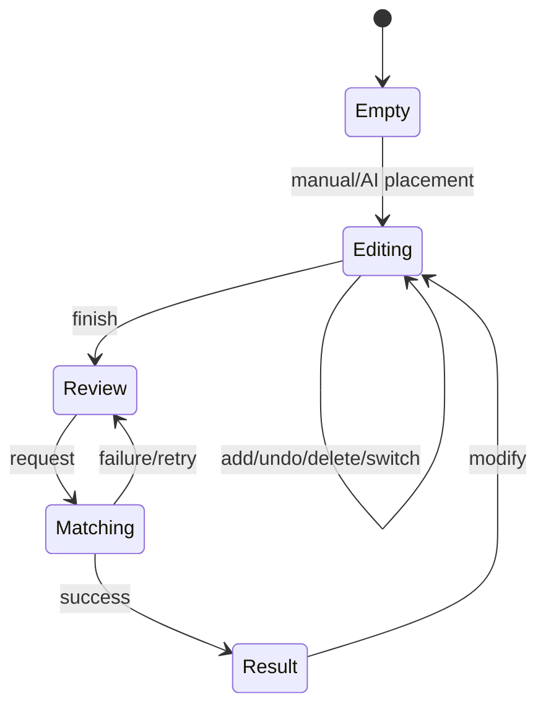
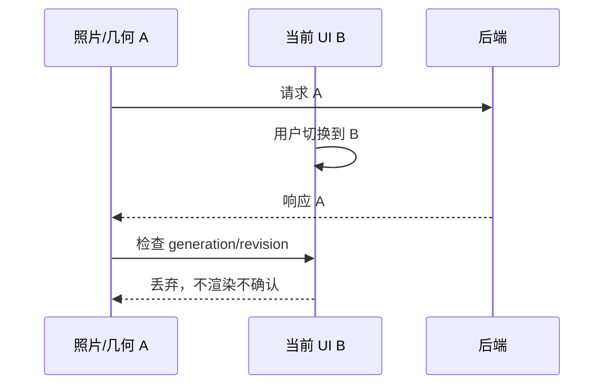

# 15 状态与会话管理

> 文档基线：2026-11-19；代码基线为 Git `27b41f6` 加当前未提交工作区。代码、部署和真机状态分层记录，以当前源码与实际证据为准。

## 15.1 小程序运行期无数据库

当前正式标注、AI 草稿和匹配结果都存在于本次小程序运行的内存中。关闭或重启可能丢失。

没有：

- 用户账户；
- 云病例数据库；
- 本地持久化病灶；
- 长期服务器存档。

## 15.2 权威状态

### `annotationSession`

唯一正式人体/局部标注状态。支持：

- front/back；
- special views；
- completed polygons；
- active draft；
- selected ID；
- review/editing phase；
- revision；
- template basis。

任何 AI 或 placement 状态都必须通过 `commitPlacement()` 才进入这里。

### `AIPhotoFlow`

每个 AI 页面实例拥有：

- generation；
- prompt revision；
- request ID；
- result ID；
- selected candidate；
- preview serial；
- correction history；
- active/queued inference。

作用是拒绝“照片 A 的迟到结果覆盖照片 B”。

### `placementSession`

独立草稿：

- 照片确认源；
- prepared geometry；
- transform；
- validation；
- owner lease；
- confirmed annotation ID；
- sourceDetached。

它不直接修改 `annotationSession`。

### `matchingSession`

缓存当前 revision 和 view 的匹配结果：

- 新几何使旧结果失效；
- 相同请求可复用 ready 响应；
- 失败保留标注；
- 迟到响应按 request/revision 丢弃。

## 15.3 生命周期

## 15.4 Revision 规则

每次正式状态变化增加 revision。异步回调必须同时核对：

- session ID；
- view；
- template basis；
- revision；
- request ID；
- generation/serial。

只看 session ID 不够。

## 15.5 迟到结果

该规则覆盖：

- 上传；
- segment；
- edit；
- candidate preview；
- placement；
- matching；
- DELETE。

## 15.6 AI 服务器会话

服务器只保存临时分析状态：

- owner principal；
- token hash；
- last_activity；
- expires；
- photo ID；
- result and edits；
- confirmed snapshot。

最多会话和并发受配置限制。

## 15.7 删除状态

AI 页面取消/替换：

- 尝试 DELETE；
- 清理本地临时图片；
- 清结果和候选；
- 迟到线程不能重新发布。

放置页退出：

- 未确认草稿可保留在内存供重入；
- 明确放弃时丢弃；
- 已确认几何留在 V2，与照片会话解耦。

## 15.8 会话过期

| 会话 | 期限/规则 |
| --- | --- |
| 微信 annotationSession | 小程序运行期 |
| AI photo session | 默认闲置 120 秒 |
| 公网测试 Bearer | 历史为 1 小时 |
| placement draft | 运行期，受 owner/revision |
| matching response | 当前几何/环境有效期 |

## 15.9 出错处理原则

- 网络失败不伪造成功；
- 版本失败保留用户几何；
- 推理失败保留提示和照片直到用户更换/取消；
- 放置失败保留草稿；
- 匹配失败保留 V2；
- 删除失败给明确提示并由服务器兜底。
