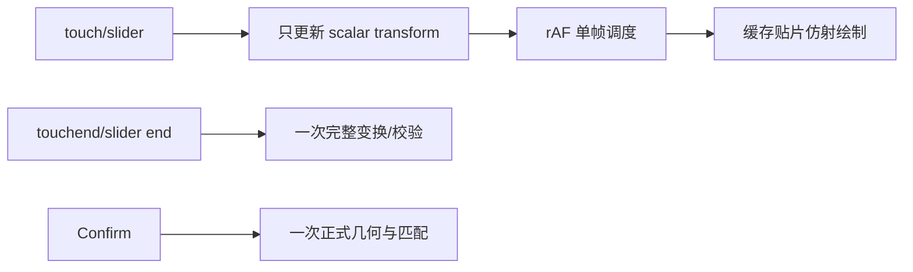

# 16 性能优化

> 文档基线：2026-11-19；代码基线为 Git `27b41f6` 加当前未提交工作区。代码、部署和真机状态分层记录，以当前源码与实际证据为准。

## 16.1 测量边界

项目区分：

- JS 事件处理；
- 数据变换；
- 几何校验；
- Canvas 查询和绘制；
- `setData`；
- 网络；
- 服务端预处理；
- MobileSAM 推理；
- 原生栅格和触摸延迟。

Node 或 Apple M4 数据不能写成手机 FPS。

## 16.2 P6：图谱与人体几何复用

主要问题：

- 每片病灶重复求当前 view 图谱并集；
- 人体边界全量扫描。

优化：

- 每请求每视图只求一次图谱并集；
- 冻结人体轮廓并建立空间索引；
- 保持同一 Shapely 公式。

## 16.3 P9：折叠屏

- 用实际容器尺寸，不用机型名；
- `resizable` 与自动横竖屏；
- 普通手机单栏；
- 展开态按容器进入双栏；
- `onResize` 后重新测量，不迁移逻辑坐标。

## 16.4 P11：照片框选

原问题：120 次 `touchmove`

- 120 次 Canvas 节点/尺寸查询；
- 约 122 次矩形查询；
- 120 次完整重绘；
- 120 次 `setData`；
- 240 次图片绘制。

优化后：

- 节点/尺寸缓存；
- 每次手势矩形查询 1 次；
- rAF 合并为一个待绘制帧；
- 普通 move 不 `setData`；
- 立即松手仍使用最后坐标。

## 16.5 P11.2：复杂 MultiPolygon

根因不是人体图片加载，而是：

- 完整源拓扑校验重复；
- 片区/孔洞两两检查；
- 边索引重复构建；
- 每次回执握手与全屏 loading。

真实样本：

- 389 片区；
- 690 环；
- 301 孔洞；
- 6018 顶点。

同机 Node 前后：

| 场景 | 修复前 | 修复后 |
| --- | ---: | ---: |
| 真实复杂样本入口 | 23,213.949 ms | 263.497 ms |
| 500 孔洞 | 5,220.572 ms | 12.714 ms |
| 1000 孔洞 | 20,664.641 ms | 28.448 ms |
| 2000 孔洞 | 82,606.447 ms | 66.690 ms |

必须注意：

- 这是 Apple M4 Node；
- 不是微信手机；
- 极端 2000 孔洞仍需真机确认；
- 不因此放宽最终人体校验。

## 16.6 Canvas 策略

人体底图保持稳定，不随每帧重绘复杂图谱。

## 16.7 AI 推理性能

历史实测：

- 云端暖模型单次推理约数秒；
- 首次包含模型加载；
- P12.1 本机 48.8 MP JPEG 预处理约 0.13 秒；
- 本机真实 MobileSAM 推理约 2 秒级；
- 模型加载后进程 RSS 可达约 0.93 GiB。

这些是特定环境记录，不是云端并发峰值。

## 16.8 图片准备

P8/P8.1：

- 大 JPEG 先用原生缩图；
- 避免创建原始 4800 万像素 Canvas；
- 单图串行；
- 超时后清理迟到临时文件；
- 最终复核大小、像素、格式和方向。

## 16.9 当前性能风险

- 手机原生 FPS/内存未测；
- 2000 孔洞级数据仍可能在低端设备阻塞；
- MobileSAM 单模型推理会阻塞其他 AI 用户；
- 50 MiB 上传的云端内存尚未按最新版本压测；
- 最新前端未形成新的体验版。

## 16.10 性能修改原则

1. 先测量，不凭感觉重构；
2. 保留原始几何；
3. 缓存只能用于显示或已验证的拓扑前提；
4. 不改匹配公式；
5. 不用丢失孔洞/片区换速度；
6. 最终确认仍必须完整校验；
7. 不宣称未测的固定帧率。
