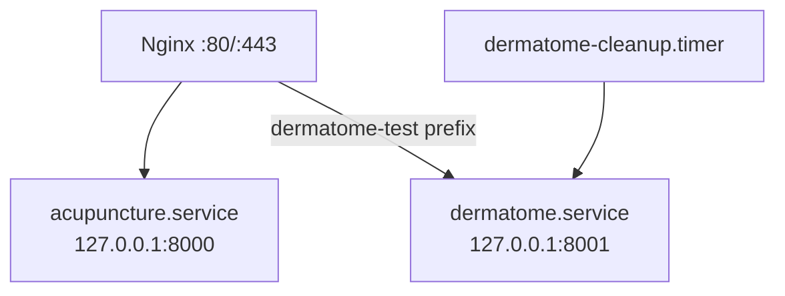

# 18 部署与发布

> 文档基线：2026-11-19；代码基线为 Git `27b41f6` 加当前未提交工作区。代码、部署和真机状态分层记录，以当前源码与实际证据为准。

## 18.1 历史生产环境

有证据的生产巡检：

| 项 | 结果 |
| --- | --- |
| 云 | 腾讯云 |
| 系统 | Ubuntu 24.04 |
| CPU | 4 逻辑 CPU，x86_64 |
| 内存 | 约 3.64 GiB |
| 磁盘 | 40 GiB 系统盘 |
| 原项目 | `acupuncture.service` :8000 |
| 新项目 | `dermatome.service` :8001 |
| Nginx | 独立路径和测试入口 |
| Python | 3.12 |
| AI | CPU 单 worker/单槽 |

真实资源仍以巡检报告为准：

- [Tencent Cloud Audit](../tencent-cloud-audit.md)
- [Deployment](../tencent-cloud-deployment.md)
- [MobileSAM Preflight](../tencent-cloud-mobile-sam-preflight.md)

## 18.2 服务隔离



新项目不能：

- 直接绑定公网 8001；
- 修改原针灸代码；
- 覆盖原 Nginx 站点；
- 删除原证书；
- 以共享服务器密钥代替业务鉴权。

## 18.3 当前公网测试入口

最近配置形状如下，具体主机与凭据必须从受控私有运维记录取得：

```text
<PUBLIC_TEST_BASE_URL>/dermatome-test
```

限制：

- 仅公开/合成测试图片；
- HTTP 不加密；
- 不是正式患者入口；
- release 不使用该地址；
- 可通过独立开关关闭。

关闭方式参见：

- `deployment/public-ip-control.sh`
- `deployment/ip-test-control.sh`
- `关闭公网测试入口.command`

## 18.4 鉴权层次

1. 受控环境总体访问；
2. 公网临时 Bearer；
3. 每次 AI 照片的 `x-ai-session-key`；
4. owner/principal 绑定；
5. Origin 限制；
6. 每分钟请求/创建限流；
7. AI 单推理槽。

公网临时 Bearer 只隔离客户端状态，不验证用户真实身份。

## 18.5 最近已证实部署

V6.7 后端：

- 变更 11 个会阴相关文件；
- 发布清单 145 项一致；
- `dermatome.service active`；
- `NRestarts=0`；
- 公网 smoke 8/8；
- 原针灸、Nginx PID/启动时间不变；
- 会阴 S2 与 UNDEFINED 可计算；
- 线上 MobileSAM 当次容量 429，未重新推理。

之后当前工作区的 P12.1/V7/P11.2 未全部进入线上。

## 18.6 部署包

发布清单：

- `deployment/release-manifest.json`

部署前必须：

1. 生成本地清单；
2. 与线上清单比较；
3. 只列出目标文件；
4. 备份线上；
5. 暂存目录校验；
6. 启动前确认图谱和依赖；
7. 启动后检查 health/ready；
8. 使用合成几何 smoke；
9. 检查原针灸服务；
10. 记录回滚路径。

## 18.7 P12.1 特殊部署提醒

当前代码：

- 50 MiB 上传；
- 5000 万源像素；
- 120 秒闲置 TTL；
- Nginx 模板 51 MiB。

如果线上 `service.env` 显式保留 `AI_IDLE_SECONDS=900`，部署后会覆盖默认 120 秒。同步时必须检查或删除该覆盖。

不能只上传前端而不更新后端限额。

## 18.8 微信上传

当前小程序已分包：

| 包 | 本地保守估算 |
| --- | ---: |
| main | 902,748 bytes |
| clinical | 1,424,938 bytes |
| special | 756,636 bytes |

流程：

1. 微信开发者工具打开 `miniprogram/`；
2. 清理编译缓存；
3. 编译；
4. 确认分包和资源；
5. 上传新版本；
6. 微信公众平台设为体验版；
7. 手机打开体验版；
8. 完成 Android/iOS 回归。

## 18.9 发布证据

`0.6.8` 上传成功证据：

- `docs/validation-records/miniprogram-package-size/wechat/gui-upload-result.json`

该报告同时说明：仍需人工在微信后台设为体验版。不要把上传成功等同于体验版可用。

## 18.10 正式上线前置

- 独立 HTTPS 域名；
- DNS 控制权；
- 微信 request/uploadFile/downloadFile 合法域名；
- 身份或受控访问方案；
- 隐私政策；
- 相册/相机权限声明；
- 数据保留和删除策略；
- 正式 Nginx 体积/超时；
- 失败监控；
- 医学审核或明确仅模拟的产品标识；
- 最新真机回归。

## 18.11 回滚

### 后端

- 只回滚 `dermatome` 项目文件；
- 不重启 `acupuncture`；
- 恢复备份文件和发布清单；
- 重启后检查 health/ready；
- 确认 8000/8001 仍只监听回环；
- 保留失败日志。

### 前端

- 微信体验版通过公众平台版本管理回退；
- 不能通过修改后端让旧前端获得不兼容新坐标；
- 版本不一致应返回 409，而不是猜测兼容。

### 公网入口

- 使用独立入口关闭脚本；
- `nginx -t` 通过再 reload；
- 不修改原针灸 fallback。

详细历史见 [deployment/rollback.md](../../deployment/rollback.md)。
