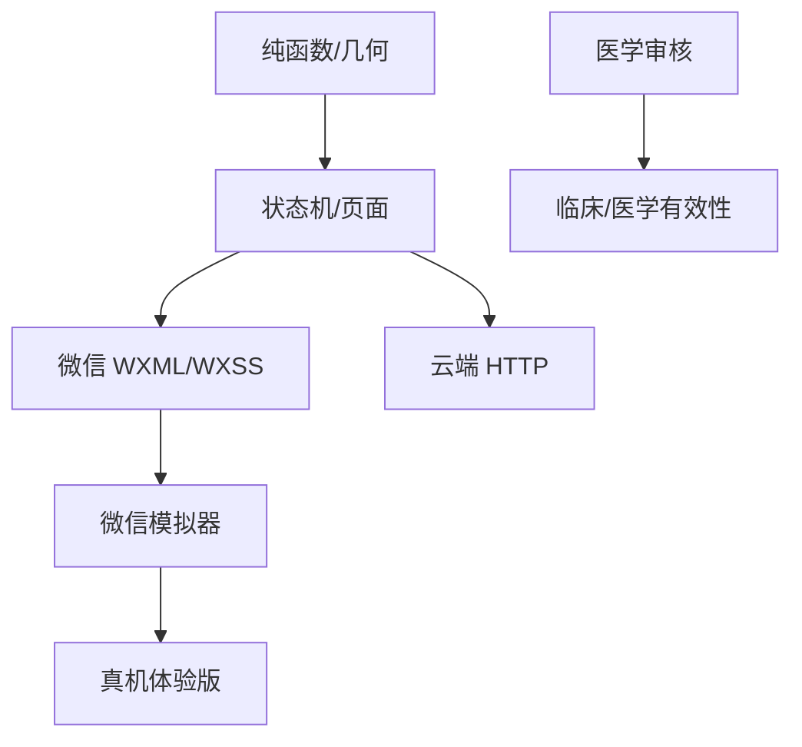

# 19 测试与验收

> 文档基线：2026-11-19；代码基线为 Git `27b41f6` 加当前未提交工作区。代码、部署和真机状态分层记录，以当前源码与实际证据为准。

## 19.1 验收层级

层级不能互相替代。

## 19.2 本轮实际执行

| 命令 | 结果 |
| --- | --- |
| `npm run typecheck` | PASSED |
| `npm test` | 431 passed |
| Python 全量（正确门禁） | 343 passed，7 warnings |
| `check_project.py` | PASSED |
| `sync_atlas.py --check` | PASSED |
| `check_miniprogram_packages.py` | PASSED |
| 全 WXML `wcc` | PASSED |
| 全 WXSS `wcsc` | PASSED |
| `git diff --check` | PASSED |

## 19.3 重要前端测试域

- 坐标正逆变换；
- DPR 与 Canvas；
- 人体轮廓与留白；
- 区域高亮/命中一致；
- V2 多片与版本；
- 图谱渲染；
- AI 上传/迟到响应；
- Mask 与照片矩形一致；
- 放置 MultiPolygon/孔洞；
- 人体边界；
- 折叠屏；
- 主包/分包路径；
- trial/release 能力矩阵；
- 结果页 Canvas。

## 19.4 重要后端测试域

- health/ready；
- 门禁；
- Identity/哈希；
- invalid geometry；
- 图谱未就绪；
- Shapely 覆盖；
- 人体交集；
- AI 上传格式；
- EXIF；
- 超大图；
- 候选/修订；
- 删除和过期；
- 授权隔离；
- 根治竞态。

## 19.5 微信工具验收

可以证明：

- 页面能编译；
- Canvas 尺寸非零；
- 实际触摸取点；
- 图谱彩色区域显示；
- 标签切换。

不能证明：

- Android/iOS 所有版本；
- 不同相机格式；
- 手机 OOM；
- 物理折叠屏；
- 长时间 FPS。

## 19.6 真机清单

### 人工标注

- 正背面；
- 跨旧区域边界；
- 手部；
- 多片；
- 缩放平移；
- 结果高亮；
- 修改后重算。

### AI

- 相册/相机；
- 1200/2400/4800 万像素；
- EXIF 旋转；
- 框选；
- 候选切换；
- 精细修正；
- 确认；
- 放置；
- 人体交集；
- 匹配；
- 照片删除。

### 特殊部位

- 左右脚底；
- 左右腋下；
- 会阴；
- 模拟免责声明；
- 单标签/全部；
- 会话隔离。

### 网络

- Wi-Fi；
- 移动网络；
- 请求超时；
- 体验版域名校验；
- 会话过期。

## 19.7 不计算医学准确率

没有专家参考 Mask 时，不能计算 Dice/IoU 并称为临床准确率。现有 AI 实验主要是定性、耗时和操作成本评估。

图谱覆盖率也只是二维模板面积，不是诊断概率。

## 19.8 当前 NOT_RUN

- 最新体验版设为体验版；
- Android/iOS 新包；
- 物理折叠屏；
- 最新 P12.1 云端大图和内存；
- 云端 120 秒 TTL；
- 手机前端长停留心跳；
- 最新 V7 从前端到云端的完整 AI 流程；
- 医学专业审核；
- 临床有效性。

## 19.9 测试失败记录规则

- 保留原命令、环境和错误摘要；
- 不能把环境门禁导致的拒绝改写为通过；
- 修正后重跑并分别记录；
- 不确定性使用 `NOT_RUN/UNKNOWN/BLOCKED`。
