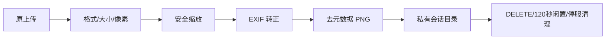

# 20 安全、隐私与许可

> 文档基线：2026-11-19；代码基线为 Git `27b41f6` 加当前未提交工作区。代码、部署和真机状态分层记录，以当前源码与实际证据为准。

## 20.1 数据分类

高敏感：

- 患者照片；
- 面部和背景；
- 姓名/病历号；
- 可关联的标注组合。

中敏感：

- 时间序列；
- 临时会话 token；
- 服务器日志；
- 设备错误信息。

公开/低敏感：

- 合成几何；
- 公开授权图谱；
- 无个人信息的模板图片。

## 20.2 最小采集

核心几何匹配不需要姓名、电话、证件或病历号。不得为了未来用途提前收集。

AI 照片只有在用户明确需要时上传，并保留手动标注替代路径。

## 20.3 临时照片安全

保护：

- 随机会话 ID；
- 256 位能力 token；
- 服务端只存 token 摘要；
- 无静态目录公开；
- `Cache-Control: no-store`；
- 禁止跨会话 owner；
- 日志不打印照片和载荷；
- 用户可取消并删除；
- 放置页 ready 后自动删除。

## 20.4 HTTP 风险

公网 IP 测试使用 HTTP：

- Bearer 和照片不加密；
- 只能公开/合成图片；
- 不能用于真实患者；
- 不是正式上线方案；
- 关闭测试入口应移除额外暴露面。

正式发布必须有 HTTPS 和微信合法域名。

## 20.5 鉴权不是身份认证

公网 `access/session`：

- 防止随意跨会话读取；
- 生成随机 principal；
- 不证明微信账号、开发调试或用户身份；
- 任何能访问该 URL 的客户端都可尝试；
- 依赖限流、容量和运维关闭。

## 20.6 服务器保护

- 独立低权限 systemd 用户；
- 代码/venv root 只读；
- 运行目录可写；
- 临时目录 0700；
- 单 worker；
- 单推理槽；
- CPU/内存/swap cgroup；
- OOM policy stop；
- 禁止公网直连 8001；
- 原针灸服务隔离。

## 20.7 许可

| 数据/资源 | 许可 | 注意 |
| --- | --- | --- |
| Commons 人体图 | CC0 | 仍需保留来源审计 |
| Goran 图谱 | CC BY-SA 4.0 | 署名和同许可分享 |
| Servier 历史手部 | CC BY 4.0 | 署名；独立手掌已退役 |
| MobileSAM | Apache 2.0 | 官方源和模型声明 |
| 人工腋下/会阴模拟 | 项目 CC0 声明 | 不代表医学来源 |

许可合法不等于医学边界正确。来源与审核是两个门禁。

## 20.8 Git 禁止项

不提交：

- 患者照片；
- `private-data/`；
- token/session；
- 模型权重；
- `.venv`；
- node_modules；
- 原始 AI 输出；
- 本机微信私有配置；
- SSH 私钥。

`.gitignore` 只是防线之一，不能从历史移除已经提交的敏感数据。

## 20.9 日志

安全日志可以记录：

- 路由；
- 状态；
- 技术错误码；
- 耗时；
- 会话 ID 的必要脱敏摘要。

不得记录：

- Authorization；
- x-ai-session-key；
- 原始照片；
- Base64；
- 完整提示/几何；
- 用户身份。

## 20.10 删除保证

当前可保证应用层删除：

- 原上传临时文件；
- 派生照片；
- Mask；
- alpha；
- Python 内存索引；
- 会话目录。

不能保证：

- 云盘物理安全擦除；
- 微信平台系统缓存；
- 基础设施备份过期前的副本；
- 调试器或网络代理截图。

这些限制必须向真实数据使用者说明。
