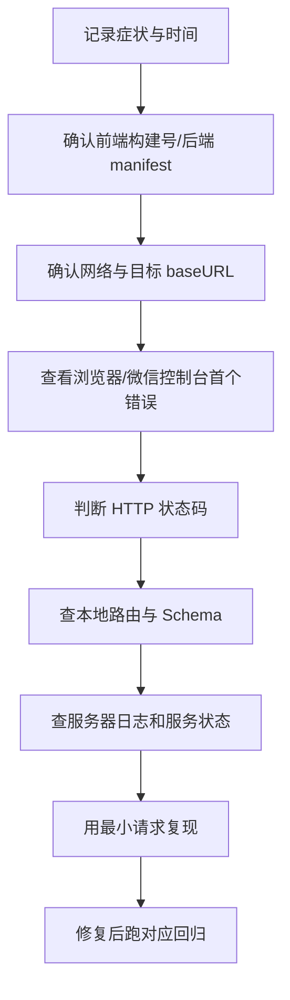

# 23 维护与故障排查

> 文档基线：2026-11-19。排障时先确认版本，再判断代码；旧体验包、旧云端和当前工作区经常表现不同。

## 23.1 通用排障顺序



每次排障先收集：

- 前端环境：develop/trial/release；
- 页面路由；
- 设备、微信版本、基础库；
- 后端地址的主机与路径前缀，不在报告中粘贴 token；
- 请求方法、路径、状态码、业务 code；
- 时间点与是否可重复；
- 是否使用公开/合成图片；
- 对应 Git 或体验版号。

不要先把问题归因于“微信限制”或“服务器慢”。必须看到实际请求是否发出、后端是否收到、Canvas 是否测到尺寸。

## 23.2 本地检查命令

```bash
cd miniprogram
npm run typecheck
npm test
```

```bash
python3 scripts/check_project.py
python3 scripts/sync_atlas.py --check
python3 scripts/check_miniprogram_packages.py
git diff --check
```

后端和 AI：

```bash
DERMATOME_ENV=test \
ENABLE_REFERENCE_MATCHING=1 \
ENABLE_AI_SEGMENTATION=1 \
PYTHONPATH=backend:. \
ai/.venv/bin/python -m pytest backend/tests ai/tests -q
```

若缺少 `ENABLE_REFERENCE_MATCHING=1`，会阴模拟测试会按门禁拒绝。先核对命令是否与 `docs/validation-records/v6.7-perineum/tests.md`、`docs/handover/19-testing-and-validation.md` 一致。

## 23.3 网络与鉴权

### 小程序提示无法连接后端或超时

排查：

1. `services/api.ts` 和 trial/develop 环境配置是否解析到正确 baseURL；
2. 后端 `/api/v1/health` 是否返回；
3. 微信工具是否校验证书/域名；
4. 体验版是否仍有旧 baseURL；
5. 请求是否经过 `/dermatome-test` 路径前缀；
6. 是否有网关 502/504；
7. 手机网络能否访问同一地址。

### 返回 401/403

可能原因：

- 受控环境缺少 Bearer；
- trial session 获取失败；
- Origin 被拒绝；
- AI 创建/上传/分割的 `x-ai-session-key` 缺失；
- 不是同一 owner/principal；
- release 环境未开放。

处理：

- 先调用 access session 获取短时访问，不把 token 写入源码、日志或文档；
- 确认 `wx.request` 与 `wx.uploadFile` 使用同一入口和认证；
- 401 不应被包装成“照片损坏”；
- 不要为排障关闭服务器鉴权。

### 返回 409 VERSION_MISMATCH

含义：模板、几何、区域集、atlas 或内容 SHA 不一致。

检查：

- 小程序发送的 identity；
- 后端实际 atlas manifest；
- `template_version`；
- `geometry_id`、`region_set_id`；
- `atlas_content_sha256`；
- body/atlas 文件是否只更新了一半。

处理：前后端一起更新，失败关闭。不要通过忽略 hash 字段临时“修好”。

### 返回 422

常见类别：

- 请求字段缺失；
- `vertices`/`geometry` 同时或都未提供；
- 坐标非有限值或越界；
- view 不支持；
- 备注/提示 revision 过期；
- body-intersection 使用错误坐标空间。

先查看响应 `error.code` 和 `field`，再查 `backend/app/schemas/` 与 `miniprogram/types/dermatome.ts`。历史上的 `POST /evaluate 422` 曾因本机运行旧后端、页面请求新字段引起；不能只改前端提示。

### 返回 429

可能：

- AI 并发槽已满；
- 上传/创建速率超限；
- 单用户会话容量已满。

不应无限自动重试。建议用户稍后重试，并检查服务端当前推理耗时与单槽状态。

### 返回 410 AI_SESSION_GONE

原因：

- 用户确认放置后已主动删除；
- 空闲超过 120 秒；
- 登录/owner 不匹配；
- 服务重启后无有效状态；
- 迟到的 segment/confirm 请求。

放置与匹配应使用本地已复制几何，不应继续依赖已删除照片。若页面仍要取照片，属于生命周期衔接 bug。

## 23.4 图片选择与上传

### 看到“10 MiB / 300 万像素”旧提示

先确认构建版本。当前工作区的 P8/P8.1 与 P12.1 已使用不同配置：

- 前端原图接收目标：50 MiB、5000 万像素；
- 上传图：8 MiB、300 万像素、最长边 1920；
- Canvas 安全预算：20 MiB、1600 万像素、单边 8192；
- FastAPI 实际文件上限：50 MiB；
- 源图安全上限：5000 万像素；
- MobileSAM 推理继续缩到受控尺寸。

如果手机仍显示旧文案，多半是旧体验包或旧前端构建，而不是当前限制继续生效。

### 照片损坏或格式不支持

检查：

- 文件是否真能解码；
- 扩展名与 MIME 是否伪装；
- EXIF 是否损坏；
- 是否为纯 HEIC；
- PNG/WebP 是否超出设备 Canvas 安全预算；
- 是否截断；
- 压缩后的实际文件是否小于上限。

当前纯 HEIC 明确要求转存 JPEG，不应声称已全面支持所有手机原生格式。

### 403/400 来自 Nginx 大小限制

查看实际 Nginx `client_max_body_size`。当前本地模板为 AI 路径 51 MiB，但生产是否同步必须核实。不要把全站无限放大；原针灸路径不应被改动。

### 自动缩图后仍是原宽度或方向错误

检查：

- `wx.compressImage` 的实际支持字段；
- `compressedWidth/compressedHeight` 的基础库要求；
- Android/iOS 格式差异；
- EXIF 是否在缩放前被读取；
- 交互坐标基准是否已切换为处理图；
- `photo_oriented_normalized_v1` 的宽高是否更新。

不要用屏幕像素修改模型原图坐标。

## 23.5 MobileSAM

### 模型加载失败

检查：

- 权重文件是否存在且大小约 40.7 MB；
- 权重 SHA/state dict 校验；
- MobileSAM source commit；
- AI venv 的 PyTorch/timm 版本；
- 是否误用 backend venv；
- 模型路径是否依赖本机绝对路径；
- 内存是否足够。

### 首个 Mask 很慢、后续较快或再次框选又慢

当前没有嵌入式特征缓存。同一图片改变提示可能重新编码。请区分：

- 图片编码；
- 提示编码；
- Mask 解码；
- 后处理与 Polygon；
- 网络上传；
- 前端 Canvas。

不要在报告里只写一个总耗时而不分阶段。

### Mask 覆盖正常皮肤

先保留原图、提示、原 Mask、叠加图和最终 MultiPolygon。检查：

- 框是否过大；
- 前景/背景是否反转；
- 是否自动采用最高分；
- 是否把整片皮肤背景误当目标；
- 轮廓转换是否填孔；
- 形态学操作是否连接碎片。

当前设计是 AI 候选加人工确认，不能直接声称最高分就是病灶。

### 候选 Mask 与照片错位

检查 `displayRect` 是否与照片等比 contain 一致；同时检查处理图宽高、EXIF 方向、DPR 和触摸坐标逆变换。Mask 与照片必须共用同一显示矩形。

## 23.6 人体放置

### “正在准备人体轮廓”长时间不结束

不是单纯加载人体 PNG。该阶段包括：

- 源 MultiPolygon 拓扑校验；
- 包围盒与变换中心；
- 照片坐标到人体坐标；
- 完整人体边界与人体孔洞检查；
- 放置页首帧。

历史复杂样本有 389 片区、301 孔洞、6018 顶点，旧路径约 23 秒。P11.2 已加入源指纹缓存、快速可信路径和空间分桶，但 2000 孔洞极端样本仍可能需要更多时间。

检查：

- 是否运行旧前端；
- 是否重复进行同一源校验；
- 是否有 1000+ 孔洞；
- 控制台是否出现首次 8 秒等待和一次自动恢复；
- Canvas 是否 width/height 为 0；
- 后端 body-intersection 是否超时。

### 拖动不跟手

确认 `touchmove` 只更新本地 transform 与预览 Canvas，不每帧跨页面执行完整几何校验或 setData。检查：

- `placement-overlay` RAF 调度；
- 基础贴图缓存；
- revision 是否在每次移动递增；
- 是否每帧重建 OffscreenCanvas；
- touchend 是否被事件队列积压。

### 确认位置不可点击

按钮需要同时满足：

```text
valid && viewport && overlayReady && !dragging && !dialog && !calculating
```

逐项检查：

- touchend 是否已执行、`dragging=false`；
- overlay 是否发布当前 revision 的 ready；
- layout revision 是否匹配；
- 人体是否完全/部分越界；
- 部分越界是否等待用户确认；
- 是否仍显示阻塞 loading。

### 只显示局部人体 / 大屏仍是单栏

当前放置页应从当前正/背面的完整人体开始，粗 region 只作上下文。大屏使用显式宽屏断点恢复 5:3 双栏。检查页面自身 WXSS 是否又把 `50vh/max-height` 覆盖到宽屏规则。

## 23.7 Canvas

### 结果页报“画布显示失败”或重试不消失

首先检查控制台尺寸：

```text
[body-canvas] waiting for layout {width:0,height:...}
[body-canvas] render failed: layout-width-or-height-unavailable
```

零宽不是图谱错误。检查：

- Canvas 父容器 flex/width；
- `.result-stage` 宽屏规则；
- `min-width: 0`；
- scroll-view 是否挤压 Canvas；
- 页面 resize 后是否重测；
- PNG 缺失时是否矢量兜底；
- `createImage()` 是否可用。

### PNG 加载失败

当前应以冻结人体轮廓矢量继续显示，并提供“重新显示”资源重试。旧基础库缺少 `getWindowInfo()` 或 `createImage()` 时有安全降级；若仍报错，记录基础库版本和实际异常。

### 页面上下滚动带着人体移动

当前页面应使用固定工作台与内部 scroll-view。检查：

- `disableScroll`；
- 根容器 `100vh`；
- 人体工作区高度稳定；
- 结果面板独立滚动；
- Canvas 是否 `catchtouchmove`；
- 小屏是否存在高于工作区的 min-height。

## 23.8 图谱匹配

### “当前视图尚未支持”

通常表示后端没加载当前 view/atlas，而非按钮完全没发请求。检查请求是否到达、`VIEW_UNSUPPORTED` 或旧前端请求了后端尚无的 view。

### `ATLAS_NOT_READY`

图谱 manifest 存在但目标几何/区域未配置。不要用前端假高亮绕过。查看 atlas service 和 view manifest。

### 匹配为空

有效情况：病灶不覆盖图谱、只接触边界、视图不匹配。检查：

- 病灶是否在有效皮肤内；
- 是否来自另一面；
- atlas 区域是否未覆盖该部位；
- intersection 面积是否为零；
- 前后端 view 是否一致。

不要自动分配给最近区域。

### 彩色区域不显示但标签存在

检查 scene/view 是否匹配、高亮 region ids 是否存在、结果 Canvas 是否零宽、图谱是否在客户端缩放后超出有效皮肤轮廓。标签与高亮应来自同一候选数据。

### 版本不一致

比较 identity 全部字段，不只 atlas 名称。任何 SHA、模板或 geometry 变化都应 409。

## 23.9 微信分包与上传

### 上传超过 2 MB

先运行：

```bash
python3 scripts/check_miniprogram_packages.py
```

检查主包是否误含大图谱、特殊部位 PNG、原始 SVG、测试或文档。当前包体保守基线见 `03-current-progress.md`。

不要把大资源移到主包或跨分包非法引用。新增资源后重新检查分包间 JS/组件/静态路径。

### 上传成功但手机仍是旧功能

上传成功不等于体验版更新。需要在微信公众平台把该版本设为体验版，并在手机重新打开。记录版本号、上传时间和页面可见版本证据。

## 23.10 服务器

### `dermatome.service` 启动失败

检查：

- `PYTHONPATH` 是否指向发布根目录，使 `app.utils` 可导入；
- backend venv 与 AI venv 是否混用；
- atlas/data 路径是否存在；
- 模型权重是否在这里被错误地设为核心启动依赖；
- `AI_IDLE_SECONDS` 是否被旧 env 覆盖；
- systemd 工作目录和临时目录权限；
- 端口 8001 是否只绑定回环。

### 公网仍不可用

依次检查：

1. systemd active；
2. 本机 `127.0.0.1:8001/health`；
3. Nginx `nginx -t`；
4. location 前缀；
5. 安全组是否只开放预期的 80/443；
6. access/Origin/速率限制；
7. 客户端 baseURL 是否仍指向旧地址。

不要直接开放 8001。

### 与针灸项目冲突

核对：

- `acupuncture.service` PID/启动时间；
- `dermatome.service` PID；
- 8000/8001 监听；
- Nginx site 是否独立；
- 部署清单是否误包含针灸文件；
- 回滚是否只作用于 dermatome。

任何需要重启针灸服务的部署都不属于当前安全流程。

## 23.11 何时升级为 BLOCKED

以下情形应停止猜测：

- 无服务器访问和实际版本证据；
- 无有效合法/授权图片；
- 图谱来源或医学审核缺失；
- 微信后台权限不可用；
- token/密钥缺失且无法安全取得；
- 真机不可用；
- 数据导致 OOM 且无安全上限证据。

记录 `BLOCKED`、缺少的最少信息和可以继续完成的本地工作。
