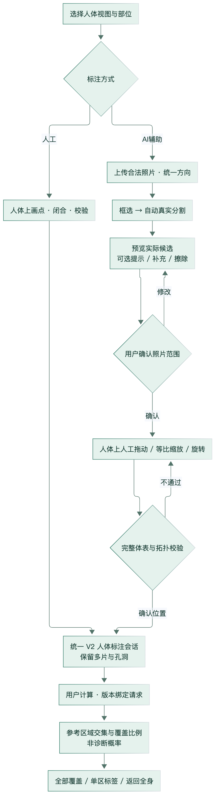
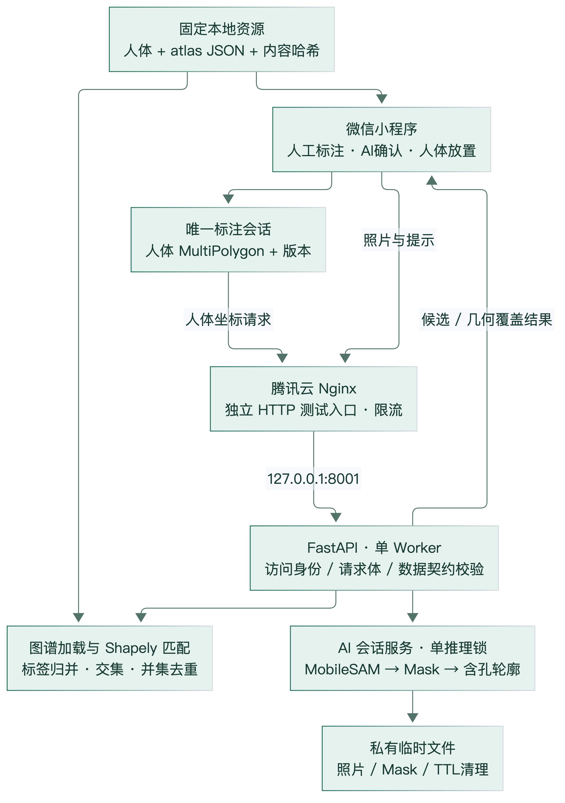

# 01 系统完整技术报告

## 1. 审计对象与研究定位

项目原名称“图像识别带状疱疹部位对应的神经节段”容易被理解成自动诊断和自动定位。根据当前实现，更准确的技术表述为：**人工或 AI 辅助获取疑似皮肤病灶范围，经用户指定标准人体上的位置后，进行参考感觉分布图谱的二维几何对应分析**。照片分割、人体放置、图谱匹配是三个独立环节。

审计以 2026-11-02 工作区为准，涵盖原生小程序、FastAPI、AI 模块、图谱制作脚本、实验及腾讯云部署记录。当前业务路径已贯通 V5.4；V5.5、病例持久化、临床确诊和自动照片配准没有实现。本次不改业务、模型、图谱或服务，只生成文档并进行本地回归及只读服务器核验。证据详见 [索引 E01～E30](技术结论与证据索引.md)。

## 2. 背景与问题

带状疱疹的皮疹常呈一个或两个相邻皮节的分布，常见于躯干或面部；亦存在非典型及播散表现。皮疹形态、病史和临床鉴别不能由一个二维位置比值替代。此处背景只支持研究动机，不提供个体诊疗判断。[CDC，Clinical Features of Shingles](https://www.cdc.gov/shingles/hcp/clinical-signs/index.html)。

皮节图具有参考作用，但常见图谱之间存在差异，相邻重叠与个体变异应纳入解释。Lee 等的综述讨论这些局限；本系统没有复制该综述的图，也没有采用其数据重建边界。[Lee、McPhee、Stringer，2008](https://pubmed.ncbi.nlm.nih.gov/18470936/)。

工程问题有三项。第一，照片中的局部皮肤缺乏足够全身解剖参照，不能直接确定标准人体位置。第二，手工描绘多个离散皮损费时且可能丢失小片、孔洞及相对位置。第三，外部感觉图谱与中性人体模板的体型和姿态不同，直接叠图会出现区域错位。项目分别通过显式人工定位、交互式候选分割和离线工程配准处理；这些措施是否提高医疗质量仍待独立研究。

## 3. 需求与当前完成边界

| 需求 | 当前实现 | 证据/边界 |
|---|---|---|
| 正背面统一浏览及粗部位选择 | 本地 PNG、16 个独立 UI 区域、实际轮廓命中、放大复位 | A；不是医学分区 |
| 手工多片标注 | 逐点、撤销、闭合、删除、两面独立、运行内会话 | A；不保证进程退出后恢复 |
| 交互式分割 | 上传后拖框自动推理；可精细提示、换候选、补充/擦除 | A；无疾病分类头、须人工确认 |
| 人体放置 | 整组平移、等比缩放、旋转、完整包含验证、原子提交 | A；位置和尺寸由人确定 |
| 参考匹配 | 完整 Polygon/MultiPolygon 输入、并集/交集、未覆盖和多候选 | A；比例非诊断概率 |
| 连续结果展示 | 原人体画布、全量覆盖、侧栏单区/全部、编辑失效 | A；真机性能尚未完整实测 |
| 防止错版和迟到结果 | 模板/图谱摘要、几何修订、请求代次、候选修订 | A；工程一致性保护 |
| 临时文件安全 | 限额、会话隔离、TTL、取消、摘要 token、单推理槽 | A；当前 HTTP 调试不适合患者照片 |
| 临床正确性和易用性效果 | 无专家真值、独立临床队列或受试者对照 | B/C；不得写准确率或节时百分比 |

性能目标是降低交互重复计算而不改变最终形状；不是承诺固定 FPS。资源目标是在已有小型云主机上隔离运行，不干扰原服务；短时健康探针不能替代并发业务容量验收。

## 4. 整体业务流程

图2为据当前状态模块绘制的工程流程，非临床决策图。源文件：[Mermaid](figures/complete-workflow.mmd)；实现依据 E07、E08、E13、E14。

**人工路径**：选择 front/back 与粗区域→在人体上点击→验证并闭合→多片会话复核→显式计算。粗区域提供导航与查看窗口，不裁切病灶、不限制输出标签，也不作为病灶所属神经的先验。

**AI 路径**：上传公开/合成测试照片→服务器统一 EXIF→显示同一方向照片→框选→真实 MobileSAM→候选预览→必要时补圈/前景背景提示/画笔修正→人工确认照片范围→人体页调整平移/大小/角度→完整合法性检查→写入 V2→调用同一匹配入口。模型仅产生形状候选；用户完成两次不同确认，分别负责照片范围与人体位置。

**匹配路径**：仅提交已确认人体空间几何与版本身份；后端加载同版图谱、核验人体包含后求交。正背面分别汇总，允许多标签或零标签，不用最近区域补出“答案”。

**显示路径**：病灶是棕色轮廓，彩色覆盖是返回候选的完整参考区域，两者不是同一几何。默认展示本次全部匹配区域，标签切换在前端完成，不再次推理。改变正式标注使旧结果失效，显示视口变化不改变几何。

## 5. 模块与实现

图1来源：实际源码与部署定义；[可编辑源](figures/system-architecture.mmd)。没有数据库、Redis、Kubernetes、外部付费 AI 或自动诊断服务。

### 5.1 前端

原生 TypeScript/WXML/WXSS 与 Canvas 2D。select 管理粗部位；annotate 集成手画、管理、复核和结果；ai-annotate 管理照片候选；placement 管理人工位置。result 保留旧路由重定向，atlas-debug 是开发专用预览。annotationSession 是正式人体几何的唯一权威，其他页面持有派生快照。

照片与透明层共用 contain 矩形；人体底图、标注及图谱共用 ViewportTransform。贴片移动过程中使用一次生成的透明预览缓存，只变换少量参数；松手与正式保存恢复完整几何校验。缓存分辨率不决定正式轮廓精度。

### 5.2 后端与 AI

FastAPI 的边界中间件限制环境、权限和真实正文大小；Pydantic 拒绝额外字段、非法坐标与复杂度。匹配不依赖模型加载；AI 适配器按需加载一份 MobileSAM，通过互斥锁顺序使用有状态 Predictor。照片会话在受控云端用私有临时快照支持停启恢复，仍固定到期，不等同病例数据库。

### 5.3 图谱

规范数据在 goran-2022-preview-v2，前端副本由确定性脚本生成，后端逐次核验七项输入摘要。现为正面 27 标签/54 实例，背面 30 标签/60 实例，共 134 个多边形片、17 个孔。图谱 CC BY-SA 4.0，人体背景 CC0，许可分开；全部图谱医审 pending、mappingEnabled=false。在显式测试环境可进行参考几何计算，不表示通过正式医学准入。

## 6. 核心算法及输入输出

| 算法 | 输入 | 核心处理 | 输出 |
|---|---|---|---|
| 图谱制作 | 固定 SVG、人工标签对应、配准控制行、模板轮廓 | 解析填充/绘制顺序、单调截面映射、局部锚点、显式表面排除 | 版本化含孔 MultiPolygon；不是自动学得医学边界 |
| AI 分割 | 已定向 RGB、框/点 | 全图或上下文裁剪→vit_t→三个替代候选→提示异常检查 | 原图尺寸 Mask；待人工确认 |
| 无损轮廓 | 二值 Mask | 前景像素格行区段求并集、环定向、无损简化检查 | 照片归一化 MultiPolygon |
| 人体放置 | 照片几何/宽高、共同中心、人工参数 | 像素度量中的相似变换→人体归一化 | 完整人体几何，保留片区与孔洞 |
| 参考匹配 | 人体几何及版号/摘要 | 同键图谱并集、交集、同面病灶并集、差集 | 每标签覆盖、总覆盖、未覆盖与实例关联 |

设病灶区域为 \(L\)，同标签/侧别/视图/类型图谱并集为 \(D_i\)，则当前候选比例：
\[
r_i=\frac{|L\cap D_i|}{|L|}.
\]
这是模板二维面积比；不能称患病概率、真实皮肤面积或深部神经节位置。完整变换、覆盖与数值规则见 [04](04-坐标转换与几何匹配.md)。

## 7. 已有验证与结果

本次重新执行前端 298 项、Python 后端与 AI 合计 180 项，均通过；7 条已有上游 warning 保留，类型检查通过。不同阶段的历史测试量不累加。单元测试大部分使用合成几何/受控替身，真实模型证据须另看实验输出。

V5.1 的真实实验有三张公开源照片，其中两张是同一病例近景/远景，另有两张合成图；九组主实验、27 个候选。后续过度分割专项复用这些来源，19 次流程、21 次 predict、57 个候选。不是新增 19 个病例。公开照片高分候选覆盖正常样皮肤的问题仍在，无专家真值，医学 Dice/IoU 为 NOT_MEASURED。

云端最近完整 HTTP 记录使用真实 trial 配置与页面适配器：两次 MobileSAM 请求 6.422s（含冷加载）和 3.311s；两次匹配 328.7ms 和 347.6ms。确认后的 10 片、12 孔、770 点经 70%/25°人体放置保持，AI/人工同几何的匹配响应相等。网络和平台适配属于这些时间，不可与本机纯模型时间直接比较。

本次只读服务器复核确认 Ubuntu 24.04.4、4 逻辑 CPU、3.64GiB RAM，两个独立服务及 Nginx active，8000/8001 均只在回环监听。没有新推理、压测或服务变更。本阶段手机体验版完整流程仍 NOT_RUN，用户尚未提供新构建真机验收证据。

## 8. 讨论

系统的工程价值在于将形状提取、人工定位、版本一致性与可解释求交串成一个可复现链条，而不是提出新分割网络。完整保留多片和孔洞可以避免凸包、填洞或首环适配导致的几何偏差，但**保真于预测不等于预测正确**。

误差至少分为照片分割、人工位置/尺度/方向、图谱配准、参考图谱个体差异及显示触摸五层。任一层都可能改变候选标签；前端测试不验证图谱解剖正确，图谱合法性不验证操作者放置正确。应单独设计真值与误差分解。

局部裁剪可提高目标在网络输入中的占比，但上下文边缘会截断目标；现有样本未证明总体质量改善。画笔修正使用户能够修改真实像素，仍需要用户识别目标，不能称“自动修复”。复杂轮廓松手时完整校验仍可能卡顿，实际开发工具 2207 点记录约 0.58～0.65s。

当前公开 IP HTTP 入口采用自动临时会话，具有隔离与限流，但没有传输加密，也不证明微信身份或访问资格。仅可公开/合成测试；与正式研究数据安全条件差距须如实呈现。

## 9. 结论

项目已有可写入技术论文的方法和实现：可追溯图谱工程化、交互式候选分割与无损轮廓、人工相似变换放置、统一二维集合运算、状态/版本保护及小程序云端集成。现有证据支持工程可行性和特定测试条件下正确运行；不支持临床准确性、普遍分割改善、自动神经定位或长期真机稳定性。投稿前的优先研究见 [10](10-研究缺口与实验建议.md)。
