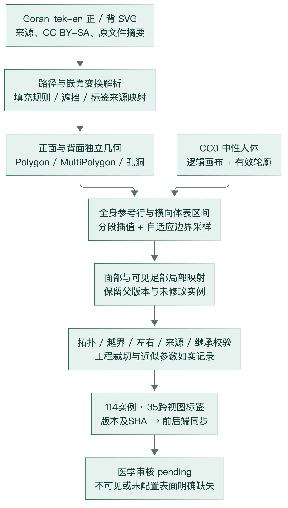
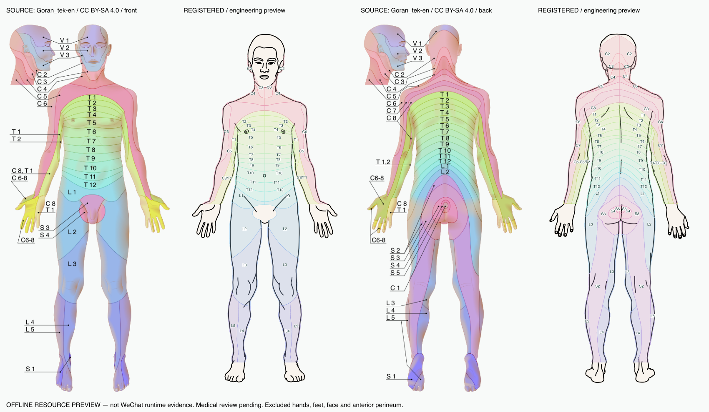

# 02 神经参考图谱构建、配准与质量控制

## 1. 医学术语与本系统表达能力

| 概念 | 本文使用含义 | 不应作的等同 |
|---|---|---|
| 神经节 | 周围神经系统的神经元胞体聚集结构 | 二维表皮着色块不是深部神经节坐标 |
| 神经/脊髓节段 | 按节段编号组织的神经解剖概念 | C/T/L/S 标签不意味着系统直接观察了脊髓或神经根 |
| 脊神经皮节 | 与脊神经根感觉分布有关的皮肤参考区域 | 不是无重叠、无个体差异的固定行政边界 |
| 外周皮神经分布区 | 特定周围神经在皮肤的感觉分布 | 神经丛混合节段后不能与单根皮节互换 |
| 三叉神经感觉分支 | V1 眼支、V2 上颌支、V3 下颌支感觉区域 | 不是脊神经，也不是面神经 VII |

术语依据：[OpenStax 周围神经系统](https://openstax.org/books/anatomy-and-physiology-2e/pages/13-4-the-peripheral-nervous-system)、[三叉神经说明](https://my.clevelandclinic.org/health/body/21581-trigeminal-nerve)、[Lee 等综述](https://pubmed.ncbi.nlm.nih.gov/18470936/)。这里只限定概念，不以网页描述推导新的皮节轮廓。

系统类型只有 spinal_dermatome、spinal_dermatome_composite、trigeminal_sensory；没有实现独立外周皮神经图。标题使用“神经参考区域”时须注明这一异质性。

## 2. 实际来源与模板

皮节来源为 Goran_tek-en 的同套 2022-09-24 男性正背面 SVG，原尺寸分别 440×955、424×955。文件页为自作并注明参考信息来自 Rob Hurt；这不等于 Rob Hurt 审核过本项目。2026-11-02 再次核验具体[正面](https://commons.wikimedia.org/wiki/File:Dermatomes_labeled,_male_front_3d-shaded.svg)、[背面](https://commons.wikimedia.org/wiki/File:Dermatomes_labeled,_male_back_3d-shaded.svg)的作者、日期和 CC BY-SA 4.0。

固定本地源位于 docs/research/v3-atlas，原文件 SHA1 分别 d20be473843591779be22c102e193d8c1407861d、261566ce5128fdc2cc536945c148ac1c8f62e66d。具体 SHA256 另见本次文件清单。文件格式、完整正背与标签有利于矢量提取，不代表其为唯一医学标准。

目标是 Šlomo 的 [Human body with blank labels.svg](https://commons.wikimedia.org/wiki/File:Human_body_with_blank_labels.svg) 派生中性模板，CC0。实际组 g5692（正）/g5815（背）分别提取，不镜像；等比缩放 1.1491108071135432，垂直平移 8.16689466484268，各自水平居中。逻辑 400×900，运行 PNG 1200×2700。模板 commons-neutral-v1/4.0.0，geometry commons-blank-cc0-v1，UI 区域修订 ui-regions-2。背景和医学图谱来源不同，必须配准。

人体整体命中边界来自背景栅格 alpha 阈值 24、3×3 闭运算连接线稿微隙、外部漫水与 0.3 逻辑单位简化。**这一步是人体素材轮廓制作；AI 病灶 Mask 后处理没有同样的闭运算。** 混淆两者会错误解释过度分割。

## 3. 当前版本与完整清单

| 视图 | 标签 | 左右实例 | 多边形片 | 孔洞 | 顶点（包含闭合点） |
|---|---:|---:|---:|---:|---:|
| 正面 | 27 | 54 | 63 | 15 | 18051 |
| 背面 | 30 | 60 | 71 | 2 | 11705 |
| 两面总计 | 标签并集 35，不能直接用 27+30 | 114 | 134 | 17 | 29756 |

本次从 front/back JSON 重算，见 [统计](audit/atlas-statistics.json)、[全部标签及 114 实例](附录-完整神经区域清单.md)、[CSV](附录-神经标签统计.csv)。正面类型实例为脊神经46、组合2、三叉6；背面为脊神经56、组合4。所有实例左右成对，但保留实际两侧源形状，不复制镜像。组合 C8/T1、C6-C8、T1/T2 整体保留，不能拆成可加和的独立节段。

旧 preview.1 为正面23标签46实例、背面30标签60实例；preview.2 新增正面 V1/V2/V3 各双侧和 S1 双侧，L4/L5 既有四个实例追加足部形状。旧106实例中的102实例几何不变，四个实例扩展，不把扩展再计一个标签。

当前 manifest：sourceLicenseStatus=verified，technicalValidationStatus=passed_offline_geometry，medicalReviewStatus=pending，mappingEnabled=false。空的 data/atlas/v1 仍保留未验证禁用状态，不能与可进行显式测试计算的 preview.2 混为一份数据。

## 4. SVG 到有效区域

图6来源 E02～E05，原图及派生几何遵守 CC BY-SA 4.0；流程示意为本次按代码整理，[源文件](figures/atlas-registration.mmd)。

svg_geometry.py 将 transform 矩阵沿嵌套组相乘，解析实际使用的 path 命令并自适应细分曲线。立方 Bézier 控制点到弦的偏离阈值为0.12源单位；二次/平滑命令转换为对应曲线。filled_geometry 通过线网 polygonize、绕数/奇偶规则恢复有效面，不把每个闭环都当实体。

source_paths 提取源图主人体填色路径，前/背各42/50条；逐路径 source-map 人工核对文本和引线端点，排除头侧插图、隐藏图层、装饰与歧义区域。不是 OCR 自动识别，也不是颜色分类网络。按 SVG 逆绘制顺序扣除被上层覆盖的面积，得到实际可见区域，保留孔和多片。

每个实例记录 id、labelId、sourceLabel、partitionType、view、解剖 side、templateId/version/geometryId、sourceRefs、sourcePathIndices、geometry 与 medicalReviewStatus。GeoJSON 形状的 MultiPolygon 使用归一化点对；每片首环外环、后续孔洞，显式首尾闭合，外环/孔环方向相反适配 Canvas nonzero。不是经纬度。

## 5. 全身工程配准：单调截面映射

实际方法不是一张全局仿射矩阵、TPS、学习式配准或自动解剖识别。prepare_atlas.py 利用完整源人体底层轮廓与目标轮廓，在已登记纵向解剖控制行之间插值高度；每0.5源单位扫描连续体表段。只有源/目标截面段数相同且锚点顺序严格递增的行进入 trusted。

同一连续体表段取左端、中点、右端对应，定义该行分段线性横向函数 \(f_j(x)\)。设相邻可信行高度为 \(y_j,y_{j+1}\)，纵向控制插值为 \(g(y)\)，则源码的全身映射为：
\[
t=\frac{y-y_j}{y_{j+1}-y_j},\qquad
W(x,y)=((1-t)f_j(x)+t f_{j+1}(x),\,g(y)).
\]
各面分别建立 trusted 与 g；源/目标截面段的匹配和控制行由工程配置决定，不能将“顺序保持”解释成“解剖已准确”。

源环先按最长0.5单位间隔分段，再自适应细分，目标弦偏离阈值0.001逻辑像素，最大递归16。映射后显式与目标体表求交，同时记录裁切**之前**的超出面积。父版正/背约58.155/107.350逻辑像素²，不应以裁后合法倒推配准正确。

父版确有数值碎片过滤：源片面积>0.001源平方单位、分侧后>0.00001逻辑平方单位；目标简化0.01逻辑单位，并以 Hausdorff 距离复核、必要时0.003或不简化。它与 AI Mask 的无损像素并集不是同一算法，也不能宣传“所有历史图谱路径绝对无损”。归一化坐标舍入到10位小数。目标中线 x=200 为本模板专属登记值；分侧后正面屏幕左=人体右，背面屏幕左=人体左。

## 6. 面部和足部局部映射

prepare_atlas_extensions.py 在固定父版输出上增量生成 preview.2，先校验父版十文件 SHA。面部路径13/14/16分别经原引线核实为V1/V2/V3，足部36/37/38/41关联L4/S1/L5；路径索引不是元素ID。

面部采用眼、鼻、口、下颌多行局部锚点：例如眼高66.5→102、鼻90.5→123、口104→135、下颌129.386→160.6。row_warp **先在上下行间插值对应的 x 锚点位置，再对当前 x 作分段线性映射**，与上节先计算 f_j 的写法有具体差异，不能混称同一个公式。

每足独立从截面构建左右端与中点，踝线842→820，随后各行匹配足背/趾面。新增环最大初分间隔0.25源单位、目标误差0.001、递归18；新局部片不按面积删小片且不简化，但仍有显式不支持表面排除与父版冲突扣除。L4/L5在踝线上做合法并集。

头发、可见眼球开口、闭口缝隙、保守耳部窗口等排除是支持范围限制，不是新造的神经边界。sourceVisibleAreaBeforeSideSplit在双侧报告可重复引用，不能相加作双倍源面积。

## 7. 质量控制与证据边界

1. 固定源、标签对应、父版、目标与制作配置的指纹；确定性同步到前端。
2. 检查几何非空、有限、闭合、自交、孔洞、MultiPolygon拓扑、类型/视图/侧别/版本绑定。
3. 检查裁前超界、简化 Hausdorff、体表差集、邻区微重叠及新旧几何差。
4. 独立参考点、原图与目标叠加及局部肩腋/腕踝/面足图，分别记录离线和开发工具证据。
5. 医学审核仍须有审核人、角色、日期、版本与逐区结论；仓库没有这样的完成记录。

父版微重叠及微小越界被明确报告，不能称完全无缝。前后端共用的几何和 source-map 一致性证明了数字化链路，没有证明来源医学边界或目标人体对应的真实误差。

此为历史离线资源对照，不是患者或微信运行截图；Goran_tek-en，CC BY-SA 4.0，经本项目配准。preview.1 历史图只解释基础制作，当前面足增量须查看 [V3.1 记录](../v3.1-atlas.md)及当前JSON，不能据旧图统计新数量。

## 8. 未覆盖和不可见范围

当前仍不配置远端手掌/手指、头侧插图、头发覆盖区、复杂耳部与耳道/口腔、眼球开口、正面会阴、源尾骨位置歧义 C1/Co1、背面足跟等。背面源存在 V1 头皮路径，但目标后脑头发遮挡、无可靠对应；不能写“源图没有V1”。源背面足底/趾腹与目标足跟表面不同，不能把L5/S1足底压成足跟。

正面新增仅限可见足部，不意味着已覆盖完整足底；没有独立足底模板。标签编号缺失不可按序补齐。图谱制作缝隙和表面排除都可能造成未覆盖；“未配置”不表示没有感觉支配。

图谱局限包括男性源迁移到中性模板、二维投影、姿态和体型差异、非自动锚点及缺医审。后续需独立专家关键点/区域审核和不确定边界记录，而不是继续用同一几何求交自证医学正确。
