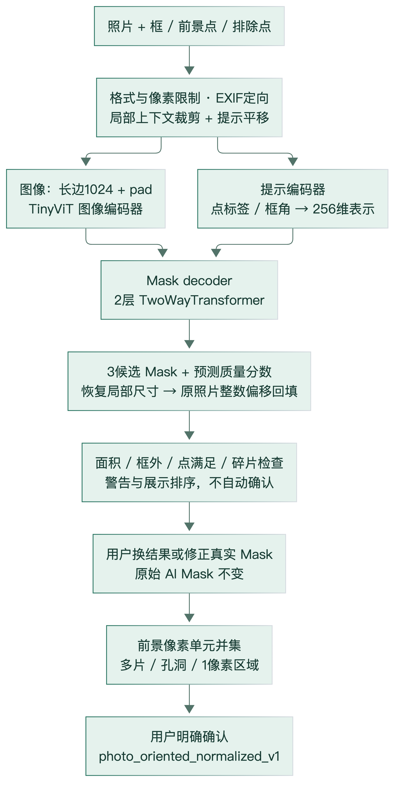
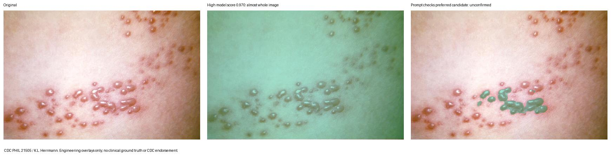
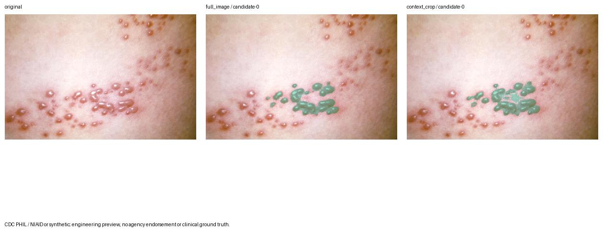
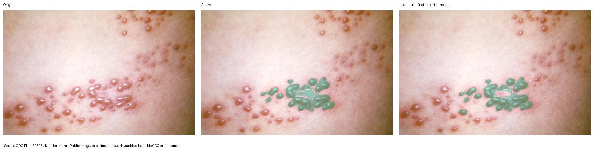

# 03 AI 辅助图像分割：实际模型、算法与局限

## 1. 模型身份与选型证据

当前唯一实际推理模型为 **MobileSAM vit_t，package 1.0**，官方源码 commit：

~~~text
f706ad9c4eb7f219c00d9050e46328518ffb65d2
权重：mobile_sam.pt
字节数：40728226（40.728 MB；38.842 MiB）
SHA256：6dbb90523a35330fedd7f1d3dfc66f995213d81b29a5ca8108dbcdd4e37d6c2f
Git blob SHA1：7ef2d090979fd9853adf17b7a99c8b94a1c5a6a7
许可：Apache-2.0
~~~

加载器 MobileSAM.__init__ 检查字节数与 Git blob，torch.load(weights_only=True)、strict state_dict；先移动到目标设备再 eval，兼顾 TinyViT eval 中的 attention bias 缓存。未下载替代权重、未训练或微调、没有付费远程 AI。[官方固定版本](https://github.com/ChaoningZhang/MobileSAM/tree/f706ad9c4eb7f219c00d9050e46328518ffb65d2)，实现 E06。

模型选择依据是已取得许可的轻量权重、框/点交互接口、原尺寸候选 Mask 输出，以及本机 CPU/MPS、云端 CPU 的真实运行证据。SAM 2 曾被调查，但没有同条件实际对照；不能宣称 MobileSAM 对皮疹“最优”。官方轻量化论文的蒸馏是上游工作，本项目没有执行该训练。[Zhang 等，2023](https://arxiv.org/abs/2306.14289)。

本机固定 Torch2.5.1、Torchvision0.20.1、timm1.0.12、NumPy2.1.3、Pillow11.1.0、Shapely2.1.2；云端为相同版本的 CPU wheel。配置支持 cpu/mps/cuda，auto 由服务适配器选择；当前云端显式 CPU、1线程，CUDA未实测。本机 CPU4线程与云端1核限制不可直接比快慢。

## 2. 实际网络结构

依据固定源码 build_sam_vit_t，而不是从名称推测：

| 部分 | 源码参数 | 职责 |
|---|---|---|
| 图像编码器 | TinyViT，输入1024，embed_dims=[64,128,160,320]，depths=[2,2,6,2]，heads=[2,4,5,10]，windows=[7,7,14,7] | 分层图像特征；内部卷积与窗口注意力 |
| 共享嵌入 | prompt_embed_dim=256，image_embedding_size=64×64 | 连接图像、提示、解码器 |
| 提示编码器 | PromptEncoder，mask_in_chans=16 | 点标签、位置及框角点编码；本项目未提供迭代低分辨率Mask提示 |
| Mask 解码器 | TwoWayTransformer depth2、embedding256、MLP2048、heads8 | 图像/提示双向交互，预测掩膜及质量 |
| 多候选 | num_multimask_outputs=3；IoU head depth3、hidden256 | 三个替代范围及内部质量预测 |

图片特征 \(E=E_I(I)\)，提示特征 \(S,D=E_P(P)\)，解码产生候选低分辨率 logits 与质量估计：
\[
(\ell_1,\ell_2,\ell_3,q_1,q_2,q_3)=D_M(E,S,D).
\]
这是接口层抽象，不是本项目新网络公式。SamPredictor 默认 return_logits=false；Sam.mask_threshold=0.0，恢复到输入原图大小后按阈值生成 bool Mask。q 是模型预计 Mask 质量，并非带状疱疹分类概率；本项目没有 disease classifier。SAM 基础结构出处：[Kirillov 等，Segment Anything，2023](https://arxiv.org/abs/2304.02643)。

图3来源：固定模型代码与 ai/ 实现；[源文件](figures/ai-segmentation-pipeline.mmd)。网络具体训练方法属于上游论文，不冒称项目训练。

## 3. 输入与方向、尺寸保护

prepare_image 使用 Pillow 实际解码，不信任扩展名/MIME；只接收单帧 JPEG/PNG/WebP。先检查解码前尺寸与体积、EXIF274合法值1～8，再 exif_transpose，透明输入在白底合成 RGB。输出预览不保留 EXIF/GPS/原文件名。最小8×8、最大单边8192；独立开发模块20MiB/12M像素，受控云端收紧为10MiB/3M像素。

照片 metadata 同时保存 stored_width/height、校正后的 width/height、exif_orientation、orientation_applied、orientation_policy、alpha_background、oriented_rgb_sha256。提示必须相对**服务器已定向图**输入，不是本地未旋转 JPEG。客户端归一化点乘此 width/height 后交模型；归一化 [0,1] 的照片边界不是人体画布。

官方 ResizeLongestSide 使最长边1024，按变换后的实际高宽缩放点/框。模型使用像素均值 [123.675,116.28,103.53]、标准差 [58.395,57.12,57.375]，右/下 padding 到1024²。postprocess_masks 先插值到模型尺寸、去 padding、再双线性回原输入尺寸，然后阈值化。包装器断言候选形状为 K×H×W，scores 有限；失败不提供假Mask。局部策略的 H/W 是裁片，随后另作整数回填。

内存包含解码RGB、模型/特征、三张全尺寸boolMask、透明图、像素行区段和Shapely对象，不可只按40.7MB权重估算。每次预测结束 reset_image；模型缓存复用，但没有跨提示持久缓存图像 embedding。

## 4. 提示与交互

像素接口 coordinate_space=photo_oriented_pixels_v1；points 每项[x,y,label]，label1前景/0背景，最多64点，点不能落在 width/height 之外。box=[x0,y0,x1,y1]可达到外缘；至少有有效框或前景点，单独背景点拒绝。

前端默认框选，触摸先扣容器位置并除 contain显示宽高。框宽/高≥0.02、面积≥0.0016且显示边各≥12 CSS px才在松手触发；move只预览，无效/取消不推理。同框去重，一份在途加一份最新待处理，照片代次和提示修订阻止旧结果覆盖新状态。

“换个结果”循环真实可用候选，只预览不确认；精细调整里保留前景/背景点、撤销、重新识别；“修正范围”修改真实Mask。结果图加载完成且修订匹配才允许用户确认。采用框选主要因既有小样本中点提示更容易选亮点或大片皮肤，而不是临床对照已证明框选最优。

## 5. 局部上下文和多区域推理

独立 segment_image 默认 full_image；HTTP SegmentRequest 默认 context_crop。最多主框+3附加框，依次使用同一个 Predictor，不并行。每框上下文：
\[
p=\max(16,\;0.2\max(w_b,h_b)).
\]
框外前景点分配给距离最近的框并扩展裁片；裁片中的所有提示参与，裁片外背景点计数记录。边界 floor/ceil 使用1e-8像素容差防整数往返误差，裁片限制在原图内。点提示没有框时明确退回整图；多框full_image被拒绝。

对于裁片左上角 \((a,b)\)，提示减去偏移；模型输出局部布尔Mask按原整数索引复制到全图零阵列：
\[
M_i[y+b,x+a]\leftarrow M_i[y+b,x+a]\lor M_{\text{local},i}[y,x].
\]
没有二次Mask插值，也不以矩形代替预测。框外上下文中的真实预测保留；裁片以外为**未推理**，不是已判健康。触及人工裁片边界的候选追加 CROP_EDGE。

每处局部候选先按提示违规代价排序，再按相同rank组合成最多3个整体替代方案；不是穷举 \(3^N\)，更不是把所有互斥候选并成一个。组合分数只是所选局部SAM分数均值。片区保持相对位置，实际像素并集可能连接预测或覆盖另一处的洞，必须将其解释为并集结果，不能保证任何输入分块数永不变化。

## 6. 异常检查与优先级

inspect_mask 以像素中心判定框并集，报告面积占图比例、Mask/框面积、框外占Mask、前景包含、背景排除、连通片数量；inspect_candidates 另报候选两两IoU。明确工程规则：

| 条件 | 警告/代价 |
|---|---|
| 面积0 | EMPTY_MASK，不可确认 |
| 面积占图>0.65 | LARGE_MASK，+5 |
| 框外占Mask>0.25 | OUTSIDE_BOX，+20 |
| Mask/框面积>2 | BOX_AREA_EXCESS，+10 |
| 每个前景遗漏/背景误含 | 对应警告，每点+100 |
| 片数>100 | FRAGMENTED，+1 |
| 候选间IoU>0.95 | SIMILAR_CANDIDATES，仅提醒 |

顺序按状态有效性、代价、原候选序号；不按SAM分数直接确认。阈值未经专家数据校准，不删除大区域、不整体收缩Mask。两个候选相似不证明正确，警告为零也不代表病灶可靠。裁片边缘告警在质量排序后追加，不额外改变排序。

## 7. Mask→Polygon/MultiPolygon

Mask 是 H×W 二值像素阵列；Polygon 是一个外环及零到多个孔环；MultiPolygon 是多个完整 Polygon。代码使用像素**格**而不是像素中心轮廓，单像素有正面积，边缘片不会丢失：

~~~text
for 每行 y:
    找出每个 True 连续区间 [a,b)
    加入矩形 [a,b] × [y,y+1]
exact = unary_union(全部矩形)
要求有效面且 exact.area == mask.sum()
尝试 preserve_topology 的简化
若简化后几何不等于 exact，退回 exact 并记录
每片统一环方向，坐标除原图宽高，输出 MultiPolygon
~~~

默认 simplify_px=0；大于0的请求也必须几何equals才能接受。四邻域语义，角点相接可为不同片区；所有正面积连通片、单像素和内部孔保留，不取凸包、不闭运算、不连接离散片。最多100000行区段，超限 CONTOUR_LIMIT，不静默丢形状；原Mask仍可对照。几何失败候选为contour_failed，不混成成功。

后续V5.3最多20000点的限制可能拒绝过于复杂的合法轮廓；这种失败是明确可见的工程容量限制，不能删除小片以“适配”。导出保真验证属于软件正确性，不是病灶精确率。

## 8. 画笔修正

apply_strokes 从原AI候选的副本重放全部笔画。半径为定向原图短边比例0.001～0.1；像素中心到线段的最短距离≤半径时 add=true或erase=false。单点为圆、多点为线段胶囊的并集，没有形态学闭运算。

最多32笔、每笔256点、合计4096点、工作窗口50000000像素；超限拒绝。每候选有edit_revision，服务器更新实际Mask、alpha和完整轮廓，原始预测文件不覆盖。撤销是重放较短历史，恢复是空历史；同修订同笔画可幂等重试，旧修订冲突409。界面临时笔迹不是最终绿色层，确认必须对应已加载的最新真实Mask。

## 9. 输出契约与错误

确认对象 schema_version=confirmed-photo-segmentation-v1，含session/photo/result/candidate标识、提示修订、定向尺寸/像素SHA、模型commit/权重SHA/device、原提示、Mask文件引用/SHA、照片MultiPolygon、confirmed_by_user、时间和期限；可含correction原Mask引用及笔画。Mask不在匹配请求中传输。

模型失败503、内存不足OUT_OF_MEMORY、无效提示/图片422、超体积413、繁忙429、旧照片/修订409、会话失效410、超时504。服务45s超时不能强杀Python推理线程；令结果失效并保持单槽，线程结束后不能复活被取消照片。这是资源管理限制，非立即释放内存的保证。

## 10. 真实效果和结论

图7：CDC PHIL21505/K.L.Herrmann，公开图；本地实验添加Mask/文字，非CDC结论。多点候选曾覆盖99.767%照片、内部评分约0.970；多离散提示另一候选覆盖99.913%、评分约0.994。原页面并非自动确认最高分；问题是通用目标语义歧义与提示不足。未发现反相、填洞、闭运算或显示偏移导致这一失败。

图8：同源同框，局部首候选从4.056%增至4.768%，保留更多片孔，同时仍有误选/漏选；面积增减不是质量真值。来源同上。

图9：同源公开图，原15982像素到15621，移除840并补入479，两笔净修正；说明真实像素与轮廓联动，不是临床认可。完整统计及失败对照在 [06](06-实验与验证结果.md)。

没有训练集/验证集/独立专家测试集；三张公开照片不能代表肤色、年龄、病程或拍摄条件。SAM2/CUDA/专用微调未实测。已有证据支持交互式分割运行、结果回原图及保真导出，不能支持“模型识别带状疱疹准确率”、自动位置识别或裁剪策略普遍优于基线。
