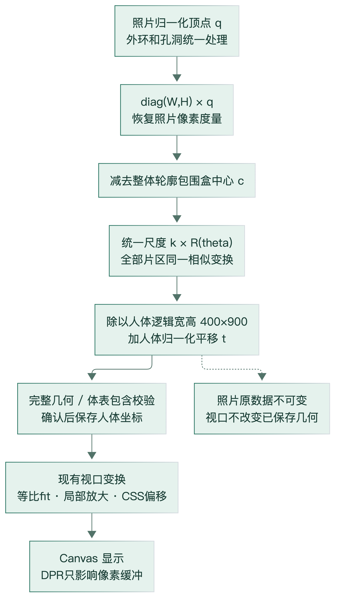
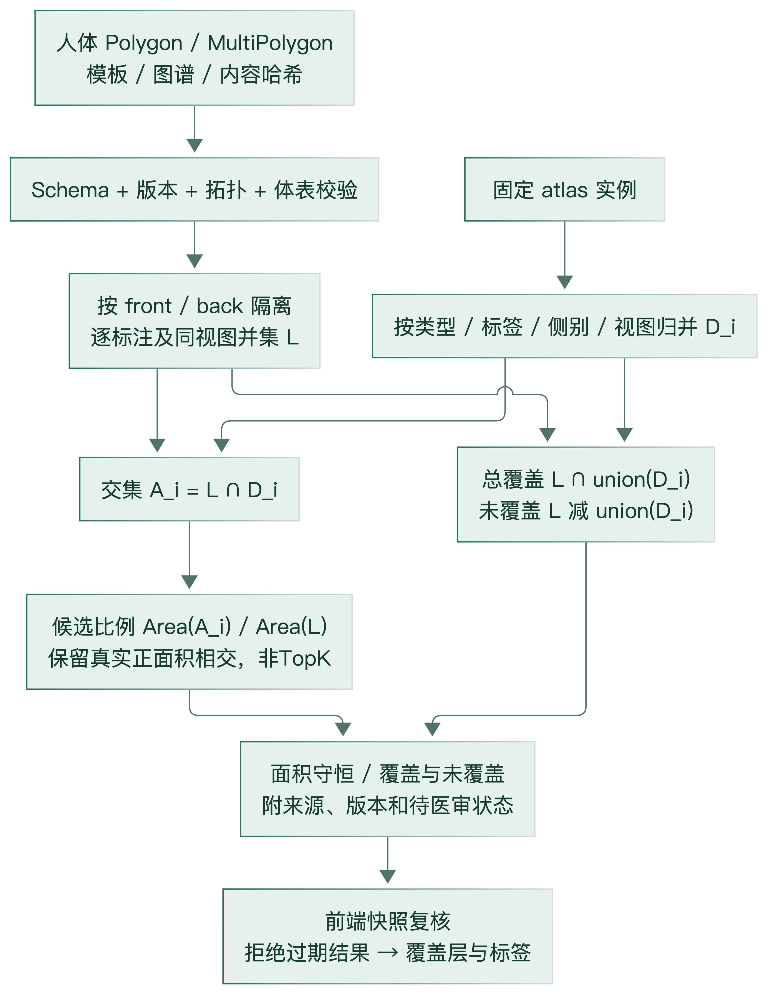

# 04 照片放置、坐标转换与几何匹配

本章公式按当前函数逐项核对。数学描述是实际实现的形式化，不作为新算法原创性声明。源代码定位见 E07～E14。

## 1. 空间与单位

| 空间 | 标识/单位 | 原点及轴 | 使用范围 |
|---|---|---|---|
| 已定向照片像素 | photo_oriented_pixels_v1 | 左上，x右/y下，宽W高H | 模型点框、像素格 |
| 已定向照片归一化 | photo_oriented_normalized_v1 | 点除W/H；轮廓边界可到1 | 照片确认/画笔/原始轮廓 |
| 人体逻辑与归一化 | 400×900；body_template_normalized_v1 | 完整画布左上，x右/y下 | 正式标注，与view/模板绑定 |
| 显示CSS与backing store | CSS px；物理像素=CSS×DPR | Canvas本地 | 触摸、视口、绘图；不保存为几何 |

API identity 的 normalized_2d_top_left 描述人体画布约定，不取代 geometry.coordinateSpace。照片与人体即使同为[0,1]也不能互换。front/back独立，不把正面x自动镜像当背面数据。

## 2. 屏幕显示及逆变换

设逻辑宽高 \(B_w,B_h=(400,900)\)，容器 \(C_w,C_h\)，padding p默认16，目标归一化窗口 \((a,b,w,h)\)。coordinate.fit 的实现：
\[
k_v=\min\left(\frac{C_w-2p}{B_ww},\frac{C_h-2p}{B_hh}\right),\quad
o_x=C_w/2-(a+w/2)B_wk_v,\quad
o_y=C_h/2-(b+h/2)B_hk_v.
\]
\[
c_x=o_x+uB_wk_v,\quad c_y=o_y+vB_hk_v;\qquad
u=\frac{c_x-o_x}{B_wk_v},\quad v=\frac{c_y-o_y}{B_hk_v}.
\]
全身窗口=(0,0,1,1)；局部来自focusBounds，只影响显示。触摸client坐标先减当次Canvas rect，已有本地x/y则直接使用CSS单位。DPR仅设置绘图上下文与物理画布，不能再次乘触点。留白/越界返回null，1e-12舍入修正不是点击吸附。

照片contain比例 \(k_p=\min(C_w/W,C_h/H)\)，偏移 \(((C_w-k_pW)/2,(C_h-k_pH)/2)\)；照片和透明Mask共享这一矩形。photoTouch减偏移后除显示宽高。离开照片显示区的触点拒绝，避免上下留白被当病灶。

## 3. 人工相似变换

图4来源 transformPhotoPolygonToBody/placementSimilarity/coordinate；[源](figures/coordinate-transform.mmd)。

preparePhotoGeometry 只接受confirmed_by_user=true、照片空间、合法MultiPolygon；将原对象读为冻结结构。整体中心取所有外环点在**照片像素空间**的总包围盒中心 \(c=(c_x,c_y)\)，不是每片质心，也不是AI估计的解剖中心。

归一化照片点 \(q=(u,v)\)，先恢复统一度量：
\[
p=\begin{bmatrix}Wu\\Hv\end{bmatrix},\quad
R_\theta=\begin{bmatrix}\cos\theta&-\sin\theta\\\sin\theta&\cos\theta\end{bmatrix},\quad
k=b_0s.
\]
其中 \(b_0\) 是逻辑单位/照片像素的初始比例，s是用户滑杆比例，t是用户设置的人体归一化中心：
\[
\boxed{q_{\mathrm{body}}=
\begin{bmatrix}1/B_w&0\\0&1/B_h\end{bmatrix}
\,kR_\theta(p-c)+t.}
\]
角度转弧度；y向下时正角在屏幕上表现为顺时针。先像素度量、再旋转缩放、再人体归一化，避免直接对归一化x/y旋转造成非正方照片变形。统一应用所有外环/孔环，形状间相对位置不变。

initialPlacement 根据用户选定粗区域bounds，初始中心是该bounds中心：
\[
b_0=0.35\min(B_w\,w_{\rm region}/w_{\rm photoBBox},
B_h\,h_{\rm region}/h_{\rm photoBBox}).
\]
初始 s=1、θ=0；允许s∈[0.1,4]、θ∈[-180°,180°]。0.35是方便编辑的初始尺度，100%不是物理尺寸，无比例尺时不能换算cm或病灶真实面积。初始中心可能需要调整才能通过人体检查，不自动吸附或裁切。

**同形性检验**：在像素/人体逻辑度量内，长度均乘k、面积乘k²；人体归一化面积另除B_wB_h。显示视口不参与正式变换。原照片几何、Mask与提示不原位修改；placementTransform独立保存target、translation、photoCenter、baseScale、scale和rotationDegrees。

## 4. 完整面包含与拓扑

仅检查顶点不足以排除跨臂躯空白的边或包围人体孔洞。validatePlacementGeometry执行：

1. 检查有限数、显式闭环、重复点、零边、退化、自交/回折；外环与孔洞关系合法。
2. 检查不同孔的面积交叠和边接触；孔洞接触图形成循环导致填充不连通则拒绝。
3. 检查MultiPolygon片区正面积重叠/共线边；孤立点接触可接受，不自动合并不合法数据。
4. 对每条病灶边求与所有人体边界交点参数，将边拆成完整拓扑区间，检查端点和各区间中点；不是固定步长采样。
5. 求填充内部见证点，并检查被病灶包围的人体孔洞；若病灶自身孔完整排除该空白可允许，否则拒绝。

数值EPS为1e-12量级；最终后端Shapely.is_valid与body.covers再独立验证。前端贴边容差与后端严格covers可能有极小差别，后端明确拒绝并要求编辑，不通过平移/缓冲修好。

手工简单环最多128不同点、面积>1e-10；AI完整几何最多1024片/每片4096环、组内20000顶点、全请求40000顶点，面片正面积即可，不套手工小面积阈值删除AI微片。每面20个正式标注组，AI一个组可有许多片/孔。超限返回错误，不截断。

## 5. 编辑预览、正式提交和性能

PlacementPreview 从确认Mask已经无损导出的照片几何，按环方向一次生成透明OffscreenCanvas（长边≤2048）；不是重新运行模型或重新下载原Mask。编辑时Canvas仿射变换缓存，仅维护中心、scale、rotation；fallback为完整矢量，不改保存几何。单个待绘制requestAnimationFrame或可取消16ms单次调度；无常驻循环。

移动过程不遍历全部正式人体顶点、不做人体面校验；结束调整重算并验证。正式确认在annotationSession.commitPlacement中**从不可变照片源和最终参数再次计算一次**，核验与预览几何相等并完整检查后原子写入。不能把上次已合法草稿当当前合法。geometryRevision必须与revision一致。

V2保留原ring兼容字段，但存在geometry时绘制/匹配必须使用全geometry；ring只是第一外环。source.photo包含照片确认快照、source.transform保存变换。重复placementId幂等，重编辑用expectedPlacementId比较替换，保持annotation ID、其他手工/AI组不变。照片到期不删除已存人体几何；进程终止仍可能失去运行内会话。

## 6. 图谱匹配

图5来源 dermatome_matcher.evaluate/coverage；[源](figures/dermatome-matching.mmd)。

设单个标注的有效面为 \(L_j\)。图谱候选按四元键
\[
K_i=(partitionType,labelId,side,view)
\]
分组，\(D_i=\bigcup_{r:K(r)=K_i}G_r\)。组合标签保留，不拆分。candidate_id是该键规范JSON的SHA256，region_ids记录完整关联实例。相同标签的独立路径/多片并集避免内部重复计面积。

对单组 \(L_j\)：
\[
I_{ji}=|L_j\cap D_i|,\qquad R_{ji}=\frac{I_{ji}}{|L_j|}.
\]
分母是用户标注面积，回答“标注中多少落在该参考区”。代码不以 \(|L_j\cup D_i|\) 为分母，因整块皮节通常远大于小病灶，IoU会混入整个参考区大小；这是指标语义说明，不是已验证的临床最优指标比较。

同视图汇总先求标注并集：
\[
L_v=\bigcup_{j:view(j)=v}L_j,\qquad A_v=\bigcup_{i:view(i)=v}D_i,
\]
\[
C_v=\frac{|L_v\cap A_v|}{|L_v|},\quad
U_v=\frac{|L_v\setminus A_v|}{|L_v|}.
\]
不同标注允许交叠并在汇总去重；不能把各片分子/分母简单相加。正背不合并为一个全身面积。不同候选可交叠，\(\sum_iR_{vi}\)可大于1，总覆盖必须用A_v并集，不能相加候选。

实质交集阈值 \(\epsilon=\max(10^{-18},|L|10^{-12})\)，仅排除数值噪声和点线接触；不是医学面积阈值。covered与uncovered之和与|L|偏差超过 \(\max(10^{-16},|L|10^{-10})\)则500 COMPUTATION_ERROR；不通过截断比例掩盖。covered≤ε为none，uncovered≤ε为full，否则partial。无候选是有效200结果，不猜邻近神经。

排序：覆盖降序，然后类型、label、side、candidate_id稳定排序；没有top-k删小候选。source=manual/ai_assisted不参与计算，也不读取照片、模型分数、提示或导航部位。历史method字符串manual_annotation_reference_geometry兼容保留，实际含义为“人工确认的参考几何”，不能据其字符串说AI未接入。

## 7. 请求、身份和结果失效

identity绑定template_id/version、geometry_id、region_set_id、atlas_id/version、atlas_content_sha256、body_content_sha256与坐标系。后端固定注册表路径；逐次核验七份图谱内容、人体导出及两份源文件SHA，不接受客户端任意路径，不缓存旧数据冒充新版。

matchingSession快照key包含会话、身份、每组完整geometry/vertices、view、id及AI placementId；排除focus、标签选择和显示revision。编辑正式几何或换版即失效。request_id、独立geometryRevision、sequence及回包时重核key拒绝迟到响应。checkedResponse检查候选实例集合与包内同版图谱对应，避免错误区域上色。

## 8. 复杂度、数据规模与限制

单次相似变换O(N)；缓存交互参数更新O(1)，位图绘制实际成本还取决于设备/像素，不能据O(1)宣称恒定帧率。环自交筛查有bbox sweep，最坏仍O(N²)；边-人体检查可达O(NB)，洞/多片关系最坏近二次，解释了结束阶段停顿。

当前图谱114实例、29756闭合计数顶点；候选按视图54/60键分组。后端每请求重读/验哈希并重建Shapely区域，随后逐候选求交与各标注/图谱并集，未采用STRtree或持久预计算缓存。集合运算复杂度依赖交点和拓扑，不能给没有依据的简单常数耗时。

真实性能见 [06](06-实验与验证结果.md)：Node命令记录器的前后比较、原生模拟器事件回放、云HTTP延迟必须分栏，不相加嵌套分项、不换算临床准确率或真实GPU FPS。今后缓存固定图谱、索引或更优包含算法可研究，但本轮未实现。
