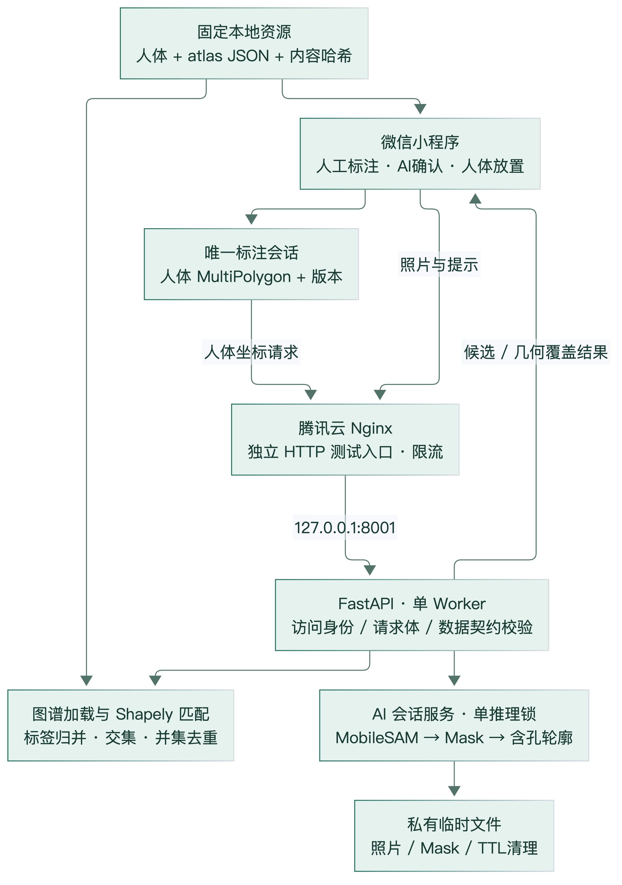
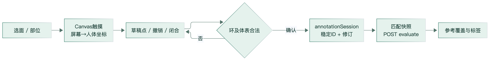
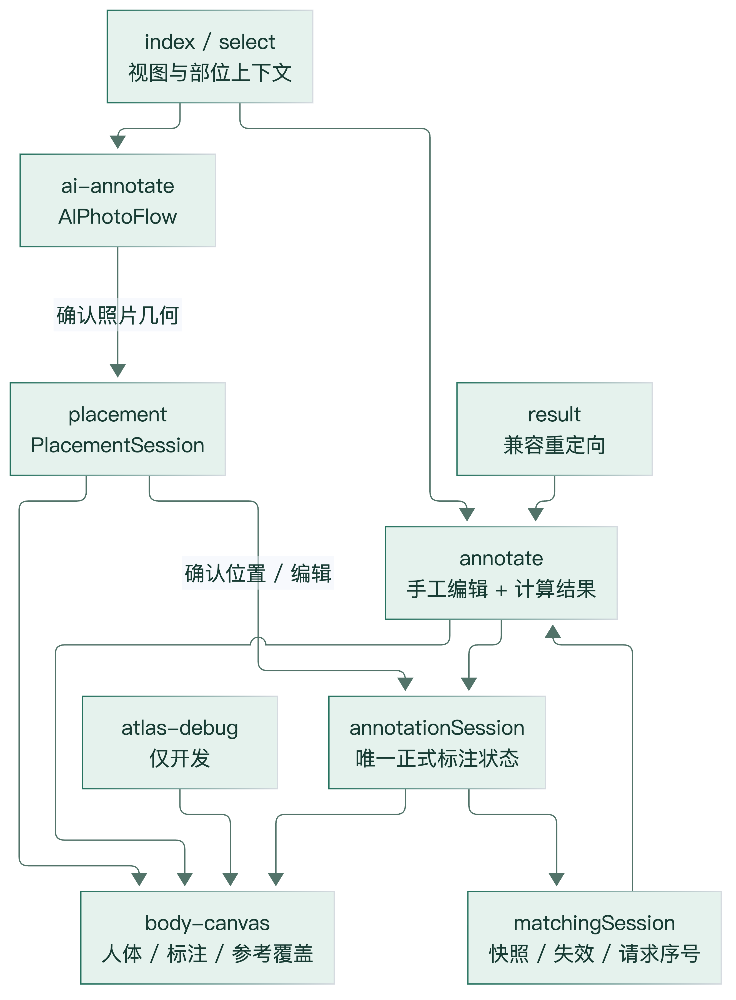
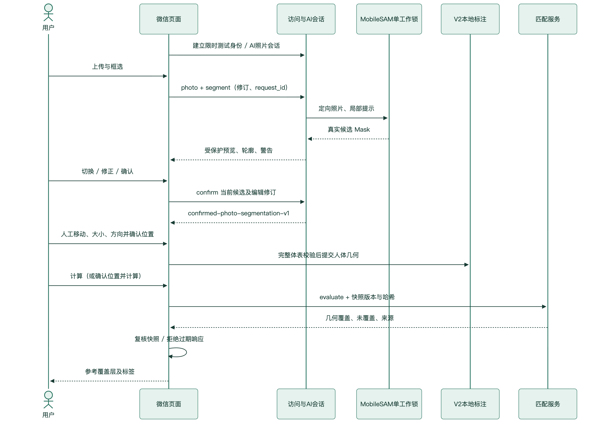

# 05 系统总体架构与部署

本章状态：代码、自动化和指定历史联调证据为 A；当前版本手机体验版、正式安全发布与医学应用为 B。图 1、2 和图 10～12 均由当前模块关系整理，无新增服务或数据库。证据：[E01、E08、E11～E16、E24～E27](技术结论与证据索引.md)。

## 1. 实际技术栈与职责

| 层 | 实际实现 | 输入→处理→输出 |
|---|---|---|
| 客户端 | 微信原生小程序、TypeScript 5.9.3、Canvas 2D | 触摸与图片→状态控制、坐标转换、绘图→已确认人体几何／照片提示 |
| API | Python、FastAPI、Pydantic、Uvicorn | 有界请求→身份、版本、几何校验→结构化结果或明确错误 |
| 分割 | PyTorch 2.5.1、MobileSAM vit_t、NumPy、Pillow | 定向 RGB 与提示→真实模型及局部裁剪→多候选像素 Mask |
| 几何 | Shapely 2.1.2、GEOS | Mask 像素单元／人体几何→并集、差集、交集→多片含孔几何与面积 |
| 资源 | 本地 PNG/SVG、JSON/TypeScript 导出 | 固定来源→脚本处理、版本及 SHA 核验→前后端一致图谱 |
| 运行 | Ubuntu、独立 venv/systemd、Nginx | 受限公网入口→loopback API→单模型工作线程与临时目录 |

图 1 系统总体架构（源码整理；独立 Python 模块是同一进程内逻辑模块，不是多个部署微服务）。

## 2. 页面与状态管理

当前 `app.json` 注册 7 页：index、select、annotate、result、atlas-debug、ai-annotate、placement。旧 result 页承担兼容重定向，主要编辑及计算结果已集中到 annotate。不能按历史路由数量推断当前用户流程。

| 页面／模块 | 职责 | 关键边界 |
|---|---|---|
| index / select | 选择视图和身体区域、进入手动或 AI | 选择只是放置上下文，不是照片自动定位 |
| annotate / body-canvas | 人工画点、闭合、编辑、列表、计算、参考覆盖层、两侧标签 | 显示全部与选单标签不重新推理；人体模型和 atlas 保持固定 |
| ai-annotate / AIPhotoFlow | 上传、默认拖框自动分析、换结果、可选精细提示及画笔、确认 | 照片世代、提示修订、请求 ID 和预览序号防迟到结果；没有自动确认 |
| placement / PlacementSession | 同组多片拖动、大小、角度、完整体表校验 | 操作草稿不能覆盖原照片结果；确认后才写正式标注 |
| annotationSession | V2 标注唯一权威内存状态 | AI 与手工共存；存储完整几何、来源、修订；不是云病例库 |
| matchingSession | 输入快照、计算、结果有效性和展示选择 | 编辑几何或绑定版本改变会使结果失效；显示视口改变不使结果失效 |
| atlas-debug | 开发分区调试与绑定检查 | develop 专用，不作为患者功能或正式审核工具 |

图 10 人工标注；图 11 页面和状态关系。图 2 已包含完整 AI—人工汇合流程。

人体绘图复用当前标准素材与坐标模块。区域实际轮廓用于选择和高亮，focusBounds 仅决定放大视野。放置预览缓存贴片，正式保存仍用完整 MultiPolygon。`source` 保留 AI 确认记录与 placementTransform；兼容 `ring` 不能代表有孔、多片 AI 几何。会话暂存不是重新启动后的持久保存承诺。

## 3. API 调用链

所有下述 API 路径相对于 `/api/v1`。Nginx 入口前缀另为 `/dermatome-test`，前端公共请求封装统一组合，上传不另外拼一份不同地址。

| 方法及路径 | 输入 | 输出／保护 |
|---|---|---|
| GET `/health` | 无 | 最小项目状态，不能据此断言模型已就绪 |
| POST `/access/session` | 空对象，受控测试开关必须启用 | 限时随机 bearer 会话；免邀请码不等于已验证微信用户身份 |
| DELETE `/access/session` | bearer | 撤销当前访问会话 |
| POST `/ai/sessions` | bearer | 照片会话 ID 与独立 session key |
| POST `/ai/sessions/{sid}/photo` | bearer、x-ai-session-key、单文件 multipart | 统一 EXIF 方向的尺寸、受保护图像引用 |
| POST `/ai/sessions/{sid}/segment` | 提示、修订、request_id | 真实候选、质量警告、像素及轮廓引用 |
| POST `/ai/sessions/{sid}/edit` | 候选、完整笔画历史、edit revision | 新 Mask 和新轮廓；原 AI Mask 不变 |
| POST `/ai/sessions/{sid}/confirm` | 当前候选及编辑修订 | confirmed-photo-segmentation-v1，人工确认标志 |
| GET `/ai/sessions/{sid}/assets/{name}` | 双层凭据、必要 result_id | PNG，private/no-store，禁止路径穿越 |
| DELETE `/ai/sessions/{sid}` | 双层凭据 | 删除临时照片、结果及会话 |
| POST `/evaluate` | 人体几何、视图、模板／atlas 版本与哈希 | 按标签侧别归并的几何覆盖、未覆盖、汇总 |
| GET `/atlas` | 预留 | 当前为 501，不应写成可动态下载正式 atlas 的接口 |

`main.py` 的访问边界先于业务处理，匹配请求另外限制体积，AI 边界限制写入并发。路由调用 Pydantic Schema、AI 会话服务或图谱加载／匹配服务；结构错误、失效身份、版本冲突、过大请求和服务不可用分别有对应错误，不混为“识别失败”。

图 12 实际接口时序，省略用户界面绘图细节。

## 4. 模型、临时文件与并发

AI 模块可选依赖延迟加载，未安装模型不妨碍普通几何后端启动。一个服务进程复用同一 MobileSAM 实例；`AISessions.worker` 互斥锁串行执行状态化 Predictor。每次请求会重新编码当前图像／裁剪，不存在未经证实的跨请求 embedding 缓存。

超时阈值 45 秒，超时使请求失效，但 Python 工作线程可能仍在计算，不能写成“强制取消 PyTorch”。迟到结果不得提交。开发配置最多 8 照片会话；当前受控云配置最多 2，上传 10 MiB、解码后 3 MP、同时写入上限 2。原始独立实验限制与服务限制不同，见[分割章](03-AI辅助图像分割.md)。

照片会话有效期 30 分钟；服务内清理周期 30 秒，独立 systemd timer 每 5 分钟兜底。云端私有快照可恢复会话而不延长原失效时间，写入采用受限目录及原子操作。AI 文件不可猜测名称、owner 隔离与 session key 是不同层次的保护；图片绝不放在公开静态目录。删除照片后，已保存人体几何仍可参与计算，但不代表照片引用永久可访问。

## 5. 结果一致性

匹配输入快照含标注 ID、视图、全部环、template/geometry/regionSet/atlas 哈希，以及 AI placement ID。请求序号、修订号、返回时快照复查共同拒绝旧响应。返回区域 ID、类型、标签和视图再与当前 atlas 核对。重新计算不会重复提交放置；编辑已保存贴片采用稳定标注 ID 和预期 placement ID 防误改。仅切换标签、放大、回全身属于显示操作，不改变人体几何。

## 6. 腾讯云实际部署状态

本次 **2026-11-02 22:37:08 CST** 只读 SSH 检查：[原始快照](audit/server-readonly.json)。没有安装、重启或修改服务器。

| 项目 | 本次实际观测 | 解释 |
|---|---|---|
| 系统 | Ubuntu 24.04.4，x86_64 | 非开发机 M4 |
| CPU | 4 逻辑核，AMD EPYC 7K62 型号 | 型号含“48-Core”不是分配了 48 核 |
| 内存 | 3,904,065,536 B，总计约 3.64 GiB；available 2,333,863,936 B | 瞬时余量，不代表高峰承诺 |
| swap | 2,084,564,992 B；已用 536,576 B | dermatome 单元另设 MemorySwapMax=0 |
| 文件系统 | 总 42,156,257,280 B；可用 30,484,996,096 B | 约 28.39 GiB 可用 |
| 负载 | 0.08 / 0.02 / 0.01 | 本次短时观测 |
| acupuncture | active；NRestarts=0；MemoryCurrent 159,055,872 B | loopback 8000；health/ready 均 200 |
| dermatome | active；NRestarts=0；MemoryCurrent 573,526,016 B | loopback 8001；health 200 |
| Nginx | active；NRestarts=0 | 公网 80/443，另有 SSH 22 |

两个独立 venv 和 systemd 服务。智络智绘单 Uvicorn Worker、单 CPU quota、MemoryHigh 1280 MiB、MemoryMax 1536 MiB、禁用 swap、低调度权重；模型线程数为 1。资源约束减少争用但不证明所有压力下不会影响针灸服务。

当前 trial 配置 `http://212.64.26.206/dermatome-test`，独立 Nginx 路由到 `127.0.0.1:8001`，没有暴露 FastAPI 公网 8001。限流 5 请求/秒、burst 12、6 连接、11 MiB Nginx 请求上限，后端仍有更严格上传和会话限制。HTTP **不加密**，仅供公开授权／合成测试图片；旧针灸 HTTPS 不意味着新服务已经有 HTTPS。不能写成正式患者隐私部署完成。

免邀请码入口由受控开关开放，自动发放 1 小时 bearer 会话；最多 16 活跃会话、每分钟 10 次申请；鉴权请求每分钟 120，照片会话建立每分钟 8。任何可访问者可能申请会话：这是限额测试接入与隔离，不是实名授权体系。包中无共享生产密钥。

develop、trial 开放业务；release 网络地址为空且在线能力受限；未知环境关闭。关闭公共 Nginx 入口可立即停止新旧会话公网访问；仅关闭新会话开关不会立即撤销现存 token。独立控制脚本和文档存在，本次没有执行。正式发布仍需可信 HTTPS、合法域名配置、用户认证与隐私评估。微信手机开发调试不是服务端认证。

## 7. 验证边界

最新历史 P4.2 证据证明公网真实接口、模型、放置数据和匹配可协作，当前只读检查证明服务仍运行。它们不能替代手机手势、相机授权、网络切换与体验版更新验收。新版本上传与本版真机闭环为 NOT_RUN；历史开发工具截图也不能移用为手机证据。最新状态与历史差异见[实验章](06-实验与验证结果.md)。
