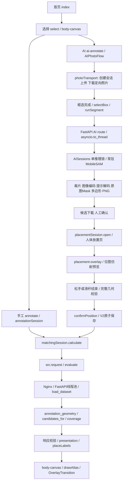

# 全链路调用与测量边界

## 实际调用关系

## A～I路径逐项状态

| 路径 | 当前实际行为 | 已测部分 | 仍未测部分 |
|---|---|---|---|
| A 启动 | app.json七路由；body-canvas ready→节点测量→两张图片缓存→fitViewport→drawBody | Node首次模块require、19次组件创建 | 微信JS注入、页面首屏、PNG解码、首个完整像素帧 |
| B 选部位 | touchEnd重新获取位置→probeTouch→hitTestRegion→focusViewport | 100次命中/聚焦；正反切换190次命令路径 | 触屏到高亮的原生响应 |
| C 手工标注 | dispatch add只检查点在人体内/重复/上限；close完整校验；syncSession差分setData | 10/100合法加点；500/2000隔离绘制及明确拒绝超限 | 原生桥接和实际绘制 |
| D 图谱 | atlas.generated静态模块；drawAtlas的WeakMap缓存最近视口投影；仍每帧逐路径提交 | 114实例/29756顶点；全部单区380次；动画19次命令批次 | GPU栅格、动画掉帧 |
| E 匹配 | snapshotKey→冻结快照→request→同步路由线程池→dataset→evaluate→checkedResponse→标签→Canvas | 本机20请求分段、云端3次完整HTTP；本地标签映射30次 | 单次生产请求内部分段、微信首绘/动画完成 |
| F AI | 上传时服务器解码/EXIF→PNG→客户端下载→框选→服务串行锁→局部模型→Mask/轮廓→下载候选 | 本机3次加载12次真实推理；云端2次；照片组件计数9组 | 手机读取/显示、纯网络往返、生产内部阶段、云端冷加载 |
| G 放置 | 原始照片不可变；一次位图；移动仅参数；complete再变换及验证 | 10场景×3次、320/375/430宽、单片/多片含孔 | 原生离屏兼容性、真实手势帧率 |
| H 确认并匹配 | commitPlacement重新准备来源/变换/校验后保存；refresh版本；最多一次calculate；成功导航 | 隔离真实commit；既有V5.4回归测试 | 本轮手机完整确认→结果耗时 |
| I 连续切换 | WeakMap生命周期，body/placement取消动画；已保存V2数据有意保留 | 10次body重建/GC；拖动中退出；298项前端回归 | 手机完整业务循环与长期Native内存 |

## 计时和追踪规则

新增脚本使用 `performance.now()` 或 `time.perf_counter()`，仅写阶段数值、次数、字节数、traceId、运行环境。不输出图片、标注顶点、令牌或身份。事件按操作汇总；不在每个touchmove打印日志。独立脚本不被小程序或服务导入，产品详细埋点默认关闭。

Node phase的wall_ms是测量器调用真实函数和模拟异步队列的墙钟时间，不是用户手势持续时间。RAF提供虚拟16ms调度机会，但绘制耗时用真实单调时钟；绝不能把虚拟帧间隔换算为实测FPS。Proxy绘图计数的开销也包含在Node结果里。

后端阶段 `REQUEST_JSON_PARSE / PYDANTIC_VALIDATE / ATLAS_LOAD / MATCH_BACKEND / RESPONSE_SERIALIZE` 为同一本机进程计时。嵌套的 `coverage.unary_union` 已包含在MATCH_BACKEND里，不能重复相加。AI模块hooks同理。

公网客户端的MATCH_HTTP、AI_SEGMENT_HTTP包括网络、代理、服务等待、运算及传输，不能命名为纯网络。云端响应目前不返回分段Server-Timing；已有Nginx未配置request_time/upstream_response_time。没有跨主机绝对时间相减，也未将本机后端耗时从云端HTTP时间扣除。

原有产品 `services/api.ts`、`body-canvas.ts`、`annotate.ts` 的少量开发指标使用Date.now且粒度粗，本轮不拿它们作为高精度帧数据。建议下一轮统一单调计时并用request_id串联；当前云端证据中的traceId是客户端记录标识，不能声称已实现服务端完整分布式追踪。
