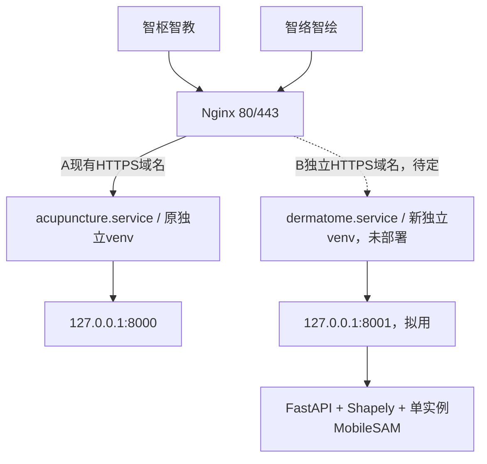

# 腾讯云只读巡检与双小程序部署可行性评估

巡检日期：**2026-11-01 18:27～18:36，北京时间（UTC+8）**。项目A：智枢智教；项目B：智络智绘（dermatome-mapper）。本报告只记录巡检和部署前分析；唯一任务进度仍为 [task.md](../task.md)。

**最终结论：CONDITIONAL GO。** 当前服务器有条件作为两个项目低并发、受控试部署的候选，尚不能证明两者同时处理图片时稳定。条件是：B单进程/单推理、资源与图片限额、同架构隔离测试通过、独立域名/HTTPS与受控生产访问准备完成。**这不代表当前B代码已经具备直接公网正式发布条件。** 没有安装、部署或改变生产服务。

## 1. 目标确认和执行边界

- 本机找到项目A `deployment/README.md`、`HTTPS_HANDOVER.md`、`FOREARM_ONLINE_20261031.md`、Nginx/systemd示例、生产依赖清单；已阅读该项目AGENTS，仅作只读调查。资料表明原项目使用现有针灸域名与独立服务。
- SSH配置中有 `acupuncture-server`，目标与部署资料一致；使用已有账户/认证方式连接成功。另有一个与针灸无关的实验主机别名，本轮未连接它，未扫描或猜测IP。报告省略公网IP及密钥位置，后续可继续用已配置的别名，无需提供私钥或密码。
- SSH使用BatchMode、已知主机校验、禁用HostKey更新/连接复用/代理转发；没有修改本机SSH配置或known_hosts。没有输出或复制私钥/凭据，日志仅保存状态、计数、必要版本与公开证书元信息。
- 远端只运行资源读取、systemd show/list、端口/进程查看、已启用Nginx配置的选定字段提取、公开证书读取、已有日志统计和小量健康/TLS请求；没有创建远程审计脚本。Python读取包元信息时禁用bytecode写入，不导入应用或加载模型。
- 没有安装/升级包、修改Nginx/systemd/防火墙/数据库、启动/停止/重启/重载服务、申请证书、创建云资源或压测。SSH、sudo和健康访问可能产生系统自身的常规审计/访问日志，这不属于应用配置/数据库改动。

## 2. 服务器基本信息和可用资源：实际检测

| 项目 | 当前事实 | 依据与范围 |
| --- | --- | --- |
| 系统 | Ubuntu **24.04.4 LTS**，Linux 6.8.0-124-generic，glibc2.39 | os-release、uname、getconf |
| CPU | **4个逻辑CPU**，x86_64，AMD EPYC 7K62来宾型号，KVM | nproc/lscpu；型号中的48-Core不是此VM分配48核 |
| 指令集 | 检出AVX/AVX2等 | lscpu；未执行PyTorch推理 |
| GPU | PCI显示为虚拟Cirrus VGA，未检出推理GPU | 本轮按CPU规划，没有GPU基准 |
| 主机运行时间 | 约24天5小时 | 首次uptime快照；不代表A服务连续运行同样时长 |
| RAM总量 | **3,904,065,536字节 = 3.64GiB** | 约4GB级；与历史“2核”线索不同，实际为4逻辑CPU |
| RAM已用 | 约0.85～0.86GiB（free统计口径） | 巡检快照；不与sar的cache计算口径混用 |
| MemAvailable | **约2.78～2.81GiB** | 不是仅看MemFree；MemFree当时约0.50～0.52GiB |
| Swap | **1.94GiB，使用0** | 不能把swap当作同速推理内存或OOM保证 |
| 系统盘 | 40GiB虚拟块设备，ext4根文件系统；使用约6.85GiB，可用**30.69GiB** | df -hT/df -B1/lsblk；没有额外数据盘，另有虚拟光驱 |
| 1/5/15分钟负载 | 首次0.16/0.06/0.01；后续约0.01/0.03/0.00 | 瞬时观察，均较轻 |
| 当前PSI | CPU/memory/io的avg10/60/300均0 | 不代表历史从未有压力 |

硬件/资源不是直接采信历史描述；CPU为4而非历史推测2。未查询云账单、实例套餐、带宽规格或控制台安全组，不能由来宾检测断言具体售卖配置。

### 已有历史监控的范围

服务器已有sysstat，读取前一天和当日采样文件，没有安装或启用监控。近24小时提取到**143个、间隔600秒的采样**（UTC 2026-10-31 10:40:01至11-01 10:30:01）：

- 整机CPU忙碌率的**10分钟平均值**最大约 **1.21%**。
- 采样MemAvailable最低 **2,930,204KiB = 约2.79GiB**，采样swap使用最大0。
- 这属于历史区间平均/离散采样，**不是逐请求峰值**。秒级MediaPipe突发和教学高并发峰值没有本轮实测，不能拿1.21%承诺AI延迟或原服务不受影响。
- 首轮sadf聚合脚本按另一版本的字段名读取avail而得到null；已按服务器实际`memory.avail/swpused`字段补充正确聚合，原输出与补充输出均保留，不把null当成内存不足或无记录。

证据：[服务/资源脱敏快照](validation-records/tencent-cloud-audit-20261101/server-services-sanitized.json)、[历史及TLS](validation-records/tencent-cloud-audit-20261101/server-history-tls-sanitized.json)、[24小时实际字段补充](validation-records/tencent-cloud-audit-20261101/server-last24h-sanitized.json)。

## 3. 智枢智教当前运行状态

| 检查 | 实际结果 |
| --- | --- |
| systemd | `acupuncture.service`，loaded/active/running、enabled |
| 服务用户 | 非root账户运行；本轮未改用户或权限 |
| 服务结构 | 原项目目录下独立venv，Python3.12.3、Uvicorn单worker、`backend.main:app` |
| 当前进程 | PID3480408；2026-10-31 23:51:02 CST启动 |
| 重启策略 | on-failure，等待5秒；NRestarts=0（本次服务运行的自动重启计数） |
| Python进程RSS | **269.49MiB**；VmHWM **270.38MiB**；17个线程 |
| cgroup内存 | current151.66MiB、peak153.65MiB；与RSS共享页归属/计费口径不同，不能相加或当作同一峰值 |
| CPU | ps累计平均约0.1%；服务累计CPU约88.98秒。不是当前图片请求耗时 |
| 资源限制 | MemoryMax/MemoryHigh与CPUQuota未设置上限；cgroup memory.events中oom/oom_kill=0 |
| 内部监听 | **127.0.0.1:8000**，未直接暴露8000公网监听 |
| 本机健康检查 | `/health`200，约26.39ms；`/ready`200，约1.02ms |
| 公网HTTPS复核 | `/health`200、`/ready`200，证书校验开启；ready的ai/model/results布尔字段均true |

公网只读请求时延约267/73ms，包含网络和TLS，不是MediaPipe推理性能。未提交真实图片、考试、写数据库或调用业务评分；当前结论为“进程/健康/就绪正常”，不冒充全业务验收。

依赖元信息实测：FastAPI0.141.1、Uvicorn0.52.4、MediaPipe0.10.35、opencv-contrib-python5.0.0.93、NumPy2.5.2。该venv未检出torch或Shapely的包元信息。**B必须使用独立venv**，不能为安装B升级A的NumPy/OpenCV等依赖。

日志仅统计：最近24小时最多300条应用日志样本未匹配到ERROR/Traceback/5xx；有限样本不证明全天零错误或无历史重启。内核近7天OOM关键字查询无命中，但该窗口内核journal本身无可见记录，**不能据此宣称全机过去7天没有OOM**；能确认的是A当前cgroup计数为0。

现有默认Nginx access日志读取到345行（上限2000）：200两条、404二百七十八条、400六十四条、499一条，无5xx；没有导出URL、访客IP或业务数据。该日志不等于所有站点流量或峰值，也不据此认定业务故障。

## 4. Nginx、HTTPS与端口

Nginx1.24.0（Ubuntu），active/running。当前已启用两个站点配置：

1. 域名站点：`acupuncture.yandunshuati.online`，HTTP80的普通路径308到HTTPS；ACME挑战保留；HTTPS443代理到127.0.0.1:8000。
2. 默认站点：HTTP80的default_server也代理到原8000，旧IP/default入口仍存在。

现有A站点上传上限10m，代理连接超时10秒、读写超时120秒。当前B上传允许20MiB、multipart额外64KiB；**未来不能直接照抄A的10m上限来宣称支持B全部上传**。需单独对齐B前端/ASGI/Nginx限额和multipart余量，并独立考虑代理临时文件/并发/超时。

当前监听：22、80、443、回环DNS53、回环8000；**未发现8001监听**。8001只是本次时点可供未来选择的内部端口，不是已预留或已经部署。服务器没有发现dermatome运行服务或端口。本轮没有申请开放8001公网，未来也建议仅回环监听。

当前公开证书CN和SAN仅覆盖A域名，由Let's Encrypt签发；有效期从2026-10-24 00:56:11至 **2027-01-22 00:56:10，北京时间**（约余81天）。实际对本机Nginx使用A的SNI和系统信任库分别完成TLS1.2/1.3握手，均校验成功；Mac公网HTTPS也通过验证。证书**不能直接覆盖尚未确定的B子域名**。

certbot.timer已启用且active，最近触发2026-11-01 16:00，下一次11-02 08:26，certbot.service上次Result=success/退出0。本轮没有执行续期或dry-run；这不证明未来续期一定成功。全局nginx.conf还声明旧TLS版本，A站点显式1.2/1.3；本轮只验证了1.2/1.3成功，没有测试旧协议拒绝。未来B应审查HTTPS默认server的TLS继承关系。

现有Nginx具备按域名区分站点的结构。可在后续获准部署时使用独立B域名/证书、转发到不同回环端口；Nginx按listen和server_name/SNI选择虚拟站点的机制见[官方请求处理说明](https://nginx.org/en/docs/http/request_processing.html)与[server_name说明](https://nginx.org/en/docs/http/server_names.html)。本轮未新增站点、域名、证书或重载。

## 5. MobileSAM资源：真实数据与估计分开

### 已有本机测量，不是服务器性能

保留当前MobileSAM vit_t、PyTorch2.5.1、torchvision0.20.1、float32、CPU4线程。权重 **40,728,226字节，约38.84MiB/40.7MB**，不是整个进程内存。

| 已有实验 | 实际记录 | 解释 |
| --- | --- | --- |
| V5.1 CPU，9次流程 | 最大记录进程高水位964,575,232字节，**919.89MiB** | Mac arm64 CPU，非MPS |
| 本轮分割专项CPU，19次流程 | 最大记录高水位1,006,206,976字节，**959.59MiB，约0.94GiB** | Mac M4/16GB，顺序模型复用 |
| 分割专项输入 | 最大700×1063，其余700×460、300×410及320×240 | 不包含12MP极限图片或生产并发 |
| 分割专项耗时 | 单图流程约0.472～0.906s，三局部框约1.487s，加载约1.362s | 仅Mac CPU，不推算腾讯云AMD耗时 |

RSS在结果对象生成时采样；进程高水位是累计值，**不是每次请求隔离峰值**，还未完整覆盖随后PNG/JSON导出和完整HTTP生命周期。后处理、碎片较多的Shapely运算、多候选与透明图会继续用内存。Linux x86_64原生库/分配器行为也可能不同。

因此本项目**已有真实进程峰值RSS记录**，但**缺少服务器同架构、全HTTP、最大图片/最复杂轮廓的可靠峰值**。不得把Mac约960MiB当作服务器上限；更不能拿MPS速度承诺云端CPU速度。详细摘录见[本机内存证据](validation-records/tencent-cloud-audit-20261101/local-mobilesam-memory.json)。

Linux x86_64、Python3.12和glibc2.39具备匹配CPU发行包的基础条件。官方提供PyTorch2.5.1/torchvision0.20.1 Linux CPU构建，见[官方历史版本页](https://pytorch.org/get-started/previous-versions/)。这仅说明可选择CPU安装路线；本轮未安装、未验证wheel组合/运行成功，后续应在隔离环境验证锁定版本，而非安装最新版本或把Mac venv直接复制到Linux。

### 当前代码已经具备的保护

- 模型惰性加载并缓存在单进程中，不为每次请求重载；Predictor有状态，使用一个全局推理/修正锁，繁忙返回429，没有无上限内存队列。
- AI写请求最多2个在途；最多8个临时会话；单图20MiB、解码12M像素、单边8192；超时45秒；会话30分钟失效、每30秒清理，取消/重启也清理。
- 多worker争用同一临时目录时第二进程关闭AI能力；不同目录则可能各自加载模型、使内存倍增。不能仅把Uvicorn workers调大来提高AI并发。

### 还需控制的资源风险

- 当前单worker内的MobileSAM仍默认 `torch.set_num_threads(4)`，可以占满这台4逻辑CPU机器，与A的MediaPipe/OpenCV抢核。未来应在隔离基准中比较1/2线程，明确把线程数传给模型配置；当前加载入口没有暴露线程数环境变量，**只设置OMP环境变量不能当作已覆盖该显式4线程设置**。
- 12MP不是“图片文件20MiB以内就很轻”。12MP的RGB约36MB，单张RGBA约48MB，3张bool Mask约36MB，方向修正/合成/临时数组/轮廓还会叠加。这些只是数组大小算术，不是进程峰值；高碎片轮廓可产生更多额外对象。
- 生产入口必须有上传/会话创建的访问与速率限制；会话令牌隔离照片，不等于限制任何人反复创建会话。Nginx缓冲临时文件也需考虑，ASGI锁不能覆盖所有代理层磁盘占用。
- 两个独立systemd服务仍共享内核、CPU、内存和磁盘。A当前无内存上限，B若无资源限制造成全机OOM，可能影响或终止原服务。

**容量估算，非测量：** 可先给B预留约1.5～2.0GiB运行预算，作为同架构测试的初始规划。当前MemAvailable约2.78GiB已包含A现状，扣除该预算余约1.28～0.78GiB；不要再重复扣A的270MiB。若B实际峰值达到3GiB，现有余量就不足。故4GB级机器可以研究受控试部署，但不能承诺12MP、多用户或长期稳定。

## 6. 推荐双项目结构

建议A/B完全独立venv、独立systemd服务、独立账户/临时目录与日志；不更改A依赖或端口。B使用CPU版PyTorch，**一个Uvicorn worker、一个AI工作槽**；先保留现有“繁忙重试”，不引入大型队列。只有交互需求明确时再设计有界、可取消/过期的小队列，不能在内存无限排队。

B拟用8001，部署当天重新核验；对外仍443按域名路由，不新增公网推理端口。B域名尚未确定，不能替用户创建 `dermatome.*` 或假设A证书可复用。域名所有者授权、DNS解析权限、备案/接入及小程序主体要求仍需实际确认，本轮未进云控制台或微信后台核验。

受控测试前对B配置内存/CPU/任务数资源边界、照片与会话总磁盘预算；参数以隔离Linux测得峰值和A保留空间决定，不能把1.5～2.0GiB规划直接视作已生效限制。建议初期评估更小的图片像素上限（例如3MP级）和5～10MiB上传限额：作为待验证方案，超限明确拒绝或引导用户缩图，不静默改变确认轮廓；当前实现仍是20MiB/12MP，本轮没有修改。

**暂不为当前小规模流程拆一个同机AI服务。** 先用B一个服务内的惰性模型和串行锁，维护成本最低；需要更多常规API worker、独立重启或更强故障隔离时，再把模型移为唯一AI进程。把它挪到同一台4GB主机的另一个进程不会增加内存，也不会自动隔离CPU竞争。

### 微信端域名准备

| 项目 | request | uploadFile | downloadFile |
| --- | --- | --- | --- |
| A，当前使用 | `https://acupuncture.yandunshuati.online` | 同左 | 同左 |
| B，后续计划 | `https://<用户确定的B域名>` | 同一个B HTTPS域名 | 同一个B HTTPS域名，用于私有照片/候选预览 |

上述B值是占位说明，**不能粘贴占位符到后台**。填写域名本身，不添加API路径；正式访问使用受信任HTTPS，不能依赖开发工具跳过域名/TLS检查。A的交接文档记录2026-10-24曾同步三项合法域名，但本轮未登录微信后台，不把旧记录说成当前后台重新验收。

微信官方[网络说明](https://developers.weixin.qq.com/miniprogram/dev/framework/ability/network.html)、[request](https://developers.weixin.qq.com/miniprogram/dev/api/network/request/wx.request.html)、[uploadFile](https://developers.weixin.qq.com/miniprogram/dev/api/network/upload/wx.uploadFile.html)、[downloadFile](https://developers.weixin.qq.com/miniprogram/dev/api/network/download/wx.downloadFile.html)本轮自动抓取不可用。此处按实际API用途与已有A交接记录列待办；当前平台的配额、备案/跨主体规则和后台配置最终由账号所有者在官方页面确认，不采用社区文章作为已核验规范。

## 7. 三种方案对比

| 方案 | 优点 | 风险/适用条件 | 本轮建议 |
| --- | --- | --- | --- |
| A：维持现有4CPU/4GB级机器 | 现有约2.8GiB可用、CPU历史较轻、磁盘余量足；不增加机器 | 同时图片请求会抢CPU；Linux最大图峰值未知；需B单worker/单推理、图片与内存/磁盘边界、原业务保留资源、先同架构测试 | **CONDITIONAL GO**，适合低并发内部受控试用；不承诺公网正式稳定 |
| B：内存升至8GB级 | 增加PyTorch/native库、图片临时数组、Shapely和A同时处理的余量 | 不能修复AI语义误分割，也不增加现有CPU吞吐；变更可能有停机窗口，需另次授权计划；8GB仍需限并发 | 有固定教学并发、需要保留较大图片、或隔离峰值逼近预算时更推荐；**现阶段不要求立即购买升级** |
| C：AI独立机器/实例 | 更好保护A，AI内存/CPU可独立扩展；常规API不必复制模型 | 增加网络、权限、部署/监控成本；不得把皮肤图片送到未经授权第三方；同机拆进程不能替代独立硬件 | A稳定性要求高、AI请求增长/延迟不可接受、需GPU或单模型峰值接近整机时推荐；当前不急于采用 |

若未来只保留2逻辑CPU/4GB规格，CPU竞争会更明显，仍不能因内存一样就认为体验一样；**本台实际是4逻辑CPU**。内存决定是否容易OOM，CPU决定并发下的等待和原教学推理竞争，两者应分别测量。

## 8. 风险分级及部署前准备

| 级别 | 已发现依据 | 后续准备（本轮未执行） |
| --- | --- | --- |
| 高 | 缺少Linux完整HTTP/大图/高碎片峰值；A/B共享4GB级RAM且当前未配置B边界 | 在隔离Ubuntu24.04 x86_64环境安装固定CPU依赖，测加载/单图/多框/笔画/导出全周期RSS和cgroup峰值，之后确定限额；不在现有生产机器直接试压 |
| 高 | B目前只允许development/test，前端只允许develop+devtools，真机base URL为空 | 后续明确授权后实现受控生产模式、访问与滥用保护、HTTPS与真机测试；不能简单把development开关放到公网当正式部署 |
| 高 | 模型默认4线程与A原生图像推理可能抢核；大图片/复杂Shapely可能延迟其他API | Linux隔离环境测1/2线程与同时A等价负载；保留单AI工作槽、设置B资源预算、观察A延迟退化 |
| 中 | B域名/解析权限/证书/微信配置未定；A证书只有A的SAN | 确认合法子域名使用权，完成独立证书/域名三项配置；不改A证书或冒用权限 |
| 中 | A10m代理上限与B20MiB不一致；多会话及代理缓冲占盘 | 对齐B专用上传限额、超时、临时目录权限、TTL、磁盘预算/告警与清理；不改A |
| 中 | A保留默认HTTP入口，全局含旧TLS声明；证书虽有效但未来续期未证明 | 在另次授权中审查入口/TLS与续期监控；本轮保持现状 |
| 中 | 当前本机实验为小图/无专家分割真值；参考图谱仍有既有审核边界 | 云部署不等于医学有效；沿用人工确认/既有图谱状态，不因部署启用未授权能力 |
| 低/当前正常 | 磁盘约30.69GiB可用、目前swap0、健康/就绪与证书正常 | 保留监控，不把这一时点当永久余量 |

建议后续隔离验证记录：冷启动/权重加载、700×460与700×1063基线、拟定像素上限与多处裁剪、最复杂允许轮廓/笔画、超限拒绝、取消/超时/TTL、单推理与另一常规服务同时请求的资源和延迟。测`VmHWM`、进程/进程树RSS、cgroup memory.peak、磁盘临时峰值与请求延迟分位；采样器覆盖PNG/JSON和整次HTTP，而非只读结果生成前的高水位。所有操作先在隔离测试环境，**本轮没有执行这些负载**。

B源码具体门禁依据：`backend/app/services/ai_sessions.py:enabled`、`backend/app/main.py:matching_enabled`、`miniprogram/config/ai.ts:canUseAI`、`miniprogram/config/development.ts`、`miniprogram/config/api.ts`。部署可行性报告不授权修改这些边界或正式医学图谱状态。

后续最少待确认信息：**B要使用的域名及DNS/主体授权、预期同时使用人数和可接受等待、拟支持的照片尺寸/是否会处理真实敏感图片、原项目可接受的性能影响与维护窗口**。服务器连接线索已足够，不需要再提供公网IP或任何私钥/密码。当前备案、云安全组、带宽/套餐、微信后台实时配置均NOT_VERIFIED。

## 9. 验证与未改动声明

已完成只读巡检，退出前A仍为PID3480408、启动时间2026-10-31 23:51:02、NRestarts0；Nginx仍PID12643、启动时间2026-10-08 13:25:29、NRestarts0，8001仍未监听。见[结束状态](validation-records/tencent-cloud-audit-20261101/final-service-state.json)。这证明所观察窗口未重启这两个进程，不能替代生产文件全量完整性审计。

本轮只新增本报告、脱敏证据和task.md记录，未修改应用代码；文档链接/JSON/代码指纹检查见[本地核验](validation-records/tencent-cloud-audit-20261101/local-verification.json)。无需运行模型、业务回归或压力测试来验证这次文档性巡检，均未运行，不借用旧测试声称云端分割已通过。

**NO DEPLOYMENT：生产应用/配置/数据库未修改，原服务未启动/停止/重启，未执行部署、软件安装、证书申请、云资源或防火墙变更。** 最终容量判定为有条件试部署候选；正式放行仍待本报告列出的隔离基准与生产访问准备。

## 后续证据：P0受限Linux验证（2026-11-01追加）

以上为只读巡检时的事实/建议，保留历史记录。用户随后单独授权建立新目录和少量硬资源受限CPU推理，已完成Linux加载与三张图片测试：模型加载后约379MiB RSS，完整单图进程高水位最高约660MiB；原服务健康和身份保持，未部署B。新增测试环境、安装网络失败与12KiB静态Swap、未验证的长期/HTTP条件均详见[P0报告](tencent-cloud-mobile-sam-preflight.md)。当前总体仍为CONDITIONAL GO，不能用后续结果覆盖本报告的只读操作边界或声称正式部署完成。

## 2026-11-01 P1–P3后续部署记录

本文件之前“未部署/未安装”为当时只读巡检结论，不回写历史。本轮用户另行授权后，已创建独立dermatome生产服务、受控访问、资源限制与临时清理timer，真实AI/匹配和停启通过；P0目录保留，原A/Nginx/证书未变。用户确认暂无新域名，微信手动联调暂缓，故结论仍为**服务器已部署，公网或微信联调仍待完成**。实际版本/指标/失败日志和运维命令见[部署报告](tencent-cloud-deployment.md)。
