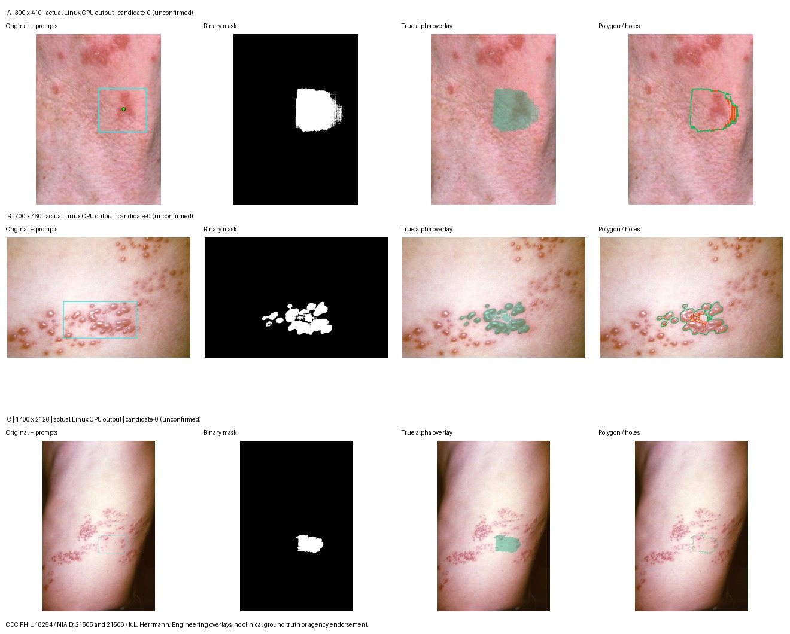

# 腾讯云 MobileSAM 部署前验证报告

日期：2026-11-01，北京时间。目标为已授权的 `acupuncture-server`。本轮是 **P0：独立Linux CPU环境、硬资源限制及少量真实推理验证**，不是正式部署。上轮只读报告保留于 [tencent-cloud-audit.md](tencent-cloud-audit.md)，总进度以 [task.md](../task.md) 为准。

**P0技术验证通过；最终部署决策：CONDITIONAL GO。** 真实MobileSAM可以在这台Linux服务器的1.5GiB/1CPU限制内加载并完成本轮三张图片的分割/导出。原服务在线期间未观察到健康失败、PID变化或重启；两套常驻FastAPI的长期/真实业务并发稳定性尚未验证，B的生产门禁/域名/隐私准备仍未完成。

## 1. 当前环境：本轮重新检测

| 项目 | 开始/结束实际数据 |
| --- | --- |
| 连接 | 已有SSH别名连接成功；沿用已知主机校验，无私钥/密码输出 |
| 系统 | Ubuntu24.04.4 LTS、x86_64、glibc2.39，系统Python3.12.3 |
| CPU | AMD EPYC来宾系统4逻辑CPU；不是型号名称中的48核 |
| RAM | 3,812,564KiB = **3.64GiB** |
| MemAvailable | 开始2,930,500KiB（约2.79GiB）；结束2,912,416KiB（约2.78GiB） |
| Swap | 总1.94GiB；开始0，安装结束后观察到**12KiB静态占用**，后续各模型阶段不增长 |
| 系统盘 | 40GiB块设备；开始可用约30.69GiB，结束可用约**29.47GiB** |
| 系统负载1/5/15分钟 | 开始0/0/0；结束约0.02/0.08/0.04 |
| 原后端/Nginx | 127.0.0.1:8000、80/443；结束8001仍未监听 |

初始健康与就绪均200、ai/model/results布尔均true，可用内存与磁盘满足本轮安全预算，才进入环境准备。证据：[初始状态](validation-records/tencent-cloud-mobile-sam-p0-20261101/initial-state.json)、[最终状态与逐项摘要](validation-records/tencent-cloud-mobile-sam-p0-20261101/final-state-and-summary.json)。

## 2. 独立测试环境与兼容性

新建并保留的唯一项目测试根目录：

```text
/srv/dermatome-preflight-20261101-p0/
├── .venv/                    # 独立Python3.12.3环境
├── model/
│   ├── MobileSAM-source/     # 固定官方源码与单份权重
│   ├── source-manifest.json
│   └── wheelhouse/           # 单份CPU wheel及其他依赖包
├── ai/                       # 当前项目AI模块的测试副本
├── samples/                  # 3张既有公开源及1张派生尺寸图
├── scripts/                  # 监测控制、安装和单图驱动
├── outputs/                  # 3次推理的真实Mask/预览/JSON
└── logs/                     # 原始指标、失败尝试和结束复核
```

没有覆盖已有目录，没有进入或修改 `/srv/acupuncture`，没有在系统Python或原venv安装包。执行身份为测试目录拥有者；本轮只使用明确可用的公开图，不接受患者照片。

核心依赖实际安装为：Python3.12.3、**torch2.5.1+cpu、torchvision0.20.1+cpu、timm1.0.12、NumPy2.1.3、Pillow11.1.0、Shapely2.1.2、psutil6.1.1**。直接依赖沿用项目固定版本，CPU构建替代Apple运行包；完整解析版本及每个安装包大小/SHA见 [packages.json](validation-records/tencent-cloud-mobile-sam-p0-20261101/server/logs/packages.json)。`pip check`通过，真实导入/模型运行进一步证明该组合可用。

当前交互式SAM路径不调用AMG的可选OpenCV小区域处理函数，**本测试venv未安装OpenCV**，也没有从A环境借用NumPy/OpenCV。未安装B的FastAPI服务层或启动Web服务器，因此普通ASGI/HTTP开销不属于本轮实测。

CPU wheels来自PyTorch官方下载源。普通依赖的PyPI直连先遇到超时/极慢下载，最终按[腾讯云官方软件源说明](https://cloud.tencent.com/document/product/213/8623)临时使用 `https://mirrors.cloud.tencent.com/pypi/simple`；只在命令行指定，保留TLS验证，**没有修改pip全局/用户配置、没有trusted-host绕过**。第三次完整安装约34.6秒（不含前两次网络等待），不是模型性能指标。

## 3. 模型来源和校验

- MobileSAM **vit_t / package1.0 / Apache-2.0**。
- 官方固定提交：`f706ad9c4eb7f219c00d9050e46328518ffb65d2`，来源 [MobileSAM官方仓库](https://github.com/ChaoningZhang/MobileSAM)。
- 权重40,728,226字节（约40.7MB/38.84MiB），SHA256 `6dbb90523a35330fedd7f1d3dfc66f995213d81b29a5ca8108dbcdd4e37d6c2f`。
- 重新获取官方固定提交Git tree，核对本机现有20个源码/许可/权重文件的Git blob和SHA；上传后在隔离目录再次核验。模型适配器加载时仍执行大小/哈希/严格state_dict校验及`weights_only=True`。
- 沿用当前项目AI预处理、MobileSAM适配器、局部推理、候选诊断、Mask→Polygon和导出模块；测试驱动没有另写分割算法。
- 仅CPU/float32，intra/inter线程均为1；HF/Torch缓存指向测试根目录，HF离线模式，不下载第二套模型、不训练、不向第三方传图。

校验清单：[model-manifest.json](validation-records/tencent-cloud-mobile-sam-p0-20261101/model-manifest.json)。

## 4. 可执行保护、探针和停止策略

先检查到cgroup v2及cpu/memory控制器，再用一次28ms的轻量transient探针核对实际文件：

| 限制 | 实际设置/验证 |
| --- | --- |
| 内存硬限 | MemoryMax1536MiB，`memory.max=1610612736` |
| 内存软限 | MemoryHigh1280MiB |
| 测试Swap | MemorySwapMax0，`memory.swap.max=0` |
| CPU | CPUQuota100%，`cpu.max=100000 100000`，约一个逻辑CPU配额 |
| 优先级/任务数 | Nice15、IOWeight10、TasksMax64，作用于测试及其子进程 |
| 超时 | 每个模型任务RuntimeMaxSec90；依赖安装900秒 |
| 清理/异常 | KillMode=control-group、OOMPolicy=stop；退出后回收自己的transient单元 |

不是仅设OMP线程数。资源限制来自**临时systemd单元+cgroup**，没有写永久unit或改原服务配置；监测控制器在外部每约0.5秒采集内存/CPU/全机可用量，每约2秒检查原服务健康、就绪及运行身份。

若原健康失败/ready为false、PID/启动时间/重启数变化、主机MemAvailable<1GiB、任何新增换页I/O、测试Swap非0、测试内存达到硬限90%、cgroup OOM、主机负载过高或模型持续占用约一核超过20秒，停止**本轮新增单元**，不重启A。每次图像阶段前另检查RSS/HWM余量。

初版绝对零Swap预检在12KiB时拦住加载；确认连续4次采样pswpin/pswpout不变、内存PSI为0、原服务健康后，修订为允许≤1MiB静态旧占用，**模型阶段任何新的swap I/O立即停止**。硬内存/CPU/测试零Swap限额未放宽。该修订依据用户“持续Swap压力”停止条件，未把12KiB隐瞒成0，也未执行swapoff清理原系统。

[探针输出](validation-records/tencent-cloud-mobile-sam-p0-20261101/limit-probe.txt)、[明确策略](validation-records/tencent-cloud-mobile-sam-p0-20261101/test-policy.json)、[Swap静态复核](validation-records/tencent-cloud-mobile-sam-p0-20261101/static-swap-observation.json)、[监测驱动](validation-records/tencent-cloud-mobile-sam-p0-20261101/guard.py)。

## 5. 真实加载结果

纯加载任务在19:13执行，通过全部资源检查，正常退出：

- 模型构造：**1.761秒**；包含Torch等导入到加载结束：**3.103秒**。
- 加载后RSS：**379.06MiB**。
- 本任务进程高水位：**388.61MiB**；`/usr/bin/time -v`为397,936KiB，与进程记录一致。
- cgroup记录峰值约340.21MiB；与RSS共享文件页的归属口径不同，不相加、不混称同一指标。
- 线程intra=1/inter=1，任务平均约占一个核的92%，受CPU配额限制；采样峰值约100%一核，**不表示整台4CPU主机被占满**。
- 主机可用内存最低约2.51GiB；原健康/就绪均200；测试Swap0，系统12KiB静态Swap不变，无OOM。

远低于本次1.5GiB上限，因此逐级继续图像测试。证据：[加载记录](validation-records/tencent-cloud-mobile-sam-p0-20261101/server/logs/load-result.json)、[监测](validation-records/tencent-cloud-mobile-sam-p0-20261101/server/logs/load-monitor.json)、[time -v](validation-records/tencent-cloud-mobile-sam-p0-20261101/server/logs/load-time.txt)。

## 6. 三张图像的真实推理与完整输出

执行**1次纯加载+3次单图任务**；每个任务独立进程，只加载一个实例，前一任务结束/资源健康复核后才开始下一项。没有同时运行多个模型，也没有循环多图压测。独立进程便于测每次高水位，不能据此宣称长期缓存模型没有内存增长。

样本均为V5.1已核验的公开CDC PHIL素材；A为既有去脸颈部裁图，B为原图，C为CDC21506原图2倍派生尺寸图。C约2.98MP，**没有新增真实拍摄细节、不是额外独立病例**，仅用于容量验证。B和C原始素材为同一病例。许可/署名见 [sources.json](../ai/experiments/sources.json)；未用私人患者照片。

| 项目 | A：小图 | B：常规尺寸 | C：相对较大图 |
| --- | --- | --- | --- |
| 图像 | CDC18254既有颈部裁图 | CDC21505原图 | CDC21506，700×1063→1400×2126派生图 |
| 定向原尺寸 | **300×410** | **700×460** | **1400×2126，2.98MP** |
| 提示 | 框+1前景点 | 框 | 框+1前景点 |
| 策略 | 当前context_crop | 当前context_crop | full_image回退路径 |
| 实际网络输入 | 均ResizeLongestSide后补齐1024×1024，1张/次 | 同左 | 同左 |
| 预处理 | 0.010秒 | 0.012秒 | 0.135秒 |
| 纯模型推理 | **3.813秒** | **4.065秒** | **3.210秒** |
| 分割链路（含质量/轮廓） | **3.921秒** | **4.199秒** | **3.517秒** |
| 轮廓/候选几何阶段 | 0.105秒 | 0.131秒 | 0.304秒 |
| 工程PNG/JSON导出 | 0.452秒 | 1.025秒 | **6.172秒** |
| 全进程总耗时，含导入/加载/导出/校验 | **7.088秒** | **8.088秒** | **13.292秒** |
| Linux峰值RSS，time与ru_maxrss一致 | **659.55MiB** | **659.93MiB** | **660.44MiB** |
| cgroup内存峰值 | 559.15MiB | 560.93MiB | 560.48MiB |
| 任务结束前RSS，尚未退出 | 490.12MiB | 475.21MiB | 545.86MiB |
| 最低主机MemAvailable | 2.30GiB | 2.31GiB | 2.31GiB |
| 进程CPU平均，占单核 | 99.48% | 98.83% | 99.93% |
| 真实候选 | 3张原尺寸Mask，均非空/轮廓合法 | 同左 | 同左 |
| 首候选片区/孔洞 | 22/101 | 16/25 | 10/4 |
| 原服务 | 健康/就绪200，身份不变 | 同左 | 同左 |

C只在A/B高水位约660MiB、停止原因为空、主机仍有余量且A健康时才执行；本轮未测12MP上传上限。所有细分都是实测，没有套用M4速度。各图复杂度/ROI/resize不同，不能因C推理稍快就称大图更快，也不能由相近高水位推断所有12MP照片只需660MiB。

工程导出包含原图、3组二值Mask/透明alpha/覆盖图/轮廓图及JSON；大图6.17秒主要是这些导出成本。它比现有HTTP发布的输出集合更多，**本轮不是完整FastAPI响应耗时测试**，不能把这些数直接当生产SLA。总耗时包含新进程导入/加载，长期常驻模型的真实请求成本另验。

9个候选保留全部片区和孔洞；下载真实Linux产物后，在本机以独立Shapely回栅格逐像素核对9张Mask，全部一致。该检查不再增加服务器推理负载，也**不代表医学分割准确率**。C等提示仍可能选中用户不期望的皮肤，工程可运行不等于病灶范围正确，继续需要人工确认/修正。



图源CDC PHIL：18254/NIAID、21505及21506/CDC K.L.Herrmann；覆盖与轮廓为本地实验添加，无机构背书或专家真值。完整原始输出在服务器测试目录outputs，以及本机忽略目录`ai/experiments/outputs/tencent-linux-p0-20261101/outputs`；没有提交模型/批量实验图。

逐图 [A结果](validation-records/tencent-cloud-mobile-sam-p0-20261101/server/logs/A-result.json)、[B结果](validation-records/tencent-cloud-mobile-sam-p0-20261101/server/logs/B-result.json)、[C结果](validation-records/tencent-cloud-mobile-sam-p0-20261101/server/logs/C-result.json)，对应`*-monitor.json`/`*-time.txt`保留完整采样与time原始数据；[汇总](validation-records/tencent-cloud-mobile-sam-p0-20261101/metrics-summary.json)、[Mask核对](validation-records/tencent-cloud-mobile-sam-p0-20261101/mask-polygon-verification.json)。

## 7. Swap、OOM、异常和原项目影响

- 安装后观测到系统Swap **0→12KiB**。不能断言必然由某一测试进程造成；它不是0，但复核期间无持续换页，所有模型任务的系统Swap均为12KiB→12KiB。
- 所有模型任务cgroup Swap为0、OOM/oom_kill为0；最终全机`oom_kill=0`、pswpin=0/pswpout=1（后两者自复核起未变），没有观察到模型引发OOM或新增换页。未清空系统Swap来美化结果。
- 原服务开始和结束均PID3480408、启动2026-10-31 23:51:02、NRestarts0，RSS均269.49MiB。Nginx仍PID12643、启动2026-10-08 13:25:29、NRestarts0。
- 四个模型阶段记录21轮在途健康/就绪采样，均200、ready布尔均true；在途探针最大约1.72ms。初始/最终单独探针有约27～32ms的health读数，不能拿缓存/测量差异宣称原服务变快。
- 核对原systemd、Nginx与启用站点、A核心源码和venv.cfg共6项哈希，开始/结束一致。没有读数据库业务内容，没有改原环境、服务、Nginx或证书。
- 原项目真实图片推理、教师同时使用、考试完整流程均**NOT_RUN**。结论是“本轮短时受控负载未观察到健康失败/重启”，不能保证生产业务延迟完全不受影响。

异常保留：第一轮PyPI超时；监测器在任务已经清理、日志已写后，摘要打印把flush传给json.dumps而报错，已修复并验证序列化；第二轮官方源下载仅约14KB/s，被主动结束，保留已下载CPU wheel；第三轮临时切换腾讯云官方HTTPS镜像安装通过。首个绝对零Swap加载预检也按失败/未运行保留。**没有把前两轮已经回收单元的systemctl缺省Result=success当作安装成功**；最终安装以pip check/版本记录与真实加载/推理为依据。

一个旧安装SSH客户端在远端任务结束后仍未退出，核对远端无对应任务后仅关闭了该本机连接。结果复制过程中曾在压缩流未结束时读取，校验报EOF；待传输完成后重新读取、验证归档安全路径并完整提取，9张Mask核对通过，未使用不完整文件。

## 8. 容量判断：实测、估计、未知

**实测：** 原项目在线时，受限模型单进程可以加载；本轮三张图峰值RSS约660MiB，模型结束前RSS约475～546MiB；纯加载379MiB。测试期间主机可用内存最低约2.30GiB，内存余量较好。安装任务cgroup峰值约1.17GiB（主要有包处理/文件缓存），这是**安装峰值，不能冒充模型峰值**。

**推断：** 现有4CPU/4GB级机器有条件容纳A和一个受限B模型实例，MobileSAM单实例常驻在内存上可作为候选。保持**单Worker、单并发AI、显式1线程和约1CPU配额**；本轮仅证明这些条件，不建议直接改成多worker/多模型副本或用4线程占核。

**未知：** B常规FastAPI服务开销、真实HTTP上传/解码/修正/取消全部分支峰值、12MP、更多碎片/孔洞、长时间反复推理后的allocator保留与增长、多用户等待时间、A教学推理同时忙碌的竞争均未验证。独立单图CLI通过不等于双服务长期稳定，内存没有OOM也不能证明多人CPU响应合格。

从本轮结果**没有必须立即升级8GB的证据**。若期望保留12MP、大量并发、较严格教学可用性或实测峰值逼近预算，8GB更有余量；它不能直接缩短CPU计算。先保持单实例和图片/访问限制，再根据真实HTTP与长时监测决定升级；本轮没有查询价格、购买或升级。

## 9. 下一阶段方案和缺少条件

建议延续原架构：A的独立venv与`acupuncture.service`/回环8000保持；B另设独立生产venv/用户/临时目录、未来`dermatome.service`/回环8001，通过Nginx独立HTTPS域名转发。当前**没有创建长期B服务、未开放8001、未改Nginx**。

后续正式准备至少包括：

1. 用户确定B域名、DNS与主体授权，配置适用的独立HTTPS证书；A现有单域证书不能自动覆盖B。
2. 微信后台为B配置request、uploadFile、downloadFile HTTPS域名，填入真机base URL并验证；现有仅develop+devtools入口和后端development/test门禁需要独立、明确的受控生产审查，不能直接用开发开关公开发布。
3. 把线程参数显式传给既有加载入口（当前生产候选入口默认4线程），单Uvicorn worker、单AI槽，保留繁忙拒绝/重试；结合实际业务设置1CPU配额、内存边界与超时。初期1.5GiB上限是本轮验证预算，**没有已经配置到正式服务**。
4. 初期可考虑≤3MP及适当文件字节上限，但还要用真实拍摄/最复杂允许形状测试；本轮C是放大派生图，不能代表所有3MP手机图。同步对齐前端、ASGI、Nginx及multipart余量，超限明确拒绝，不静默改变用户确认轮廓。
5. 上传访问与滥用限制、敏感图片用途说明/可信后端/私有会话、独立存储、TTL/磁盘总量和自动清理；未具备这些条件前继续使用公开/合成测试图。
6. 独立预发布环境做全HTTP和长时串行稳定性、取消/超时/恢复及允许的轻量A/B业务共存验收；发布/回滚计划、维护窗口和监控告警就绪后，再单独授权正式部署。原图谱/医学边界不因部署而升级状态。

**暂不需要拆成多套同机微服务。** 一个B API进程内复用模型最简单；未来常规API需要多worker、模型需要独立重启/更强限制、或AI流量影响A时，再考虑唯一推理进程或独立机器。把AI拆到同一台4GB服务器不会增加物理内存。

## 10. 本轮服务器文件、依赖和清理说明

服务器并非“完全没有变化”：本轮按授权新增测试根目录、venv、固定模型源码/权重、CPU依赖包、合法测试图、驱动、日志和输出。结束盘点：venv约976MiB，model（含单份权重及wheelhouse）约250MiB，samples约1.8MiB，outputs约17.6MiB，logs约1.6MiB，其余源码/驱动约0.1MiB，根目录总约**1.22GiB**。完整包列表/哈希见packages.json。

临时`dermatome-p0-limit-probe-*`/`install-*`/`load-*`/`a-*`/`b-*`/`c-*`单元由systemd-run创建并回收，没有永久systemd服务配置。结束时全部临时单元和测试模型/控制进程为空，没有长期驻留MobileSAM或Web服务，原8000与80/443不变。

中止pip后，在同用户/本轮时段发现59个`/tmp/pip-*`**候选临时目录**，总约3.73MiB；仅所有者/时间能匹配，未将它们全部断言为本轮独占，也未批量删除。精确清单见 [pip-temp-inventory.json](validation-records/tencent-cloud-mobile-sam-p0-20261101/pip-temp-inventory.json)。pip全局cache未启用；没有保留多份大型torch wheel。正常pip构建使用的其他临时目录会自行回收，系统的SSH/sudo/systemd日志也会自然增加。

清理建议：先保留本地报告、模型清单、指标和必要公开预览；用户确认不再复现后，删除**本轮精确测试根目录**即可撤销该环境。`/tmp`候选应按清单核对所有者/mtime/是否在用后逐项处理，不使用通配符批量删除未知目录。不要删除`/srv/acupuncture`、系统Python、原venv或原服务配置。当前临时单元已回收，无需撤销永久服务。**本轮没有执行整目录删除**，保留环境供审查。

本机新建本报告、`docs/validation-records/tencent-cloud-mobile-sam-p0-20261101/`证据和`task.md`追加记录；原始Linux公开输出下载在忽略的`ai/experiments/outputs/tencent-linux-p0-20261101/`。276个本机应用代码文件与基线哈希一致，未修改分割/匹配/人体/小程序业务逻辑，未提交或推送Git。

## 11. 最终决策与证据索引

**CONDITIONAL GO：** Linux兼容与本轮受限单进程推理已通过，可进入受控预发布/生产准备；资源上暂不强制升级8GB。不得直接把本轮当作正式部署、长期共存或多用户性能验收。

- 实测成功：1次独立加载、3张串行真实分割、9个原尺寸Mask/合法轮廓、9项独立像素回栅格一致、实际硬限与全过程健康采样、结束无进程/端口遗留。
- 未执行：生产B FastAPI服务、Nginx/DNS/HTTPS变更、真机、公网上传、敏感患者图、12MP极限、双业务多用户并发、长时持续压力、故障注入/OOM试验、训练或云资源升级。
- 原服务：身份不变、健康/就绪正常、6项核心文件指纹相同；不能据此声称整个服务器无变化或全部业务时延无影响。

证据目录 [P0记录](validation-records/tencent-cloud-mobile-sam-p0-20261101/)，关键核对 [protection-verification.json](validation-records/tencent-cloud-mobile-sam-p0-20261101/protection-verification.json)。原始监测/安装失败和`time -v`见`server/logs/`；控制/安装/单图驱动保留于同一证据目录。本轮结束，等待用户审查，不自动部署。
