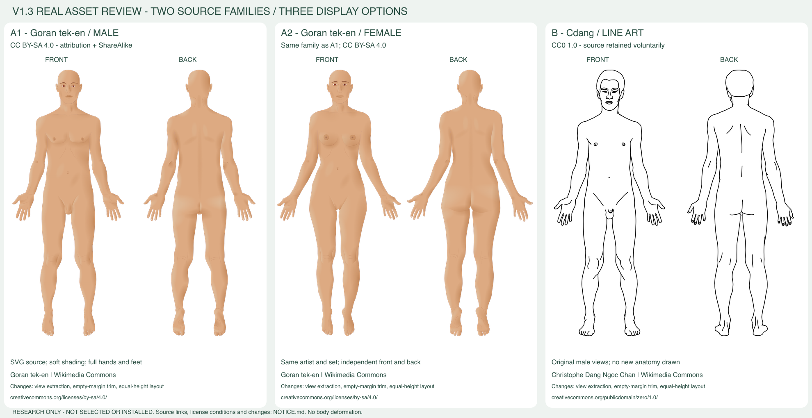

# V1.3 人体素材调查与替换决策

调查日期：2026-10-22（Asia/Shanghai）。本轮只做调查、原文件检查、许可核验与预览，**没有替换运行模型**。当前仍为neutral-body-v3 / 3.0.0、400×900；所有候选放在docs/research，未进入miniprogram。唯一总进度见[task.md](../task.md)。

建议优先选择 **A1：Goran tek-en 男性正背面**；若需要女性体型，选择同系列A2。前提是接受素材CC BY-SA 4.0的署名及适用改编同许可分享要求。若交付不接受这些条件，B线稿的CC0许可更简单，但视觉档次较低；更合适的长期替代是委托专业医学插画师制作并明确商用/修改/打包权利。

本轮获得**两套来源系列、三个展示选项**。A1/A2属于同一作者系列，不能算两套独立来源。没有凑出3～5套同时满足质量、双视图、源文件与商用许可的正式方案。另保留Servier排除样本、付费图库及开源项目调查说明。

## 1. 当前模型为什么不宜继续修补

已阅读AGENTS、task、README、architecture、atlas-spec，并检查neutral-v3.ts、body-models.ts、body-regions.ts、render.ts、body-path.ts、body-debug.ts及coordinate.ts。现有[四栏图](validation-records/v12-comparison-2026-10-22.png)已经实际查看，以下是工程视觉评价，未经医学专家审核。

| 当前缺陷 | 结构原因与后果 |
| --- | --- |
| 颈肩像细颈接宽肩盖 | 少量曲线控制整个斜方肌/锁骨/三角肌过渡，缺少可信的表面结构；整体平滑不等于解剖自然 |
| 胸腰骨盆不协调 | V1.2调整了宽度和高度，但胸廓/腰/髋主要仍靠外轮廓收放与稀疏线条表达，腰髋曲线偏程式化 |
| 四肢长度与姿态仍僵硬 | 移动裆点和膝线可以满足比例断言，却不能自动形成自然的肢体体积、承重与关节转折 |
| 肘膝踝结构不足 | 肘、膝主要是短弧线，踝部是一段收窄，缺少稳定可辨识的结构；正背面轮廓完全相同也限制了真实差异 |
| 手脚过于简化 | 手指由连续短折线/二次曲线组成，掌指关系弱；脚掌近似楔形，没有足趾及足跟层次 |
| 整体玩偶感 | 左右严格镜像、少量符号线和统一渐变的组合，难以达到成熟医学插画的体积感；局部修补会不断牵动相邻曲线和区域 |

原实现是TS中的Canvas路径，没有独立的高质量SVG原画。离线SVG是路径导出物。坐标/命中代码可保留为工程基础，但它们验证的是“点是否落在声明的设计位置”，不是“人体画得是否专业”。不再以这些路径继续修补为主路线。

## 2. 真实素材与预览

所有六个人体展示高度统一650px，白底；只从原SVG抽取原有视图组、去掉透明空白、等比例缩放和排版，没有重画、变形或用前面翻转冒充背面。组合图1980×1020，已实际看图。它是**素材比较图**，不是微信渲染测试。原文件及派生预览的署名与许可见[NOTICE](research/v13-materials/NOTICE.md)。

| 选项 | 来源 / 作者 | 正面 / 背面真实预览 | 视觉与比例评价 | 格式 / 配准成本 |
| --- | --- | --- | --- | --- |
| A1 男性写实阴影 | [Commons文件页](https://commons.wikimedia.org/wiki/File:Male_front-back_3d-shaded_human_illustration.svg)，Goran tek-en | [正面](research/v13-materials/a-male-front-preview.png) / [背面](research/v13-materials/a-male-back-preview.png) | 成人体型自然，颈肩、膝踝、手足明显比当前细致；肤色与柔和阴影适合医学软件。上臂距胸廓较近，小屏应补验 | 原始SVG813×946左右，1,002,501字节；局部区域和命中需重建，中等工作量 |
| A2 女性写实阴影 | [Commons文件页](https://commons.wikimedia.org/wiki/File:Female_front-back_3d-shaded_human_illustration.svg)，同一作者同系列 | [正面](research/v13-materials/a-female-front-preview.png) / [背面](research/v13-materials/a-female-back-preview.png) | 同风格完整双视图，手部、躯干与下肢有形体；性别/体型特点清楚，不能与男性共用所有坐标 | 原始SVG897×946左右，1,181,556字节；单独模板及独立配准，成本与A1相近 |
| B 男性人体线稿 | [Commons原四视图页](https://commons.wikimedia.org/wiki/File:Silhouette_femme_homme_anterieur_posterieur.svg)，Christophe Dang Ngoc Chan（Cdang） | [正面](research/v13-materials/b-male-front-preview.png) / [背面](research/v13-materials/b-male-back-preview.png) | 基于实际成人照片描线，有真实轮廓差异，清爽易叠色；线条较粗、缺体积和肤色，不如A成熟，只作备选 | 原SVG446×918左右、363,932字节，含男女前后四组；取原男性两组。外轮廓仍需核查闭合，中等工作量 |

A、B均有真实头颈、躯干、骨盆、双臂掌指及双腿足，背面具有独立后枕/肩胛/臀背细节。A男女为同套素材；B也是同作者前后配对。上述“自然/较细致”为实际看图判断，没有虚构头身测量、专业医学审核或临床准确率。

A与B的来源链都可追溯到Mikael Häggström的Human Body.jpg，因此它们不是两个独立的人群/解剖学参考标准。本轮没有下载原人物照片或将其纳入项目。

## 3. 商业许可逐项核验

依据为**具体文件页许可**及Creative Commons官方条款，不以Commons平台身份推断公共领域。

| 必查项 | A1/A2：Goran系列 | B：Cdang线稿 |
| --- | --- | --- |
| 原始来源 / 作者 | 上述两份独立Commons文件页 / Goran tek-en | 上述四视图文件页 / Cdang |
| 原始文件可获取 | 是，SVG原字节已取得并记录SHA-256 | 是，四视图SVG原字节已取得并记录SHA-256 |
| 免费 | 是，无素材购买费用 | 是，无素材购买费用 |
| 允许修改 | 是，CC BY-SA 4.0条件下 | 是，CC0 1.0 |
| 允许商业使用 | 是，许可没有NC限制，须遵守BY/SA等条件 | 是，CC0明确允许商业复制与修改 |
| 修改后随小程序打包 | 许可允许在各种媒介分发，但必须落实署名、许可、改动说明、适用改编同许可分享及不得额外限制；本轮未验证最终发包合规 | 从该版权许可看允许；仍须保留来源记录并核对其他适用权利，未执行发包 |
| 是否署名 | 必须；采用Goran tek-en，并保留来源链/许可及改动记录 | CC0不强制署名；项目仍保留作者和来源 |
| 再分发要求 | 改编素材继续按CC BY-SA 4.0或许可允许的兼容条件分发；不得以客户独占条款覆盖该素材权利 | CC0没有BY/SA式的署名或同许可分享义务 |
| 许可证据 | [男性文件许可](https://commons.wikimedia.org/wiki/File:Male_front-back_3d-shaded_human_illustration.svg#Summary)、[女性文件许可](https://commons.wikimedia.org/wiki/File:Female_front-back_3d-shaded_human_illustration.svg#Summary)、[CC BY-SA 4.0官方条款](https://creativecommons.org/licenses/by-sa/4.0/) | [原文件许可段](https://commons.wikimedia.org/wiki/File:Silhouette_femme_homme_anterieur_posterieur.svg#Licensing)、[CC0官方说明](https://creativecommons.org/publicdomain/zero/1.0/) |
| 尚未确认的事项 | 用户/客户是否接受SA素材交付：UNKNOWN；实际分发是否施加许可不允许的技术或合同限制：未核验 | 个别商业使用涉及的其他权利/最终交付审核：未核验；医学审核：未取得 |

CC官方说明允许上述条件内的商业使用，也明确不保证全部其他权利。不能把“CC BY-SA”写成“禁止商用”，也不能在此推断“整个应用一律必须开源”。本轮只明确素材及适用改编的义务；最终交付方式须与该义务相容。若客户要求素材及衍生资源独占、禁止再分发，A不适合该条件。

本目录预览已经附作者、来源、许可和改动说明；A适用派生预览保留CC BY-SA 4.0。没有购买任何付费素材、接受新协议或向作者发送消息。

## 4. 调查过但不列为可直接采用的正式素材

| 来源 | 真实调查与许可 | 排除/保留原因 |
| --- | --- | --- |
| C Servier Medical Art 正背面肌肉图 | [正面](https://smart.servier.com/smart_image/musculature-front/) / [背面](https://smart.servier.com/smart_image/musculature-back/)，Les Laboratoires Servier；[真实对比预览](research/v13-materials/c-servier-excluded-preview.png)。免费、可改、可商用；[官方FAQ](https://smart.servier.com/using-smart-images-what-you-can-do/)明确允许移动应用并要求署名。CC BY 4.0无SA义务 | 肌肉纤维/腱膜细节过重，属于去皮肌肉图，不能作皮肤/皮节底图；[格式说明](https://smart.servier.com/using-smart-images-what-you-can-do/)为PNG/PPTX、目前不提供SVG。PNG已看图；PPTX内部可编辑向量是否齐全UNKNOWN，未下载验证 |
| D Irina Mir《Blank body anatomy chart》 | [官方商品页](https://creativemarket.com/irmirx/2185905-Blank-body-anatomy-chart)：男女前后、EPS+透明PNG；本次显示Extended Commercial为60美元，未购买，实际结算另核对。[平台App使用说明](https://support.creativemarket.com/hc/en-us/articles/360026669574-Graphics-Use-in-Apps)及[扩展许可FAQ](https://support.creativemarket.com/hc/en-us/articles/360021011614-Extended-Commercial-License-FAQ)规定应用需扩展许可，并有标题/数量、源素材提取、用户定制等限制 | 未购原文件；小程序打包和未来病灶编辑/导出是否符合其限制UNKNOWN，不能仅买普通Commercial就采用。商品预览链接本次获取失败，未据此编造视觉评分或本地图片。可从商品页人工查看；不列为已授权正式方案 |
| E 开源人体高亮项目 | [giavinh79/react-body-highlighter](https://github.com/giavinh79/react-body-highlighter)自述MIT、SVG多边形来自react-native-body-highlighter | 是肌肉分区交互组件，不等于高质量表面插画；完整原画权利链尚未逐文件核验，素材级许可为UNKNOWN。只借鉴“视觉与交互区域分离”的思路，未下载路径、引入React或安装依赖 |
| B的中性变体 | [Cdang无性别双面线稿](https://commons.wikimedia.org/wiki/File:Silhouette_humain_asexue_anterieur_posterieur.svg)文件页标CC0，属于B同系列 | 原文件请求HTTP429，未获得并实际查看，不以原B男性图冒充中性版预览，也不增算独立候选 |
| OpenStax | [官方人体区域教学页](https://openstax.org/books/anatomy-and-physiology/pages/1-6-anatomical-terminology)有前后教学图 | 本轮未确认该张图独立可编辑源文件及可用无标签版本，未复制为正式资源；教材中的区域名称也不是本项目可直接启用的皮节边界 |

C虽然许可清楚，但视觉内容不符合要求；D虽然是付费正规平台，也不能在许可未落实时列为可投产素材。其他免费聚合站没有可追溯授权的资源未下载。

## 5. 综合比较与推荐

评分为本次工程看图和结构检查的相对判断，不是实验分数。

| 维度 | A1 / A2 | B | C（排除） | D（未授权调查） |
| --- | --- | --- | --- | --- |
| 成人比例、完整性 | 较好，手足/关节细节完整 | 自然成人轮廓，体积表现弱 | 结构较细，内容为肌肉 | 仅商品描述确认双面，未完成看图 |
| 前后一致性 | 同套独立视图，仍需关键点配准 | 同作者双面，前后轮廓不完全相同 | 同系列肌肉双面 | 源文件未取得 |
| 医学教学视觉 | 当前最适合，阴影可在选定后评估弱化 | 适合清爽标记表，非写实终稿 | 教肌肉可用，皮肤覆盖不宜 | UNKNOWN |
| SVG可编辑性 | 有原生矢量，渐变较复杂 | 有矢量，结构更简单 | 官方暂无SVG，PPTX内部未知 | EPS说明存在，未验证 |
| Canvas适配 | 推荐SVG编辑源+本地透明PNG；需新图片绘制适配 | PNG或规范化简单路径；不直接粘贴SVG | PNG容易，内容不适配 | 授权后还需格式转换 |
| 叠加便利性 | 柔和表面，适合轮廓/标签覆盖；需检查对比度 | 无阴影，叠色最清爽；高亮需另设填充/遮罩 | 纹理会与皮节/病灶边界竞争 | UNKNOWN |
| 商业许可 | 免费，BY-SA义务明确，交付条件需接受 | 免费，CC0义务较少 | 免费，BY明确 | 付费扩展许可及适用性待确认 |
| 维护成本 | 原画复杂但运行PNG可控，保留来源和导出流程 | 低于A，但若追求写实需另行插画制作 | 不建议花费精力改造成皮肤图 | 受授权范围和原文件质量影响 |

**推荐A1作为当前默认底图候选，A2作为同系列女性备选。**它们最接近用户要求的成熟人体表面插画，前后、手足、膝踝均可直接观察，不依赖开发者重新拼一个人体。A1/A2的许可条件应作为选型的一部分，不能留到交付时再处理。

如果A的自然度仍不符合用户预期，不建议退回v3继续修补。可选择专业委托：先做一组缩略稿，经用户确认后交付同一骨架的前后SVG/透明PNG、独立闭合外轮廓、关键位置层、来源与商用/修改/打包/交付客户授权。医学插画师应参与视觉审核；委托报价及工期本轮未询价，不虚构预算。

## 6. 后续迁移影响（尚未实施）

| 项目文件 / 数据 | 选定后需要的工作 |
| --- | --- |
| miniprogram/assets/body/ | 新增选定源SVG及透明PNG、署名许可文件，保留neutral-v3等历史；本轮候选不直接复制进去 |
| data/body-models.ts | 新模板/geometryId/regionSetId及版本；男女若都启用须各自绑定，不冒用neutral-body-v3；withBodyVisual的样式替换接口不适合跨几何换图 |
| types/dermatome.ts | 若采用PNG，评估最小的图片视觉类型；现有BodyVisual只表示路径。避免引入完整SVG解析框架 |
| components/body-canvas/render.ts及body-canvas.ts | 新增本地图片异步加载/缓存/失败重试，以现有viewport等比drawImage；保持DPR、旧回调隔离和单点重投影。当前没有该能力，不宣称直接换文件即可运行 |
| 逻辑画布 | 来源每个人体的宽高与现400×900不同；选定后固定“同骨架高度、公共留白、同尺度”的正背面逻辑画布。原始双联图不能直接作为单面宽高，PNG去透明边距与逻辑矩形之间要保存明确变换 |
| data/body-regions.ts | 正背面16个粗区域多边形全部重新核对/建立，尤其肩、腋、腕、裆、髋、膝、踝和手足；旧区域只能作名称清单，不能作新坐标 |
| 轮廓命中 / 遮罩 | 从选定源闭合外轮廓或经审核的透明alpha外缘生成，绑定同一导出变换；臂躯/腿间空隙必须排除。PNG矩形不能当人体命中区，肌肉或细节路径不能全当外轮廓 |
| 区域局部视口 | 重建各区域bounds，逐项检查头/手/足不误裁切以及胸腹/背部留白；图像画布和overlay共用同一坐标框 |
| 前后配准 | 前后图独立，不水平翻转。肩/肘/腕/髋/膝/踝纵向对应应检查，但不要求两个外轮廓逐点相等；自然前后结构有差异 |
| utils/coordinate.ts / body-debug.ts | 归一化和fit/focus/reset公式原则上复用；传入新逻辑尺寸和同源矩形。保留版本/view隔离，不迁移旧调试点。实际十字、滚动、DPR另实测 |
| tests/miniprogram/ | 原公式测试保留；资源与版本测试更新，新建独立关节点/区域/命中配准夹具。旧“前后outline完全相等”的断言不能硬套外部素材，要改为各自资源匹配及骨架位置校验 |
| 后续医学图谱绑定 | 未来正式图谱必须绑定新模板、view、画布/资源哈希及审核版本；人体素材的开放许可不能替代皮节图谱许可或医学审核。本轮data/atlas不变 |

**整体仿射变换不足以完成旧模型到新人体的配准。**全图的缩放/平移可处理坐标框与留白，不能同时修正旧头肩、肘腕、裆膝、踝足的所有对应差异。应在新素材自身坐标中重新建立粗区域和命中数据，分别验证前后；不能把旧多边形整体拉伸后当作已正确配准。

技术工作量初估：单一体型正背面约**3～5个工程日**，包括资源整理和最小绘制适配、区域/轮廓配准、自动与微信视觉验证；额外女性模板约增加1～2日配准/验收。是未实施前的估算，不包含等待用户选择、版权答复、插画委托或医学审核。若需要复杂路径重放而不用PNG，工期会上升；本轮不以具体数字承诺性能。

PNG方案需要按最大局部缩放/DPR选择分辨率并实测解码/内存；不会只放大低分辨率缩略图，也不把SVG原画全部路径转入TS。A原SVG本地渲染已成功，不证明微信能直接解码SVG；小程序中的图像显示、overlay剪裁、缓存及多机型仍为NOT_RUN。

## 7. 选定后的顺序与本轮边界

1. 用户选A1、A2、B，或决定专业委托；同步确定是否接受A的BY-SA交付条件。**此步之前不替换。**
2. 固定所选原文件、作者/许可/来源哈希，整理正背面和公共逻辑画布；只做约定的视觉清理并记录改动。
3. 新模板版本升级，SVG作编辑源；若选PNG运行方案，完成本地图片绘制与同源遮罩适配。
4. 在新坐标下建立正背面粗区域、命中、关键位置和放大范围；医学皮节仍不启用。
5. 分别执行坐标公式测试、关节/区域配准、真实内外点击和十字误差验证；三种模拟器与真机分开记录。
6. 用户查看全身/各局部/正背面实机预览后进行视觉验收；只有实际替换和验证完成才更新任务状态。

本轮运行模型、旧资源、区域数据、Canvas公式、命中/缩放逻辑、业务页面及后端保持原字节。未实现V2/V3，未提交或推送。原文件下载记录、SVG结构检查、预览尺寸与失败记录见[调查记录](validation-records/v13-research-2026-10-22.txt)；最终文件边界检查见[验证记录](validation-records/v13-validation-2026-10-22.txt)。本轮没有运行新素材的微信测试，也不继承旧版62项通过作为新素材验收证据。
