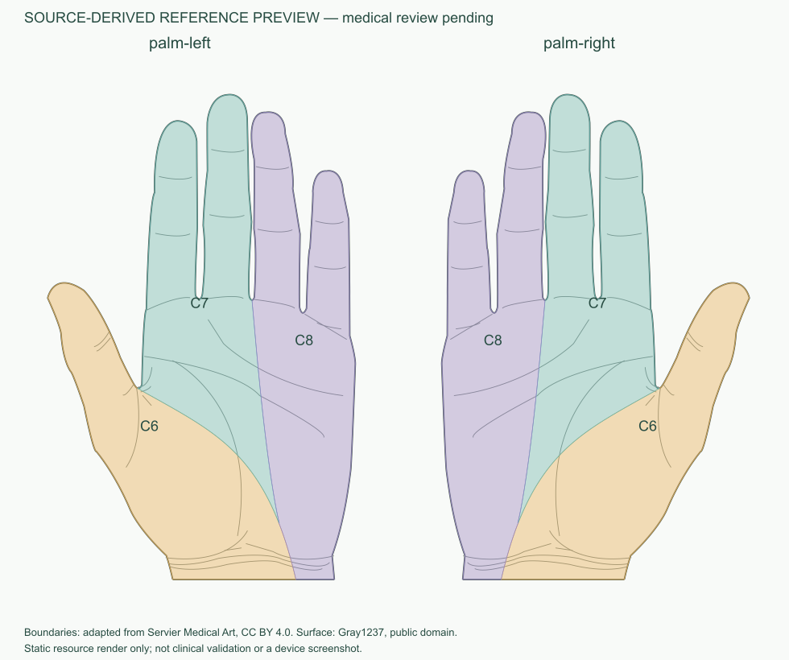

# 特殊部位：脚底、腋下与独立手掌历史记录

> V6.6更新：当前特殊部位为左右脚底及左右腋下。脚底仍可按原Goran图谱参考计算；腋下新增局部观察窗、人工圈选及独立会话，皮节边界未配准，保持ATLAS_NOT_READY。独立手掌继续退役。见[V6.6报告](validation-records/v6.6-axilla/report.md)与台账。下方V6.1/V6.4/V6.5段落为各轮历史，不代表恢复掌功能。

> V6.5更新：下文V6.1是历史记录。当前左右手掌/手背在全身front/back标注；独立掌入口、运行资源和后端加载器已退役。特殊部位仅保留左右脚底，共享页面/会话/Canvas改名local-surface。历史来源和许可证仍保留，不自动迁移旧掌坐标。见[退役记录](validation-records/v6.5-main-body-hand/removed-palm-feature.md)。

2026-11-04更新。总进度以 [task.md](../task.md) 为准。当前已实现左右掌侧显示、人工标注、独立会话、Servier真实来源边界及参考匹配；医学审核仍待完成，完整微信计算流程尚未实测。**本地实现不代表服务器或手机体验版已经更新。**

## 入口与范围

人体选择页→特殊部位→左手掌/右手掌。支持逐点圈选、撤销、取消草稿、闭合、多片标注、选择删除、完成范围、计算参考区域、全部/单标签高亮、返回修改和放大/复位。标签来自实际图谱数据。正常回到全身不清空原front/back会话。

仅实现掌心、掌侧手指及截取的掌腕连接。V6.1当时手背、足底、腋下、大腿内侧、会阴均未实现；足底后于V6.4独立接入，见[足底报告](validation-records/v6.4/开发报告.md)，本页保留手掌版本记录。关闭/重启小程序后内存标注不保证保留。

## 独立坐标与身份

| 字段 | 当前值 |
|---|---|
| viewId | palm-left、palm-right |
| templateId / version | commons-palm-v1 / 1.1.0 |
| geometryId / regionSetId | commons-palm-outline-v2 / commons-palm-ui-v2 |
| 逻辑画布 / 透明PNG | 440×700 / 880×1400 |
| 图谱ID / 版本 | palm-dermatomes-v1 / palm-dermatomes-preview.3 |
| 标签 / 区域实例 | C6、C7、C8 / 左右各3，共6 |
| 技术状态 / 许可 | passed_offline_geometry / verified |
| 医学审核 / 正式映射 | pending / mappingEnabled=false |

原点左上，X向右、Y向下，归一化0～1，复用既有坐标和视口公式。局部手掌和全身有不同模板空间；相同数值不代表同一解剖位置。照片仍是photo_oriented_normalized_v1，不能直接写入手掌或全身。

BodyView仍为front/back；新增PalmView及SurfaceView，通用类型的默认参数保留BodyView。掌侧会话和匹配状态独立，不能混入全身汇总。旧1.0.0反置模板、旧preview.2图谱会话/响应明确拒绝，不自动换侧、镜像或重解释已有标注。

## 展示素材与左右规则

采用 [Gray1237.svg](https://commons.wikimedia.org/wiki/File:Gray1237.svg)，Rhcastilhos矢量化自Carter/Gray图版，文件为公有领域声明并有任意用途后备许可。保留原外形及掌纹，去骨骼血管文字、截腕；没有重画指形或更改比例。每侧366个闭环点，命中与完整皮肤包含共用。

五指朝上、掌心朝向观察者：**左掌拇指在画面左，右掌在画面右**。原始未镜像图是左掌，另一侧用x'=440-x（归一化1-x）生成。此前左右误认已更正，见 [纠正报告](validation-records/v6.1-side-fix/report.md)。本次新增皮节时没有再改展示素材或模板版本。

## 皮节来源、数字化与配准

采用 [Servier Medical Art — Dermatomes](https://smart.servier.com/smart_image/dermatomes/)。官方[署名说明](https://smart.servier.com/how-to-cite-servier-medical-art/)和[使用说明](https://smart.servier.com/using-smart-images-what-you-can-do/)明确CC BY 4.0、商业派生和移动应用使用。当前说明页保留机构、许可、来源和修改署名；展示手掌与皮节参考的许可分别记录。

实际查看官网PNG及原始PPTX第26页前面观：group71682，外形71995、分界曲线72147/72148、C7/C8标签72039/72041。C6掌侧部分与源图标有C6的前臂连续。采用原曲线而非测试点推导，也没有借用正中/尺/桡神经分区。

源图右掌五指向下，转180°后拇指在右。截取源掌腕范围至child-coordinate y=2310，不延入近端T1楔形。四个指蹼连接位置和两个腕口端点构成配准控制组，对原始曲线作均值坐标变换；右掌完成后生成左侧镜像。源图描边交接误差和浮点处理均明确记录，未通过内缩区域或放宽合法性判定掩盖越界。两次整手配准失败草稿保留。

生成器scripts/build_palm_atlas.py默认检查重现，--write导出；随后scripts/sync_palm.py同步身份/哈希与客户端。registration.json保存源路径ID、实际控制点、来源哈希、原始/配准曲线、几何验证及限制。详细证据见 [续查报告](validation-records/v6.1-recheck/report.md) 和 [原文件许可](../data/sources/servier-palm-v1/NOTICE.md)。

技术上6区覆盖当前显示范围，内部无面积重叠，没有添加T1。这只是来源示意图的几何分区，**不表示真实皮节无重叠、每个人相同或配准已通过医学审核**。未映射其他表面，未得到临床准确率。来源图、配准方法和参考对应仍需专业审核。

## 标注、计算与结果

1. 冻结模型注册表提供局部皮肤与图谱身份。
2. Canvas复用fitViewport/focusViewport/canvasToNormalized、触摸换算、V2绘制和P6皮肤索引。
3. V2的editManualView共用逐点/撤销/闭合/多片/删除操作，执行重复、自交、数量及完整皮肤包含检查；跨指缝即使顶点落在皮肤上也拒绝。
4. PalmSessionStore分别暂存两侧，标注带view、ID、basis、atlasIdentity、manual来源和完整MultiPolygon。异步取点携带session/revision/view/layout以拒绝迟到事件。
5. 仍请求/api/v1/evaluate，复用鉴权、环境、超时与V4响应核对。固定图谱注册表加载手掌或Goran数据，不允许请求指定文件路径。
6. 后端验证模板、版本、哈希、左右、来源、皮肤完整包含和准入，再用现有交集/标注面积公式及P6每请求每视图一次并集；没有修改算法。空/未就绪图谱409，损坏503，版本不符409。
7. 返回实际相交候选，允许多候选、未覆盖；只有边界接触不当作覆盖。侧边标签与高亮使用真实区域，孔洞和MultiPolygon沿用原契约。
8. 修改标注/权限/模板/图谱身份即失效；退出取消和迟到请求不能覆盖新会话。正式release/production限制保持。

V5放置仍强绑定全身模板，本轮**没有AI手掌放置**，页面不显示误导入口。将来需要独立验证局部模板、完整包含、会话导入及失效机制，不能把当前照片轮廓直接当掌侧坐标。

## 真实验证与发布状态

本轮前端328、backend+AI256通过（7条既有依赖警告），包含18项新增来源配准测试。8个预先人工选取参考位置×左右2侧验证本来源的对应；不冒充临床测试。现有合成测试保留多片/孔洞/未覆盖/接触零面积/去重/版本/环境门禁回归。

原生微信已实际看到修正后左/右手形、切换计数隔离，以及右掌已有标注的放大/复位。原生操作发生在新图谱写入前；任意坐标点击仍报noWindowsAvailable，因此新增标注、新图谱计算、高亮切换、真机与不同屏幕触摸仍 **NOT_RUN**。静态预览不能替代这些验证。

未部署、未上传体验版、未提交或推送Git。旧服务器未同步手掌数据时无法计算新身份；旧手机代码不会自动新增能力。本轮停在本地工程实现与验证，后续先做对应后端/客户端发布验收和专业配准审核，不自动开发其他部位。
