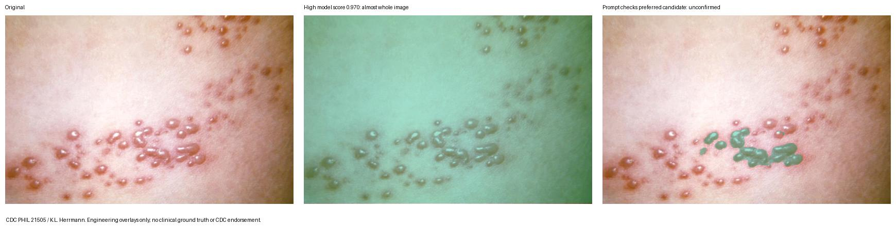
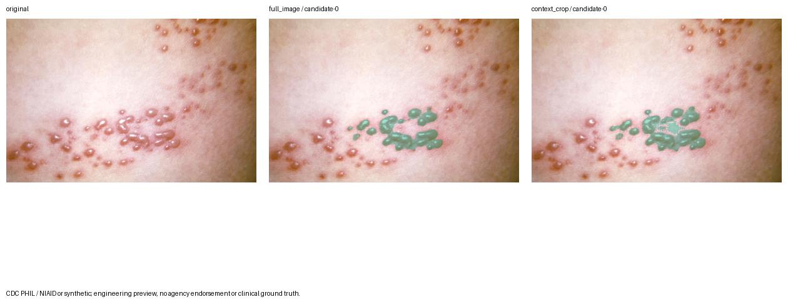
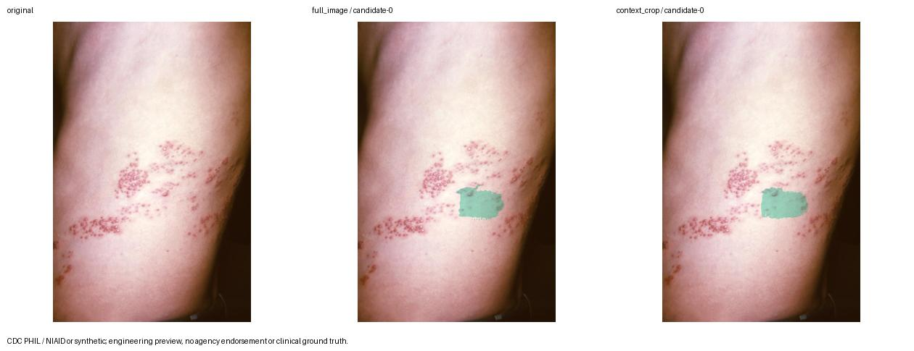
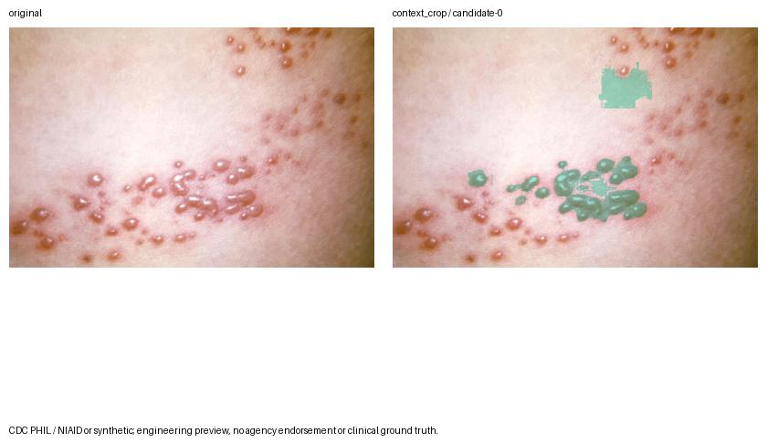
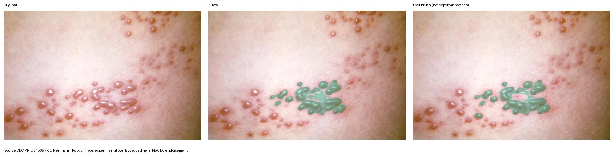

# V5 MobileSAM 过度分割专项：诊断、实现与实测

2026-11-01。唯一进度台账仍为 [task.md](../../../task.md)。**工程改造已完成，模型误选/漏选尚未消除；不能当作临床自动分割。** 本轮没有收到用户所指的新增失败原图/提示，以下诊断针对仓库已有合法样本与真实实现，不冒认已经解释每一张用户照片。

## 1. 原因与排除项

- 复现通用提示分割的语义歧义：CDC21505 多前景点实验 C 的第三候选覆盖 **99.767%** 照片，内部预测分数约 **0.970**；E 的第三候选覆盖 **99.913%**、分数约 **0.994**。模型可能把整片皮肤当作被提示对象，高分不等于病灶正确。
- 旧页面默认预览的是**原始顺序首个有效候选**，并不是按最高分自动确认。此前已有人工确认和大面积警告，但缺少提示遵从度排序、局部推理、真实像素修正。不能把“高分候选很差”误写成“代码自动确认了最高分”。
- 框内仍可能包含正常样皮肤、多个不同目标；背景点不保证模型排除所有非目标区域。F 的低对比度提示位于较淡的下方皮肤区域，仍会得到可疑范围；小框也不能保证正确。普通图像分割模型不理解带状疱疹诊断。
- 未发现前景/背景反转：预测 bool True 原样写 PNG 255，透明层 alpha 只来自相同 True 像素。已检查真实原图、提示图、二值 Mask、覆盖及轮廓。
- 原有 EXIF → 定向原图 → SamPredictor 预处理/原尺寸返回正常；原图和透明层共用 contain 变换。原多边形模块按像素单元求并集，保留孔洞/微小片区，没有闭运算、凸包或强制平滑。所有本轮 57 个返回候选的多边形回栅格均与 Mask 逐像素相同；这是**几何保真性**，不是医学准确率。
- 开发新裁剪功能时另发现一个数值问题：归一化框往返可能把整数边界变成 `214.999999999...`，floor/ceil 会让裁剪多出一列/行，影响模型输出。已对裁剪取整应用 **1e-8 像素浮点容差**并补独立回归。没有平移人体或篡改模型结果。首次 HTTP 证据保留，最终 HTTP 的 B 候选面积与直接像素实验一致。



图像来源 CDC PHIL 21505 / K.L. Herrmann；分割/提示/标识为本地实验添加，CDC 不背书本软件或结果。源许可见 [既有来源清单](../../../ai/experiments/sources.json)。

## 2. 保留模型的最小改造

### 局部上下文与多个区域

保留 MobileSAM vit_t 1.0，官方源 commit `f706ad9c4eb7f219c00d9050e46328518ffb65d2`，Apache-2.0；40,728,226 字节既有权重，SHA256 `6dbb90523a35330fedd7f1d3dfc66f995213d81b29a5ca8108dbcdd4e37d6c2f`，没有重新下载/训练或新增模型依赖。

服务默认 `context_crop`，独立 `segment_image` 默认 `full_image` 保持已有 CLI 实验兼容。每框周边留 `max(16px, 20%×较长框边)` 上下文，边缘限于原照片。框外前景点分配给最近框并扩展其裁剪范围，不静默丢点；裁剪内所有提示转为局部像素。未处于裁剪内的背景点被记录，裁剪外为未推理零值。

模型返回的**真实局部二值 Mask**按整数偏移贴回原图大小，不对 Mask 再缩放、插值，也不把框代替预测。模型在框外的预测仍保留到上下文边界；触及人为裁剪边缘时显示可能截断的警告，可扩大圈选或改用整图。裁剪外不是已验证健康皮肤。

“精细调整 → 补圈一处”支持共 **4 个框**。分别调用同一缓存 Predictor，再对相同候选优先序的局部结果求像素并集，形成至多3个整体替代候选；这是有记录的组合策略，不是穷举 3^N，也不是将3个互斥全图候选全合并。分离片区不连线；孔洞保持，除非另一处实际预测覆盖该孔洞（显式像素并集语义）。多框时整图回退禁用，需重新圈选单框。未增加模型并行队列。

### 候选诊断与人工确认

每候选保留模型评分与原 Mask，附上框并集面积、Mask/框面积比、框外占比、前景包含和背景排除数组、片区/孔洞数、候选两两 Mask IoU。空/无效几何不提供确认。

展示优先级使用可解释的提示违规代价，**不使用 SAM 分数自动接受**：每个未包含前景/误包含背景 +100，框外占比>25% +20，Mask/框面积>2 +10，照片面积占比>65% +5，片区>100 +1；同分保留原顺序。候选 IoU>0.95 提示相似。所有数值只是初始工程提示规则，未按医学标注校准，**不删除/缩小任何大区域**，不宣称规则能判断病灶真假；模型自己的 IoU 分数与候选间几何 IoU 均非临床准确率。

### 轻量真实画笔

主流程仍是“上传 → 框选自动识别 → 确认”。结果下“修正范围”才展开补充区域/擦除误选、大小、撤销、恢复原识别、完成修正。原前景/背景提示保留于精细调整。用户可以补圈遗漏簇或切回整图，不满意可返回手动标注。

画笔输入为 `photo_oriented_normalized_v1`，半径按定向原图短边归一化。按原图像素中心对线段胶囊/圆覆盖做 add/erase，不做形态学闭运算。每次松手发送**完整笔画历史**，从不可变原候选 Mask 重放，再使用原有 `mask_to_polygons` 生成几何与真实 alpha。拖动中的红/蓝笔迹仅是临时动作指示，正式绿色层来自服务器最新文件。

每候选独立修订与撤销；原预测文件不覆盖。修正失误可恢复、补回或换候选；推理重新运行会替换该轮修正，界面明确提示。每笔≤256点、总≤4096点/32笔、计算窗口≤50M像素，超限明确失败、不悄悄抽稀。笔画越界/取消/页面退出不提交。

请求版本、照片代次和候选共同校验。加载保留照片/上一预览、禁止确认；修正超时保留待重试历史，禁止切候选/确认旧版本，可同版本幂等重试或更高版本恢复。图片换源、取消、TTL/删除后的迟到修正不能重新发布。必须等当前透明层实际加载完成，再由用户确认。

## 3. 实验规模与效果

最终可复现命令：

```sh
ai/.venv/bin/python -m ai.experiments.oversegmentation --output ai/experiments/outputs/overseg-20261101-final
```

实际 **3张公开来源照片（21505/21506为同一病例）+2张合成图**，不是15～30独立医学样本。沿用9个实验，加1个三框实验，共19次分割流程/21次实际模型 predict/57个整体候选。所有推理执行成功，不等于所有范围有用。点提示无框的 A/C/D/E/H 请求局部策略时**明确退回整图**，输出相同，不冒称局部算法改善。

CPU float32/4线程/PyTorch2.5.1/Python3.12.14；同一已加载模型，载入1.362s。原机器环境沿用V5.1的Apple M4/16GB；本轮读取硬件sysctl被环境限制，未重新声称测量设备/GPU利用率。每次输入/提示/原mask/alpha/覆盖/轮廓/质量/面积/变换/环境/耗时在忽略目录中保留；可提交的精简结果见 [experiment-summary.json](experiment-summary.json)，原始执行日志见 [experiment-final.txt](experiment-final.txt)。第一次实验也保留于 `overseg-20261101-a`，不覆盖。

| 实验 | 首候选整图→局部，占原图面积 | 原图执行→局部执行 | 观察与限制 |
| --- | --- | --- | --- |
| B，清晰簇状框 | 4.056%→4.768% | 0.495→0.513s | 多了细部与小片区（7片1孔→16片25孔），仍含簇间皮肤/有遗漏；不能只凭面积扩大或缩小评价对错 |
| F，低对比度失败 | 1.954%→1.984% | 0.541→0.501s | 两种都选中较淡的下部区域，未证明修复目标错选；分数变高仍不能接受为医学真值 |
| G，颈部裁图 | 1.662%→7.484% | 0.483→0.501s | 局部覆盖扩大明显，也包含更多可见发红区域；是否改善须专家标注，不能仅因增大称失败或因更多细节称成功 |
| J，三处独立框 | 6.970%（只有多局部） | 1.487s | 首候选70片88孔，均被保留；三处推理成本增加，仍须检查微碎片与遗漏 |

单图流程总处理0.472～0.906s（含准备、诊断与轮廓，不含磁盘导图），并非实时帧率。无专家轮廓，**Dice/IoU医学准确率、正常皮肤误选率、漏诊率均NOT_MEASURED**。没有对标注时间进行受试者计时，也没有证明裁剪普遍改善。保留F及高分大面积错误，允许查看/拒绝所有候选。





## 4. 实际画笔修正前后

微信原生公开CDC21505测试，实际工具手势：圈选 → 擦除簇间一条连接范围 → 撤销 → 重擦 → 在可见遗漏处补充一笔 → 完成修正 → 人工确认。**2笔净修正，4次服务操作**，并非用模型输出生成伪专家标注。仍有可见未选目标/可能误选，展示工程可控修正能力，不称临床合格轮廓。

原候选15,982像素 → 15,621像素；实际移除840、补入479，不是整体收缩。原9片27孔 → 最终12片20孔（用户笔画可以改变连通性/孔洞数量）。原始Mask不变，撤销回到原始面积；最终Mask与多边形逐像素一致。纯笔画重放0.151ms仅供模块计时，不能代替网络/绘图耗时。实测微信HTTP修正50/41/53/50ms，照片确认15ms，既有evaluate155ms。断续验证过程未测用户操作总时长。



[完整导出位置](../../../ai/experiments/outputs/overseg-native-correction-20261101)、[修正摘要](correction-summary.json)、[微信紧凑观察](native/final-observation.txt)。导出脚本先核对图像SHA与明确的公共CDC源一致，拒绝其他图片；不批量复制私有会话/令牌。

## 5. 回归及原生证据

| 实际命令/验证 | 结果 |
| --- | --- |
| `npm test --prefix miniprogram` | **285 PASSED / 0 FAILED**（原275+新增10），[日志](frontend-final.txt) |
| `npm run typecheck --prefix miniprogram` | PASSED，[日志](typecheck.txt) |
| `ai/.venv/bin/python -m pytest ai/tests -q` | **101 PASSED**（原78+新增23），1.76s，7条既有timm/模型注册警告，[最终日志](ai-final-3.txt) |
| `backend/.venv/bin/python -m pytest backend/tests -q` | **61 PASSED**，10.59s，1条既有Starlette警告，[日志](backend.txt) |
| `backend/.venv/bin/python scripts/check_placement_geometry.py` | **1341**独立Shapely有效性/人体covers对照，[日志](placement-oracle.txt) |
| `python3 scripts/check_project.py` | PASSED，7页/组件/资源检查，[日志](project-check.txt) |
| 微信wcc/wcsc全部页面和组件 | exit0，实际命令见[native-compilers.json](native-compilers.json) |
| `DERMATOME_TEST_BRUSH=1 node scripts/test_placement_http.cjs docs/validation-records/v5-oversegmentation/http-final` | **PASSED**，真实MobileSAM、真实修正/确认/匹配；wx/Canvas是适配器，[记录](http-final/real-page-http.json) |

最终HTTP：两次分割2.153s（含冷加载）/0.567s；4次修正约41～44ms（含平台适配绘制）；确认 **10片13孔**，70%/25°放置后保持；人工组共存、同ID编辑替换、重复点击一次提交、照片删除后410但人体几何仍可匹配、同几何manual与AI响应相等。不能把其片区数混作原生测试数量。

微信原生主流程：Shingles开发工具Stable2.01.2510290、基础库3.17.4、iPhone12/13ProMax模拟器。实际上传公共图→拖框→真实局部结果→实际擦除/撤销/补充→显式确认→人体腹部拖动→确认计算→自动全部参考填充/4项标签。最终V2保存 **12片20孔1288点**，照片修正revision4保留。截图 [局部结果](native/01-local-result.jpg)、[擦除](native/02-erased.jpg)、[补充](native/03-erase-and-add.jpg)、[人体放置](native/04-corrected-body-placement.jpg)、[匹配结果](native/05-corrected-matching.jpg)。诊断只记录操作类别/时长/数量，wx.request临时包装已恢复。

自动化新增覆盖：整数裁剪/边界/框外前景/多区孔洞；point-only回退；候选面积/提示违规/相似；圆形像素度量；撤销原Mask精确恢复；空Mask拒绝确认；版本重试/旧版拒绝；取消中途文件不复活；权限/TTL/素材最新版本；3种尺寸触摸笔画；新照片拒绝迟到修正；确认几何及孔洞；主流程显式确认与手动回退。

**失败记录保留**：第一轮新增AI测试的两个请求夹具漏传必需coordinate_space，得到422，修复测试载荷后通过（[旧日志](ai-final.txt)）；不是放松服务校验。首次完整图比较找错G文件名未读取成功，随后实际查看正确G_neck_crop。微信新增slider标签选择器曾报WXSS警告，改为类选择器并通过wcc/wcsc；历史基础库弃用提示仍存在。首次HTTP裁剪出现整数往返多1px，已单独修复/补测并另存最终结果，不覆盖初次记录。

NOT_RUN：真机画笔、相机、多屏原生画笔、弱网压力/实际OOM、32笔最大图最坏性能、临床专家验收、真实15～30独立病例对照；自动替身/几何测试不冒充这些。原生主流程完成于最后裁剪浮点修复前，其实际拖框非整数，不受该整数问题影响；最终精确像素框修复以独立测试+真实HTTP再次验证，未重复整条原生流程。

## 6. 专用模型评估：有必要研究，但数据先行

根据这批失败，若产品目标是稳定自动区分病灶与正常皮肤，**值得规划有监督的专用分割实验**。仅换通用SAM名称或加裁剪不足以证明解决；目前没有专家真值，不能立即判断哪个架构更好或开始大规模训练。

- 数据：先制定“水疱本体、红斑、结痂是否均计入”的标注规则；先收集约15～30例合法、去标识化且可用于训练的独立病例作专家双人标注/分歧复核试点。这是**计划**，不是现有数量，也不保证足够训练。后续按学习曲线与误差类别扩大，不预设达到某准确率。需包含肤色、光线、距离、阶段、正常皮肤及相似皮疹对照、标尺有无；保存原图方向、孔洞与不确定边界。
- 划分：按患者/拍摄事件独立分组，21505和21506必须同组；裁图/增强/相邻照片不能跨训练测试。独立保留测试集与外部场景，不用用户AI确认结果直接当专家真值。
- 候选：先对固定MobileSAM（全图/局部+提示）做基线；在相同数据与资源下比较轻量2D U-Net/nnU-Net，以及冻结编码器、只训练提示/Mask解码器或小适配层的SAM路线。官方[nnU-Net](https://github.com/MIC-DKFZ/nnUNet)提供有监督2D/3D分割流程（Apache-2.0）；官方[MedSAM](https://github.com/bowang-lab/MedSAM)提供医学图像框提示与训练入口（Apache-2.0），可作为研究参考，**未在本项目验证其对皮肤/带状疱疹优于MobileSAM**。本轮仅查官方资料，无安装/下载/训练。代码许可不自动赋予第三方训练图片/权重全部权利，后续单独核验。
- 预注册指标：有专家真值后按患者汇总Dice/IoU、正常皮肤假阳性面积、病灶/小片召回、边界误差；同时记录每例修正笔数/时间、弃用率、CPU延迟/内存。区分模型原输出与人工修正输出，并报告失败与置信区间；当前候选间IoU或Mask→Polygon一致性不能充当医学准确率。
- 资源：先在隔离环境做少量小样本试跑/显存检查，再决定GPU预算；现有M4 CPU推理结果不等于可承担完整训练。继续保留人工确认和手动标注作为回退。

官方来源查阅日期2026-11-01：[MobileSAM](https://github.com/ChaoningZhang/MobileSAM)、[MedSAM](https://github.com/bowang-lab/MedSAM)、[nnU-Net](https://github.com/MIC-DKFZ/nnUNet)。以上模型实验建议是本项目的后续方案，不是已完成比较或临床推荐。

## 7. 边界与后续

没有改人体模板、神经图谱、医审状态、匹配公式、人体坐标转换或V2/V4核心状态。没有新增框架/数据库/付费接口/模型权重，没有提交或推送Git。新增接口仍受开发环境门禁、私有会话令牌、上传类型/字节/像素限制、30分钟TTL、取消删除与重启清理约束；不宣称正式患者上传部署完成。

下一步先请用户用原失败图在本地受控环境确认“圈选范围、候选差异、画笔操作成本”，取得合法可处理图片与专家标注后再评估专用训练。本轮停止在分割专项，不推进其他业务阶段。

## 8. 文件变更与保护

新增 `ai/inference/local_regions.py`、`ai/postprocessing/quality.py`、`ai/postprocessing/brush.py`、两份实验/导出脚本、`ai/tests/test_oversegmentation.py`。修改 `ai/segmentation.py`/`preprocessing/image.py`/`export.py`，后端AI schema/routes/session/boundary，小程序AI types/services/state/page/photo-canvas及相应测试，扩展既有真实HTTP测试脚本。文档更新task、README、AI README、架构、API、AI说明与本证据目录。

完整[changes.json](changes.json)；[protection-check.json](protection-check.json)核验59个受保护源码/固定数据文件不变，涵盖原MobileSAM适配器、原Mask→Polygon、人体素材/区域、正式/参考图谱、照片/人体坐标、放置/V2/V4核心会话和原匹配器。新增资料不包含模型权重、患者照片或令牌。

样式类选择器修改后另跑前端 **285 PASSED** 和类型检查：[frontend-post-style.txt](frontend-post-style.txt)、[typecheck-post-style.txt](typecheck-post-style.txt)。先前日志保持原样；最终HTTP是整数框取整修复后的10片13孔845点，原生非整数框数据则是12片20孔1288点。
