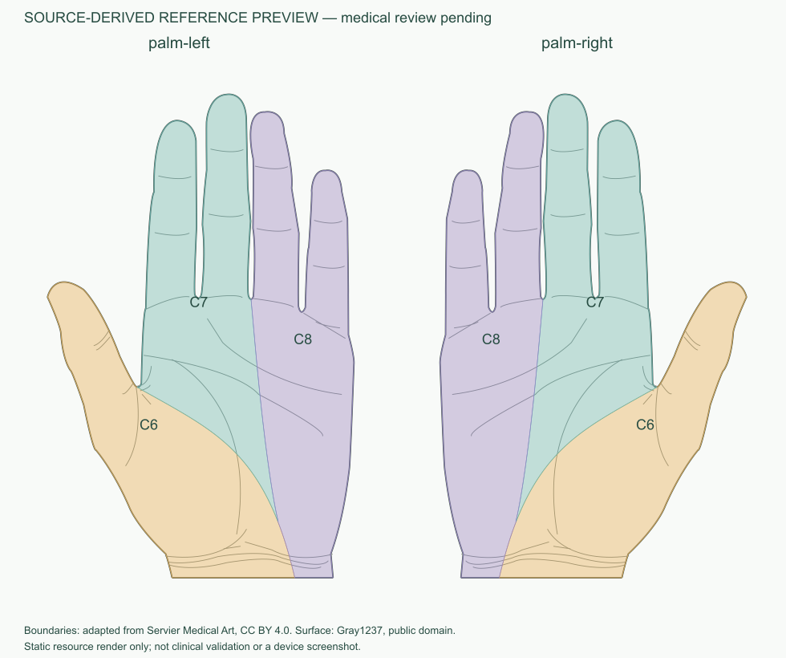

# V6.1 续查、真实边界接入与验证

日期：2026-11-04。总进度见 `task.md`。用户本次附件与上一份7572字符的V6.1任务逐字相同；承接现有代码及左右纠正，未重新初始化。

## 本次结果

新增了可追溯的真实掌侧参考边界，解除此前“缺少可采用边界”的工程阻塞。当前是 **3个标签（C6/C7/C8）、每侧3个区域，共6个区域实例**，图谱版本 `palm-dermatomes-preview.3`。不是三等分，也不是按手指数自行分区。

手掌模板仍为 `commons-palm-v1 / 1.1.0`，轮廓v2、区域集v2、440×700画布和PNG/SVG不变。左掌拇指在画面左，右掌在画面右。源手形、全身front/back、MobileSAM、V5放置及P6匹配数学均未改。

**医学审核依然pending、正式mappingEnabled=false。参考图可计算不等于临床定位有效。没有医学审核人、诊断准确率或临床验收结论。** 本次未部署云端、未上传体验版；当前手机体验版不能因此自动获得手掌匹配。

## 新来源及许可

实际检索、查看并下载了 [Servier Medical Art — Dermatomes](https://smart.servier.com/smart_image/dermatomes/) 的官网PNG和官方PPTX原始包。[署名页面](https://smart.servier.com/how-to-cite-servier-medical-art/) 和 [使用说明](https://smart.servier.com/using-smart-images-what-you-can-do/) 明确CC BY 4.0、商业修改及移动应用使用。原始文件、校验值、修改说明和署名在 `data/sources/servier-palm-v1/NOTICE.md`，运行时说明页也显示署名和来源。

不是依据文件名认定内容：先实际看官网前面观，再从PPTX第26页group71682提取可编辑原始曲线并渲染掌部。外形shape71995；两条内部皮节分界shape72147/72148；C7/C8原始标签shape72039/72041；C6区域向近端连续到原图明确的C6前臂。没有添加T1掌面区域。

本次也查看OpenStax当前页面：图注归于Mikael Häggström修改图，但当前许可说明含非商业限制；未据此导入项目。此前指定文献、Goran合并标签和展示手掌许可的调查记录仍保留，Servier发现不会让那些被排除的资料自动变成可用边界。

## 配准方法与失败保留

1. 读取PPTX DrawingML原始 `moveTo/cubicBezTo/close` 及shape局部变换；每条三次曲线100段采样。固定原始文件SHA，未知命令拒绝。
2. 截取源手掌至child-coordinate y=2310，避开近端T1楔形；该线定义展示范围，不是一条新神经边界。
3. 同时查看Gray掌部和源图，以四个指蹼连接位置、两个腕口端点建立6个对应控制点。只对原始掌部分界曲线做均值坐标变换，不重画人体。
4. 源图描边末端存在小于0.5原图局部单位的交接误差，分别为约0.212、0.371、0.046。按原始线宽内对应指蹼交接，明确记录，没有跨越未配置区域延长边界。
5. 两条转换曲线与真实皮肤轮廓共同分割成3区；标签来自原图。右掌配准后用x'=1-x生成左掌，并恢复完全相同的canonical皮肤顶点，避免浮点换算造成严格包含谓词误判。没有内缩或放宽后端校验。
6. 两侧区域合法、严格包含、内部无面积重叠；并集与当前显示范围面积差小于1e-12。原图只表达一种教学示意分布，技术全覆盖不代表个体分布完整或无重叠。

失败未隐去：

- 最初的整只手外缘控制会使第二条分界进入指缝，越界长度5.6288逻辑单位；加密采样仍为5.3317，不能靠密集顶点解决。分别保存在 `registration-v01-rejected/`、`registration-v02-rejected/`。
- 最终改为掌部6个对应点，转换曲线越界长度均0、无自交；没有剪掉越界段假装成功。
- 初次正式导出时，归一化/镜像浮点尾差约1e-17导致严格`covers`拒绝，导出在写文件前终止。通过沿用实际皮肤顶点及同一个指蹼端点修复，未修改匹配或合法性公式。
- 最初普通网络读取发生DNS限制，授权下载后成功；IAB图片页超时，之后用已授权原始素材作源文件核验，不宣称浏览器成功加载。

`scripts/build_palm_atlas.py` 默认只检查可重现性，`--write`生成参考数据；`scripts/sync_palm.py`同步前后端身份。此前preview.2数据和前端注册表保存在 `before-runtime/`。旧图谱会话/响应不静默迁移或重解释，保留原对象并明确版本不符。

## 实际测试

| 命令 | 结果 |
|---|---|
| `npm --prefix miniprogram test` | PASSED：328，0失败；包含类型编译，日志frontend.txt |
| `PYTHONPATH=backend ai/.venv/bin/python -m pytest backend/tests ai/tests -q` | PASSED：256，7条既有依赖警告；日志backend-ai.txt |
| `ai/.venv/bin/python scripts/build_palm_atlas.py` | PASSED：原始素材到正式参考数据可重现 |

新增18项来源配准测试：8个独立人工指定位置×左右2侧，以及分区/镜像、原始曲线来源与医审门禁。参考点在看原图和Gray手掌后先记录预期，包括拇指C6、中/食指C7、环/小指C8、掌部三点；不调用待测命中函数生成预期。它们验证的是本来源的工程对应，不证明每个人必然符合该分布。

现有合成测试继续覆盖多片、孔洞、跨区、接触零面积、未覆盖、并集去重、版本错配、全身/手掌隔离、迟到响应和release限制。旧“正式空图谱阻塞”用例改为验证真实来源预览；保留独立未就绪/空图谱拒绝用例，没有删掉准入保护。

其他同步/路径/保护文件检查的命令和退出状态见 `checks.json`。静态预览由当前PNG和实际6区几何生成，已实际查看：

## 微信真实验证的边界

本次通过原生AX按钮实际执行并看到了：左掌→右掌切换，左右计数分别0和1；修正后的左右手形；右掌已有三角形放大及复位后仍在原位置。通过窗口Raise恢复了清晰截图，这些操作不是Node模拟；既有右掌标注没有删除或重写。

这些原生检查发生在新图谱写入之前，验证的是修正后展示/会话/放大复位。任意坐标点击仍报 `noWindowsAvailable`，没有完成新增顶点、闭合或完整匹配链路。初次编译点击也因旧元素ID失效失败。**新Servier图谱的微信计算、高亮切换、手机、多尺寸触摸仍NOT_RUN**；工具调用中的截图不是保存在本目录的静态预览。

没有为复测清空当前用户内存标注或自动重启小程序。新atlas身份保护可能拒绝旧会话，这是防止数据含义改变，不是自动迁移承诺。需要在保留所需数据后重新编译运行新版本，并单独部署对应后端/数据后，才可验证云端手机闭环。

## 使用与未实现内容

本地代码入口：人体模型→特殊部位→左右手掌→逐点圈选→闭合→完成标注→计算参考区域。预览/计算在既有环境门禁内，结果来自同一个V4服务；显示全部、单标签、返回修改沿用已实现交互。服务器尚未更新时不要把版本不符或无图谱的错误当成无匹配。

AI手掌放置仍未实现，现有V5绑定全身模板，不在此轮强行重构。手背、足底、腋下、大腿内侧、会阴均未新增。后续优先做新图谱的真实微信闭环和独立专业配准审核；本轮不自动部署、发布或开发下一部位。

## 文件变更与保护核对

- 新增 `scripts/build_palm_atlas.py`、`scripts/preview_palm_atlas.py`，以及 `data/sources/servier-palm-v1/` 原始文件、署名和静态预览。
- 更新 `data/atlas/palm-v1/` 的manifest、左右区域、来源、配准五份JSON；同步 `miniprogram/data/palm.generated.ts`，后端 `palm_atlas_service.py` 仅升级当前图谱版本常量。
- 更新原前端palm-session和后端palm-matching测试，新增 `backend/tests/test_palm_source_registration.py` 18项来源配准测试。
- 更新task、README、architecture、atlas-spec、api、validation、references、局部视图说明及来源续查记录。旧当前说明与preview.2资源保存在before-runtime，历史结论没有抹去。
- 232个既有运行文件快照中，仅上述7个运行/数据文件改变，其余225个无变化、0删除。特别包含手掌PNG/SVG/皮肤轮廓、全身人体/图谱、V5变换、P6几何与匹配公式。详情见delivery-check.json。

生成和同步检查5项全部exit0。没有访问生产服务器，没有提交/推送Git或上传体验版。当前完成的是V6.1本地参考工程接入；新图谱原生闭环和医学验证不能标记DONE。
