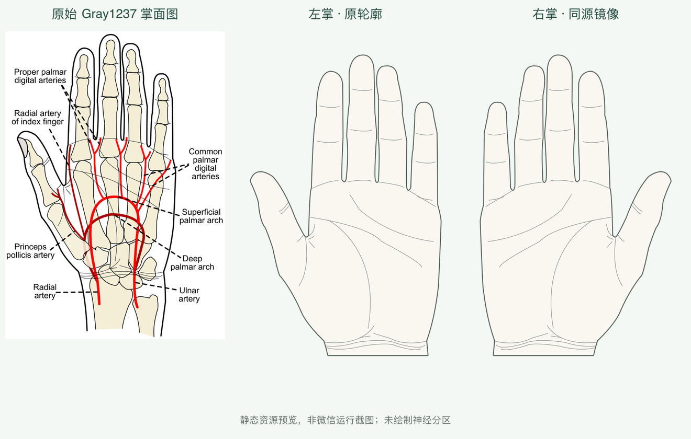

# V6.1 左右手掌纠正记录

日期：2026-11-04。用户发现左右手反置，经核查属实，已经修正本地代码和资源。

## 错误与依据

上一轮把原始Gray左掌误判为右掌，并把镜像标为左掌；还错误地认为上游图注有误。该判断撤销。正确观察条件是**五指向上、掌心朝向观察者**：左掌拇指在画面左侧，右掌拇指在右侧。

[Gray1237.png原始文件说明](https://commons.wikimedia.org/wiki/File:Gray1237.png)明确写明左掌，未镜像SVG与它一致。上轮轮廓/命中测试只证明图像与几何一致，没有独立验证解剖左右，因而未发现这个错误。

## 实际修正

- 原始未镜像轮廓、掌纹及PNG改为 `palm-left`；其水平镜像改为 `palm-right`。
- 同步交换各自完整闭环皮肤轮廓、命中数据、资源路径对应、生成脚本、来源矩阵及页脚拇指提示。
- 修正统一预览标题、当前架构/API/图谱说明；历史报告保留并增加明显的撤销提示，不将旧测试包装为左右已验证。
- 模板 `commons-palm-v1` 升为 **1.1.0**；geometry=`commons-palm-outline-v2`、regionSet=`commons-palm-ui-v2`；空图谱版本=`palm-dermatomes-preview.2`，前后端及哈希一起同步。
- 旧1.0.0会话不自动镜像、不换侧写回。模板不符时明确拒绝，原对象保留；旧接口身份返回409 VERSION_MISMATCH。正常编译重启后使用新模板。

旧资源、命中数据、身份及脚本保存在 `before/`，哈希见 `before-sha256.json`。本次实际确认，新左掌的几何/PNG与旧右掌完全相同，新右掌与旧左掌完全相同；这是修正错误的左右分配，没有改变手形比例。

## 验证

- `npm --prefix miniprogram test`：**328 passed，0 failed**，含类型编译及两项新左右回归，日志 `frontend.txt`。
- `PYTHONPATH=backend ai/.venv/bin/python -m pytest backend/tests -q`：**137 passed**，含新增旧掌模板接口拒绝测试，日志 `backend.txt`。本次未重跑未修改的AI独立实验，不将上一轮AI计数写成本次测试。
- `ai/.venv/bin/python data/sources/palm-v1/validate_resource.py`：22人工选取的表面/空白点、闭环、归一化及镜像检查通过，左右归属字段已纠正。
- `scripts/sync_palm.py --check`、`sync_matching_body.py --check`、`sync_atlas.py --check` 均通过。
- 新回归直接检查原图左掌保持未镜像、右掌镜像，实际PNG与几何在拇指/食指空隙处一致；另检查旧版标注不能静默迁移。
- 修正前后同一指缝参考点：左掌(0.28,0.45)、右掌(0.72,0.45)，旧版本错误显示皮肤、修正后为透明空白；像素与Shapely均独立核验。见 `regression-evidence.json`。
- 原有63个受保护全身/AI/放置/坐标/P6几何文件SHA无变化。没有修改人体素材、神经边界或匹配公式。

静态预览已实际查看，微信原生交互本轮 **NOT_RUN**；没有新的可用原生窗口证据，沿用既有工具限制。未部署、未上传体验版、未提交/推送Git。医学皮节边界仍为BLOCKED、0实例，左右纠正不能解除来源阻塞。
