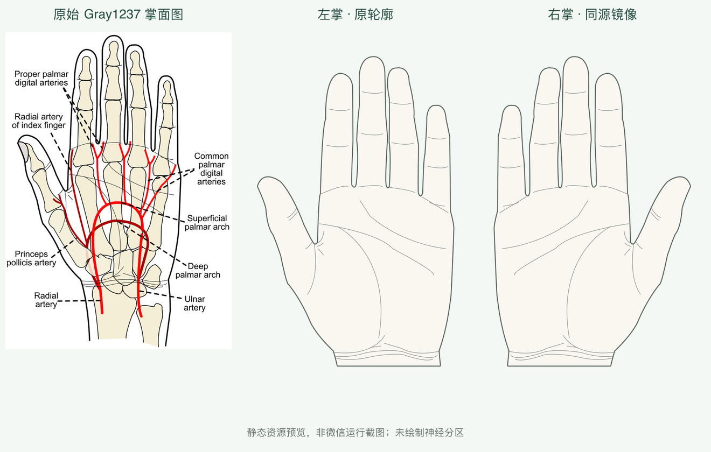

# V6.1 手掌素材、许可与神经边界来源核验

**左右更正（2026-11-04）：本历史记录的左右识别判断错误，原图注没有左右错误。1.0.0把原始左掌命名成了右掌；已在1.1.0同步修正图片、轮廓和身份。以下旧左右说明不再有效，旧测试证明几何对齐但没有证明解剖左右。见[更正记录](v6.1-side-fix/report.md)。**

日期：2026-11-04。范围：只做本地资料调查、真实 SVG 提取、静态渲染和表面几何检查；不部署、不改变当前全身图谱及审核状态。

**结论：掌面显示资源 READY；独立掌面神经皮节面积边界 BLOCKED。** 本轮没有生成 C6/C7/C8 闭合区域，不能宣称完成掌面神经匹配。缺口是可合法使用、表面方向明确、能建立可审核完整边界的资料，不是接口几何计算能力。

## 实际素材选择

| 资源 | 真实检查 | 许可 | 结论 |
|---|---|---|---|
| 用户指定 [Hand pointing down (contour).svg](https://commons.wikimedia.org/wiki/File:Hand_pointing_down_(contour).svg) | 已下载原始 SVG、渲染并查看；为向下指的手势，若干手指折叠 | CC0 1.0，Clker-Free-Vector-Images | 不适合作完整掌面 |
| [Hand.svg](https://commons.wikimedia.org/wiki/File:Hand.svg) | 已查看；完整张开五指，但只有泛用轮廓，没有掌面细节 | CC BY-SA 3.0（选定许可），Kieff / LucasVB；历史上传 Kenny sh | 可用备用，未选 |
| [Hand parts - en.svg](https://commons.wikimedia.org/wiki/File:Hand_parts_-_en.svg) | 已查看；有指甲，中央标注 back，实际手背 | CC BY-SA 3.0，Fred the Oyster / HombreDHojalata | 不能作为掌面 |
| [Gray1237.svg](https://commons.wikimedia.org/wiki/File:Gray1237.svg) | 已查看；真实掌面医学插图，外缘和皮肤褶皱为独立 SVG 路径 | 作者 Rhcastilhos 的公有领域释放；在法律不允许释放地区另有任何用途授权 | **选用显示底图，非神经图谱** |

原始手稿由 Henry Vandyke Carter 绘制，Gray 第1237图；本项目使用 Rhcastilhos 的矢量版本。具体授权见[文件许可段落](https://commons.wikimedia.org/wiki/File:Gray1237.svg#Licensing)，不把 Commons 网站整体当作 CC0。原文件、SHA-256、作者与取舍见 `data/sources/palm-v1/sources.json`。`build_resource.py` 固定原文件哈希，源变化后必须重新核验。

## 提取与坐标

- 原始逻辑尺寸：530.75×743.44。保留作者 `path1881` 外缘和 `path5541`～`path5595` 皮肤褶皱；去除骨骼、血管、文字及引线。不重新画手，不通过颜色或骨线推断神经区域。
- 截去近端前臂至源 `y=610`，在该腕口截面闭合显示/命中轮廓；这只是产品表面显示边界。整体向下平移40；比例没有拉伸。
- 独立逻辑画布：**440×700**；左右各一张透明 **880×1400 PNG**。保留可编辑 SVG、原始 SVG、提取脚本和渲染脚本。
- 指尖朝上，掌面朝向观察者；**右掌拇指在屏幕左、左掌拇指在屏幕右**。左掌从右掌做 `x'=440−x`，对应归一化 `x'=1−x`。
- 上游 Gray PNG 的文字描述称“left hand”，但本次 SVG 显示拇指位于屏幕左。不能机械继承该文字作为应用左右名称；本项目按掌面朝向观察者的明确解剖约定命名，并记录这一来源标注不一致。掌纹保留，不会将手背翻转冒充掌面。
- `palm-resource.json` 是资源提取结果，不是正式医学区域文件。每侧闭合轮廓366顶点，以源曲线0.12逻辑单位容差采样。图像采用原始曲线，命中轮廓具有该已记录的离散化误差。
- 模板标识：`commons-palm-v1` / `1.0.0`；几何：`commons-palm-outline-v1`；粗区域配置：`commons-palm-ui-v1`。与全身模板独立。



本图只是静态资源，不能据此标记真机操作验收通过。

## 指定医学参考逐项核验

1. [Jajeh 等，2024，PMC10982913](https://pmc.ncbi.nlm.nih.gov/articles/PMC10982913/)，DOI `10.21037/jss-23-39`：神经根与桡、尺、正中周围神经的描述明确不同。文章许可为 CC BY-NC-ND 4.0，不允许本商业项目依此许可修改图示；未复制图示或构造区域。
2. [Rajendran 等，2025，PMC12097171](https://pmc.ncbi.nlm.nih.gov/articles/PMC12097171/)，DOI `10.21315/mjms-09-2024-738`：[PubMed 记录](https://pubmed.ncbi.nlm.nih.gov/40417203/)交叉核实。文章 CC BY 4.0；Table2 是关键感觉测试点，图1标题也是前后面感觉测试关键点，注明改编自 ASIA。直接图像请求遇访问挑战，因此**没有声称查看过该图像**；第三方改编图的独立许可亦未进一步确认。文字和测试点不能自动变成完整掌侧闭合面积。
3. [StatPearls，Anatomy, Skin, Dermatomes，NBK535401](https://www.ncbi.nlm.nih.gov/sites/books/NBK535401/)：提供拇指、中指、小指等神经根参考标志，但不是掌面面积边界。正文 CC BY-NC-ND 4.0。它的图1另指向 [Grant 1962 663.png](https://commons.wikimedia.org/wiki/File:Grant_1962_663.png)；该 Commons 页面只因美国未续期而标公有领域，并明确警告中国等地区的版权可能不同，不能把图注里的 Public Domain 当作本项目全球商用许可。此候选标记 UNKNOWN，未下载或复制进项目。
4. [NBK551638](https://www.ncbi.nlm.nih.gov/sites/books/NBK551638/) 的实际标题是 **Anatomy, Medial Antebrachial Cutaneous Nerve**。它不是独立掌面神经根边界图；不能把前臂周围神经资料改名成 C6/C7/C8 区域。只作资料范围核验，无图像复制。

以上说明是来源和工程可用性调查，不是临床定位结论。未把 T1 为凑面积添加到掌面，未根据主要测试点推断整根手指或邻近掌面所属。

## 既有 Goran 源文件核查

已读取仓库真实原始前/背 SVG、既有 `source-map.json`，并直接裁窗渲染手部。源前掌含 **C6-C8** 合并区域（源 pathIndex29/30）及 **C8/T1** 合并区域（pathIndex31），不是可直接拆开的独立 C6/C7/C8 掌面分区。背面可见指甲与不同指端覆盖；不能把背面源区域复制到掌面。

局部原图证据在 `data/sources/palm-v1/goran-front-hand-detail.png`、`goran-back-hand-detail.png`，是源图窗口，不是配准后的医学数据。来源 Goran_tek-en，CC BY-SA 4.0，署名与衍生说明在同目录 NOTICE。当前全身图谱保留，新的掌面图谱保持无几何的 BLOCKED 状态。

## 实际检查与复现

在现有环境执行：

```sh
ai/.venv/bin/python data/sources/palm-v1/build_resource.py
SHARP_MODULE=/Users/griplan/.cache/codex-runtimes/codex-primary-runtime/dependencies/node/node_modules/sharp node data/sources/palm-v1/render_resource.cjs
ai/.venv/bin/python data/sources/palm-v1/validate_resource.py
```

结果：提取、PNG渲染成功；22个独立人工选定参考点检查通过（每侧7个有效表面点、4个指间/拇指间空白点），归一化闭环合法无自交，镜像面积/几何在舍入容差内一致。验证结果保存于 `data/sources/palm-v1/resource-validation.json`。这验证的是表面命中、左右坐标和静态资源，不是神经区配准或医学准确性。

实际查看：指定手势、备用轮廓、手背候选、Gray原图、新左右掌、Goran前后手部放大与统一对比图。微信页面行为由主任务单独测试；本记录不能代替运行验收。

## 继续解除图谱阻塞所需证据

需要一套来源、授权和可见表面明确的掌侧神经根区域图，能逐条解释掌中央、鱼际、小鱼际、五指和腕口边界；如采用专业人员提供图，应取得明确商用修改及再分发授权。随后独立登记来源和版本、建立源边界到本掌模板的可审核配准、处理空白/重叠并完成医学审核。不得靠平均分掌、指尖标志点连线、周围神经改名、拆分 Goran 合并标签来绕过。

## 2026-11-04 新来源续查

上文作为首次调查历史保留。后续实际取得Servier官方CC BY 4.0的Dermatomes PNG/PPTX，原始文件含掌侧完整曲线，已完成离线配准与参考接入；不再将“尚无可用边界”作为当前结论。来源许可、原路径、失败实验及使用限制见 [续查报告](v6.1-recheck/report.md) 和 [新来源NOTICE](../../data/sources/servier-palm-v1/NOTICE.md)。医审仍pending，不能把许可确认和几何通过称为医学验证。
