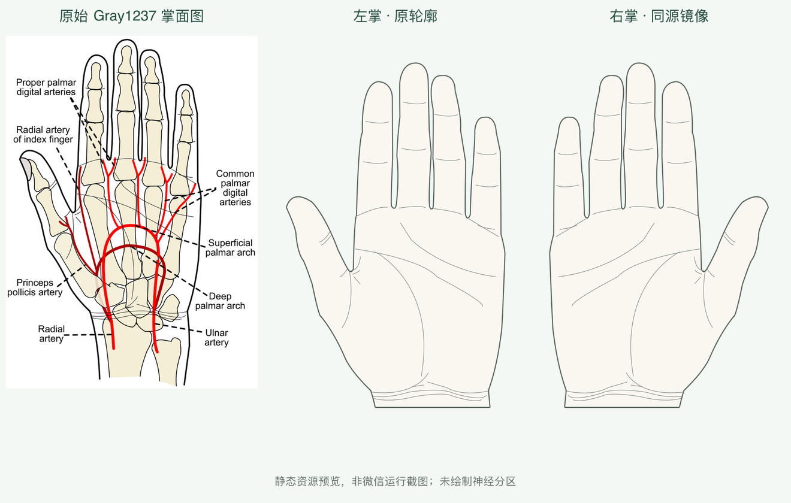

# V6.1 手掌局部视图开发报告

**左右更正（2026-11-04）：本历史记录的左右识别判断错误，原图注没有左右错误。1.0.0把原始左掌命名成了右掌；已在1.1.0同步修正图片、轮廓和身份。以下旧左右说明不再有效，旧测试证明几何对齐但没有证明解剖左右。见[更正记录](../v6.1-side-fix/report.md)。**

日期：2026-11-04；本机 macOS 15.6.1 arm64、现有 Node/TypeScript 与 Python 3.12.14 环境。没有安装新运行依赖、训练模型、部署、上传体验版或提交/推送 Git。

## 当前结论

**可以在本地新代码中进入左右手掌并人工圈选、暂存和复核；目前不能获取有可靠完整边界依据的掌侧参考皮节匹配。** 新页面在 Node 适配器和类型/路径检查中通过，微信原生实际显示/操作仍 NOT_RUN，因此不宣称用户手机流程已验收。

医学阻塞是缺少许可允许商业派生、朝向及区域语义可核实的完整掌侧脊神经皮节几何。当前0医学标签、0区域实例；前端计算禁用、后端409 ATLAS_NOT_READY。没有将标志点、外周神经或合并标签补画成C6/C7/C8面积边界。

## 1. UI 与左右手掌

入口为人体选择页的紧凑“特殊部位”→两掌选择；不改首页流程或原正背面人体。左掌 `palm-left`、右掌 `palm-right` 独立视图/会话，逐点标注、多片、撤销、取消、删除、确认、返回修改、放大/复位已实现。返回原全身页保留原状态。没有其他四个特殊部位按钮。

## 2. 素材、模板、来源

采用 [Gray1237.svg](https://commons.wikimedia.org/wiki/File:Gray1237.svg)，作者 Rhcastilhos，公有领域 PD-self 与任意用途后备授权；保留作者、原始哈希和修改记录。来自真实掌侧医学图的外缘与掌纹，非手工拼接。去骨骼/血管/文字，截腕、平移、镜像；没有调整人体模型或重画手形。

模板 `commons-palm-v1 / 1.0.0`，几何 `commons-palm-outline-v1`，逻辑440×700，PNG880×1400，每侧366轮廓坐标。左掌拇指在屏幕右，右掌在左；镜像 x'=1-x。源图文字标注左右差异记录在[来源调查](../v6.1-sources.md)。

## 3. 医学资料、区域数量、配准和审核

逐项调查用户指定PMC10982913、PMC12097171、NBK535401、NBK551638以及现有Goran原图。限制包括CC BY-NC-ND、只有感觉测试点、第三方图许可/司法辖区不明、资料实际为前臂外周神经、源掌区是C6–C8与C8/T1合并标签。PMC12097171仅取得正文/表/图注，直接原图访问遇挑战，没有宣称查看过该图。研究文件保存实际证据及每项取舍。

**实际配置0标签、左右各0区域；未做皮节边界配准，controlPoints为空，medicalReviewStatus=pending，mappingEnabled=false。** 皮肤轮廓与展示图的对齐已检验，但不等于神经区医学配准。需要合法完整边界源与后续医学审核，才可能解除当前阻塞。

## 4. V2/V4 复用、AI 与接口

- V2人工动作抽成 `editManualView`，全身和手掌复用原闭合/自交/完整表面包含判断。手掌新权威会话每片保存view、basis、atlasIdentity、ID、source=manual、完整MultiPolygon；不写front/back会话。
- Canvas复用坐标函数、触摸读取、病灶绘制和P6边索引。单帧调度/本地图片缓存；保存坐标不随视口变化。
- 前后端类型可识别四视图，但模板仍严格分离。相同 `/api/v1/evaluate`、原Shapely交集/面积、并集去重、接触零面积与P6复用机制。固定掌图谱加载器检查来源、完整几何、版本与哈希。
- 结果全部/单区/恢复全部与紧凑侧边标签复用V4工具；只用合成非医学区域验证技术路径，实际正式掌图谱不会产生这些测试结果。
- AI手掌放置 **未实现**：V5仍强绑定全身模板，避免为本轮强行重构。既有分割/人体放置/匹配代码及医审状态保持。

## 5. 实际测试

| 命令/检查 | 最终结果 | 证据 |
|---|---|---|
| `npm --prefix miniprogram run typecheck` | PASSED | check-1.txt |
| `npm --prefix miniprogram test` | **326 passed，0 failed，0 skipped** | frontend-final-root.txt |
| `PYTHONPATH=backend ai/.venv/bin/python -m pytest backend/tests ai/tests -q` | **237 passed，7条既有依赖warning** | backend-ai.txt |
| `PYTHONPATH=backend ai/.venv/bin/python -m pytest backend/tests/test_palm_matching.py -q` | **40 passed**，在最终来源元信息/hash更新后复测 | backend-palm-final.txt |
| `ai/.venv/bin/python scripts/check_project.py` | 九页导航/路径/组件静态检查PASSED | check-2.txt |
| `ai/.venv/bin/python scripts/sync_palm.py --check` | 前后端轮廓与身份/hash同步PASSED | check-3.txt |
| `ai/.venv/bin/python scripts/sync_matching_body.py --check` | 原人体导出一致PASSED | check-4.txt |
| `ai/.venv/bin/python scripts/sync_atlas.py --check` | 原全身图谱副本/hash一致PASSED | check-5.txt |
| `ai/.venv/bin/python scripts/check_preview_atlas.py` | 原图谱来源/绑定/几何/左右检查PASSED | check-6.txt |
| `ai/.venv/bin/python scripts/test_atlas_geometry.py` | 5 tests PASSED | check-7.txt |
| `ai/.venv/bin/python scripts/test_atlas_extensions.py` | 6 tests PASSED | check-8.txt |
| `ai/.venv/bin/python data/sources/palm-v1/validate_resource.py` | 22人工选定表面/空白点＋闭环/镜像PASSED | data/sources/palm-v1/resource-validation.json |
| PNG alpha与轮廓独立抽样 | 左右内部/外部共37025点符合；排除1475个边缘带抗锯齿样本 | frontend-resource-alignment.json |

前端相比P6的303新增23测试（12会话/注册/匹配，11页面/Canvas）；后端+AI相比197新增40手掌测试。上述专项40包含在237总数中，不能重复累计。运行环境/命令见 checks.json。资源人工参考点和抽样不是医学准确率。

新增覆盖：真实五指/掌心/腕口/指缝，顶点在皮肤但区域跨缝拒绝，左右隔离，版本变更不迁移，review只读，旧请求/失效权限/取消/超时重试，多片/孔洞/同标签多片/交叠去重/未覆盖/边界接触，混用front/back拒绝，release门禁，来源不符和空图谱拒绝，三种屏宽/放大复位、单帧合并、退出释放及图片复用。

## 6. 发现与修复

- 共享AnnotationViewState交叉类型会使手掌completed推断丢失来源字段：改为明确Omit后扩展，不改变V2数据。
- 独立审查发现触摸异步查询未贯穿草稿修订号：在touchStart捕获sessionId/revision，Canvas前后与页面接收都校验，新增同面换草稿/新会话迟到点击测试。
- 匹配回包额外检查review阶段和当前环境权限；过期失败也清理自己的loading，不取消更新请求。
- 原静态检查器只认识七页，首次失败记录 check-project-first.txt 保留。同步明确允许的两页、返回导航和组件检查，未放松旧页要求。
- 来源研究排除手势/手背素材，保留失败访问记录；没有因许可或资料不足而伪造医学区域。

早期前端323/325和最后326日志均保留，最终以root最终日志为准。初始类型调整属于编译阶段问题，不是运行通过证据。

## 7. 原有能力保护与修改文件

启动前对166个选定源文件存SHA，最终17个既有源码发生计划内兼容修改、0删除。63个受保护原人体素材/图谱/AI/放置/坐标/P6几何文件哈希0变化，见 protection-and-changes.json。旧图谱/人体副本检查另行通过。没有声称所有仓库文件都在该快照内。

主要新增：

- `miniprogram/types/palm.ts`；`data/palm-models.ts`、`palm.generated.ts`；`assets/palm/`。
- `miniprogram/state/palm-session.ts`、`palm-matching-session.ts`；`utils/manual-annotation.ts`。
- `miniprogram/pages/special-parts/`、`pages/palm/`、`components/palm-canvas/`。
- `backend/app/services/palm_atlas_service.py`；`backend/tests/test_palm_matching.py`。
- `data/body/palm-resource.json`、`palm-v1.json`；`data/atlas/palm-v1/`；`data/sources/palm-v1/`；`scripts/sync_palm.py`。
- `tests/miniprogram/palm-session.test.cjs`、`palm-ui.test.cjs`；来源/验收文档。

修改：app路由、select入口、共用annotation/atlas/evaluate/dermatome类型、V2操作委托、drawLesions类型、atlas-focus/candidate工具类型、网络错误文案和response验证；后端View、错误文案、固定图谱分派与数据集许可输出。后端匹配数学、全身素材及P6算法未改。静态路径检查、README、task、architecture、atlas-spec、api、validation、references同步更新。

## 8. 微信真实验证与未完成范围

微信新页面的原生编译/导航/画图/返回、真机Wi-Fi/移动网络均 **NOT_RUN**。工具能取Shingles旧首页，但新鲜元素19点击立即报invalid element ID；截图为倾斜缩小窗口，无法可靠操作。记录 wechat-attempt.json，无需用户在场确认，没有绕过工具操作。静态预览不可冒充运行截图。

真实掌侧参考匹配、实际标签高亮 **BLOCKED**；手掌AI放置 **未实现**。手背、足底、腋下、大腿内侧、会阴均不在本轮。未生成任何T1或虚构神经范围。

下一轮先取得并审核合法掌侧边界、数字化/配准后通过数据准入，再验真实匹配；AI局部放置另行授权。当前可对手掌手动圈选进行本机编译与人工界面审阅，但不能将其描述为已完成医学匹配。
