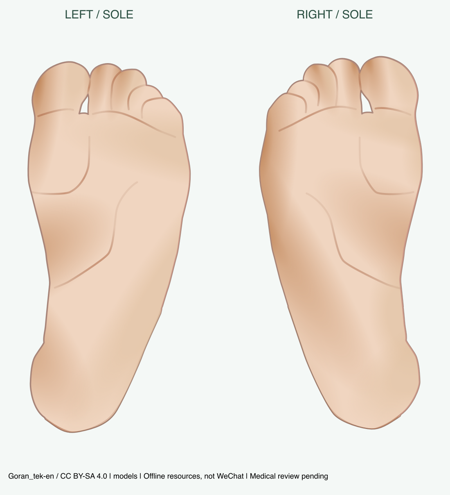
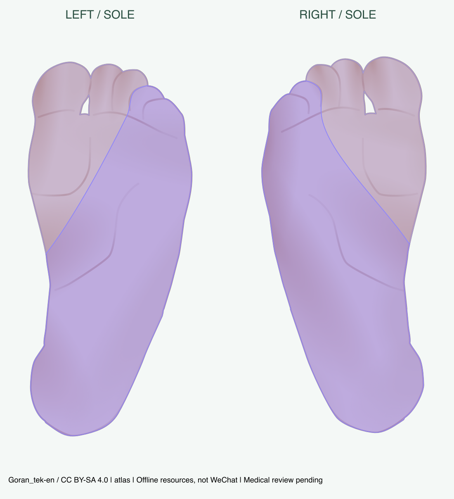

# V6.4：Goran 独立左右脚底交付

2026-11-05。**本地工程实现与自动化验证完成；微信原生/真机验收 NOT_RUN，医学专业审核 pending。未部署服务器、未上传体验版。** 本轮停在 V6.4，不开展下一个特殊部位。

## 用户入口与流程

人体模型 → 特殊部位 → 左脚底或右脚底。默认进入逐点圈选；闭合范围后可新增多片、选择删除、完成标注、计算参考区域。计算后显示实际相交标签，点击单标签查看、显示全部、放大/复位；返回修改使旧结果失效。左右脚底各自暂存，返回全身不清除人体和手掌标注。关闭小程序仍按既有会话暂存规则处理。

开发环境的“参考图谱”可查看全部 L5/S1；trial 保留原参考匹配权限，调试图谱入口仍受原门禁控制。release/production 未开放医学参考计算。现有云端未部署本轮数据，不能声称当前手机体验版已经支持脚底计算；旧服务会拒绝新图谱身份，而不会错误使用背面图谱。

## 六项验收回答

1. **左右脚底都有独立模型。** `sole-left`、`sole-right`，template `goran-sole-v1/1.0.0`；320×640逻辑空间、640×1280透明PNG。两侧分别提取原侧足底，脚趾朝上；左足大趾在画面左、右足在画面右。没有把一只脚镜像冒充另一只原始实例。
2. **成功提取 L5、S1，各两侧，共4个图谱实例。** Goran 背面实际元素 `root/9/1/43`、`root/9/1/44`，核对文件摘要、路径摘要、父变换和真实文字引线。不是按数组编号猜标签。额外扫描全50个着色元素，记录邻踝 S2 极窄接缝片和 L4 数值残余，未擅自补为足底分区。
3. **跟垫、足弓、前脚掌及可见五趾跖侧投影有参考着色。** S1为跟垫/足弓及外侧前足主面，L5为内侧前足及部分趾腹；每根趾完整侧面、趾间隐藏面、后跟周向和整个足部不在此二维模板中。左/右显示皮肤仍约0.102%/0.081%未覆盖，包含源细缝和未确认邻踝接缝，保留原样。不能据此宣称所有真实足底均被医学完整覆盖。
4. **本地圈选→确认→真实参考几何匹配→单区/全部高亮已经接通。** 使用同一 V2 操作、V4 `/api/v1/evaluate` 和 Shapely 交集；真实 FastAPI 测试和页面/请求/响应联动已通过。微信触摸及原生渲染尚未完成实测，不能写成手机验收通过。
5. **全身与 Servier 手掌兼容。** 68个受保护旧资源/数据/核心算法文件的起始SHA256无变化；旧手掌/全身会话身份和图谱版本未改。现有共享局部页、会话和加载器扩展视图注册，不另造匹配算法。
6. **技术验证与医学验证分开。** 336项前端、283项后端+AI通过；来源/曲线/多片/孔洞/触摸坐标/版本/实际HTTP/P6回归及图像轮廓抽样见专项记录。7条既有依赖警告保留。没有专家标注、临床数据或个体解剖验证，专业审核仍待进行。

## 实际资源预览

下图是当前SVG/PNG与实际区域数据的离线渲染，**不是微信截图**。

[L5单区](L5.png) · [S1单区](S1.png) · [原图左足（右栏为足底）](../../goran-full-atlas-audit/evidence/left-foot-original.png) · [原图右足](../../goran-full-atlas-audit/evidence/right-foot-original.png)

## 复用与数据流

- `types/dermatome.ts` 增加 SoleView/LocalSurfaceView；BodyView仍是front/back。旧 Palm* 类型/类/路由名称保留，内部通用局部表面使用显式四视图注册；不会对未知字符串自动开放。
- `data/local-models.ts` 分发旧手掌与新足底数据。`palmSession`仍是局部标注唯一权威源，按view键隔离四组会话；脚底从未写入全身 annotationSession。
- 复用现有 `pages/palm/palm` / `palm-canvas`，动态显示手掌/脚底及左右名称；V2取点、全轮廓合法性、V4候选筛选和Canvas孔洞绘制复用。原手掌页面样式未改，没有新增复杂编辑界面。
- `atlas_service`只增加固定足底分发；提取原掌加载器为 `local_atlas_service`，保留校验与门禁。`sole_atlas_service`只配置固定身份及来源检查，数学仍在原 `dermatome_matcher`。
- `matching-session`响应允许列表新增两个明确view，仍检查请求中的预期view、完整身份、候选region IDs和数值。换图谱、修改标注、离页、迟到响应不能恢复旧结果。
- 手工逐片圈选仍按既有V2能力输出简单外环；完整数据/匹配/绘图链支持MultiPolygon与孔洞，不新增孔洞编辑器，也不宣称已有AI足底导入。源图谱的孔洞和小片原样保留。

## 修改文件

新增资源：`miniprogram/assets/sole/`、`data/body/sole-resource.json`、`sole-v1.json`、`data/atlas/sole-v1/`、`miniprogram/data/sole.generated.ts`。

新增代码：`miniprogram/data/local-models.ts`、`backend/app/services/local_atlas_service.py`、`sole_atlas_service.py`；生成/预览 `scripts/build_sole_atlas.py`、`preview_sole.py`、`render_sole.cjs`。

修改原代码：局部页/Canvas、特殊部位入口、局部会话与匹配会话、视图/图谱类型、响应view允许列表、后端evaluate schema及固定图谱加载器。详细15个既有运行文件与17个新增运行文件见 [delivery-check.json](delivery-check.json)。

测试：新增 `backend/tests/test_sole_matching.py`、`tests/miniprogram/sole.test.cjs`；原手掌测试仅把“脚底不是合法view”改为“脚底合法但不能用手掌图谱”。另有本目录可复现资源、API与性能检查。

文档：task、README、architecture、atlas-spec、api、v6-special-body-views及本目录。原历史实验/失败日志保留；没有修改 MobileSAM、全身/手掌资源、神经图谱、匹配公式或V5放置规则。

## 未完成事项

- 微信原生与手机完整操作验收：工具控件索引失效，截图是不可读过渡窗口。记录 [wechat-attempt.json](wechat-attempt.json)，未以静态资源冒充运行截图。
- 专业审核：左右观察面、近端足底截取边界、S2邻踝接缝、原源示意的个体差异及适用范围。
- 生产发布：本轮明确不部署、不上传，旧服务器/体验版不会自动更新。

完整依据：[原路径、覆盖与配准](原路径提取与覆盖范围.md) · [测试与性能](测试与验收记录.md) · [许可与医审](版权与医学审核.md)。
