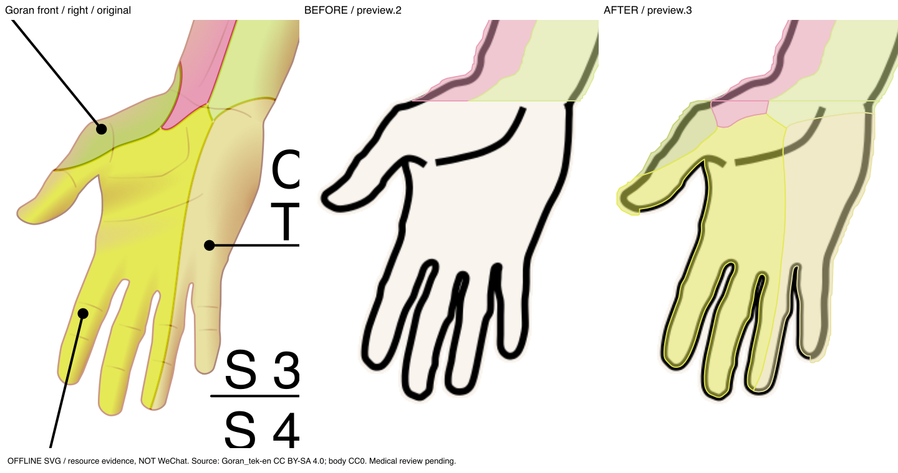
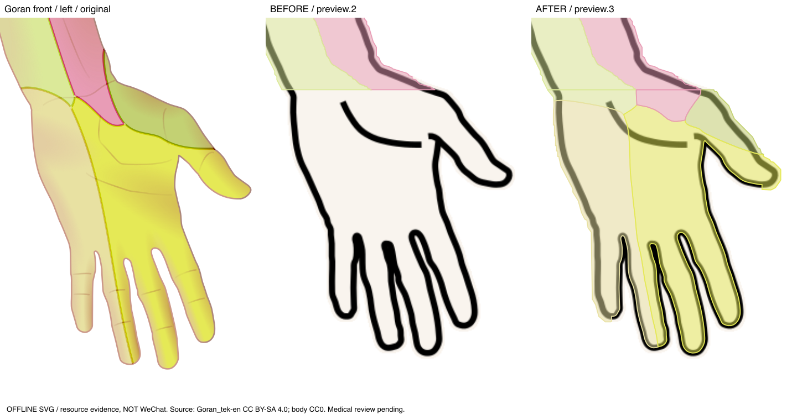
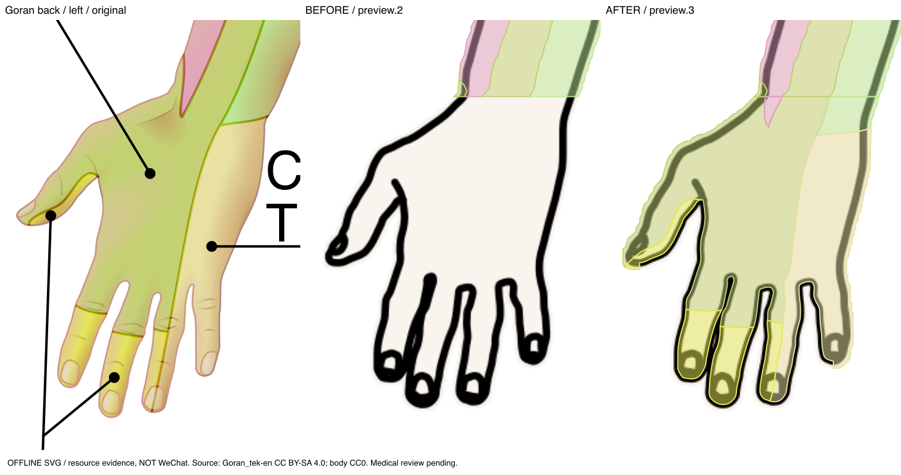
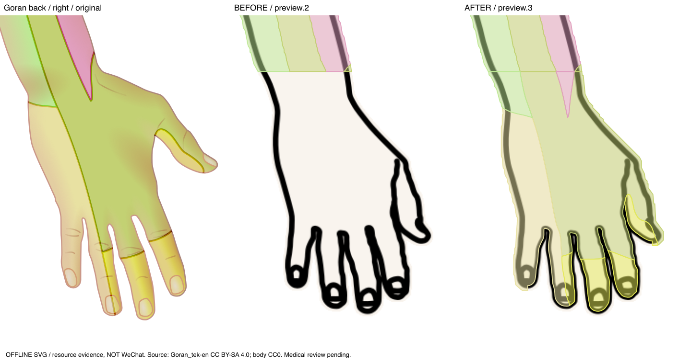
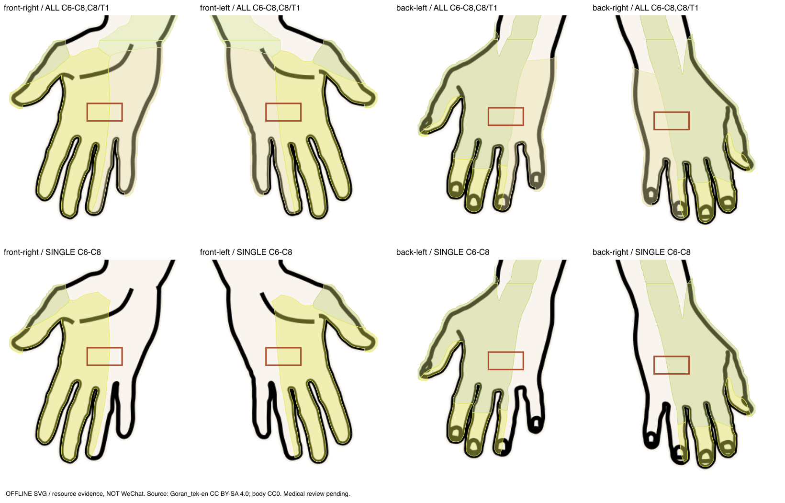

# V6.5 主人体手部补全与独立手掌退役

2026-11-05。本地实现及自动化验证完成；微信运行/真机性能和医学审核尚未完成。未部署、未上传。

## 实际原因

用户的人体图片本来就有正面手掌和背面手背。问题来自旧 Goran 提取/配准范围：前面p29/30/31被整体排除，其他手部路径在source y=440截断，背面多条指背路径未选用；目标手部覆盖结束在腕部约y440。绘制器和后端一致使用这份不完整数据，所以可圈选却返回未覆盖。不是前后面选反，也不是返回已有手部结果后未着色。

此外，旧身体有效轮廓从栅格蒙版生成时填实了部分窄指缝。已按原SVG墨线修正有效范围。图片不改，坐标规则不改。

## 实施结果

- 新图谱preview.3增加22个实际源路径实例，114→136区。四只手分别配准；正面掌侧以C6–8、C8/T1为主，背面包括真实指背与手背组合区，腕部保留源C5/C7/T1/T2过渡，没有自编独立掌侧C6/C7/C8边界。
- 原114区几何逐项不变，面部、躯干、肩背、原上肢近端、下肢保留。每手匹配使用原V4交集/面积公式、P6并集复用。实际跨区测试请求及响应在evidence。
- 全身原V2人工标注和V5 AI放置/匹配继续工作；多片、孔洞和坐标/版本保护保留。手部不需要跳转独立页面。
- 特殊部位仅保留左右脚底；Gray/Servier独立掌运行资源、旧路由、注册表、专用状态与后端加载器退役。来源、历史数据与代码归档保留。不能把旧palm坐标当作全身坐标。
- 模板4.0.1、geometry hands-v2表明指缝有效性变化；旧标注几何不改，旧匹配结果通过版本/摘要失效。

## 真实对照

三联图从左到右：Goran原始局部 / 旧配置 / 新配置；包含腕部衔接。全部为资源静态渲染，非微信截图。

## 尚未消除的限制

可见掌/手背、五指的参考区域已配置；源组合标签交界细缝、目标边缘适配余量仍可能返回部分未覆盖。手指侧面/隐面与独立完整C6/C7/C8掌侧边界无足够源证据，不生成。技术面积覆盖约99.77%–99.86%只对应当前二维手表面，绝不是临床准确率。该工程配准需要医学专家逐指/腕复核，medicalReviewStatus仍pending，mappingEnabled仍false。

10片匹配基准中位耗时62.2→113.8ms，新增精细曲线使计算量增加；手机流畅度未验证，不能宣称性能不变。云端未更新，新客户端若连接旧服务器将触发版本不一致。

## 文件与证据

- 新源路径配准/检查/预览/基准：`scripts/hand_registration.py`、`prepare_hand_atlas.py`、`check_main_hands.py`、`preview_main_hands.py`、`preview_hand_matches.py`、`benchmark_main_hands.py`、`benchmark_hand_canvas.cjs`。
- 新图谱与轮廓：`data/atlas/goran-2022-preview-v3/`、`data/body/commons-template4-hands-v2.json`、`miniprogram/data/body-hands.generated.ts`及前后端绑定、生成副本。
- 退役迁移：`pages/local-surface/`、`components/local-surface-canvas/`、`state/local-surface-*`、`types/local-surface.ts`、特殊部位页面、app路由、固定atlas注册与HTTP410。
- 新测试：`backend/tests/test_main_body_hands.py`、`tests/miniprogram/main-body-hands.test.cjs`，原局部会话/UI测试迁为local-surface，旧测试归档。
- 详细清单：[输入文件变化](evidence/changed-tracked-inputs.json)；[来源路径](source-path-audit.md)；[配准与未覆盖](atlas-registration.md)；[退役策略](removed-palm-feature.md)；[本轮测试](tests.md)。

## 五项回答

1. 正面左右掌：本地真实源几何匹配及绘制测试通过，微信实际操作待验。
2. 背面左右手背：本地同样通过，方向/左右独立，微信待验。
3. 未覆盖：源细缝、边缘适配余量、未显示的手指侧/隐面；不推导独立掌侧C6/C7/C8。未覆盖量按真实几何返回。
4. 独立掌功能：运行入口与专属业务已清理；历史记录和源文件保留，无坐标迁移。
5. 全身/脚底：原有几何、匹配数值与自动回归保持；脚底源资源/图谱身份不变。不能把自动测试说成微信或医学验收完成。
