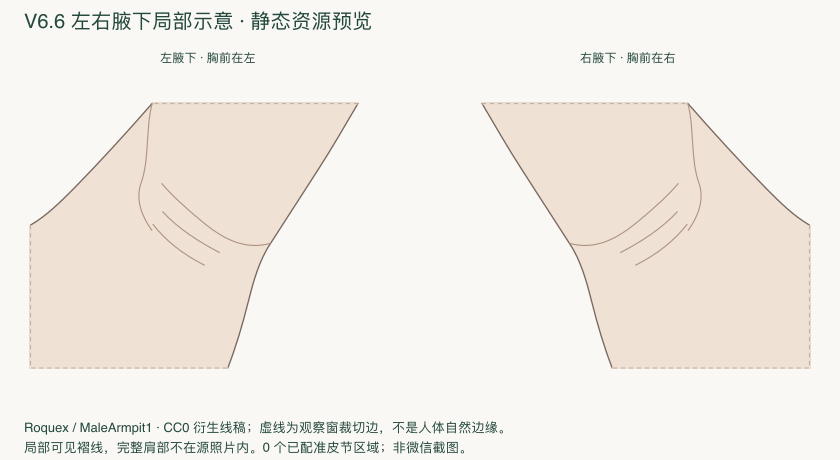
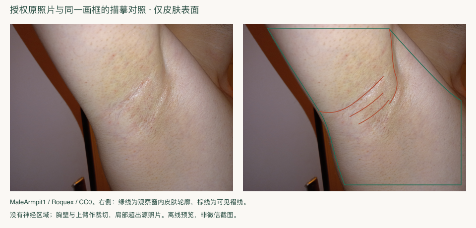
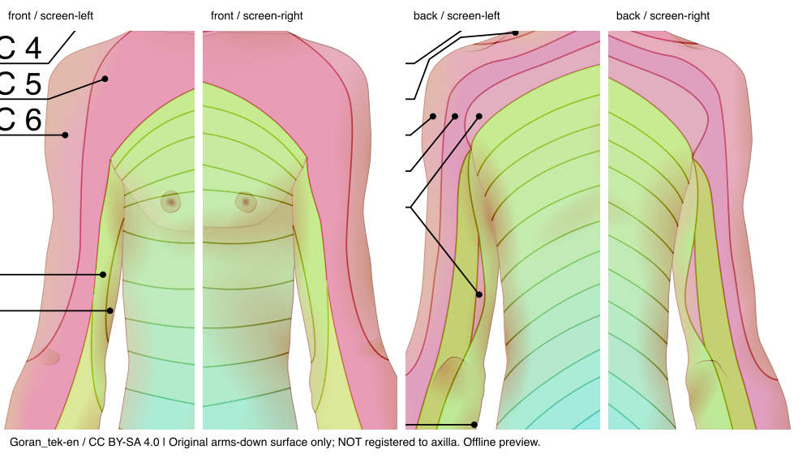
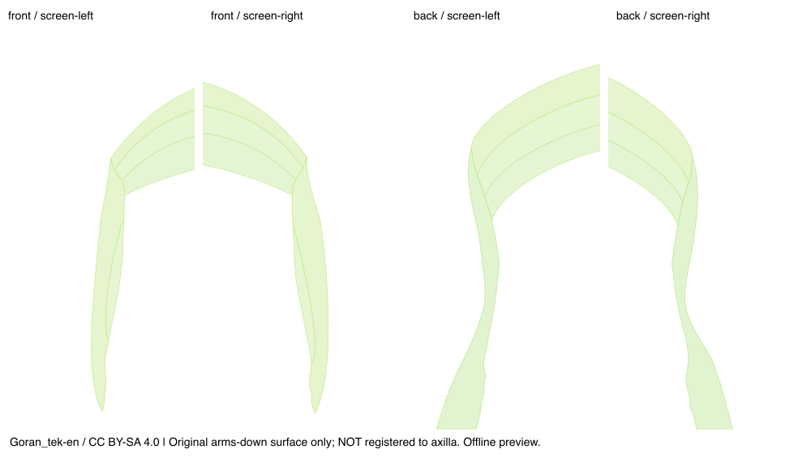
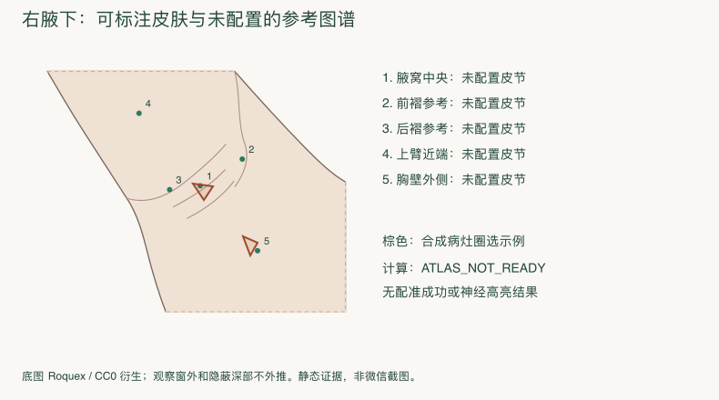

# 解剖表面与边界证据

## 左右和显示表面

作者明确标记右腋下。原照片近端抬起的上臂在画面左上，胸前侧在右；右模板保持此朝向，左模板执行 `x'=1-x, y'=y`。左右不是正面人体的左右屏幕规则，而是两个有方向说明的独立局部观察窗。左图镜像只是显示对称假设，不代表双侧生物学完全对称，不生成神经图谱。

可见皮肤包含中央及褶线附近、上臂近端内侧和胸壁侧。褶线/中央参考点由查看源照片人工选定，保存在[evidence/reference-points.json](evidence/reference-points.json)；这些点没有调用命中算法来生成期望答案。其解剖名称仍需专业审核。完整肩帽不在源照片里；隐藏的深部、绕到背侧或照片外的皮肤不补绘。虚线注明观察窗裁切，不冒充自然外轮廓。

## Goran实际源元素复核

先核对原文件SHA1，再核对XML绝对元素路径、tag、原d字符串SHA256、累计矩阵、此前源标签审计；不是只凭p数组位置指定医学身份。原文件没有clipPath、mask、use；本轮不把原始填充几何当成跨姿态可见面。标签依此前可见文字/引线和source-map记录，实际源图裁切保留颜色及引线。路径没有XML id，所以不能虚构sourceElementId；以元素route+d摘要可复查。

| 原视图 | XML路径 | 源标签 | 解释 |
|---|---|---|---|
| front | root/6/1/1 | T1 | 原胸部上方垂臂投影 |
| front | root/6/1/2 | T2 | 同上 |
| front | root/6/1/3 | T3 | 同上 |
| front | root/6/1/19 | T1 | 原臂躯干交界可见片 |
| front | root/6/1/20 | T2 | 同上 |
| back | root/9/1/6 | T1 | 原上背投影 |
| back | root/9/1/7 | T2 | 同上 |
| back | root/9/1/8 | T3 | 同上 |
| back | root/9/1/41 | T1/T2 | 原内臂组合标签，不能拆成独立两区 |

共9个源元素、4种标签记法，原数据可跨左右；不是9个腋下实例。实际采样坐标、左右信息和矩阵在[goran-source-elements.json](evidence/goran-source-elements.json)。这些是 `original_svg_user_units / auditOnly`，**全部admittedToAxilla=false**。本次没有建立有效的抬臂目标边界，运行图谱为0标签、0实例。Goran原图可见一部分腋缘不等于该部分已在新模板成功配准。

Goran图及审计衍生：Goran_tek-en，CC BY-SA4.0；变更为裁切、采样及突出选定路径，未宣称医学审核通过。其他照片/图谱调查详见[source-review.md](source-review.md)。没有采用额外皮节图去补齐隐藏表面。

## 覆盖与匹配

| 局部表面 | 可以在显示皮肤内圈选 | 已配准的参考皮节 |
|---|---|---|
| 腋窝中央可见部分 | 是 | 未配置 |
| 前褶附近 | 是 | 未配置 |
| 后褶附近 | 是 | 未配置 |
| 上臂近端内侧 | 是 | 未配置 |
| 胸壁侧 | 是 | 未配置 |
| 隐藏深部/完整肩部/裁切外 | 不作可见表面外推 | 未配置 |

不能把未配置解释为皮肤没有神经；此时无合法覆盖比例可报告。没有真实匹配成功或T2高亮截图可提供。下图只有合成标注与真实未就绪状态说明，**不是微信运行截图，不是神经匹配结果**。

