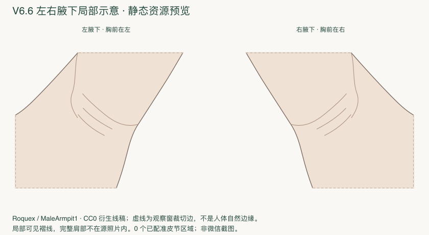

# V6.6 左右腋下独立视图 — 本地实施报告

2026-11-05。**安全可实施部分已落地：左右局部模板、人工标注、会话隔离、身份与未就绪保护。完整神经匹配验收尚未满足，边界配准BLOCKED。** 唯一进度记录在[task.md](../../../task.md)。没有部署云端、上传体验版或提交Git。

## 用户现在可以做什么

本地重新编译后，从人体模型 → 特殊部位 → 左腋下/右腋下，逐点圈选 → 闭合 → 新增/撤销/删除 → 完成标注。放大、复位、切换左右和返回重入保留本次小程序运行内会话；关闭/重启不持久化。页面保留返回特殊部位/全身入口。

采用Roquex CC0右腋下照片的局部可见皮肤衍生线稿，左侧镜像，400×360独立坐标。**这是局部观察窗，完整肩部不在源照片内；还不是已获用户视觉验收的完整医学插画。** 展示/配准两种许可和身份独立管理。

## 本轮没有强行完成的部分

Goran垂臂原图9个邻近源元素已重新提取到审计文件，包括T1、T2、T3、T1/T2；但不能把它们拉伸到抬臂后新出现的腋窝中央。补充文献说明感觉关联，不提供足够的目标面边界。当前**0个可计算神经标签、0个已配准实例**。

因此整个新局部视图的神经边界保持未配置；前端计算禁用，后端409 ATLAS_NOT_READY，标注仍保留。不存在成功的腋下匹配结果或神经标签高亮，不能用“覆盖100%为空”假成功。静态病灶图只展示合成圈选与未就绪状态。

## 逐项验收回答

| 用户验收项 | 实际结果 |
|---|---|
| 左右独立抬臂模型 | 已建立两个局部观察窗，独立ID/模板；完整肩帽未包含，视觉专业审核待做 |
| 中央、前褶、后褶能否标注 | 可见皮肤内可以；5个源参考点与左右闭合测试通过。褶线命名待解剖审核 |
| 采用何种皮节图谱 | 没有发布可计算腋下图谱；固定新身份为axilla-reference-v1/axilla-unconfigured.1 |
| Goran提取了什么 | 审计重提取9个源元素，标签T1、T2、T3、T1/T2；目标注册数0 |
| 其他资料 | Roquex CC0只用于显示；NCBI/PMC/DermNet等只作关系与许可调查，没有变成新增医学面 |
| 实际标签/实例数 | 新腋下运行图谱0/0；不拿审计元素数量冒充运行实例 |
| 哪些仍未覆盖 | 中央、前后褶、近端内臂、胸侧均未配置；隐藏深部/裁切外不外推 |
| 能否圈选并计算 | 可以圈选、确认和运行内保存；**暂不能计算** |
| 计算后高亮 | 未完成，受边界缺失阻塞；共享结果组件保留，未用假数据演示成功 |
| 左右隔离 | 已测试，与脚底、全身会话也隔离；不得跨view求和/迁移 |
| 全身、手部、足底 | 50个保护摘要不变；真实图谱回归通过；原生微信视觉本轮未验 |
| 自动化 | 前端348、后端+AI296，类型/编译/复现/结构检查通过；详见tests.md |
| 微信真机 | NOT_RUN，自动窗口不可可靠操作；未上传新包 |
| 医学审核 | 未完成；需审核模板视角、左右、褶线、许可充分的边界、配准、重叠及个体差异 |

## 工程改动

新增：`assets/axilla`两侧SVG/PNG及NOTICE；`data/body/axilla-*.json`；`data/atlas/axilla-v1`空图谱身份/来源/配准说明；`miniprogram/data/axilla.generated.ts`；`backend/app/services/axilla_atlas_service.py`；生成/复查/预览脚本及前后端测试。

修改：前端View类型、local-models registry、special-parts入口、local-surface页标题/方向及返回入口、共享响应view白名单；后端Evaluate View枚举、atlas固定分派与错误说明。没有另写计算公式或坐标模块。复用原V2手动编辑、LocalSurfaceSessionStore、结果标签/Canvas和共享后端loader。

MultiPolygon/孔洞数据能力与完整几何校验保留；当前手动UI仍画无孔简单环，多片分别管理，本轮没做挖孔编辑器。V5放置页和会话依赖front/back BodyView、全身区域及保存链，接入腋下并非只加一个ID，因此本轮不改V5、不放置AI到腋下。

`source-review.md`记录实际许可和未采用候选；`registration.md`区分显示采样和未完成医学配准；`anatomy-and-atlas.md`记录源元素、表面范围及静态图；`tests.md`记录实际数量、初次失败、性能与NOT_RUN。历史结果未覆盖，Thomson弃稿仍保留。

## 后续阻塞与最小准备

需要合法可数字化的抬臂皮节区域图，或取得有依据的源图边界及专家确认的跨姿态对应；仅有检查点和T2关联不足。完整肩部展示也需要更合适的授权素材/专业插画完善，不能靠猜测外推当前照片。取得这些证据后再建立新图谱版本、区域配准、真实跨区/未覆盖测试以及微信操作验收。此处停止，不开展会阴、云端部署或体验版上传。
