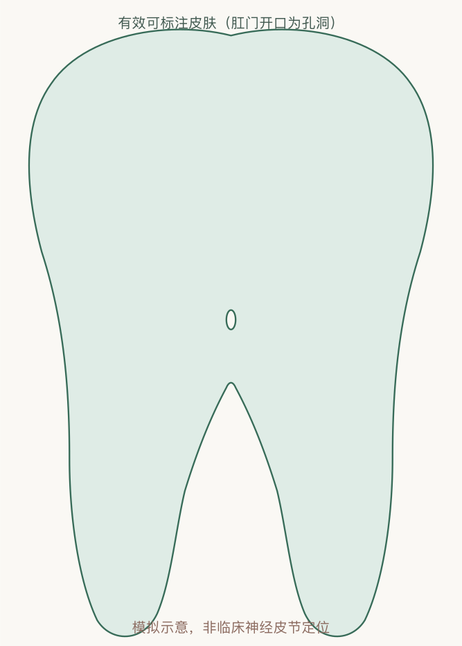
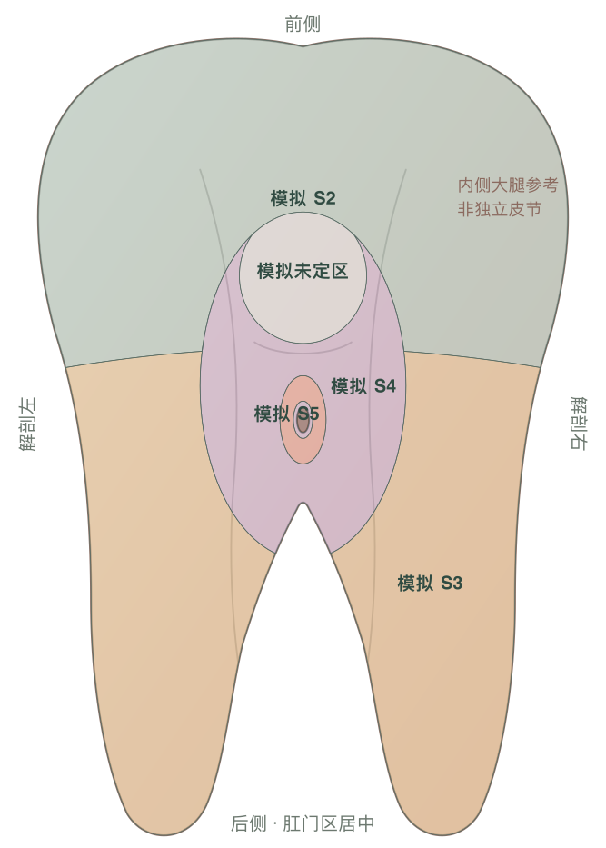
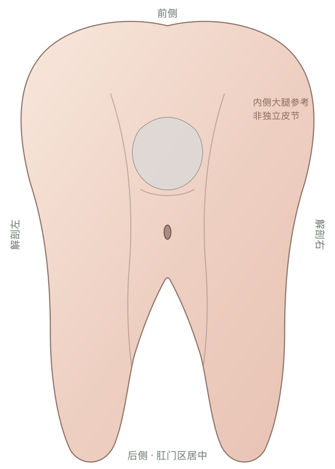
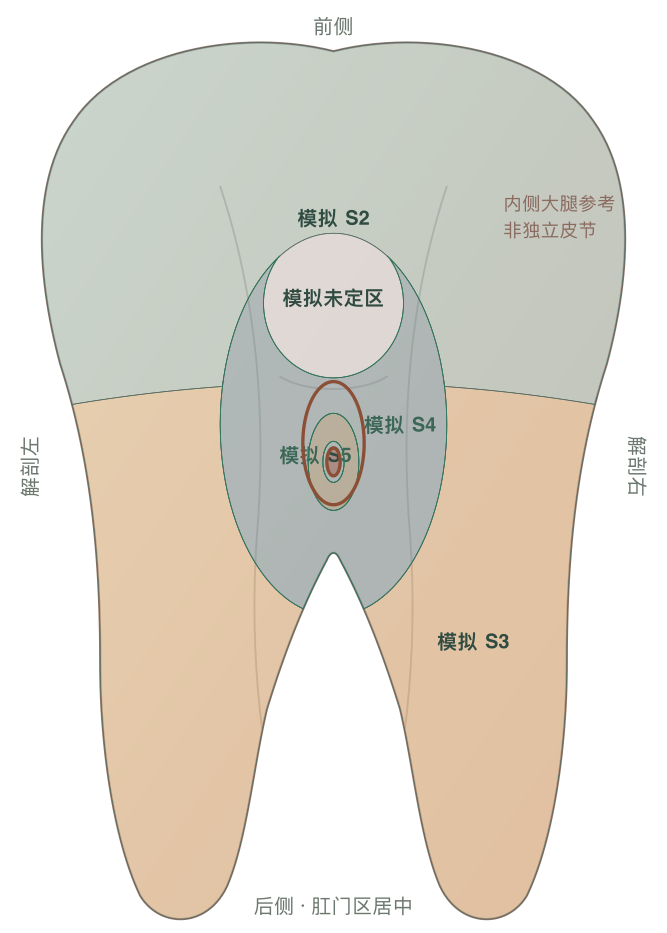
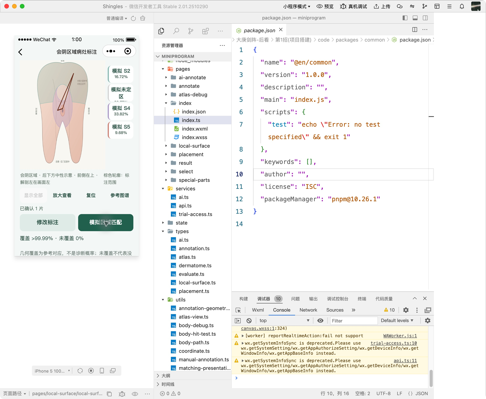
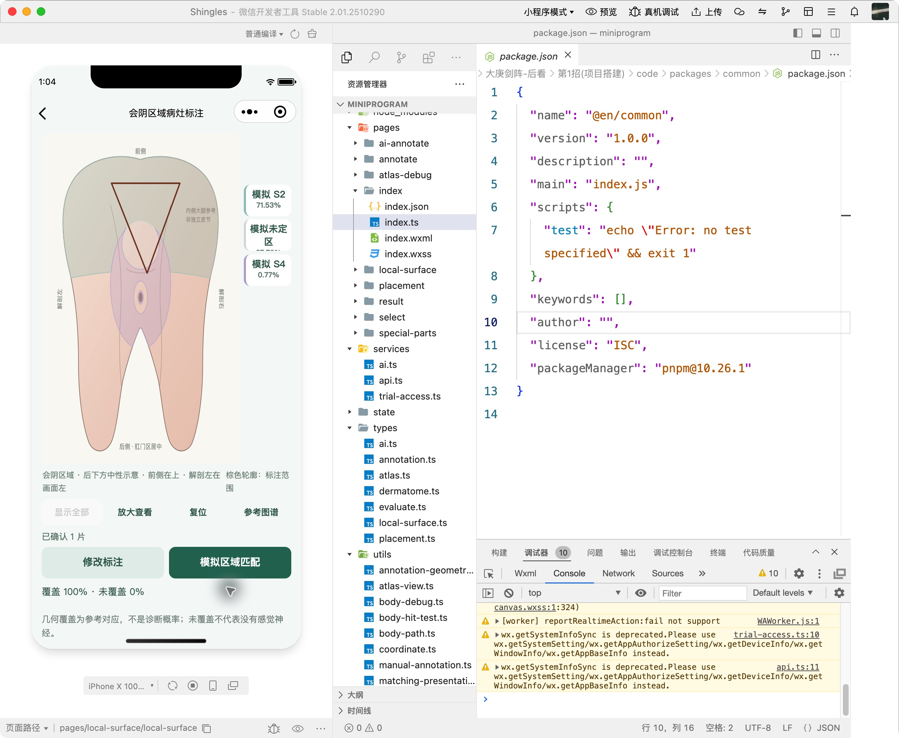
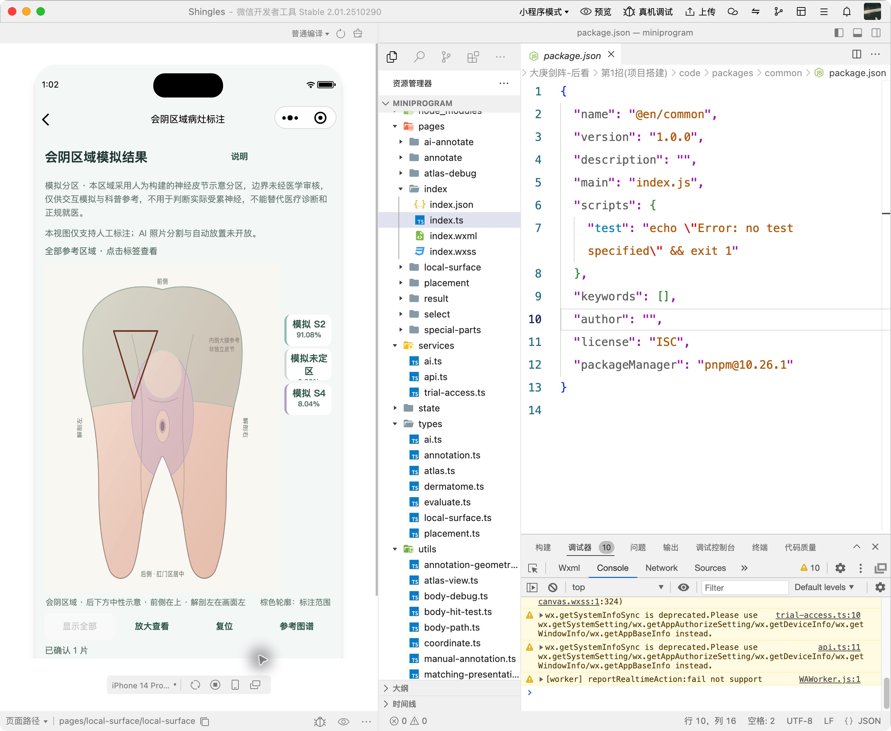
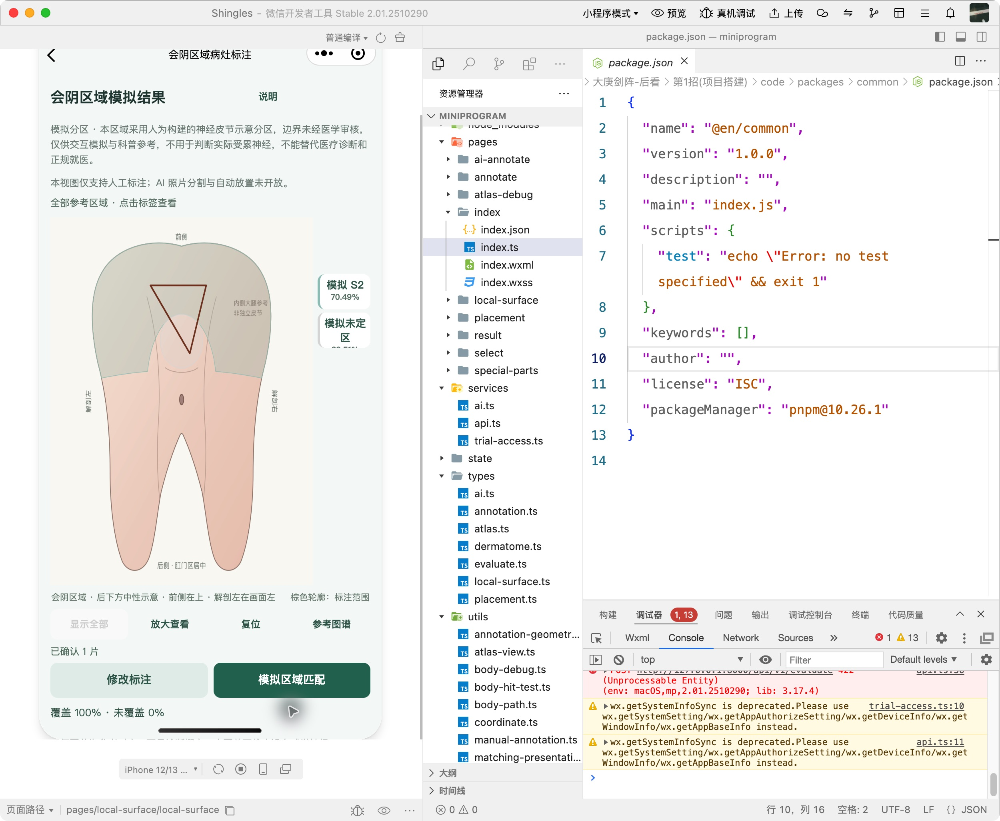
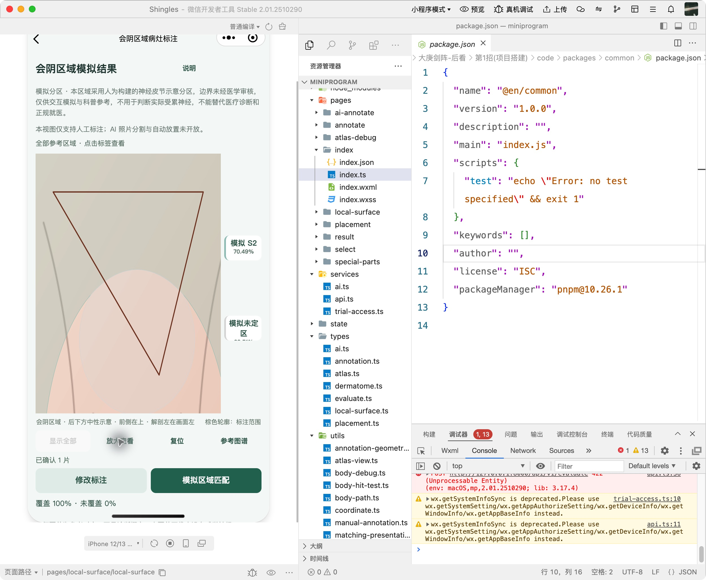

# V6.7 会阴中性示意与全区域模拟匹配报告

## 结论

V6.7 的本地工程实现、离线几何验证、前后端回归、微信静态编译和微信开发者工具原生流程已经完成。新增一个中性会阴区域视图、一个人工构建的全覆盖模拟图谱，以及可复用的手动标注、几何匹配、高亮和标签筛选流程。

本视图是二维交互示意，不区分性别，不绘制具体男女外生殖器，也不是完整会阴环周或三维重建。`S2`、`S3`、`S4`、`S5` 仅为模拟分区符号；中央前侧/泌尿生殖面保留为“模拟未定区”，没有强行归入骶神经标签。医学审核状态仍为 `pending`，正式医学映射仍未启用。

微信开发者工具内已实际完成 320、375、430 像素宽模拟器的页面导航、Canvas 触摸取点、闭合、复核、真实后端匹配和高亮；428 像素宽还完成了单标签、显示全部、放大与复位。V6.7 会阴后端已于 2026-11-12 部署到腾讯云，公网 smoke 8/8 通过。手机真机验证仍为 `NOT_RUN`。本轮没有上传体验版，也没有提交或推送 Git。

## 实际成果

| 项目 | 实际值 |
| --- | --- |
| viewId | `perineum-overview` |
| templateId / version | `neutral-perineum-overview-v1` / `1.0.0` |
| geometryId | `neutral-perineum-skin-v1` |
| regionSetId | `neutral-perineum-ui-v1` |
| 逻辑画布 | 400 × 560 |
| atlasId / version | `perineum-schematic-v1` / `perineum-schematic.1` |
| 图谱类型 | `SCHEMATIC` |
| 医学审核 | `NOT_MEDICALLY_VALIDATED`，`pending` |
| 用途 | `INTERACTIVE_SIMULATION` |
| 来源类型 | `ARTIFICIALLY_CONSTRUCTED` |
| 模拟区域 | S2、S3、S4、S5、UNDEFINED，共 5 个 |
| 有效皮肤覆盖 | 100%，见下文 |
| 正式映射 | `mappingEnabled=false` |

## 真实预览

有效皮肤轮廓，肛门开口保留为真实孔洞：

完整模拟分区：

中央未定区：

合成病灶与 S4/S5 匹配示例：

以上 PNG 均由同一生成器输出，不是微信运行截图。

微信开发者工具原生运行截图：

## 用户流程

人体模型 → 特殊部位 → 会阴区域 → 逐点圈选一片或多片范围 → 闭合 → 完成标注 → 模拟区域匹配 → 显示实际相交区域 → 点击标签单区查看或显示全部 → 返回修改。

该视图隐藏左右切换，因为它是单一中性观察面。标注、撤销、删除、放大、复位、匹配和高亮复用现有 local-surface 框架。AI 照片分割及自动放置明确禁用。

微信开发者工具中的实际结果：

| 模拟器宽度 | 实际标注 | 真实后端结果 |
| --- | --- | --- |
| 320 × 568 | 画布取 3 点、闭合、复核 1 片 | S2 16.72%、未定区 39.77%、S4 33.82%、S5 9.68%，覆盖 >99.99%、未覆盖 0% |
| 375 × 812 | 画布取 3 点、闭合、复核 1 片 | S2 71.53%、未定区 27.70%、S4 0.77%，覆盖 100%、未覆盖 0% |
| 430 × 932 | 画布取 3 点、闭合、复核 1 片 | S2 91.08%、未定区 0.88%、S4 8.04%，覆盖 100%、未覆盖 0% |
| 428 × 926 | 画布取 3 点、闭合、复核 1 片 | S2 70.49%、未定区 29.51%，覆盖 100%、未覆盖 0%；单区、全部、放大、复位均通过 |

比例因各尺寸实际绘制的合成三角形不同而不同。首次匹配时本机仍是旧后端进程并返回 422；停止旧进程、以 `DERMATOME_ENV=test ENABLE_REFERENCE_MATCHING=1` 启动当前代码后，后续请求全部通过。旧控制台记录不代表最终运行状态。

会阴 Canvas 的读屏标签已由错误的“右脚足底”修正为“会阴区域”；新增自动化检查覆盖脚底、腋下、会阴和未知视图。

## 验证摘要

- 前端：`359/359` 通过。
- 后端与 AI：`322/322` 通过，7 条既有 MobileSAM/timm 依赖警告。
- TypeScript：通过。
- 图谱生成器：14 个导出可复现。
- 微信 `wcc`、`wcsc` 静态编译：通过。
- 有效皮肤覆盖：`100%`，136,264 个网格皮肤点中漏点 0。
- 分区面积重叠：0。

详细命令与证据见[测试记录](tests.md)。

## 医学与产品边界

- 会阴模拟区域不是经过医学审核的皮节边界。
- 没有把阴部神经等外周神经分布当作脊神经皮节。
- 没有根据照片、部位或几何相交结果推断真实受累神经。
- 几何覆盖比例只表示标注与示意区域的重叠面积。
- 模拟未定区不返回伪造成 S2–S5 的确定标签。
- 结果页常驻“仅用于交互模拟与科普，不能替代诊断和就医”的提示。

## 未完成事项

- 微信开发者工具页面导航、触摸圈选、真实匹配、高亮、单区/全部、放大复位和 320/375/430 适配：`PASSED`。
- 手机真机与体验版：`NOT_RUN`。
- 医学专业审核：`pending`。
- 腾讯云部署：`PASSED`。r4 只同步了 V6.7 会阴相关的 11 个文件，线上发布清单 145 项全部存在且哈希一致；公网 smoke 8/8 通过，`acupuncture.service` 与 Nginx 的 PID、启动时间、重启计数和保护文件摘要均未变化。ready 的 `ai_model_loaded=false` 表示 MobileSAM 尚未惰性加载。另一次公开 CDC 图 AI 冒烟因受控服务已有两个临时分析会话而返回 `429 AI_CAPACITY`，未删除他人会话，线上 MobileSAM 真实推理仍为 `NOT_RUN`。详见[部署记录](deployment-v6.7/README.md)。
- 体验版上传：未执行。
- 具体性别会阴模型、完整环周视图和三维重建：不在本轮范围。
