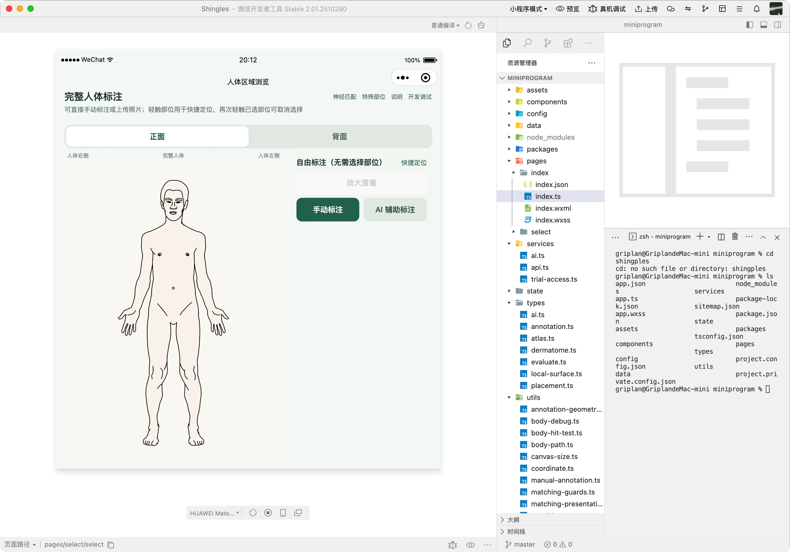
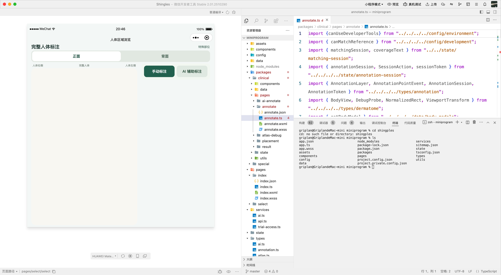
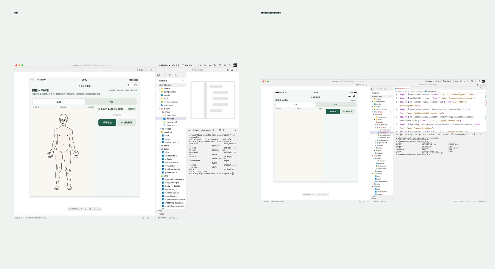

# 控件审查与前后对照

## 分类

| 控件或标签 | 分类 | V7.1 处理 |
|---|---|---|
| 正背面切换 | A 核心 | 保留，独立布局区并实际点击验证 |
| 手动标注 | A 核心 | 保留；完成确认后自动匹配 |
| AI 辅助标注 | A 核心 | 保留；仍允许无预选部位进入全身自由放置 |
| 特殊部位 | A 核心 | 保留入口，脚底、腋下、会阴流程不变 |
| 修改标注 | A 核心 | 保留，修改后重新完成可再次自动匹配 |
| 说明 | B | 按用户最新要求暂时隐藏；底层来源、许可、隐私和医学边界内容保留 |
| 快捷定位 | C | 从客户主界面移除；人体平移缩放能力保留 |
| 独立神经匹配入口 | C | 移除；自动匹配替代 |
| “自由标注（无需选择部位）” | C | 删除；新版默认行为不再重复解释 |
| “上传图片 AI 识别病灶区域”等长文案 | B | 统一为“AI 辅助标注” |
| 全部标注 / 标注1 | B | 结果多于一片时才显示 |
| 显示全部 / 放大当前 | B | 仅在单选参考区域时显示，并改为“查看全部 / 放大区域” |
| 全身 | A | 始终保留 |
| 开发调试 | D | 按用户最新要求暂时隐藏；底层调试能力与开发权限判断保留 |
| 交互提示 | B | 只在调试、提示或局部视图需要时出现 |

## 主界面

修改前同屏出现独立神经匹配、快捷定位、从列表选择和长功能说明，用户需要理解内部工作流。修改后主界面的同一区域聚焦于人体、正背面切换和三个业务入口。

## 结果页

- 结果显示仍复用同一 `annotate` 工作区，不再跳转独立低频结果页；旧 `pages/result/result` 继续作为兼容重定向。
- 单片时直接查看当前结果；多片时才显示范围筛选。
- 候选标签为空时显示“暂无匹配结果”。
- “修改标注”与“重试匹配”在需要时出现，避免常驻技术入口。
- “查看全部”“放大区域”“全身”按当前状态显示，避免三个按钮长期同时占用空间。
- 参考区域颜色、棕色病灶轮廓、覆盖比例和必要的参考性质说明继续保留。
