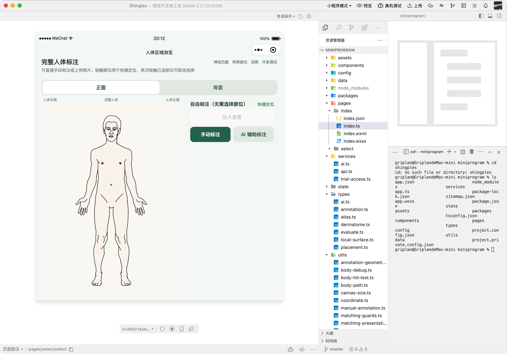
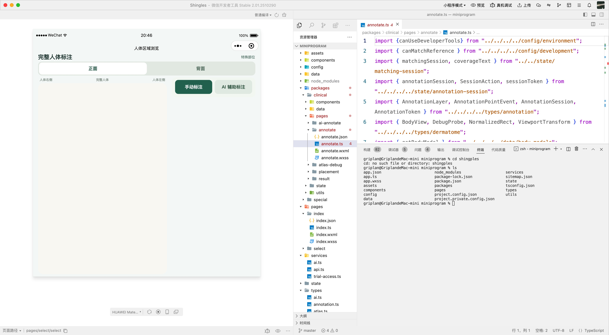
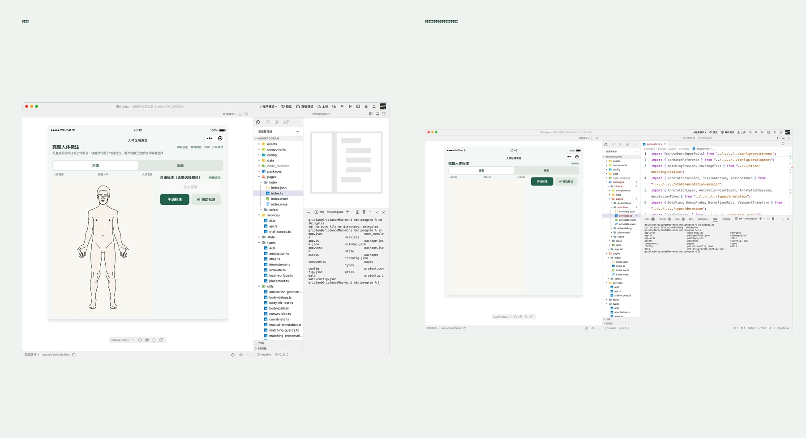

# V7.1：交互流程精简与界面冗余清理

日期：2026-11-16
范围：本地实现、自动回归与微信开发者工具模拟器验证。未部署腾讯云，未上传体验版，未提交或推送 Git。

## 结果

V7.1 已完成。主界面现在只突出正背面切换、手动标注、AI 辅助标注和特殊部位。按用户最新要求，“说明”和“开发调试”入口也已暂时隐藏；底层说明内容、调试开关和受控权限判断保留。独立快捷定位、独立神经匹配入口和“自由标注（无需选择部位）”等重复说明已从客户界面移除。

手动标注闭合并完成确认后，沿用现有 `matchingSession` 自动进入参考结果；页面重新打开已有完成标注时也会恢复结果。这里只调整触发与展示，没有复制或修改 V4 匹配公式、图谱几何或后端评估算法。

同页面对照：

## 控件处理

- 移除了首页独立“神经匹配”入口。已有确认标注再次进入“手动标注”时直接恢复结果，完成新标注后自动匹配。
- 移除了“快捷定位”和重复的“自由标注（无需选择部位）”说明。人体仍可单指平移、双指缩放，标注页仍可查看全身和放大区域。
- 保留“手动标注”“AI 辅助标注”“特殊部位”和正背面切换。
- 暂时隐藏“说明”和“开发调试”入口；相关页面状态、功能代码及开发权限判断没有删除，便于以后恢复。
- 单片结果不再展示“全部标注 / 标注1”；多片时保留全部与单片切换。
- 神经区域单选时才显示“查看全部”和“放大区域”；“全身”始终保留为恢复视图入口。
- 空结果明确显示“暂无匹配结果”，不再只显示容易误解的零值。
- 医疗、参考图谱、模拟分区和未审核状态说明继续保留，没有因精简而移除必要边界。

## 自动匹配

`annotate` 页的“完成标注”先执行原有 `review`，随后调用既有 `viewMatches()`。结果页在 `result=1` 时同样调用既有流程，并复用已有的 pending、ready、stale、error 状态。失败只显示“重试匹配”；无有效标注时不会发请求。修改标注会沿用原失效机制，重新完成后再次匹配。

本次没有更改：

- V4 Shapely 交集、覆盖比例和候选排序。
- Goran/Servier 及特殊部位图谱。
- MobileSAM、上传限制和图片会话清理。
- 人体逻辑坐标、特殊部位模拟边界或历史标注数据。

## 正背面遮挡

正背面切换改为独立的 `flex: 0 0 auto` 区域；人体与结果画布位于单独裁剪的查看区，`overflow:hidden`，不会将绘制内容或透明触摸区域扩展到切换控件。双栏折叠布局按实际窗口尺寸沿用 P9 媒体容器规则，不使用机型名称。

微信开发者工具在 `HUAWEI Mate X6内 100%` 预设中实际显示新主页面。已实际点击“背面”，页面切换为人体背面；再点击“正面”，页面恢复人体正面。两次均成功，证明切换控件可获得点击且未被 Canvas 覆盖。

## 验证结论

- TypeScript：PASS。
- 小程序前端：406/406 PASS。
- 后端与 AI：330/330 PASS，7 条既有 MobileSAM/timm 警告。
- 微信开发者工具重新编译：PASS；界面状态显示 Errors 0、Warnings 3。
- 微信自带 WXML/WXSS 编译：PASS。
- 项目结构、图谱一致性、分包边界：PASS。
- 主包、clinical、special 保守体积均低于 2 MiB。
- 真机 Android/iOS、物理折叠屏和长时触摸性能：NOT_RUN。

详细记录见 [控件前后对照](controls-before-after.md)、[布局与遮挡](layout-and-overlap.md)、[流程回归](workflow-regression.md) 和 [测试记录](tests.md)。
