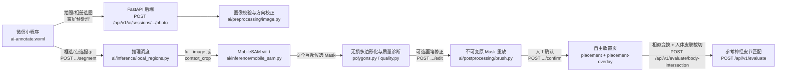

# 带状疱疹神经皮节映射系统：AI 病灶识别分割技术文档与优化方案

> **适用范围**：`dermatome-mapper` 仓库（微信小程序前端 + FastAPI 后端 + 本地 AI 候选分割模块）\
> **安全与合规边界**：本系统当前仅用于**辅助理解、教学与研究**；AI 分割结果与参考皮节占比均**不构成临床诊断或医学置信度**，所有识别轮廓均需人工确认后方可进入人体放置与参考匹配。

---

## 1. 系统整体技术架构与数据流

系统采用**“照片坐标系与人体坐标系严格解耦”**的分层架构：AI 模块仅在方向校正后的照片像素空间中生成候选病灶轮廓（不直接做人体解剖配准），再由用户在小程序自由放置页中通过人工平移、等比缩放与旋转将其映射到人体模型，最后由后端计算病灶与参考神经皮节图谱的二维交集面积占比。

### 1.1 核心模块与代码路径映射

| 模块职责 | 关键代码路径 | 说明 |
| :--- | :--- | :--- |
| 分割总入口与结果契约 | `ai/segmentation.py` | 编排预处理、推理、多边形化、质量诊断与耗时/内存记录 |
| 模型加载与前向推理 | `ai/inference/mobile_sam.py` | 加载固定版本 `MobileSAM (vit_t)`，管理单实例 `SamPredictor` |
| 局部上下文裁剪推理 | `ai/inference/local_regions.py` | `context_crop` 策略：支持主框 + 最多 3 个补充框局部推理并无重采样回填 |
| 图像预处理与提示校验 | `ai/preprocessing/image.py` | EXIF 方向校正、透明图白底合成、格式/像素上限校验、提示坐标校验 |
| 无损掩膜转多边形 | `ai/postprocessing/polygons.py` | 基于 Shapely 的像素单元格合并，保留多孔与多连通片 |
| 提示遵循度质量诊断 | `ai/postprocessing/quality.py` | 检查漏点、越框、过度分割等告警并调整预览排序（不删候选） |
| 照片空间画笔修正 | `ai/postprocessing/brush.py` | 从不可变原 AI Mask 重放补充/擦除笔画，保障重试幂等 |
| 结果可视化与导出 | `ai/export.py` | 导出原图、提示图、Mask、叠加图、轮廓图与 `result.json` |
| 后端 AI 会话接口 | `backend/app/api/routes/ai.py` | `/api/v1/ai/sessions` 系列的创建、上传、分割、画笔修正、确认、删除 |
| 后端人体裁切与皮节匹配 | `backend/app/api/routes/evaluate.py` | `/api/v1/evaluate/body-intersection` 与 `/api/v1/evaluate` |
| 小程序 AI 标注与自由放置 | `miniprogram/packages/clinical/pages/ai-annotate/` `miniprogram/packages/clinical/pages/placement/` | 拍照/选图、框选与画笔微调、自由拖拽/缩放/旋转映射至人体 |

---

## 2. 当前采用的核心模型详解

### 2.1 模型选型与固定版本信息

当前 AI 分割模块采用开源轻量化提示分割模型 **MobileSAM（`vit_t` 变体）**，在 `ai/inference/mobile_sam.py` 中对源码与权重进行了严格锁定：

| 属性 | 当前配置 |
| :--- | :--- |
| 模型名称与变体 | `MobileSAM`（`sam_model_registry["vit_t"]`） |
| 骨干网络架构 | **TinyViT**（知识蒸馏自原始 SAM ViT-H 图像编码器） + SAM Prompt Encoder + Mask Decoder |
| 源码固定提交 | `f706ad9c4eb7f219c00d9050e46328518ffb65d2`（`ChaoningZhang/MobileSAM`） |
| 权重文件体积与完整性 | `40,728,226` 字节（约 38.8 MB）；加载时校验文件字节数、Git Blob SHA-1（`7ef2d090979fd9853adf17b7a99c8b94a1c5a6a7`）并计算 SHA-256 |
| 加载安全策略 | `torch.load(..., map_location="cpu", weights_only=True)` + `load_state_dict(state, strict=True)`，禁用自动联网下载与假推理回退 |
| 开源许可协议 | `Apache-2.0` |
| 推理精度与运行环境 | `float32`；支持 `cpu` / `mps` / `cuda`（开发与微信联调实测环境为 Python 3.12.14 + PyTorch 2.5.1 + CPU 4 线程，MPS 尚未在 V5.2 服务上做完整实测） |

### 2.2 输入输出规格与运行约束

- **输入**：方向校正后的 `RGB uint8` 图像数组，以及照片像素坐标系（`photo_oriented_pixels_v1`）下的提示信息：
  - 前景/背景点 `points`：`[x, y, label]`（`1` 为前景，`0` 为背景，最多 64 个点）；
  - 主提示框 `box`：`[x0, y0, x1, y1]`，可选最多 3 个补充框 `additional_boxes`（需配合 `context_crop` 策略）。
- **内部尺寸变换**：由官方 `SamPredictor` 执行 `ResizeLongestSide` 将长边缩放至 `1024` 并补齐到 `1024 × 1024`，推理结束后再映射回原图 `(H, W)`。
- **输出**：`multimask_output=True` 固定返回 **3 个互斥的布尔候选掩膜**（`shape: (3, H, W)`）及对应的 `scores`（模型内部预测的 Mask IoU，**仅作参考，非医学置信度**）。
- **并发与状态约束**：官方 `SamPredictor` 内部持有可变图像特征状态，非线程安全；因此当前服务采用**单工作槽顺序执行**，每次 `predict()` 结束后在 `finally` 中调用 `self.predictor.reset_image()` 清理特征，**尚无跨请求的 Image Embedding 缓存**。

### 2.3 当前阶段选择 MobileSAM 的原因

1. **零样本冷启动**：项目早期尚无经医学专家逐像素标注的大规模带状疱疹临床分割数据集，通用提示分割模型无需训练即可配合用户框选/点选快速跑通端到端闭环。
2. **CPU 可跑、部署门槛低**：相比原始 SAM ViT-H（约 2.4 GB），MobileSAM 的 TinyViT 编码器仅约 38.8 MB，在无独立 GPU 的本地开发机或轻量 CPU 服务器上即可运行。
3. **天然支持交互式纠偏**：原生接受前景点、背景点与检测框提示，契合临床“先圈定大概区域，再精细补点/排除”的交互范式。

---

## 3. 病灶识别与分割算法实现细节

整条分割流水线由 `ai/segmentation.py:segment_image()` 串联，分为 5 个确定性阶段：

### 阶段 1：图像预处理与提示校验（`ai/preprocessing/image.py`）
1. **体积与防炸弹校验**：限制单帧 `JPEG / PNG / WebP`（拒收动图），文件体积 `≤ 20 MiB`，总像素 `≤ 12,000,000`，单边 `8 ~ 8192 px`，捕获 `DecompressionBombWarning`。
2. **EXIF 方向校正**：读取 EXIF Tag `274` 并执行 `ImageOps.exif_transpose()`，保证后续所有提示坐标均对齐到正向展示图；同时剥离 EXIF、GPS 与原文件名元数据。
3. **透明通道处理**：含 Alpha 通道的图片统一在纯白底 `(255, 255, 255, 255)` 上合成 `RGB`，确保前端预览与后端推理视觉一致。
4. **提示校验（`validate_prompts`）**：强制校验 `coordinate_space == "photo_oriented_pixels_v1"`、坐标有限值且落在图像范围内；必须至少提供一个有效框或前景点。

### 阶段 2：全图推理 vs. 局部上下文裁剪推理（`ai/inference/local_regions.py`）
系统支持两种推理策略：
- **`full_image`（独立 CLI 默认）**：直接将整张 `RGB` 图与主框/点提示送入 `MobileSAM.predict()`。
- **`context_crop`（小程序针对过度分割专项引入）**：
  1. 将主框 `box` 与最多 3 个 `additional_boxes` 依次作为独立区域；所有前景点按最近框距离分配到对应区域。
  2. 为每个框计算上下文外扩边距：`padding = max(16.0, 0.2 * max(box_w, box_h))`，并囊括落入该区域的所有前景/背景点，取整数像素边界 `[x0, y0, x1, y1]` 裁剪子图。
  3. 对每个局部裁剪图分别调用 `MobileSAM` 推理，生成 3 个局部候选 Mask，并按局部提示遵循度（非空优先、惩罚分升序）排序。
  4. **无重采样整数偏移回填**：按排名对齐（`rank = 0, 1, 2`）将各区域的局部二值 Mask 直接按切片 `combined[rank, y0:y1, x0:x1] |= masks[i]` 拼回原图尺寸，裁剪区外保持为 `0`（不做推断），并记录是否触及裁剪边缘（`CROP_EDGE` 告警）。

### 阶段 3：无损掩膜转多边形矢量（`ai/postprocessing/polygons.py`）
为保证临床记录几何保真、不偷偷丢弃散在的小水疱或填平环形病灶孔洞，`mask_to_polygons()` 未采用有损轮廓近似，而是采用**像素单元格精确合并**：
1. 逐行扫描二值掩膜，提取水平连续前景区段（Run-Length），每段构造 `shapely.box(a, y, b, y + 1)`；区段总数超过 `MAX_RUNS = 100,000` 时明确抛出 `CONTOUR_LIMIT` 并保留原始 Mask。
2. 调用 `unary_union(runs)` 生成拓扑合法的 `Polygon / MultiPolygon`（4 邻域连通），并强制校验 `exact.area == int(mask.sum())`，确保单个像素也有精确面积、不丢片、不填洞。
3. 默认 `simplify_px = 0.0`（完全无损）；即便传入正值，若简化后拓扑失效或与原几何不完全等价（`not simplified.equals(exact)`），自动回退到精确几何并标记 `fallback_to_exact: true`。
4. 外环与内孔按 `orient(part, sign=1)` 统一方向，除以图像宽高 `(w, h)` 输出归一化 `photo_oriented_normalized_v1` 坐标系下的 GeoJSON 形态 `MultiPolygon`。

### 阶段 4：提示遵循度质量诊断与排序（`ai/postprocessing/quality.py`）
`inspect_candidates()` 对 3 个候选进行非破坏性诊断（只调整展示顺序与提示告警，**绝不自动删除候选或替代人工确认**）：
- 告警规则：`EMPTY_MASK`（空掩膜）、`LARGE_MASK`（占全图面积 `> 65%`）、`OUTSIDE_BOX`（框外面积占比 `> 25%`）、`BOX_AREA_EXCESS`（掩膜面积超过框面积 `2` 倍）、`FOREGROUND_MISSED`（遗漏前景点）、`BACKGROUND_INCLUDED`（误含背景点）、`FRAGMENTED`（连通片 `> 100`）、`SIMILAR_CANDIDATES`（候选两两 IoU `> 0.95`）。
- 惩罚分公式：`penalty = 100 * (漏前景数 + 误含背景数) + 20 * OUTSIDE_BOX + 10 * BOX_AREA_EXCESS + 5 * LARGE_MASK + FRAGMENTED`，按状态正常优先、惩罚分升序决定 `display_order`。

### 阶段 5：照片空间画笔修正（`ai/postprocessing/brush.py`）
当 AI 局部漏选或多选时，用户可在小程序进入「修正范围」使用画笔补充（`add`）或擦除（`erase`）：
- 后端**始终从不可变的原始 AI Mask 出发**，按完整笔画列表（上限 `32` 笔、总点数 `≤ 4096`、单次覆盖像素运算量 `≤ 50,000,000`）重放胶囊线段距离场 `dist_to_segment <= r`，然后重新经过 `mask_to_polygons()` 输出无损矢量，保证超时重试完全幂等。

### 阶段 6：自由放置与参考皮节面积计算（小程序 + `backend/app/api/routes/evaluate.py`）
确认后的照片轮廓进入自由放置页，经人工平移、缩放、旋转形成相似变换参数，调用 `/api/v1/evaluate/body-intersection` 与人体皮肤边界求精确交集后，再提交 `/api/v1/evaluate` 计算各参考神经皮节的交集面积占比。

---

## 4. 当前方案的瓶颈与优化空间诊断

结合带状疱疹的真实临床拍摄特点与当前代码实现，存在以下 5 类明确瓶颈：

1. **通用预训练模型的领域鸿沟（过度分割与边界漂移）**：
   - MobileSAM 是在自然场景数据集（SA-1B）上蒸馏而来，对“红斑底色 + 簇集水疱 + 结痂”缺乏专病语义先验。
   - 在红斑边缘与正常皮肤对比度低、存在体毛/皮肤褶皱/阴影反光时，极易把整片皮肤或相邻衣物一并吞入（过度分割），这也是此前不得不引入 `context_crop` 和手动画笔修正的根本原因。
2. **散在微小水疱的召回率偏低**：
   - 带状疱疹早期或边缘常呈米粒状散在卫星灶；MobileSAM 的 `1024×1024` 编码特征图步长为 `16`（特征网格 `64×64`），对局部占比极小的水疱容易漏检或黏连成块。
3. **交互延迟瓶颈：无 Image Embedding 缓存**：
   - 在 `ai/inference/mobile_sam.py` 中，每次 `predict()` 都会重新执行 `self.predictor.set_image(rgb)`（TinyViT 编码占单次推理绝大部分耗时）并在结束时 `reset_image()`。用户在同一张照片上补点、排除点或切换策略时，被迫重复跑图像编码。
4. **CPU 浮点推理与无损多边形传输开销**：
   - 当前权重以 PyTorch `float32` 在 CPU 4 线程运行，缺乏 ONNX Runtime / OpenVINO / CoreML / MPS 加速与量化；
   - 无损像素单元格合并（`simplify_px=0.0`）在复杂水疱边缘会产生数千级阶梯顶点，增加 JSON 体积与小程序端多边形传输/缓存负担。
5. **缺乏临床真值数据集与量化评测基准**：
   - 当前仅有 3 张公开样本与 2 张合成图，尚未建立带皮肤科医师金标准 Mask 的内部验证集，无法量化评估 Dice、IoU、小目标召回率及不同肤色/光照下的泛化表现（相关指标均为**待实测**）。

---

## 5. 系统性优化方案（双路线对比与落地建议）

### 路线 A：基于当前 MobileSAM 的持续优化与微调（低成本、稳妥演进）

#### A1. 零训练工程优化（立即可落地）
1. **会话级 Image Embedding 缓存**：
   - 在 `backend/app/services/ai_sessions.py` 中，为同一会话同一原图（或同一 `crop_xyxy`）缓存 `predictor.get_image_embedding()`（约数 MB，随会话销毁同步释放）。用户在同图上点选前景/背景点微调时，**只需重跑轻量 Prompt Encoder + Mask Decoder**，交互响应可从秒级降至百毫秒级。
2. **推理引擎加速**：
   - 将 TinyViT 图像编码器与 Mask Decoder 导出为 ONNX，采用 `ONNX Runtime`（CPU 开启 AVX2/NEON，Mac 启用 CoreML/MPS，GPU 服务器启用 CUDA/TensorRT）或 `FP16` 推理，实测耗时待基准测试验证。
3. **专病启发式预处理增强（仅用于编码分支，不改原图展示）**：
   - 针对红斑/水疱低对比度，可在推理输入前测试局部对比度增强（如 Lab 空间 `a*` 红绿通道 CLAHE 温和增强），提升模型对红斑边界的敏感度（需通过 A/B 评测确认不引入噪声）。
4. **可控拓扑简化**：
   - 在保留孔洞和独立小连通片的前提下，将默认 `simplify_px` 探索放宽至 `0.5 ~ 1.0 px`（引入轻量 Douglas-Peucker 并在面积误差 `< 0.5%` 时接受），大幅压缩多边形顶点数。

#### A2. 基于当前 MobileSAM 的参数高效微调（小样本专病适配）
- **微调策略**：冻结 TinyViT Image Encoder 主干（防止小样本过拟合、保留强泛化），仅微调 **Mask Decoder + Prompt Encoder**，或在 TinyViT 后几层 Attention 注入 **LoRA（rank = 4 ~ 8）**。
- **损失函数**：采用 `Focal Loss + Dice Loss` 联合监督，并在水疱边缘与小连通域增加权重（Boundary-aware / 小目标加权），缓解前景/背景极度不均衡问题。
- **训练数据与成本**：
  - 数据量级：**300 ~ 1,000 张**脱敏带状疱疹临床照片（覆盖红斑期、水疱期、结痂期、不同部位与光照），标注为像素级二值 Mask 或 COCO Polygon；
  - 模拟交互训练：训练时从真值 Mask 自动采样带随机扰动的框 + 前景/背景点，与小程序真实交互完全对齐；
  - 算力门槛：单张消费级 GPU（如 RTX 4090 / A10 24GB）即可在数小时内完成收敛。
- **预期收益与上限**：显著降低框选后的过度分割与漏边问题，减少人工画笔修正频次；但受限于 MobileSAM 的交互式范式，**仍需用户先框选病灶，无法单靠该模型一步实现“零提示全自动检测”**。

---

### 路线 B：替换其他模型重新训练（面向更高精度或全自动识别）

若后续目标是**“拍照即自动框出并分割疱疹（免手动框选）”**，或追求更高的小病灶边缘精度，可评估以下 4 类主流架构：

| 候选模型路线 | 架构定位 | 小病灶精度 | 边缘贴合度 | 推理速度（相对） | 部署与显存成本 | 所需标注数据量 | 典型适用场景 |
| :--- | :--- | :--- | :--- | :--- | :--- | :--- | :--- |
| **YOLO11-Seg / YOLOv8-Seg**（n/s/m） | 轻量单阶段实例分割（全自动） | 中～高（配高分辨率输入/切片更佳） | 中（Proto Mask 上采样有轻微平滑） | **极快**（CPU/端侧均可跑） | **极低**（10~50 MB） | 中（1,000~3,000 张） | **推荐用于全自动一键检测+分割**，或作为前级自动生成 `box` 喂给 SAM |
| **SegFormer（B2 / B3）** | 轻量 Transformer 语义分割（全自动） | 高（多尺度特征融合） | 高（无 Anchor 限制，适合不规则红斑） | 快（GPU 毫秒级，CPU 中等） | 低～中（100~180 MB） | 中（1,000~2,500 张） | 适合弥漫性、边缘模糊的红斑与成片皮疹语义分割 |
| **Mask2Former（Swin-T / R50）** | 高精度通用分割架构（全自动） | **极高** | **极高** | 较慢（强依赖 GPU） | 高（显存与算力要求高） | 高（2,000~5,000+ 张） | 云端 GPU 高精度离线/科研评估，不适合低配 CPU 部署 |
| **SAM2-Tiny / MedSAM** | 新一代/医学专域提示分割 | 高（SAM2 多尺度特征优于初代） | **极高** | 中（SAM2-Tiny 接近 MobileSAM） | 低～中（SAM2-Tiny ~150 MB） | 低（300~1,000 张微调即可） | **推荐用于升级当前交互式提示分割底座**，替代初代 MobileSAM |

#### 推荐组合选型建议
- **如果保持“用户框选 + AI 精分”交互模式**：优先采用 **MobileSAM 微调（路线 A）**，或在升级底座时切换至 **SAM2-Tiny 微调**（多尺度特征对小水疱与红斑边缘更友好）。
- **如果升级为“拍照一键自动识别 + 允许人工微调”**：推荐采用 **两阶段协同架构（YOLO11-Seg 自动检测病灶框 + 微调后的 MobileSAM/SAM2 精细分割）**——既免去用户手动拉框的步骤，又保留点选/画笔交互纠偏能力。

---

### 5.3 分阶段实施路线图与验收指标

| 阶段 | 核心目标 | 关键动作 | 验收指标（均需在内部验证集实测） |
| :--- | :--- | :--- | :--- |
| **短期（1~2 周）** 零训练工程提效 | 降低交互等待时间、建立评测基线 | 1. 增加会话级 Image Embedding 缓存； 2. 导出 ONNX Runtime 对比 CPU/MPS 耗时； 3. 收集 50~100 张脱敏病例建立首批金标准评测集 | 同图二次微调耗时下降 ≥ 60%（待实测）；建立基线 Dice / IoU 报告 |
| **中期（1~2 月）** 小样本专病微调 | 解决红斑过度分割与小水疱漏检 | 1. 扩充至 300~1,000 张多期疱疹标注数据； 2. 冻结编码器微调 MobileSAM Mask Decoder / LoRA； 3. 引入小目标加权损失 | 整图 Dice / IoU 显著提升（目标待基线确定后设定）；人工画笔修正率明显下降 |
| **长期（3~6 月）** 全自动识别升级 | 拍照自动出结果，降低操作门槛 | 1. 积累 2,000+ 张多中心脱敏数据； 2. 训练 YOLO11-Seg 或 SegFormer 实现自动病灶定位； 3. 与微调分割模型串联并持续迭代 | 自动检测小病灶召回率、端到端响应耗时（目标 < 1.5s，待实测） |

#### 临床数据采集与隐私脱敏合规要点
- **严格去标识化**：入库训练前必须清除所有 EXIF/GPS、医院编号、患者姓名、腕带与面部可识别特征，严禁将原始患者照片提交至 Git 仓库或未经授权的第三方云端 AI 服务。
- **分层划分数据集**：按**患者 ID（Patient-level）**严格划分训练集、验证集与测试集，严禁同一患者不同角度照片同时出现在训练集与测试集造成指标虚高。
- **分群评估**：除整体 Dice、IoU 外，需单独统计**小病灶子集（面积占比 < 2%）召回率**、**红斑模糊边缘的 Boundary F1 / HD95** 以及**端到端 P50 / P95 响应耗时**。
